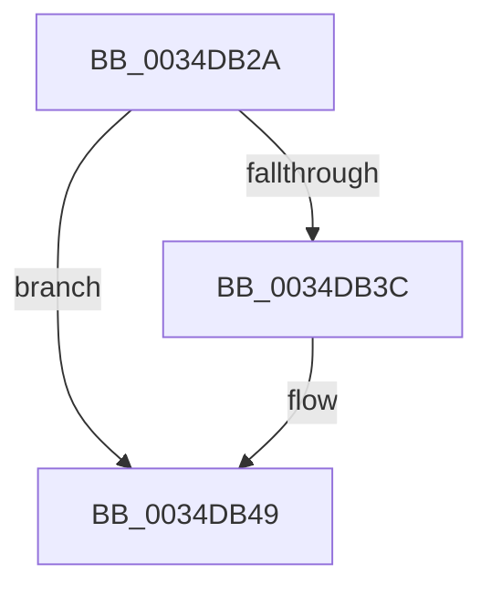

# sub_0034DB2A

- RVA: `0x0034DB2A`–`0x0034DB5B` (길이 `49` bytes)
- VA: `0x000000014034DB2A`
- 실행 섹션: `.text`
- PDB 이름 있음: `아니요`; PDB Function 태그: `아니요`
- unwind 정보 RVA: `0x00078A50`
- 디코드: `11`개 명령, `49/49` bytes 표시
- 미해석 바이트: `0` (있으면 어셈블리에 `.byte`로 보존)

> 이 문서는 커널 이미지의 기계어와 PDB 기호를 분석해 생성했습니다. 4번과 5번은 함수 원형과 자료형을 바이너리 사용 방식에서 추정한 C 해석이며 원본 소스 복구 결과는 아닙니다.

## 1. Dependencies

- 직접 호출 지점: **1**; 고유 호출 대상: **1**
- 직접 호출자로 확인된 함수: **0**
- RIP 상대 이미지 참조: **2**

### Outgoing calls
- `0x0034DB44` → [KiLowerIrqlProcessIrqlFlags](../4F/KiLowerIrqlProcessIrqlFlags_function_004F5698.md) (function, `0x004F5698`)

### Direct callers
- 이 함수 시작 RVA로 연결되는 직접 call은 확인되지 않았습니다. 간접 호출은 완전히 역산할 수 없습니다.

### Static image references
- `0x0034DB2A` → RVA `0x00E67260` (`.data`; read/write)
- `0x0034DB33` → RVA `0x00FC6D20` (`ALMOSTRO`; read)

## 2. Other-region calls and transfers

- 다른 실행 섹션으로 향하는 call: **0**
- call이 아닌 외부 분기/꼬리 이동: **1**
  - `0x0034DB59` → [sub_0034DB5B + 0x1C](Unknown_function_0034DB5B.md) (`tail-transfer`)

## 3. Assembly (complete function range)

```asm
0034DB2A  F0 48 83 25 2D 97 B1 00 00      lock and qword ptr [rip + 0xb1972d], 0
0034DB33  83 3D E6 91 C7 00 00            cmp dword ptr [rip + 0xc791e6], 0
0034DB3A  74 0D                           je 0x14034db49
0034DB3C  44 0F 20 C1                     mov rcx, cr8
0034DB40  40 0F B6 D6                     movzx edx, sil
0034DB44  E8 4F 7B 1A 00                  call 0x1404f5698
0034DB49  40 0F B6 C6                     movzx eax, sil
0034DB4D  44 0F 22 C0                     mov cr8, rax
0034DB51  48 8B 74 24 50                  mov rsi, qword ptr [rsp + 0x50]
0034DB56  48 85 DB                        test rbx, rbx
0034DB59  74 1C                           je 0x14034db77
```

## 4. C-style interpretation (structured pseudocode)

```c
__int64 __fastcall sub_0034DB2A(__int64 a1, __int64 a2, __int64 a3, __int64 a4, __int64 a5, __int64 a6, __int64 a7, __int64 a8, __int64 a9, __int64 a10)
{
    __int64 result;

    if ((*(unsigned int *)(v_rip + 13079014)) != 0) {
        a1 = v_cr8;
        a2 = (unsigned __int8)(v_rsi);
        result = KiLowerIrqlProcessIrqlFlags(a1, a2, a3, a4);
    }
}
```

## 5. (Beta) C Style

```c
int64_t sub_0034DB2A(int64_t Arg1, int64_t Arg2, int64_t Arg3, int64_t Arg4, uint64_t Arg5, uint64_t Arg6, uint64_t Arg7, uint64_t Arg8, uint64_t Arg9, int64_t Arg10)
{
    int64_t result;

    if ((*(uint32_t *)(v_rip + 0xC791E6)) != 0) {
        Arg1 = v_cr8;
        Arg2 = (uint8_t)(local_rsi);
        result = KiLowerIrqlProcessIrqlFlags(Arg1, Arg2, Arg3, Arg4);
    }
}
```

## 6. Execution-region graph

[열기: 2D/3D 그래프와 함수 탐색 컨트롤 패널](../../../control-panel.html?section=text&rva=0x0034DB2A&view=graph)

- 2D 그래프는 위에서 아래로 흐르고, 3D 그래프는 빈 공간을 드래그해 회전합니다. Shift+드래그는 이동, 휠은 확대·축소, 함수 노드 선택은 대상 보고서 이동입니다.

### Static fallback


