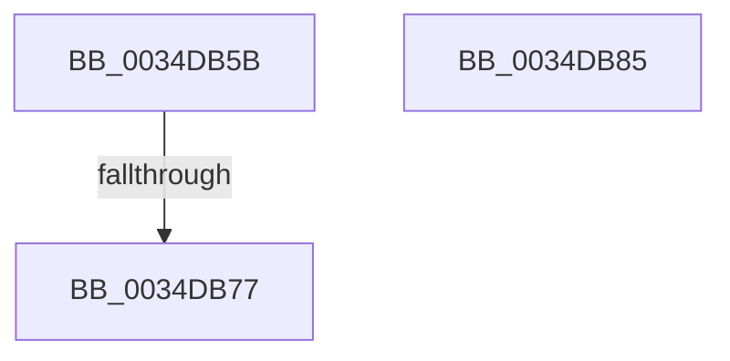

# sub_0034DB5B

- RVA: `0x0034DB5B`–`0x0034DB86` (길이 `43` bytes)
- VA: `0x000000014034DB5B`
- 실행 섹션: `.text`
- PDB 이름 있음: `아니요`; PDB Function 태그: `아니요`
- unwind 정보 RVA: `0x00078A64`
- 디코드: `13`개 명령, `43/43` bytes 표시
- 미해석 바이트: `0` (있으면 어셈블리에 `.byte`로 보존)

> 이 문서는 커널 이미지의 기계어와 PDB 기호를 분석해 생성했습니다. 4번과 5번은 함수 원형과 자료형을 바이너리 사용 방식에서 추정한 C 해석이며 원본 소스 복구 결과는 아닙니다.

## 1. Dependencies

- 직접 호출 지점: **0**; 고유 호출 대상: **0**
- 직접 호출자로 확인된 함수: **0**
- RIP 상대 이미지 참조: **0**

### Outgoing calls
- 직접 디코드된 call 명령이 없습니다.

### Direct callers
- 이 함수 시작 RVA로 연결되는 직접 call은 확인되지 않았습니다. 간접 호출은 완전히 역산할 수 없습니다.

### Static image references
- 디코드된 RIP-relative 메모리 참조가 없습니다.

## 2. Other-region calls and transfers

- 다른 실행 섹션으로 향하는 call: **0**
- call이 아닌 외부 분기/꼬리 이동: **1**
  - `0x0034DB75` → [sub_0034DBC7](Unknown_function_0034DBC7.md) (`tail-transfer`)

## 3. Assembly (complete function range)

```asm
0034DB5B  48 8D 8B 68 01 00 00            lea rcx, [rbx + 0x168]
0034DB62  0F 0D 09                        prefetchw byte ptr [rcx]
0034DB65  48 8B 01                        mov rax, qword ptr [rcx]
0034DB68  48 83 E0 FE                     and rax, 0xfffffffffffffffe
0034DB6C  48 8D 50 FE                     lea rdx, [rax - 2]
0034DB70  F0 48 0F B1 11                  lock cmpxchg qword ptr [rcx], rdx
0034DB75  75 50                           jne 0x14034dbc7
0034DB77  48 8B C5                        mov rax, rbp
0034DB7A  48 8B 6C 24 48                  mov rbp, qword ptr [rsp + 0x48]
0034DB7F  48 83 C4 30                     add rsp, 0x30
0034DB83  5B                              pop rbx
0034DB84  C3                              ret
0034DB85  CC                              int3
```

## 4. C-style interpretation (structured pseudocode)

```c
__int64 __fastcall sub_0034DB5B(__int64 a1, __int64 a2, __int64 a3, __int64 a4, __int64 a5, __int64 a6, __int64 a7, __int64 a8, __int64 a9)
{
    __int64 result;
    __int64 v_rsp;

    result = (*(unsigned __int64 *)(v_rbx + 360)) & (-2);
    v_rsp = (v_rsp) + (48);
    return v_rbp;
}
```

## 5. (Beta) C Style

```c
int64_t sub_0034DB5B(int64_t Arg1, int64_t Arg2, int64_t Arg3, int64_t Arg4, uint64_t Arg5, uint64_t Arg6, uint64_t Arg7, uint64_t Arg8, int64_t Arg9)
{
    int64_t result;
    int64_t local_rsp;

    result = (*(uint64_t *)(local_rbx + 0x168)) & (-2);
    local_rsp = (local_rsp) + (48);
    return local_rbp;
}
```

## 6. Execution-region graph

[열기: 2D/3D 그래프와 함수 탐색 컨트롤 패널](../../../control-panel.html?section=text&rva=0x0034DB5B&view=graph)

- 2D 그래프는 위에서 아래로 흐르고, 3D 그래프는 빈 공간을 드래그해 회전합니다. Shift+드래그는 이동, 휠은 확대·축소, 함수 노드 선택은 대상 보고서 이동입니다.

### Static fallback


