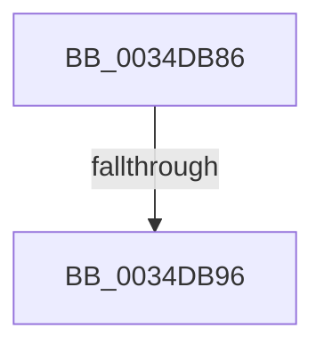

# sub_0034DB86

- RVA: `0x0034DB86`–`0x0034DBA7` (길이 `33` bytes)
- VA: `0x000000014034DB86`
- 실행 섹션: `.text`
- PDB 이름 있음: `아니요`; PDB Function 태그: `아니요`
- unwind 정보 RVA: `0x00078A7C`
- 디코드: `5`개 명령, `33/33` bytes 표시
- 미해석 바이트: `0` (있으면 어셈블리에 `.byte`로 보존)

> 이 문서는 커널 이미지의 기계어와 PDB 기호를 분석해 생성했습니다. 4번과 5번은 함수 원형과 자료형을 바이너리 사용 방식에서 추정한 C 해석이며 원본 소스 복구 결과는 아닙니다.

## 1. Dependencies

- 직접 호출 지점: **1**; 고유 호출 대상: **1**
- 직접 호출자로 확인된 함수: **0**
- RIP 상대 이미지 참조: **2**

### Outgoing calls
- `0x0034DB9D` → [KxWaitForSpinLockAndAcquire](../20/KxWaitForSpinLockAndAcquire_function_002085C0.md) (function, `0x002085C0`)

### Direct callers
- 이 함수 시작 RVA로 연결되는 직접 call은 확인되지 않았습니다. 간접 호출은 완전히 역산할 수 없습니다.

### Static image references
- `0x0034DB86` → RVA `0x00E67260` (`.data`; read/write)
- `0x0034DB96` → RVA `0x00E67260` (`.data`; read)

## 2. Other-region calls and transfers

- 다른 실행 섹션으로 향하는 call: **0**
- call이 아닌 외부 분기/꼬리 이동: **2**
  - `0x0034DB90` → [sub_0034DA7E + 0x4B](Unknown_function_0034DA7E.md) (`tail-transfer`)
  - `0x0034DBA2` → [sub_0034DA7E + 0x4B](Unknown_function_0034DA7E.md) (`tail-transfer`)

## 3. Assembly (complete function range)

```asm
0034DB86  F0 48 0F BA 2D D0 96 B1 00 00   lock bts qword ptr [rip + 0xb196d0], 0
0034DB90  0F 83 33 FF FF FF               jae 0x14034dac9
0034DB96  48 8D 0D C3 96 B1 00            lea rcx, [rip + 0xb196c3]
0034DB9D  E8 1E AA EB FF                  call 0x1402085c0
0034DBA2  E9 22 FF FF FF                  jmp 0x14034dac9
```

## 4. C-style interpretation (structured pseudocode)

```c
__int64 __fastcall sub_0034DB86(void)
{
    __int64 result;

    result = KxWaitForSpinLockAndAcquire(v_rip + 11638467, a2, a3, a4);
}
```

## 5. (Beta) C Style

```c
void sub_0034DB86(void)
{
    int64_t result;

    result = KxWaitForSpinLockAndAcquire(v_rip + 11638467, a2, a3, a4);
}
```

## 6. Execution-region graph

[열기: 2D/3D 그래프와 함수 탐색 컨트롤 패널](../../../control-panel.html?section=text&rva=0x0034DB86&view=graph)

- 2D 그래프는 위에서 아래로 흐르고, 3D 그래프는 빈 공간을 드래그해 회전합니다. Shift+드래그는 이동, 휠은 확대·축소, 함수 노드 선택은 대상 보고서 이동입니다.

### Static fallback


