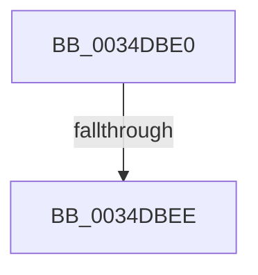

# sub_0034DBE0

- RVA: `0x0034DBE0`–`0x0034DC04` (길이 `36` bytes)
- VA: `0x000000014034DBE0`
- 실행 섹션: `.text`
- PDB 이름 있음: `아니요`; PDB Function 태그: `아니요`
- unwind 정보 RVA: `0x00078B08`
- 디코드: `7`개 명령, `36/36` bytes 표시
- 미해석 바이트: `0` (있으면 어셈블리에 `.byte`로 보존)

> 이 문서는 커널 이미지의 기계어와 PDB 기호를 분석해 생성했습니다. 4번과 5번은 함수 원형과 자료형을 바이너리 사용 방식에서 추정한 C 해석이며 원본 소스 복구 결과는 아닙니다.

## 1. Dependencies

- 직접 호출 지점: **1**; 고유 호출 대상: **1**
- 직접 호출자로 확인된 함수: **0**
- RIP 상대 이미지 참조: **2**

### Outgoing calls
- `0x0034DBFA` → [KiReleaseSpinLockInstrumented](../39/KiReleaseSpinLockInstrumented_function_00392EF0.md) (function, `0x00392EF0`)

### Direct callers
- 이 함수 시작 RVA로 연결되는 직접 call은 확인되지 않았습니다. 간접 호출은 완전히 역산할 수 없습니다.

### Static image references
- `0x0034DBE0` → RVA `0x00F0DE58` (`.data`; read)
- `0x0034DBF3` → RVA `0x00E67260` (`.data`; read)

## 2. Other-region calls and transfers

- 다른 실행 섹션으로 향하는 call: **0**
- call이 아닌 외부 분기/꼬리 이동: **2**
  - `0x0034DBE8` → [sub_0034DB2A](Unknown_function_0034DB2A.md) (`tail-transfer`)
  - `0x0034DBFF` → [sub_0034DB2A + 0x9](Unknown_function_0034DB2A.md) (`tail-transfer`)

## 3. Assembly (complete function range)

```asm
0034DBE0  8B 05 72 02 BC 00               mov eax, dword ptr [rip + 0xbc0272]
0034DBE6  85 C0                           test eax, eax
0034DBE8  0F 85 3C FF FF FF               jne 0x14034db2a
0034DBEE  48 8B 54 24 38                  mov rdx, qword ptr [rsp + 0x38]
0034DBF3  48 8D 0D 66 96 B1 00            lea rcx, [rip + 0xb19666]
0034DBFA  E8 F1 52 04 00                  call 0x140392ef0
0034DBFF  E9 2F FF FF FF                  jmp 0x14034db33
```

## 4. C-style interpretation (structured pseudocode)

```c
__int64 __fastcall sub_0034DBE0(__int64 a1, __int64 a2, __int64 a3, __int64 a4, __int64 a5, __int64 a6, __int64 a7)
{
    __int64 result;

    result = KiReleaseSpinLockInstrumented(v_rip + 11638374, a7, a3, a4);
}
```

## 5. (Beta) C Style

```c
int64_t sub_0034DBE0(int64_t Arg1, int64_t Arg2, int64_t Arg3, int64_t Arg4, uint64_t Arg5, uint64_t Arg6, int64_t Arg7)
{
    int64_t result;

    result = KiReleaseSpinLockInstrumented(v_rip + 11638374, Arg7, Arg3, Arg4);
}
```

## 6. Execution-region graph

[열기: 2D/3D 그래프와 함수 탐색 컨트롤 패널](../../../control-panel.html?section=text&rva=0x0034DBE0&view=graph)

- 2D 그래프는 위에서 아래로 흐르고, 3D 그래프는 빈 공간을 드래그해 회전합니다. Shift+드래그는 이동, 휠은 확대·축소, 함수 노드 선택은 대상 보고서 이동입니다.

### Static fallback


