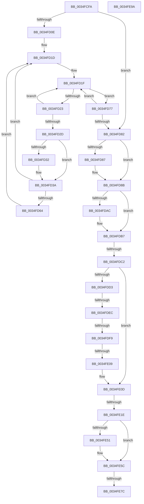

# sub_0034FCFA

- RVA: `0x0034FCFA`–`0x0034FE9B` (길이 `417` bytes)
- VA: `0x000000014034FCFA`
- 실행 섹션: `.text`
- PDB 이름 있음: `아니요`; PDB Function 태그: `아니요`
- unwind 정보 RVA: `0x00078D04`
- 디코드: `105`개 명령, `417/417` bytes 표시
- 미해석 바이트: `0` (있으면 어셈블리에 `.byte`로 보존)

> 이 문서는 커널 이미지의 기계어와 PDB 기호를 분석해 생성했습니다. 4번과 5번은 함수 원형과 자료형을 바이너리 사용 방식에서 추정한 C 해석이며 원본 소스 복구 결과는 아닙니다.

## 1. Dependencies

- 직접 호출 지점: **4**; 고유 호출 대상: **4**
- 직접 호출자로 확인된 함수: **0**
- RIP 상대 이미지 참조: **1**

### Outgoing calls
- `0x0034FD35` → [KeAbPreWait](../20/KeAbPreWait_function_0020E560.md) (function, `0x0020E560`)
- `0x0034FD4D` → [KeWaitForSingleObject](../20/KeWaitForSingleObject_function_0020E6B0.md) (function, `0x0020E6B0`)
- `0x0034FD6D` → [KeAbPreAcquire](../21/KeAbPreAcquire_function_00210230.md) (function, `0x00210230`)
- `0x0034FE64` → [ExReleaseFastMutex](../25/ExReleaseFastMutex_function_002519C0.md) (function, `0x002519C0`)

### Direct callers
- 이 함수 시작 RVA로 연결되는 직접 call은 확인되지 않았습니다. 간접 호출은 완전히 역산할 수 없습니다.

### Static image references
- `0x0034FDDF` → RVA `0x00FC6F88` (`ALMOSTRO`; read)

## 2. Other-region calls and transfers

- 다른 실행 섹션으로 향하는 call: **0**
- call이 아닌 외부 분기/꼬리 이동: **6**
  - `0x0034FDBC` → [sub_0034FEB1](Unknown_function_0034FEB1.md) (`tail-transfer`)
  - `0x0034FDE6` → [sub_0034FEB1 + 0x123](Unknown_function_0034FEB1.md) (`tail-transfer`)
  - `0x0034FDF3` → [sub_0034FEB1 + 0x179](Unknown_function_0034FEB1.md) (`tail-transfer`)
  - `0x0034FE03` → [sub_0034FEB1 + 0x1D3](Unknown_function_0034FEB1.md) (`tail-transfer`)
  - `0x0034FE18` → [sub_0034FEB1 + 0x12](Unknown_function_0034FEB1.md) (`tail-transfer`)
  - `0x0034FE76` → [sub_0034FEB1 + 0x5F](Unknown_function_0034FEB1.md) (`tail-transfer`)

## 3. Assembly (complete function range)

```asm
0034FCFA  48 89 B4 24 98 00 00 00         mov qword ptr [rsp + 0x98], rsi
0034FD02  4C 89 74 24 48                  mov qword ptr [rsp + 0x48], r14
0034FD07  4C 89 7C 24 40                  mov qword ptr [rsp + 0x40], r15
0034FD0C  72 74                           jb 0x14034fd82
0034FD0E  FF 47 10                        inc dword ptr [rdi + 0x10]
0034FD11  48 8B F5                        mov rsi, rbp
0034FD14  44 8B F8                        mov r15d, eax
0034FD17  41 BE 04 00 00 00               mov r14d, 4
0034FD1D  8B 07                           mov eax, dword ptr [rdi]
0034FD1F  A8 01                           test al, 1
0034FD21  75 54                           jne 0x14034fd77
0034FD23  41 8D 0C 06                     lea ecx, [r14 + rax]
0034FD27  F0 0F B1 0F                     lock cmpxchg dword ptr [rdi], ecx
0034FD2B  75 F2                           jne 0x14034fd1f
0034FD2D  48 85 F6                        test rsi, rsi
0034FD30  74 08                           je 0x14034fd3a
0034FD32  48 8B CE                        mov rcx, rsi
0034FD35  E8 26 E8 EB FF                  call 0x14020e560
0034FD3A  45 33 C9                        xor r9d, r9d
0034FD3D  4C 89 6C 24 20                  mov qword ptr [rsp + 0x20], r13
0034FD42  48 8D 4F 18                     lea rcx, [rdi + 0x18]
0034FD46  45 33 C0                        xor r8d, r8d
0034FD49  41 8D 51 22                     lea edx, [r9 + 0x22]
0034FD4D  E8 5E E9 EB FF                  call 0x14020e6b0
0034FD52  0F 0D 0F                        prefetchw byte ptr [rdi]
0034FD55  41 BF 03 00 00 00               mov r15d, 3
0034FD5B  45 8D 77 FF                     lea r14d, [r15 - 1]
0034FD5F  48 85 F6                        test rsi, rsi
0034FD62  74 B9                           je 0x14034fd1d
0034FD64  45 33 C0                        xor r8d, r8d
0034FD67  48 8B D6                        mov rdx, rsi
0034FD6A  48 8B CF                        mov rcx, rdi
0034FD6D  E8 BE 04 EC FF                  call 0x140210230
0034FD72  48 8B F0                        mov rsi, rax
0034FD75  EB A6                           jmp 0x14034fd1d
0034FD77  8B C8                           mov ecx, eax
0034FD79  41 33 CF                        xor ecx, r15d
0034FD7C  F0 0F B1 0F                     lock cmpxchg dword ptr [rdi], ecx
0034FD80  75 9D                           jne 0x14034fd1f
0034FD82  48 85 ED                        test rbp, rbp
0034FD85  74 04                           je 0x14034fd8b
0034FD87  C6 45 0A 01                     mov byte ptr [rbp + 0xa], 1
0034FD8B  65 48 8B 04 25 88 01 00 00      mov rax, qword ptr gs:[0x188]
0034FD94  48 89 47 08                     mov qword ptr [rdi + 8], rax
0034FD98  41 0F B6 C4                     movzx eax, r12b
0034FD9C  89 47 30                        mov dword ptr [rdi + 0x30], eax
0034FD9F  48 8B 84 24 90 00 00 00         mov rax, qword ptr [rsp + 0x90]
0034FDA7  48 85 C0                        test rax, rax
0034FDAA  74 0B                           je 0x14034fdb7
0034FDAC  48 8B 84 24 90 00 00 00         mov rax, qword ptr [rsp + 0x90]
0034FDB4  F0 FF 00                        lock inc dword ptr [rax]
0034FDB7  66 83 6B 26 01                  sub word ptr [rbx + 0x26], 1
0034FDBC  0F 85 EF 00 00 00               jne 0x14034feb1
0034FDC2  48 8B 43 18                     mov rax, qword ptr [rbx + 0x18]
0034FDC6  45 33 E4                        xor r12d, r12d
0034FDC9  4C 8B 78 28                     mov r15, qword ptr [rax + 0x28]
0034FDCD  44 38 6B 24                     cmp byte ptr [rbx + 0x24], r13b
0034FDD1  74 3A                           je 0x14034fe0d
0034FDD3  48 8B 3B                        mov rdi, qword ptr [rbx]
0034FDD6  40 32 F6                        xor sil, sil
0034FDD9  40 32 ED                        xor bpl, bpl
0034FDDC  45 8B F4                        mov r14d, r12d
0034FDDF  44 39 25 A2 71 C7 00            cmp dword ptr [rip + 0xc771a2], r12d
0034FDE6  0F 85 E8 01 00 00               jne 0x14034ffd4
0034FDEC  44 39 A7 E0 05 00 00            cmp dword ptr [rdi + 0x5e0], r12d
0034FDF3  0F 84 31 02 00 00               je 0x14035002a
0034FDF9  F0 FF 8F E0 05 00 00            lock dec dword ptr [rdi + 0x5e0]
0034FE00  40 84 F6                        test sil, sil
0034FE03  0F 85 7B 02 00 00               jne 0x140350084
0034FE09  44 88 63 24                     mov byte ptr [rbx + 0x24], r12b
0034FE0D  48 8B 4B 08                     mov rcx, qword ptr [rbx + 8]
0034FE11  48 8D 43 08                     lea rax, [rbx + 8]
0034FE15  48 3B C8                        cmp rcx, rax
0034FE18  0F 85 A5 00 00 00               jne 0x14034fec3
0034FE1E  4C 89 23                        mov qword ptr [rbx], r12
0034FE21  41 8B CC                        mov ecx, r12d
0034FE24  66 44 89 63 26                  mov word ptr [rbx + 0x26], r12w
0034FE29  B8 20 00 00 00                  mov eax, 0x20
0034FE2E  48 8B D3                        mov rdx, rbx
0034FE31  89 0C 03                        mov dword ptr [rbx + rax], ecx
0034FE34  48 8B 84 24 88 00 00 00         mov rax, qword ptr [rsp + 0x88]
0034FE3C  48 89 84 24 88 00 00 00         mov qword ptr [rsp + 0x88], rax
0034FE44  48 8B 84 24 88 00 00 00         mov rax, qword ptr [rsp + 0x88]
0034FE4C  48 85 C0                        test rax, rax
0034FE4F  74 0B                           je 0x14034fe5c
0034FE51  48 8B 84 24 88 00 00 00         mov rax, qword ptr [rsp + 0x88]
0034FE59  F0 FF 00                        lock inc dword ptr [rax]
0034FE5C  48 8B 4B 18                     mov rcx, qword ptr [rbx + 0x18]
0034FE60  48 8B 49 30                     mov rcx, qword ptr [rcx + 0x30]
0034FE64  E8 57 1B F0 FF                  call 0x1402519c0
0034FE69  48 8B 5C 24 30                  mov rbx, qword ptr [rsp + 0x30]
0034FE6E  48 8D 44 24 30                  lea rax, [rsp + 0x30]
0034FE73  48 3B D8                        cmp rbx, rax
0034FE76  0F 85 94 00 00 00               jne 0x14034ff10
0034FE7C  4C 8B 7C 24 40                  mov r15, qword ptr [rsp + 0x40]
0034FE81  4C 8B 74 24 48                  mov r14, qword ptr [rsp + 0x48]
0034FE86  48 8B B4 24 98 00 00 00         mov rsi, qword ptr [rsp + 0x98]
0034FE8E  48 83 C4 50                     add rsp, 0x50
0034FE92  41 5D                           pop r13
0034FE94  41 5C                           pop r12
0034FE96  5F                              pop rdi
0034FE97  5D                              pop rbp
0034FE98  5B                              pop rbx
0034FE99  C3                              ret
0034FE9A  CC                              int3
```

## 4. C-style interpretation (structured pseudocode)

```c
__int64 __fastcall sub_0034FCFA(__int64 a1, __int64 a2, int a3, int a4, __int64 a5, __int64 a6, __int64 a7, __int64 a8, __int64 a9, __int64 a10, __int64 a11, __int64 a12, __int64 a13, __int64 a14, __int64 a15, __int64 a16, __int64 a17, __int64 a18, __int64 a19)
{
    __int64 result;
    __int64 v_r12;
    __int64 v_rbp;
    __int64 v_rsi;
    __int64 v_rsp;
    unsigned __int64 v_stack_p20;
    unsigned __int64 v_stack_p40;
    unsigned __int64 v_stack_p48;
    unsigned __int64 v_stack_p88;
    unsigned __int64 v_stack_p98;

    v_stack_p98 = v_rsi;
    v_stack_p48 = v_r14;
    v_stack_p40 = v_r15;
    if (condition_is_below) goto loc_0034FD82;
loc_0034FD1D:
loc_0034FD1F:
    if ((((unsigned __int8)((unsigned int)(*(unsigned int *)(v_rdi)))) & (1)) != 0) goto loc_0034FD77;
    if ((((unsigned __int8)((unsigned int)(*(unsigned int *)(v_rdi)))) & (1)) != 0) goto loc_0034FD1F;
    result = (unsigned int)(*(unsigned int *)(v_rdi));
    if (v_rbp != 0) {
        a1 = v_rbp;
        result = KeAbPreWait(a1, a2, a3, a4);
    }
    a4 = 0;
    v_stack_p20 = v_r13;
    a3 = 0;
    result = KeWaitForSingleObject(v_rdi + 24, a4 + 34, a3, a4);
    if (v_rbp == 0) goto loc_0034FD1D;
    a3 = 0;
    result = KeAbPreAcquire(v_rdi, v_rbp, a3, a4);
    goto loc_0034FD1D;
loc_0034FD77:
    a1 = (unsigned int)(((unsigned int)((unsigned int)(result))) ^ (3));
    if (condition_is_not_equal) goto loc_0034FD1F;
loc_0034FD82:
    if (v_rbp != 0) {
        *(unsigned __int8 *)(v_rbp + 10) = 1;
    }
    *(unsigned __int64 *)(v_rdi + 8) = *(unsigned __int64 *)(gs_base + (0 + 392));
    *(unsigned int *)(v_rdi + 48) = (unsigned int)((unsigned __int8)(v_r12));
    result = a18;
    if (a18 != 0) {
        result = a18;
    }
    v_r12 = 0;
    if ((*(unsigned __int8 *)(v_rbx + 36)) == ((unsigned __int8)(v_r13))) goto loc_0034FE0D;
    v_rsi = 0;
    v_rbp = 0;
    *(unsigned __int8 *)(v_rbx + 36) = 0;
loc_0034FE0D:
    *(unsigned __int64 *)(v_rbx) = 0;
    *(unsigned __int16 *)(v_rbx + 38) = 0;
    *(unsigned int *)(v_rbx + 32 * 1) = 0;
    v_stack_p88 = a17;
    result = a17;
    if (a17 != 0) {
        result = a17;
    }
    result = ExReleaseFastMutex(*(unsigned __int64 *)(*(unsigned __int64 *)(v_rbx + 24) + 48), v_rbx, a3, a4);
    v_rsp = (v_rsp) + (80);
    return a6;
}
```

## 5. (Beta) C Style

```c
int64_t sub_0034FCFA(int64_t Arg1, int64_t Arg2, int32_t Arg3, int32_t Arg4, uint64_t Arg5, int64_t Arg6, uint64_t Arg7, int64_t Arg8, int64_t Arg9, uint64_t Arg10, uint64_t Arg11, uint64_t Arg12, uint64_t Arg13, uint64_t Arg14, uint64_t Arg15, uint64_t Arg16, void *Arg17, void *Arg18, int64_t Arg19)
{
    uint8_t *arg17 = (uint8_t *)Arg17;
    uint8_t *arg18 = (uint8_t *)Arg18;

    int64_t result;
    int64_t local_r12;
    int64_t local_rbp;
    int64_t local_rsi;
    int64_t local_rsp;
    uint64_t v_stack_p20;
    uint64_t v_stack_p40;
    uint64_t v_stack_p48;
    uint64_t v_stack_p88;
    uint64_t v_stack_p98;

    v_stack_p98 = local_rsi;
    v_stack_p48 = local_r14;
    v_stack_p40 = local_r15;
    if (condition_is_below) goto loc_0034FD82;
loc_0034FD1D:
loc_0034FD1F:
    if ((((uint8_t)((uint32_t)(*(uint32_t *)(local_rdi)))) & (1)) != 0) goto loc_0034FD77;
    if ((((uint8_t)((uint32_t)(*(uint32_t *)(local_rdi)))) & (1)) != 0) goto loc_0034FD1F;
    result = (uint32_t)(*(uint32_t *)(local_rdi));
    if (local_rbp != 0) {
        Arg1 = local_rbp;
        result = KeAbPreWait(Arg1, Arg2, Arg3, Arg4);
    }
    Arg4 = 0;
    v_stack_p20 = local_r13;
    Arg3 = 0;
    result = KeWaitForSingleObject(local_rdi + 24, Arg4 + 34, Arg3, Arg4);
    if (local_rbp == 0) goto loc_0034FD1D;
    Arg3 = 0;
    result = KeAbPreAcquire(local_rdi, local_rbp, Arg3, Arg4);
    goto loc_0034FD1D;
loc_0034FD77:
    Arg1 = (uint32_t)(((uint32_t)((uint32_t)(result))) ^ (3));
    if (condition_is_not_equal) goto loc_0034FD1F;
loc_0034FD82:
    if (local_rbp != 0) {
        *(uint8_t *)(local_rbp + 0xA) = 1;
    }
    *(uint64_t *)(local_rdi + 0x8) = *(uint64_t *)(gs_base + (0 + 0x188));
    *(uint32_t *)(local_rdi + 0x30) = (uint32_t)((uint8_t)(local_r12));
    result = Arg18;
    if (Arg18 != NULL) {
        result = Arg18;
    }
    local_r12 = 0;
    if ((*(uint8_t *)(local_rbx + 0x24)) == ((uint8_t)(local_r13))) goto loc_0034FE0D;
    local_rsi = 0;
    local_rbp = 0;
    *(uint8_t *)(local_rbx + 0x24) = 0;
loc_0034FE0D:
    *(uint64_t *)(local_rbx) = 0;
    *(uint16_t *)(local_rbx + 0x26) = 0;
    *(uint32_t *)(local_rbx + 0x20 * 1) = 0;
    v_stack_p88 = Arg17;
    result = Arg17;
    if (Arg17 != NULL) {
        result = Arg17;
    }
    result = ExReleaseFastMutex(*(uint64_t *)(*(uint64_t *)(local_rbx + 0x18) + 0x30), local_rbx, Arg3, Arg4);
    local_rsp = (local_rsp) + (80);
    return Arg6;
}
```

### 관측된 메모리 오프셋

구조체 형식이 확인되지 않은 접근은 인자 기준의 오프셋으로만 기록했습니다.

| 기준 인자 | 오프셋 표현 | 폭 (bit) | 접근 |
|---|---:|---:|---|
| `Arg17` | `+ 0x0` | `32` | `R/W` |
| `Arg18` | `+ 0x0` | `32` | `R/W` |

## 6. Execution-region graph

[열기: 2D/3D 그래프와 함수 탐색 컨트롤 패널](../../../control-panel.html?section=text&rva=0x0034FCFA&view=graph)

- 2D 그래프는 위에서 아래로 흐르고, 3D 그래프는 빈 공간을 드래그해 회전합니다. Shift+드래그는 이동, 휠은 확대·축소, 함수 노드 선택은 대상 보고서 이동입니다.

### Static fallback


