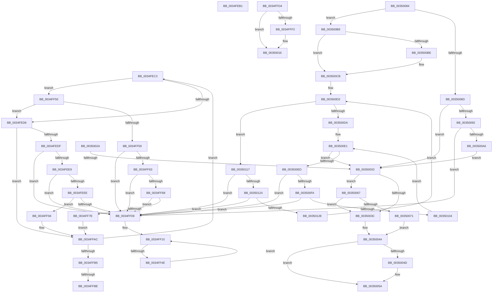

# sub_0034FEB1

- RVA: `0x0034FEB1`–`0x00350141` (길이 `656` bytes)
- VA: `0x000000014034FEB1`
- 실행 섹션: `.text`
- PDB 이름 있음: `아니요`; PDB Function 태그: `아니요`
- unwind 정보 RVA: `0x00078D34`
- 디코드: `159`개 명령, `656/656` bytes 표시
- 미해석 바이트: `0` (있으면 어셈블리에 `.byte`로 보존)

> 이 문서는 커널 이미지의 기계어와 PDB 기호를 분석해 생성했습니다. 4번과 5번은 함수 원형과 자료형을 바이너리 사용 방식에서 추정한 C 해석이며 원본 소스 복구 결과는 아닙니다.

## 1. Dependencies

- 직접 호출 지점: **10**; 고유 호출 대상: **8**
- 직접 호출자로 확인된 함수: **0**
- RIP 상대 이미지 참조: **3**

### Outgoing calls
- `0x0034FEBC` → [FsRtlReleaseHeaderMutex](../25/FsRtlReleaseHeaderMutex_function_002516C0.md) (function, `0x002516C0`)
- `0x0034FF3B` → [KeSetEventBoostPriorityEx](../35/KeSetEventBoostPriorityEx_function_00350148.md) (function, `0x00350148`)
- `0x0034FFE5` → [ExAllocatePool2](../../poolcode/B8/ExAllocatePool2_function_00B820F0.md) (function, `0x00B820F0`)
- `0x00350000` → [RtlCaptureStackBackTrace](../2F/RtlCaptureStackBackTrace_function_002F9FF0.md) (function, `0x002F9FF0`)
- `0x0035001D` → [KeAcquireSpinLockRaiseToDpc](../20/KeAcquireSpinLockRaiseToDpc_function_00208470.md) (function, `0x00208470`)
- `0x00350055` → [KiLowerIrqlProcessIrqlFlags](../4F/KiLowerIrqlProcessIrqlFlags_function_004F5698.md) (function, `0x004F5698`)
- `0x0035007D` → [KiReleaseSpinLockInstrumented](../39/KiReleaseSpinLockInstrumented_function_00392EF0.md) (function, `0x00392EF0`)
- `0x003500C6` → [ExFreePoolWithTag](../../poolcode/B8/ExFreePoolWithTag_function_00B82870.md) (function, `0x00B82870`)
- `0x00350110` → [ExFreePoolWithTag](../../poolcode/B8/ExFreePoolWithTag_function_00B82870.md) (function, `0x00B82870`)
- `0x0035013A` → [ExFreePoolWithTag](../../poolcode/B8/ExFreePoolWithTag_function_00B82870.md) (function, `0x00B82870`)

### Direct callers
- 이 함수 시작 RVA로 연결되는 직접 call은 확인되지 않았습니다. 간접 호출은 완전히 역산할 수 없습니다.

### Static image references
- `0x00350033` → RVA `0x00FC6B06` (`ALMOSTRO`; read)
- `0x00350044` → RVA `0x00FC6D20` (`ALMOSTRO`; read)
- `0x00350067` → RVA `0x00F0DE58` (`.data`; read)

## 2. Other-region calls and transfers

- 다른 실행 섹션으로 향하는 call: **4**
  - `0x0034FFE5` → [ExAllocatePool2](../../poolcode/B8/ExAllocatePool2_function_00B820F0.md) (`.text` → `POOLCODE`)
  - `0x003500C6` → [ExFreePoolWithTag](../../poolcode/B8/ExFreePoolWithTag_function_00B82870.md) (`.text` → `POOLCODE`)
  - `0x00350110` → [ExFreePoolWithTag](../../poolcode/B8/ExFreePoolWithTag_function_00B82870.md) (`.text` → `POOLCODE`)
  - `0x0035013A` → [ExFreePoolWithTag](../../poolcode/B8/ExFreePoolWithTag_function_00B82870.md) (`.text` → `POOLCODE`)
- call이 아닌 외부 분기/꼬리 이동: **7**
  - `0x0034FEC1` → [sub_0034FCFA + 0x182](Unknown_function_0034FCFA.md) (`tail-transfer`)
  - `0x0034FF48` → [sub_0034FCFA + 0x182](Unknown_function_0034FCFA.md) (`tail-transfer`)
  - `0x0034FFB8` → [sub_0034FCFA + 0x124](Unknown_function_0034FCFA.md) (`tail-transfer`)
  - `0x0034FFCF` → [sub_0034FCFA + 0x12F](Unknown_function_0034FCFA.md) (`tail-transfer`)
  - `0x00350025` → [sub_0034FCFA + 0xF2](Unknown_function_0034FCFA.md) (`tail-transfer`)
  - `0x0035002D` → [sub_0034FCFA + 0x10F](Unknown_function_0034FCFA.md) (`tail-transfer`)
  - `0x00350062` → [sub_0034FCFA + 0x10F](Unknown_function_0034FCFA.md) (`tail-transfer`)

## 3. Assembly (complete function range)

```asm
0034FEB1  48 8B 94 24 88 00 00 00         mov rdx, qword ptr [rsp + 0x88]
0034FEB9  48 8B CB                        mov rcx, rbx
0034FEBC  E8 FF 17 F0 FF                  call 0x1402516c0
0034FEC1  EB B9                           jmp 0x14034fe7c
0034FEC3  48 8B D1                        mov rdx, rcx
0034FEC6  48 8B 09                        mov rcx, qword ptr [rcx]
0034FEC9  4C 8B 42 28                     mov r8, qword ptr [rdx + 0x28]
0034FECD  4D 85 C0                        test r8, r8
0034FED0  0F 89 7A 00 00 00               jns 0x14034ff50
0034FED6  4D 85 ED                        test r13, r13
0034FED9  0F 85 CD 00 00 00               jne 0x14034ffac
0034FEDF  4C 8B 42 08                     mov r8, qword ptr [rdx + 8]
0034FEE3  48 39 51 08                     cmp qword ptr [rcx + 8], rdx
0034FEE7  75 20                           jne 0x14034ff09
0034FEE9  49 39 10                        cmp qword ptr [r8], rdx
0034FEEC  75 1B                           jne 0x14034ff09
0034FEEE  49 89 08                        mov qword ptr [r8], rcx
0034FEF1  4C 8D 4C 24 30                  lea r9, [rsp + 0x30]
0034FEF6  4C 89 41 08                     mov qword ptr [rcx + 8], r8
0034FEFA  4C 8B 44 24 30                  mov r8, qword ptr [rsp + 0x30]
0034FEFF  4D 39 48 08                     cmp qword ptr [r8 + 8], r9
0034FF03  0F 84 8B 00 00 00               je 0x14034ff94
0034FF09  B9 03 00 00 00                  mov ecx, 3
0034FF0E  CD 29                           int 0x29
0034FF10  48 8B CB                        mov rcx, rbx
0034FF13  44 89 64 24 28                  mov dword ptr [rsp + 0x28], r12d
0034FF18  48 8B 1B                        mov rbx, qword ptr [rbx]
0034FF1B  4C 8D 84 24 80 00 00 00         lea r8, [rsp + 0x80]
0034FF23  45 33 C9                        xor r9d, r9d
0034FF26  C6 44 24 20 01                  mov byte ptr [rsp + 0x20], 1
0034FF2B  33 D2                           xor edx, edx
0034FF2D  8B 41 38                        mov eax, dword ptr [rcx + 0x38]
0034FF30  48 83 C1 10                     add rcx, 0x10
0034FF34  89 84 24 80 00 00 00            mov dword ptr [rsp + 0x80], eax
0034FF3B  E8 08 02 00 00                  call 0x140350148
0034FF40  48 8D 44 24 30                  lea rax, [rsp + 0x30]
0034FF45  48 3B D8                        cmp rbx, rax
0034FF48  0F 84 2E FF FF FF               je 0x14034fe7c
0034FF4E  EB C0                           jmp 0x14034ff10
0034FF50  4D 3B C7                        cmp r8, r15
0034FF53  0F 8F 7D FF FF FF               jg 0x14034fed6
0034FF59  4C 8B 42 08                     mov r8, qword ptr [rdx + 8]
0034FF5D  48 39 51 08                     cmp qword ptr [rcx + 8], rdx
0034FF61  75 A6                           jne 0x14034ff09
0034FF63  49 39 10                        cmp qword ptr [r8], rdx
0034FF66  75 A1                           jne 0x14034ff09
0034FF68  49 89 08                        mov qword ptr [r8], rcx
0034FF6B  4C 8D 4C 24 30                  lea r9, [rsp + 0x30]
0034FF70  4C 89 41 08                     mov qword ptr [rcx + 8], r8
0034FF74  4C 8B 44 24 38                  mov r8, qword ptr [rsp + 0x38]
0034FF79  4D 39 08                        cmp qword ptr [r8], r9
0034FF7C  75 8B                           jne 0x14034ff09
0034FF7E  4C 89 42 08                     mov qword ptr [rdx + 8], r8
0034FF82  4C 8D 4C 24 30                  lea r9, [rsp + 0x30]
0034FF87  4C 89 0A                        mov qword ptr [rdx], r9
0034FF8A  49 89 10                        mov qword ptr [r8], rdx
0034FF8D  48 89 54 24 38                  mov qword ptr [rsp + 0x38], rdx
0034FF92  EB 18                           jmp 0x14034ffac
0034FF94  4C 89 02                        mov qword ptr [rdx], r8
0034FF97  4C 8D 4C 24 30                  lea r9, [rsp + 0x30]
0034FF9C  4C 89 4A 08                     mov qword ptr [rdx + 8], r9
0034FFA0  4C 8B EA                        mov r13, rdx
0034FFA3  49 89 50 08                     mov qword ptr [r8 + 8], rdx
0034FFA7  48 89 54 24 30                  mov qword ptr [rsp + 0x30], rdx
0034FFAC  48 3B C8                        cmp rcx, rax
0034FFAF  0F 85 0E FF FF FF               jne 0x14034fec3
0034FFB5  4D 85 ED                        test r13, r13
0034FFB8  0F 84 60 FE FF FF               je 0x14034fe1e
0034FFBE  49 8B 45 30                     mov rax, qword ptr [r13 + 0x30]
0034FFC2  48 89 03                        mov qword ptr [rbx], rax
0034FFC5  66 C7 43 26 01 00               mov word ptr [rbx + 0x26], 1
0034FFCB  41 8B 4D 38                     mov ecx, dword ptr [r13 + 0x38]
0034FFCF  E9 55 FE FF FF                  jmp 0x14034fe29
0034FFD4  BA 70 00 00 00                  mov edx, 0x70
0034FFD9  41 B8 42 6F 6F 73               mov r8d, 0x736f6f42
0034FFDF  40 B6 01                        mov sil, 1
0034FFE2  8D 4A D0                        lea ecx, [rdx - 0x30]
0034FFE5  E8 06 21 83 00                  call 0x140b820f0
0034FFEA  4C 8B F0                        mov r14, rax
0034FFED  48 85 C0                        test rax, rax
0034FFF0  74 24                           je 0x140350016
0034FFF2  45 33 C9                        xor r9d, r9d
0034FFF5  4C 8D 40 10                     lea r8, [rax + 0x10]
0034FFF9  41 8D 51 0A                     lea edx, [r9 + 0xa]
0034FFFD  8D 4A F7                        lea ecx, [rdx - 9]
00350000  E8 EB 9F FA FF                  call 0x1402f9ff0
00350005  65 48 8B 0C 25 88 01 00 00      mov rcx, qword ptr gs:[0x188]
0035000E  49 89 4E 60                     mov qword ptr [r14 + 0x60], rcx
00350012  4D 89 66 68                     mov qword ptr [r14 + 0x68], r12
00350016  48 8D 8F 10 06 00 00            lea rcx, [rdi + 0x610]
0035001D  E8 4E 84 EB FF                  call 0x140208470
00350022  0F B6 E8                        movzx ebp, al
00350025  E9 C2 FD FF FF                  jmp 0x14034fdec
0035002A  40 84 F6                        test sil, sil
0035002D  0F 84 D6 FD FF FF               je 0x14034fe09
00350033  F6 05 CC 6A C7 00 01            test byte ptr [rip + 0xc76acc], 1
0035003A  75 2B                           jne 0x140350067
0035003C  F0 4C 21 A7 10 06 00 00         lock and qword ptr [rdi + 0x610], r12
00350044  44 39 25 D5 6C C7 00            cmp dword ptr [rip + 0xc76cd5], r12d
0035004B  74 0D                           je 0x14035005a
0035004D  44 0F 20 C1                     mov rcx, cr8
00350051  40 0F B6 D5                     movzx edx, bpl
00350055  E8 3E 56 1A 00                  call 0x1404f5698
0035005A  40 0F B6 C5                     movzx eax, bpl
0035005E  44 0F 22 C0                     mov cr8, rax
00350062  E9 A2 FD FF FF                  jmp 0x14034fe09
00350067  8B 05 EB DD BB 00               mov eax, dword ptr [rip + 0xbbddeb]
0035006D  85 C0                           test eax, eax
0035006F  75 CB                           jne 0x14035003c
00350071  48 8B 54 24 78                  mov rdx, qword ptr [rsp + 0x78]
00350076  48 8D 8F 10 06 00 00            lea rcx, [rdi + 0x610]
0035007D  E8 6E 2E 04 00                  call 0x140392ef0
00350082  EB C0                           jmp 0x140350044
00350084  44 39 A7 E0 05 00 00            cmp dword ptr [rdi + 0x5e0], r12d
0035008B  74 2C                           je 0x1403500b9
0035008D  4D 85 F6                        test r14, r14
00350090  74 A1                           je 0x140350033
00350092  48 8D 87 00 06 00 00            lea rax, [rdi + 0x600]
00350099  48 8B 48 08                     mov rcx, qword ptr [rax + 8]
0035009D  48 39 01                        cmp qword ptr [rcx], rax
003500A0  0F 85 63 FE FF FF               jne 0x14034ff09
003500A6  49 89 06                        mov qword ptr [r14], rax
003500A9  49 89 4E 08                     mov qword ptr [r14 + 8], rcx
003500AD  4C 89 31                        mov qword ptr [rcx], r14
003500B0  4C 89 70 08                     mov qword ptr [rax + 8], r14
003500B4  E9 7A FF FF FF                  jmp 0x140350033
003500B9  4D 85 F6                        test r14, r14
003500BC  74 0D                           je 0x1403500cb
003500BE  BA 42 6F 6F 73                  mov edx, 0x736f6f42
003500C3  49 8B CE                        mov rcx, r14
003500C6  E8 A5 27 83 00                  call 0x140b82870
003500CB  48 8D B7 F0 05 00 00            lea rsi, [rdi + 0x5f0]
003500D2  48 8B 0E                        mov rcx, qword ptr [rsi]
003500D5  48 3B CE                        cmp rcx, rsi
003500D8  75 3D                           jne 0x140350117
003500DA  48 8D B7 00 06 00 00            lea rsi, [rdi + 0x600]
003500E1  48 8B 0E                        mov rcx, qword ptr [rsi]
003500E4  48 3B CE                        cmp rcx, rsi
003500E7  0F 84 46 FF FF FF               je 0x140350033
003500ED  48 8B 01                        mov rax, qword ptr [rcx]
003500F0  48 39 71 08                     cmp qword ptr [rcx + 8], rsi
003500F4  0F 85 0F FE FF FF               jne 0x14034ff09
003500FA  48 39 48 08                     cmp qword ptr [rax + 8], rcx
003500FE  0F 85 05 FE FF FF               jne 0x14034ff09
00350104  48 89 06                        mov qword ptr [rsi], rax
00350107  BA 42 6F 6F 73                  mov edx, 0x736f6f42
0035010C  48 89 70 08                     mov qword ptr [rax + 8], rsi
00350110  E8 5B 27 83 00                  call 0x140b82870
00350115  EB CA                           jmp 0x1403500e1
00350117  48 8B 01                        mov rax, qword ptr [rcx]
0035011A  48 39 71 08                     cmp qword ptr [rcx + 8], rsi
0035011E  0F 85 E5 FD FF FF               jne 0x14034ff09
00350124  48 39 48 08                     cmp qword ptr [rax + 8], rcx
00350128  0F 85 DB FD FF FF               jne 0x14034ff09
0035012E  48 89 06                        mov qword ptr [rsi], rax
00350131  BA 42 6F 6F 73                  mov edx, 0x736f6f42
00350136  48 89 70 08                     mov qword ptr [rax + 8], rsi
0035013A  E8 31 27 83 00                  call 0x140b82870
0035013F  EB 91                           jmp 0x1403500d2
```

## 4. C-style interpretation (structured pseudocode)

```c
__int64 __fastcall sub_0034FEB1(__int64 a1, __int64 a2, __int64 a3, __int64 a4, __int64 a5, __int64 a6, __int64 a7, __int64 a8, __int64 a9, __int64 a10, __int64 a11, __int64 a12, __int64 a13, __int64 a14, __int64 a15, __int64 a16, __int64 a17)
{
    __int64 result;
    unsigned __int8 v_stack_p20;
    unsigned int v_stack_p28;
    unsigned __int64 v_stack_p30;
    unsigned __int64 v_stack_p38;
    unsigned __int64 v_stack_p78;
    unsigned __int64 v_stack_p80;

    result = FsRtlReleaseHeaderMutex(v_rbx, a17, a3, a4);
}
```

## 5. (Beta) C Style

```c
int64_t sub_0034FEB1(int64_t Arg1, int64_t Arg2, int64_t Arg3, int64_t Arg4, uint64_t Arg5, uint64_t Arg6, uint64_t Arg7, uint64_t Arg8, uint64_t Arg9, uint64_t Arg10, uint64_t Arg11, uint64_t Arg12, uint64_t Arg13, uint64_t Arg14, uint64_t Arg15, uint64_t Arg16, int64_t Arg17)
{
    int64_t result;
    uint8_t v_stack_p20;
    uint32_t v_stack_p28;
    uint64_t v_stack_p30;
    uint64_t v_stack_p38;
    uint64_t v_stack_p78;
    uint64_t v_stack_p80;

    result = FsRtlReleaseHeaderMutex(local_rbx, Arg17, Arg3, Arg4);
}
```

## 6. Execution-region graph

[열기: 2D/3D 그래프와 함수 탐색 컨트롤 패널](../../../control-panel.html?section=text&rva=0x0034FEB1&view=graph)

- 2D 그래프는 위에서 아래로 흐르고, 3D 그래프는 빈 공간을 드래그해 회전합니다. Shift+드래그는 이동, 휠은 확대·축소, 함수 노드 선택은 대상 보고서 이동입니다.

### Static fallback


