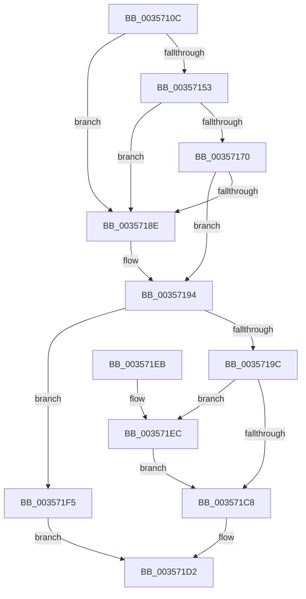

# CcAllocateWorkQueueEntry

- RVA: `0x0035710C`–`0x003571FC` (길이 `240` bytes)
- VA: `0x000000014035710C`
- 실행 섹션: `.text`
- PDB 이름 있음: `예`; PDB Function 태그: `아니요`
- unwind 정보 RVA: `0x000795B0`
- 디코드: `66`개 명령, `240/240` bytes 표시
- 미해석 바이트: `0` (있으면 어셈블리에 `.byte`로 보존)

> 이 문서는 커널 이미지의 기계어와 PDB 기호를 분석해 생성했습니다. 4번과 5번은 함수 원형과 자료형을 바이너리 사용 방식에서 추정한 C 해석이며 원본 소스 복구 결과는 아닙니다.

## 1. Dependencies

- 직접 호출 지점: **4**; 고유 호출 대상: **3**
- 직접 호출자로 확인된 함수: **8**
- RIP 상대 이미지 참조: **0**

### Outgoing calls
- `0x00357146` → [ExpInterlockedPopEntrySList](../6B/ExpInterlockedPopEntrySList_function_006BA570.md) (function, `0x006BA570`)
- `0x00357163` → [ExpInterlockedPopEntrySList](../6B/ExpInterlockedPopEntrySList_function_006BA570.md) (function, `0x006BA570`)
- `0x00357181` → [guard_dispatch_icall](../6B/guard_dispatch_icall_function_006BAAD0.md) (function, `0x006BAAD0`)
- `0x003571CB` → [CcReferencePrivateVolumeCacheMap](CcReferencePrivateVolumeCacheMap_function_00357210.md) (function, `0x00357210`)

### Direct callers
- [CcAsyncCopyRead](CcAsyncCopyRead_function_00358880.md) at `0x0035897C`
- [CcScheduleReadAheadNuma](../38/CcScheduleReadAheadNuma_function_0038883C.md) at `0x00388AD6`
- [CcLazyWriteScanVolume](../38/CcLazyWriteScanVolume_function_00388DC0.md) at `0x0038909E`
- [CcLazyWriteScan](../3C/CcLazyWriteScan_function_003C9394.md) at `0x003C9848`
- [CcQueueLazyWriteScanThreadForVolume](../3C/CcQueueLazyWriteScanThreadForVolume_function_003C9AF0.md) at `0x003C9C8C`
- [CcQueueLazyWriteScanThread](../57/CcQueueLazyWriteScanThread_function_0057BBD0.md) at `0x0057BDC0`
- [CcWaitForCurrentLazyWriterActivityOnNode](../57/CcWaitForCurrentLazyWriterActivityOnNode_function_0057C618.md) at `0x0057C664`
- [sub_006EC29A](../6E/Unknown_function_006EC29A.md) at `0x006EC2E8`

### Static image references
- 디코드된 RIP-relative 메모리 참조가 없습니다.

## 2. Other-region calls and transfers

- 다른 실행 섹션으로 향하는 call: **0**
- 별도 외부 분기/꼬리 이동을 확인하지 못했습니다.

## 3. Assembly (complete function range)

```asm
0035710C  48 89 5C 24 08                  mov qword ptr [rsp + 8], rbx
00357111  48 89 6C 24 10                  mov qword ptr [rsp + 0x10], rbp
00357116  48 89 74 24 18                  mov qword ptr [rsp + 0x18], rsi
0035711B  57                              push rdi
0035711C  41 56                           push r14
0035711E  41 57                           push r15
00357120  48 83 EC 20                     sub rsp, 0x20
00357124  65 48 8B 2C 25 20 00 00 00      mov rbp, qword ptr gs:[0x20]
0035712D  48 8B F9                        mov rdi, rcx
00357130  4D 8B F1                        mov r14, r9
00357133  4D 8B F8                        mov r15, r8
00357136  48 8B F2                        mov rsi, rdx
00357139  48 8B 9D 60 08 00 00            mov rbx, qword ptr [rbp + 0x860]
00357140  48 8B CB                        mov rcx, rbx
00357143  FF 43 14                        inc dword ptr [rbx + 0x14]
00357146  E8 25 34 36 00                  call 0x1406ba570
0035714B  4C 8B D0                        mov r10, rax
0035714E  48 85 C0                        test rax, rax
00357151  75 3B                           jne 0x14035718e
00357153  FF 43 18                        inc dword ptr [rbx + 0x18]
00357156  48 8B 9D 68 08 00 00            mov rbx, qword ptr [rbp + 0x868]
0035715D  48 8B CB                        mov rcx, rbx
00357160  FF 43 14                        inc dword ptr [rbx + 0x14]
00357163  E8 08 34 36 00                  call 0x1406ba570
00357168  4C 8B D0                        mov r10, rax
0035716B  48 85 C0                        test rax, rax
0035716E  75 1E                           jne 0x14035718e
00357170  8B 53 2C                        mov edx, dword ptr [rbx + 0x2c]
00357173  48 8B 43 30                     mov rax, qword ptr [rbx + 0x30]
00357177  44 8B 43 28                     mov r8d, dword ptr [rbx + 0x28]
0035717B  8B 4B 24                        mov ecx, dword ptr [rbx + 0x24]
0035717E  FF 43 18                        inc dword ptr [rbx + 0x18]
00357181  E8 4A 39 36 00                  call 0x1406baad0
00357186  4C 8B D0                        mov r10, rax
00357189  48 85 C0                        test rax, rax
0035718C  74 06                           je 0x140357194
0035718E  8B 45 24                        mov eax, dword ptr [rbp + 0x24]
00357191  41 89 02                        mov dword ptr [r10], eax
00357194  4D 89 16                        mov qword ptr [r14], r10
00357197  4D 85 D2                        test r10, r10
0035719A  74 59                           je 0x1403571f5
0035719C  49 89 BA 88 00 00 00            mov qword ptr [r10 + 0x88], rdi
003571A3  B8 01 00 00 00                  mov eax, 1
003571A8  49 89 B2 90 00 00 00            mov qword ptr [r10 + 0x90], rsi
003571AF  4D 89 BA 98 00 00 00            mov qword ptr [r10 + 0x98], r15
003571B6  F0 48 0F C1 87 10 05 00 00      lock xadd qword ptr [rdi + 0x510], rax
003571BF  48 FF C0                        inc rax
003571C2  48 83 F8 01                     cmp rax, 1
003571C6  7E 24                           jle 0x1403571ec
003571C8  48 8B CE                        mov rcx, rsi
003571CB  E8 40 00 00 00                  call 0x140357210
003571D0  33 C0                           xor eax, eax
003571D2  48 8B 5C 24 40                  mov rbx, qword ptr [rsp + 0x40]
003571D7  48 8B 6C 24 48                  mov rbp, qword ptr [rsp + 0x48]
003571DC  48 8B 74 24 50                  mov rsi, qword ptr [rsp + 0x50]
003571E1  48 83 C4 20                     add rsp, 0x20
003571E5  41 5F                           pop r15
003571E7  41 5E                           pop r14
003571E9  5F                              pop rdi
003571EA  C3                              ret
003571EB  CC                              int3
003571EC  B9 0E 00 00 00                  mov ecx, 0xe
003571F1  CD 29                           int 0x29
003571F3  EB D3                           jmp 0x1403571c8
003571F5  B8 9A 00 00 C0                  mov eax, 0xc000009a
003571FA  EB D6                           jmp 0x1403571d2
```

## 4. C-style interpretation (structured pseudocode)

```c
__int64 __fastcall CcAllocateWorkQueueEntry(__int64 a1, __int64 a2, __int64 a3, __int64 a4)
{
    __int64 result;
    __int64 v_rsp;
    unsigned __int64 v_stack_p10;
    unsigned __int64 v_stack_p18;
    unsigned __int64 v_stack_p8;

    v_stack_p8 = v_rbx;
    v_stack_p10 = v_rbp;
    v_stack_p18 = v_rsi;
    v_rsp = (v_rsp) - (32);
    result = ExpInterlockedPopEntrySList(*(unsigned __int64 *)(*(unsigned __int64 *)(gs_base + (0 + 32)) + 2144), a2, a3, a4);
    if (result != 0) goto loc_0035718E;
    result = ExpInterlockedPopEntrySList(*(unsigned __int64 *)(*(unsigned __int64 *)(gs_base + (0 + 32)) + 2152), a2, a3, a4);
    if (result != 0) goto loc_0035718E;
    result = guard_dispatch_icall((unsigned int)(*(unsigned int *)(*(unsigned __int64 *)(*(unsigned __int64 *)(gs_base + (0 + 32)) + 2152) + 36)), (unsigned int)(*(unsigned int *)(*(unsigned __int64 *)(*(unsigned __int64 *)(gs_base + (0 + 32)) + 2152) + 44)), (unsigned int)(*(unsigned int *)(*(unsigned __int64 *)(*(unsigned __int64 *)(gs_base + (0 + 32)) + 2152) + 40)), a4);
    if (result != 0) {
        result = *(unsigned int *)(*(unsigned __int64 *)(gs_base + (0 + 32)) + 36);
        *(unsigned int *)(result) = (unsigned int)(result);
    }
    *(unsigned __int64 *)(a4) = result;
    if (result == 0) goto loc_003571F5;
    *(unsigned __int64 *)(result + 136) = a1;
    *(unsigned __int64 *)(result + 144) = a2;
    *(unsigned __int64 *)(result + 152) = a3;
    result = (1) + 1;
    if (result <= 1) goto loc_003571EC;
loc_003571C8:
    result = CcReferencePrivateVolumeCacheMap(a2, (unsigned int)(*(unsigned int *)(*(unsigned __int64 *)(*(unsigned __int64 *)(gs_base + (0 + 32)) + 2152) + 44)), (unsigned int)(*(unsigned int *)(*(unsigned __int64 *)(*(unsigned __int64 *)(gs_base + (0 + 32)) + 2152) + 40)), a4);
    result = 0;
loc_003571D2:
    v_rsp = (v_rsp) + (32);
    return result;
loc_003571EC:
    goto loc_003571C8;
loc_003571F5:
    goto loc_003571D2;
}
```

## 5. (Beta) C Style

```c
int64_t CcAllocateWorkQueueEntry(void *Arg1, int64_t Arg2, int64_t Arg3, void *Arg4)
{
    uint8_t *arg1 = (uint8_t *)Arg1;
    uint8_t *arg4 = (uint8_t *)Arg4;

    int64_t result;
    int64_t local_rsp;
    uint64_t v_stack_p10;
    uint64_t v_stack_p18;
    uint64_t v_stack_p8;

    v_stack_p8 = local_rbx;
    v_stack_p10 = local_rbp;
    v_stack_p18 = local_rsi;
    local_rsp = (local_rsp) - (32);
    result = ExpInterlockedPopEntrySList(*(uint64_t *)(*(uint64_t *)(gs_base + (0 + 0x20)) + 0x860), Arg2, Arg3, Arg4);
    if (result != 0) goto loc_0035718E;
    result = ExpInterlockedPopEntrySList(*(uint64_t *)(*(uint64_t *)(gs_base + (0 + 0x20)) + 0x868), Arg2, Arg3, Arg4);
    if (result != 0) goto loc_0035718E;
    result = guard_dispatch_icall((uint32_t)(*(uint32_t *)(*(uint64_t *)(*(uint64_t *)(gs_base + (0 + 0x20)) + 0x868) + 0x24)), (uint32_t)(*(uint32_t *)(*(uint64_t *)(*(uint64_t *)(gs_base + (0 + 0x20)) + 0x868) + 0x2C)), (uint32_t)(*(uint32_t *)(*(uint64_t *)(*(uint64_t *)(gs_base + (0 + 0x20)) + 0x868) + 0x28)), Arg4);
    if (result != 0) {
        result = *(uint32_t *)(*(uint64_t *)(gs_base + (0 + 0x20)) + 0x24);
        *(uint32_t *)(result) = (uint32_t)(result);
    }
    *(uint64_t *)(arg4) = result;
    if (result == 0) goto loc_003571F5;
    *(void **)(result + 0x88) = Arg1;
    *(uint64_t *)(result + 0x90) = Arg2;
    *(uint64_t *)(result + 0x98) = Arg3;
    result = (1) + 1;
    if (result <= 1) goto loc_003571EC;
loc_003571C8:
    result = CcReferencePrivateVolumeCacheMap(Arg2, (uint32_t)(*(uint32_t *)(*(uint64_t *)(*(uint64_t *)(gs_base + (0 + 0x20)) + 0x868) + 0x2C)), (uint32_t)(*(uint32_t *)(*(uint64_t *)(*(uint64_t *)(gs_base + (0 + 0x20)) + 0x868) + 0x28)), Arg4);
    result = 0;
loc_003571D2:
    local_rsp = (local_rsp) + (32);
    return result;
loc_003571EC:
    goto loc_003571C8;
loc_003571F5:
    goto loc_003571D2;
}
```

### 관측된 메모리 오프셋

구조체 형식이 확인되지 않은 접근은 인자 기준의 오프셋으로만 기록했습니다.

| 기준 인자 | 오프셋 표현 | 폭 (bit) | 접근 |
|---|---:|---:|---|
| `Arg1` | `+ 0x510` | `64` | `R/W` |
| `Arg4` | `+ 0x0` | `64` | `W` |

## 6. Execution-region graph

[열기: 2D/3D 그래프와 함수 탐색 컨트롤 패널](../../../control-panel.html?section=text&rva=0x0035710C&view=graph)

- 2D 그래프는 위에서 아래로 흐르고, 3D 그래프는 빈 공간을 드래그해 회전합니다. Shift+드래그는 이동, 휠은 확대·축소, 함수 노드 선택은 대상 보고서 이동입니다.

### Static fallback


