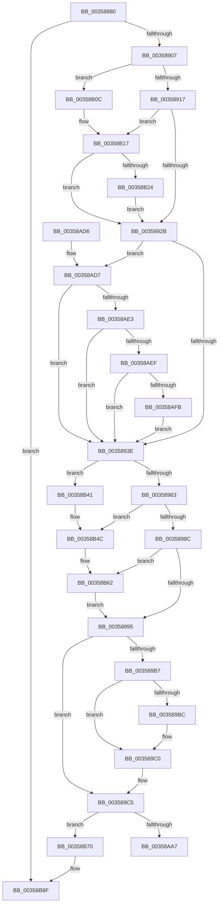

# CcAsyncCopyRead

- RVA: `0x00358880`–`0x00358BAE` (길이 `814` bytes)
- VA: `0x0000000140358880`
- 실행 섹션: `.text`
- PDB 이름 있음: `예`; PDB Function 태그: `아니요`
- unwind 정보 RVA: `0x0007979C`
- 디코드: `184`개 명령, `814/814` bytes 표시
- 미해석 바이트: `0` (있으면 어셈블리에 `.byte`로 보존)

> 이 문서는 커널 이미지의 기계어와 PDB 기호를 분석해 생성했습니다. 4번과 5번은 함수 원형과 자료형을 바이너리 사용 방식에서 추정한 C 해석이며 원본 소스 복구 결과는 아닙니다.

## 1. Dependencies

- 직접 호출 지점: **18**; 고유 호출 대상: **15**
- 직접 호출자로 확인된 함수: **0**
- RIP 상대 이미지 참조: **8**

### Outgoing calls
- `0x003588AB` → [PsGetIoPriorityThread](../34/PsGetIoPriorityThread_function_00343930.md) (function, `0x00343930`)
- `0x003588CA` → [KeQueryPerformanceCounter](../37/KeQueryPerformanceCounter_function_0037E7E0.md) (function, `0x0037E7E0`)
- `0x003588EF` → [CcGetNodeForReadAhead](CcGetNodeForReadAhead_function_00358BC0.md) (function, `0x00358BC0`)
- `0x00358952` → [ExAllocatePoolWithTagFromNode](ExAllocatePoolWithTagFromNode_function_0035A944.md) (function, `0x0035A944`)
- `0x0035897C` → [CcAllocateWorkQueueEntry](CcAllocateWorkQueueEntry_function_0035710C.md) (function, `0x0035710C`)
- `0x003589D6` → [KeAcquireInStackQueuedSpinLock](../27/KeAcquireInStackQueuedSpinLock_function_002757A0.md) (function, `0x002757A0`)
- `0x003589EE` → [KeReleaseInStackQueuedSpinLock](../34/KeReleaseInStackQueuedSpinLock_function_00342CE0.md) (function, `0x00342CE0`)
- `0x00358A4E` → [PsGetPagePriorityThread](../3C/PsGetPagePriorityThread_function_003C3E80.md) (function, `0x003C3E80`)
- `0x00358A93` → [IoReferenceIoAttributionFromThread](../3C/IoReferenceIoAttributionFromThread_function_003CB490.md) (function, `0x003CB490`)
- `0x00358AB7` → [CcPostWorkQueueAsyncRead](../45/CcPostWorkQueueAsyncRead_function_0045D624.md) (function, `0x0045D624`)
- `0x00358B02` → [CcSetTelemetryPeriodicTimer](../../page/AD/CcSetTelemetryPeriodicTimer_function_00ADB788.md) (function, `0x00ADB788`)
- `0x00358B11` → [RtlRaiseStatus](../2F/RtlRaiseStatus_function_002F6A50.md) (function, `0x002F6A50`)
- `0x00358B35` → [CcScheduleReadAheadNuma](../38/CcScheduleReadAheadNuma_function_0038883C.md) (function, `0x0038883C`)
- `0x00358B46` → [RtlRaiseStatus](../2F/RtlRaiseStatus_function_002F6A50.md) (function, `0x002F6A50`)
- `0x00358B54` → [ExFreePoolWithTag](../../poolcode/B8/ExFreePoolWithTag_function_00B82870.md) (function, `0x00B82870`)
- `0x00358B5C` → [RtlRaiseStatus](../2F/RtlRaiseStatus_function_002F6A50.md) (function, `0x002F6A50`)
- `0x00358B89` → [KeBugCheckEx](../4F/KeBugCheckEx_function_004FD660.md) (function, `0x004FD660`)
- `0x00358BA8` → [KeBugCheckEx](../4F/KeBugCheckEx_function_004FD660.md) (function, `0x004FD660`)

### Direct callers
- 이 함수 시작 RVA로 연결되는 직접 call은 확인되지 않았습니다. 간접 호출은 완전히 역산할 수 없습니다.

### Static image references
- `0x00358917` → RVA `0x00E65B94` (`.data`; read)
- `0x0035892B` → RVA `0x00F8F2C8` (`.data`; read/write)
- `0x00358932` → RVA `0x00F8F3C4` (`.data`; read)
- `0x00358A9B` → RVA `0x00F8F520` (`.data`; read)
- `0x00358AD7` → RVA `0x00F8F2A1` (`.data`; read)
- `0x00358AE3` → RVA `0x00F8F260` (`.data`; read)
- `0x00358AEF` → RVA `0x00F8F3C0` (`.data`; read)
- `0x00358AFB` → RVA `0x00F8F280` (`.data`; read)

## 2. Other-region calls and transfers

- 다른 실행 섹션으로 향하는 call: **2**
  - `0x00358B02` → [CcSetTelemetryPeriodicTimer](../../page/AD/CcSetTelemetryPeriodicTimer_function_00ADB788.md) (`.text` → `PAGE`)
  - `0x00358B54` → [ExFreePoolWithTag](../../poolcode/B8/ExFreePoolWithTag_function_00B82870.md) (`.text` → `POOLCODE`)
- 별도 외부 분기/꼬리 이동을 확인하지 못했습니다.

## 3. Assembly (complete function range)

```asm
00358880  48 89 5C 24 18                  mov qword ptr [rsp + 0x18], rbx
00358885  48 89 54 24 10                  mov qword ptr [rsp + 0x10], rdx
0035888A  55                              push rbp
0035888B  56                              push rsi
0035888C  57                              push rdi
0035888D  41 54                           push r12
0035888F  41 55                           push r13
00358891  41 56                           push r14
00358893  41 57                           push r15
00358895  48 83 EC 50                     sub rsp, 0x50
00358899  4C 8B E1                        mov r12, rcx
0035889C  45 8B E8                        mov r13d, r8d
0035889F  65 48 8B 0C 25 88 01 00 00      mov rcx, qword ptr gs:[0x188]
003588A8  4C 8B F2                        mov r14, rdx
003588AB  E8 80 B0 FE FF                  call 0x140343930
003588B0  48 83 A4 24 90 00 00 00 00      and qword ptr [rsp + 0x90], 0
003588B9  33 C0                           xor eax, eax
003588BB  0F 57 C0                        xorps xmm0, xmm0
003588BE  48 89 44 24 48                  mov qword ptr [rsp + 0x48], rax
003588C3  33 C9                           xor ecx, ecx
003588C5  0F 11 44 24 38                  movups xmmword ptr [rsp + 0x38], xmm0
003588CA  E8 11 5F 02 00                  call 0x14037e7e0
003588CF  4D 8B 4C 24 30                  mov r9, qword ptr [r12 + 0x30]
003588D4  48 8B D8                        mov rbx, rax
003588D7  49 8B 44 24 28                  mov rax, qword ptr [r12 + 0x28]
003588DC  48 8B 78 08                     mov rdi, qword ptr [rax + 8]
003588E0  48 8B CF                        mov rcx, rdi
003588E3  4C 8B BF 18 02 00 00            mov r15, qword ptr [rdi + 0x218]
003588EA  4C 89 7C 24 30                  mov qword ptr [rsp + 0x30], r15
003588EF  E8 CC 02 00 00                  call 0x140358bc0
003588F4  41 8B CD                        mov ecx, r13d
003588F7  48 8B E8                        mov rbp, rax
003588FA  49 03 0E                        add rcx, qword ptr [r14]
003588FD  48 3B 4F 08                     cmp rcx, qword ptr [rdi + 8]
00358901  0F 8F 88 02 00 00               jg 0x140358b8f
00358907  33 C9                           xor ecx, ecx
00358909  48 39 8C 24 B0 00 00 00         cmp qword ptr [rsp + 0xb0], rcx
00358911  0F 84 F5 01 00 00               je 0x140358b0c
00358917  38 0D 77 D2 B0 00               cmp byte ptr [rip + 0xb0d277], cl
0035891D  48 8B B4 24 C0 00 00 00         mov rsi, qword ptr [rsp + 0xc0]
00358925  0F 85 EC 01 00 00               jne 0x140358b17
0035892B  48 FF 05 96 69 C3 00            inc qword ptr [rip + 0xc36996]
00358932  39 0D 8C 6A C3 00               cmp dword ptr [rip + 0xc36a8c], ecx
00358938  0F 84 99 01 00 00               je 0x140358ad7
0035893E  44 8B 4D 18                     mov r9d, dword ptr [rbp + 0x18]
00358942  BA 08 00 00 00                  mov edx, 8
00358947  41 0F BA E9 1F                  bts r9d, 0x1f
0035894C  41 B8 43 63 41 73               mov r8d, 0x73416343
00358952  E8 ED 1F 00 00                  call 0x14035a944
00358957  4C 8B F0                        mov r14, rax
0035895A  48 85 C0                        test rax, rax
0035895D  0F 84 DE 01 00 00               je 0x140358b41
00358963  48 83 20 00                     and qword ptr [rax], 0
00358967  4C 8D 8C 24 90 00 00 00         lea r9, [rsp + 0x90]
0035896F  48 8B 97 58 02 00 00            mov rdx, qword ptr [rdi + 0x258]
00358976  4C 8B C5                        mov r8, rbp
00358979  49 8B CF                        mov rcx, r15
0035897C  E8 8B E7 FF FF                  call 0x14035710c
00358981  44 8B F8                        mov r15d, eax
00358984  85 C0                           test eax, eax
00358986  0F 88 C0 01 00 00               js 0x140358b4c
0035898C  48 85 F6                        test rsi, rsi
0035898F  0F 84 CD 01 00 00               je 0x140358b62
00358995  B8 00 F0 FF FF                  mov eax, 0xfffff000
0035899A  41 8D 95 FF 0F 00 00            lea edx, [r13 + 0xfff]
003589A1  48 23 D0                        and rdx, rax
003589A4  48 8B 86 20 02 00 00            mov rax, qword ptr [rsi + 0x220]
003589AB  48 8B 88 38 06 00 00            mov rcx, qword ptr [rax + 0x638]
003589B2  48 85 C9                        test rcx, rcx
003589B5  74 0E                           je 0x1403589c5
003589B7  48 85 D2                        test rdx, rdx
003589BA  74 04                           je 0x1403589c0
003589BC  F0 48 01 11                     lock add qword ptr [rcx], rdx
003589C0  F0 48 FF 41 10                  lock inc qword ptr [rcx + 0x10]
003589C5  48 8B 4C 24 30                  mov rcx, qword ptr [rsp + 0x30]
003589CA  48 8D 54 24 38                  lea rdx, [rsp + 0x38]
003589CF  48 81 C1 00 03 00 00            add rcx, 0x300
003589D6  E8 C5 CD F1 FF                  call 0x1402757a0
003589DB  8B 47 04                        mov eax, dword ptr [rdi + 4]
003589DE  48 8D 4C 24 38                  lea rcx, [rsp + 0x38]
003589E3  FF C0                           inc eax
003589E5  89 47 04                        mov dword ptr [rdi + 4], eax
003589E8  FF 87 20 02 00 00               inc dword ptr [rdi + 0x220]
003589EE  E8 ED A2 FE FF                  call 0x140342ce0
003589F3  F0 FF 87 10 02 00 00            lock inc dword ptr [rdi + 0x210]
003589FA  48 8B 94 24 90 00 00 00         mov rdx, qword ptr [rsp + 0x90]
00358A02  48 8B CE                        mov rcx, rsi
00358A05  48 8B 84 24 98 00 00 00         mov rax, qword ptr [rsp + 0x98]
00358A0D  C7 82 80 00 00 00 05 00 00 00   mov dword ptr [rdx + 0x80], 5
00358A17  48 89 7A 10                     mov qword ptr [rdx + 0x10], rdi
00358A1B  48 8B BC 24 C8 00 00 00         mov rdi, qword ptr [rsp + 0xc8]
00358A23  4C 89 62 20                     mov qword ptr [rdx + 0x20], r12
00358A27  48 8B 00                        mov rax, qword ptr [rax]
00358A2A  48 89 42 18                     mov qword ptr [rdx + 0x18], rax
00358A2E  44 89 6A 28                     mov dword ptr [rdx + 0x28], r13d
00358A32  4C 89 72 30                     mov qword ptr [rdx + 0x30], r14
00358A36  48 8B 47 10                     mov rax, qword ptr [rdi + 0x10]
00358A3A  48 89 42 40                     mov qword ptr [rdx + 0x40], rax
00358A3E  48 8B 84 24 B8 00 00 00         mov rax, qword ptr [rsp + 0xb8]
00358A46  48 89 42 48                     mov qword ptr [rdx + 0x48], rax
00358A4A  48 89 7A 50                     mov qword ptr [rdx + 0x50], rdi
00358A4E  E8 2D B4 06 00                  call 0x1403c3e80
00358A53  89 42 38                        mov dword ptr [rdx + 0x38], eax
00358A56  48 8B CE                        mov rcx, rsi
00358A59  65 48 8B 04 25 88 01 00 00      mov rax, qword ptr gs:[0x188]
00358A62  4C 8B B4 24 90 00 00 00         mov r14, qword ptr [rsp + 0x90]
00358A6A  48 8B 90 B8 00 00 00            mov rdx, qword ptr [rax + 0xb8]
00358A71  49 89 56 58                     mov qword ptr [r14 + 0x58], rdx
00358A75  49 8D 56 68                     lea rdx, [r14 + 0x68]
00358A79  49 89 76 60                     mov qword ptr [r14 + 0x60], rsi
00358A7D  8A 47 18                        mov al, byte ptr [rdi + 0x18]
00358A80  41 88 46 70                     mov byte ptr [r14 + 0x70], al
00358A84  8B 47 1C                        mov eax, dword ptr [rdi + 0x1c]
00358A87  41 89 46 74                     mov dword ptr [r14 + 0x74], eax
00358A8B  49 89 5E 78                     mov qword ptr [r14 + 0x78], rbx
00358A8F  48 83 22 00                     and qword ptr [rdx], 0
00358A93  E8 F8 29 07 00                  call 0x1403cb490
00358A98  8B 4F 1C                        mov ecx, dword ptr [rdi + 0x1c]
00358A9B  3B 0D 7F 6A C3 00               cmp ecx, dword ptr [rip + 0xc36a7f]
00358AA1  0F 87 C9 00 00 00               ja 0x140358b70
00358AA7  8B D1                           mov edx, ecx
00358AA9  49 8B CE                        mov rcx, r14
00358AAC  48 C1 E2 04                     shl rdx, 4
00358AB0  48 03 95 00 01 00 00            add rdx, qword ptr [rbp + 0x100]
00358AB7  E8 68 4B 10 00                  call 0x14045d624
00358ABC  48 8B 9C 24 A0 00 00 00         mov rbx, qword ptr [rsp + 0xa0]
00358AC4  B0 01                           mov al, 1
00358AC6  48 83 C4 50                     add rsp, 0x50
00358ACA  41 5F                           pop r15
00358ACC  41 5E                           pop r14
00358ACE  41 5D                           pop r13
00358AD0  41 5C                           pop r12
00358AD2  5F                              pop rdi
00358AD3  5E                              pop rsi
00358AD4  5D                              pop rbp
00358AD5  C3                              ret
00358AD6  CC                              int3
00358AD7  38 0D C4 67 C3 00               cmp byte ptr [rip + 0xc367c4], cl
00358ADD  0F 85 5B FE FF FF               jne 0x14035893e
00358AE3  38 0D 77 67 C3 00               cmp byte ptr [rip + 0xc36777], cl
00358AE9  0F 84 4F FE FF FF               je 0x14035893e
00358AEF  39 0D CB 68 C3 00               cmp dword ptr [rip + 0xc368cb], ecx
00358AF5  0F 85 43 FE FF FF               jne 0x14035893e
00358AFB  48 8B 0D 7E 67 C3 00            mov rcx, qword ptr [rip + 0xc3677e]
00358B02  E8 81 2C 78 00                  call 0x140adb788
00358B07  E9 32 FE FF FF                  jmp 0x14035893e
00358B0C  B9 E8 00 00 C0                  mov ecx, 0xc00000e8
00358B11  E8 3A DF F9 FF                  call 0x1402f6a50
00358B16  CC                              int3
00358B17  41 F7 01 00 00 02 00            test dword ptr [r9], 0x20000
00358B1E  0F 84 07 FE FF FF               je 0x14035892b
00358B24  4C 8B CE                        mov r9, rsi
00358B27  48 89 6C 24 20                  mov qword ptr [rsp + 0x20], rbp
00358B2C  45 8B C5                        mov r8d, r13d
00358B2F  49 8B D6                        mov rdx, r14
00358B32  49 8B CC                        mov rcx, r12
00358B35  E8 02 FD 02 00                  call 0x14038883c
00358B3A  33 C9                           xor ecx, ecx
00358B3C  E9 EA FD FF FF                  jmp 0x14035892b
00358B41  B9 9A 00 00 C0                  mov ecx, 0xc000009a
00358B46  E8 05 DF F9 FF                  call 0x1402f6a50
00358B4B  CC                              int3
00358B4C  BA 43 63 41 73                  mov edx, 0x73416343
00358B51  49 8B CE                        mov rcx, r14
00358B54  E8 17 9D 82 00                  call 0x140b82870
00358B59  41 8B CF                        mov ecx, r15d
00358B5C  E8 EF DE F9 FF                  call 0x1402f6a50
00358B61  CC                              int3
00358B62  65 48 8B 34 25 88 01 00 00      mov rsi, qword ptr gs:[0x188]
00358B6B  E9 25 FE FF FF                  jmp 0x140358995
00358B70  48 83 64 24 20 00               and qword ptr [rsp + 0x20], 0
00358B76  45 33 C9                        xor r9d, r9d
00358B79  BA A9 04 00 00                  mov edx, 0x4a9
00358B7E  49 C7 C0 20 04 00 C0            mov r8, 0xffffffffc0000420
00358B85  41 8D 49 34                     lea ecx, [r9 + 0x34]
00358B89  E8 D2 4A 1A 00                  call 0x1404fd660
00358B8E  CC                              int3
00358B8F  48 83 64 24 20 00               and qword ptr [rsp + 0x20], 0
00358B95  45 33 C9                        xor r9d, r9d
00358B98  BA 03 04 00 00                  mov edx, 0x403
00358B9D  49 C7 C0 20 04 00 C0            mov r8, 0xffffffffc0000420
00358BA4  41 8D 49 34                     lea ecx, [r9 + 0x34]
00358BA8  E8 B3 4A 1A 00                  call 0x1404fd660
00358BAD  CC                              int3
```

## 4. C-style interpretation (structured pseudocode)

```c
__int64 __fastcall CcAsyncCopyRead(__int64 a1, __int64 a2, int a3, __int64 a4, __int64 a5, __int64 a6, __int64 a7, __int64 a8)
{
    __int64 result;
    __int64 v_rsp;
    unsigned __int64 v_stack_m40;
    unsigned __int64 v_stack_m50;
    unsigned __int64 v_stack_m58;
    unsigned __int64 v_stack_p10;
    unsigned __int64 v_stack_p18;
    unsigned __int64 v_stack_p20;
    unsigned __int64 v_stack_p8;

    v_stack_p18 = v_rbx;
    v_stack_p10 = a2;
    v_rsp = (v_rsp) - (80);
    result = PsGetIoPriorityThread(*(unsigned __int64 *)(gs_base + (0 + 392)), a2, a3, a4);
    result = 0;
    v_stack_m40 = 0;
    a1 = 0;
    v_stack_m50 = v_xmm0;
    result = KeQueryPerformanceCounter(a1, a2, a3, a4);
    v_stack_m58 = *(unsigned __int64 *)(*(unsigned __int64 *)(*(unsigned __int64 *)(a1 + 40) + 8) + 536);
    result = CcGetNodeForReadAhead(*(unsigned __int64 *)(*(unsigned __int64 *)(a1 + 40) + 8), a2, a3, *(unsigned __int64 *)(a1 + 48));
    a1 = ((unsigned int)((unsigned int)((unsigned int)(a3)))) + (*(unsigned __int64 *)(a2));
    if (a1 > (*(unsigned __int64 *)(*(unsigned __int64 *)(*(unsigned __int64 *)(a1 + 40) + 8) + 8))) goto loc_00358B8F;
    a1 = 0;
    if (a5 == 0) goto loc_00358B0C;
    if ((*(unsigned __int8 *)(v_rip + 11588215)) != 0) goto loc_00358B17;
loc_0035892B:
    if ((*(unsigned int *)(v_rip + 12806796)) == 0) goto loc_00358AD7;
loc_0035893E:
    result = ExAllocatePoolWithTagFromNode(a1, 8, (unsigned int)(0x73416343ULL), (unsigned int)(*(unsigned int *)(result + 24)));
    if (result == 0) goto loc_00358B41;
    result = CcAllocateWorkQueueEntry(*(unsigned __int64 *)(*(unsigned __int64 *)(*(unsigned __int64 *)(a1 + 40) + 8) + 536), *(unsigned __int64 *)(*(unsigned __int64 *)(*(unsigned __int64 *)(a1 + 40) + 8) + 600), result, v_stack_p8);
    if (sign_flag) goto loc_00358B4C;
    if (a7 == 0) goto loc_00358B62;
loc_00358995:
    a2 = ((unsigned int)(a3) + 4095) & ((unsigned int)(0xFFFFF000ULL));
    if (*(unsigned __int64 *)(*(unsigned __int64 *)(a7 + 544) + 1592) == 0) goto loc_003589C5;
    if (a2 != 0) {
    }
loc_003589C5:
    a1 = (v_stack_m58) + (768);
    result = KeAcquireInStackQueuedSpinLock(a1, v_stack_m50, result, v_stack_p8);
    result = (unsigned int)(((unsigned int)(*(unsigned int *)(*(unsigned __int64 *)(*(unsigned __int64 *)(a1 + 40) + 8) + 4))) + 1);
    *(unsigned int *)(*(unsigned __int64 *)(*(unsigned __int64 *)(a1 + 40) + 8) + 4) = (unsigned int)(result);
    result = KeReleaseInStackQueuedSpinLock(v_stack_m50, v_stack_m50, result, v_stack_p8);
    *(unsigned int *)(v_stack_p8 + 128) = 5;
    *(unsigned __int64 *)(v_stack_p8 + 16) = *(unsigned __int64 *)(*(unsigned __int64 *)(a1 + 40) + 8);
    *(unsigned __int64 *)(v_stack_p8 + 32) = a1;
    *(unsigned __int64 *)(v_stack_p8 + 24) = *(unsigned __int64 *)(v_stack_p10);
    *(unsigned int *)(v_stack_p8 + 40) = (unsigned int)((unsigned int)(a3));
    *(unsigned __int64 *)(v_stack_p8 + 48) = result;
    *(unsigned __int64 *)(v_stack_p8 + 64) = *(unsigned __int64 *)(a8 + 16);
    *(unsigned __int64 *)(v_stack_p8 + 72) = a6;
    *(unsigned __int64 *)(v_stack_p8 + 80) = a8;
    result = PsGetPagePriorityThread(a7, v_stack_p8, result, v_stack_p8);
    *(unsigned int *)(v_stack_p8 + 56) = (unsigned int)(result);
    *(unsigned __int64 *)(v_stack_p8 + 88) = *(unsigned __int64 *)(*(unsigned __int64 *)(gs_base + (0 + 392)) + 184);
    *(unsigned __int64 *)(v_stack_p8 + 96) = a7;
    *(unsigned __int8 *)(v_stack_p8 + 112) = (unsigned __int8)(*(unsigned __int8 *)(a8 + 24));
    *(unsigned int *)(v_stack_p8 + 116) = (unsigned int)((unsigned int)(*(unsigned int *)(a8 + 28)));
    *(unsigned __int64 *)(v_stack_p8 + 120) = result;
    result = IoReferenceIoAttributionFromThread(a7, v_stack_p8 + 104, result, v_stack_p8);
    if (((unsigned int)((unsigned int)(*(unsigned int *)(a8 + 28)))) > (*(unsigned int *)(v_rip + 12806783))) goto loc_00358B70;
    a2 = ((unsigned int)((unsigned int)((unsigned int)(*(unsigned int *)(a8 + 28))))) << (4);
    a2 = (a2) + (*(unsigned __int64 *)(result + 256));
    result = CcPostWorkQueueAsyncRead(v_stack_p8, a2, result, v_stack_p8);
    v_rsp = (v_rsp) + (80);
    return 1;
loc_00358AD7:
    if ((*(unsigned __int8 *)(v_rip + 12806084)) != ((unsigned __int8)(v_stack_p8))) goto loc_0035893E;
    if ((*(unsigned __int8 *)(v_rip + 12806007)) == ((unsigned __int8)(v_stack_p8))) goto loc_0035893E;
    if ((*(unsigned int *)(v_rip + 12806347)) != ((unsigned int)(v_stack_p8))) goto loc_0035893E;
    result = CcSetTelemetryPeriodicTimer(*(unsigned __int64 *)(v_rip + 12806014), a2, result, v_stack_p8);
    goto loc_0035893E;
loc_00358B0C:
    result = RtlRaiseStatus((unsigned int)(0xC00000E8ULL), a2, result, v_stack_p8);
loc_00358B17:
    if (((*(unsigned int *)(v_stack_p8)) & (0x20000ULL)) == 0) goto loc_0035892B;
    v_stack_p20 = result;
    result = CcScheduleReadAheadNuma(a1, v_stack_p8, (unsigned int)((unsigned int)((unsigned int)(a3))), a7);
    a1 = 0;
    goto loc_0035892B;
loc_00358B41:
    result = RtlRaiseStatus((unsigned int)(0xC000009AULL), v_stack_p8, (unsigned int)((unsigned int)((unsigned int)(a3))), a7);
loc_00358B4C:
    result = ExFreePoolWithTag(v_stack_p8, (unsigned int)(0x73416343ULL), (unsigned int)((unsigned int)((unsigned int)(a3))), a7);
    result = RtlRaiseStatus((unsigned int)((unsigned int)((unsigned int)((unsigned int)(result)))), (unsigned int)(0x73416343ULL), (unsigned int)((unsigned int)((unsigned int)(a3))), a7);
loc_00358B62:
    goto loc_00358995;
loc_00358B70:
    a4 = 0;
    result = KeBugCheckEx(a4 + 52, (unsigned int)(0x4A9ULL), 0xFFFFFFFFC0000420ULL, a4);
loc_00358B8F:
    a4 = 0;
    result = KeBugCheckEx(a4 + 52, (unsigned int)(0x403ULL), 0xFFFFFFFFC0000420ULL, a4);
    return result;
}
```

## 5. (Beta) C Style

```c
int64_t CcAsyncCopyRead(void *Arg1, void *Arg2, void *Arg3, int64_t Arg4, int64_t Arg5, int64_t Arg6, int64_t Arg7, void *Arg8)
{
    uint8_t *arg1 = (uint8_t *)Arg1;
    uint8_t *arg2 = (uint8_t *)Arg2;
    uint8_t *arg3 = (uint8_t *)Arg3;
    uint8_t *arg8 = (uint8_t *)Arg8;

    int64_t result;
    int64_t local_rsp;
    uint64_t v_stack_m40;
    uint64_t v_stack_m50;
    uint64_t v_stack_m58;
    uint64_t v_stack_p10;
    uint64_t v_stack_p18;
    uint64_t v_stack_p20;
    uint64_t v_stack_p8;

    v_stack_p18 = local_rbx;
    v_stack_p10 = Arg2;
    local_rsp = (local_rsp) - (80);
    result = PsGetIoPriorityThread(*(uint64_t *)(gs_base + (0 + 0x188)), Arg2, Arg3, Arg4);
    result = 0;
    v_stack_m40 = 0;
    Arg1 = 0;
    v_stack_m50 = v_xmm0;
    result = KeQueryPerformanceCounter(Arg1, Arg2, Arg3, Arg4);
    v_stack_m58 = *(uint64_t *)(*(uint64_t *)(*(uint64_t *)(arg1 + 0x28) + 0x8) + 0x218);
    result = CcGetNodeForReadAhead(*(uint64_t *)(*(uint64_t *)(arg1 + 0x28) + 0x8), Arg2, Arg3, *(uint64_t *)(arg1 + 0x30));
    Arg1 = ((uint32_t)((uint32_t)((uint32_t)(Arg3)))) + (*(uint64_t *)(arg2));
    if (Arg1 > (*(uint64_t *)(*(uint64_t *)(*(uint64_t *)(arg1 + 0x28) + 0x8) + 0x8))) goto loc_00358B8F;
    Arg1 = 0;
    if (Arg5 == 0) goto loc_00358B0C;
    if ((*(uint8_t *)(v_rip + 0xB0D277)) != 0) goto loc_00358B17;
loc_0035892B:
    if ((*(uint32_t *)(v_rip + 0xC36A8C)) == 0) goto loc_00358AD7;
loc_0035893E:
    result = ExAllocatePoolWithTagFromNode(Arg1, 8, (uint32_t)(0x73416343ULL), (uint32_t)(*(uint32_t *)(result + 0x18)));
    if (result == 0) goto loc_00358B41;
    result = CcAllocateWorkQueueEntry(*(uint64_t *)(*(uint64_t *)(*(uint64_t *)(arg1 + 0x28) + 0x8) + 0x218), *(uint64_t *)(*(uint64_t *)(*(uint64_t *)(arg1 + 0x28) + 0x8) + 0x258), result, v_stack_p8);
    if (sign_flag) goto loc_00358B4C;
    if (Arg7 == 0) goto loc_00358B62;
loc_00358995:
    Arg2 = ((uint32_t)(Arg3) + 4095) & ((uint32_t)(0xFFFFF000ULL));
    if (*(uint64_t *)(*(uint64_t *)(Arg7 + 0x220) + 0x638) == 0) goto loc_003589C5;
    if (Arg2 != NULL) {
    }
loc_003589C5:
    Arg1 = (v_stack_m58) + (768);
    result = KeAcquireInStackQueuedSpinLock(Arg1, v_stack_m50, result, v_stack_p8);
    result = (uint32_t)(((uint32_t)(*(uint32_t *)(*(uint64_t *)(*(uint64_t *)(arg1 + 0x28) + 0x8) + 0x4))) + 1);
    *(uint32_t *)(*(uint64_t *)(*(uint64_t *)(arg1 + 0x28) + 0x8) + 0x4) = (uint32_t)(result);
    result = KeReleaseInStackQueuedSpinLock(v_stack_m50, v_stack_m50, result, v_stack_p8);
    *(uint32_t *)(v_stack_p8 + 0x80) = 5;
    *(uint64_t *)(v_stack_p8 + 0x10) = *(uint64_t *)(*(uint64_t *)(arg1 + 0x28) + 0x8);
    *(void **)(v_stack_p8 + 0x20) = Arg1;
    *(uint64_t *)(v_stack_p8 + 0x18) = *(uint64_t *)(v_stack_p10);
    *(uint32_t *)(v_stack_p8 + 0x28) = (uint32_t)((uint32_t)(Arg3));
    *(uint64_t *)(v_stack_p8 + 0x30) = result;
    *(uint64_t *)(v_stack_p8 + 0x40) = *(uint64_t *)(arg8 + 0x10);
    *(uint64_t *)(v_stack_p8 + 0x48) = Arg6;
    *(void **)(v_stack_p8 + 0x50) = Arg8;
    result = PsGetPagePriorityThread(Arg7, v_stack_p8, result, v_stack_p8);
    *(uint32_t *)(v_stack_p8 + 0x38) = (uint32_t)(result);
    *(uint64_t *)(v_stack_p8 + 0x58) = *(uint64_t *)(*(uint64_t *)(gs_base + (0 + 0x188)) + 0xB8);
    *(uint64_t *)(v_stack_p8 + 0x60) = Arg7;
    *(uint8_t *)(v_stack_p8 + 0x70) = (uint8_t)(*(uint8_t *)(arg8 + 0x18));
    *(uint32_t *)(v_stack_p8 + 0x74) = (uint32_t)((uint32_t)(*(uint32_t *)(arg8 + 0x1C)));
    *(uint64_t *)(v_stack_p8 + 0x78) = result;
    result = IoReferenceIoAttributionFromThread(Arg7, v_stack_p8 + 104, result, v_stack_p8);
    if (((uint32_t)((uint32_t)(*(uint32_t *)(arg8 + 0x1C)))) > (*(uint32_t *)(v_rip + 0xC36A7F))) goto loc_00358B70;
    Arg2 = ((uint32_t)((uint32_t)((uint32_t)(*(uint32_t *)(arg8 + 0x1C))))) << (4);
    Arg2 = (Arg2) + (*(uint64_t *)(result + 0x100));
    result = CcPostWorkQueueAsyncRead(v_stack_p8, Arg2, result, v_stack_p8);
    local_rsp = (local_rsp) + (80);
    return 1;
loc_00358AD7:
    if ((*(uint8_t *)(v_rip + 0xC367C4)) != ((uint8_t)(v_stack_p8))) goto loc_0035893E;
    if ((*(uint8_t *)(v_rip + 0xC36777)) == ((uint8_t)(v_stack_p8))) goto loc_0035893E;
    if ((*(uint32_t *)(v_rip + 0xC368CB)) != ((uint32_t)(v_stack_p8))) goto loc_0035893E;
    result = CcSetTelemetryPeriodicTimer(*(uint64_t *)(v_rip + 0xC3677E), Arg2, result, v_stack_p8);
    goto loc_0035893E;
loc_00358B0C:
    result = RtlRaiseStatus((uint32_t)(0xC00000E8ULL), Arg2, result, v_stack_p8);
loc_00358B17:
    if (((*(uint32_t *)(v_stack_p8)) & (0x20000ULL)) == 0) goto loc_0035892B;
    v_stack_p20 = result;
    result = CcScheduleReadAheadNuma(Arg1, v_stack_p8, (uint32_t)((uint32_t)((uint32_t)(Arg3))), Arg7);
    Arg1 = 0;
    goto loc_0035892B;
loc_00358B41:
    result = RtlRaiseStatus((uint32_t)(0xC000009AULL), v_stack_p8, (uint32_t)((uint32_t)((uint32_t)(Arg3))), Arg7);
loc_00358B4C:
    result = ExFreePoolWithTag(v_stack_p8, (uint32_t)(0x73416343ULL), (uint32_t)((uint32_t)((uint32_t)(Arg3))), Arg7);
    result = RtlRaiseStatus((uint32_t)((uint32_t)((uint32_t)((uint32_t)(result)))), (uint32_t)(0x73416343ULL), (uint32_t)((uint32_t)((uint32_t)(Arg3))), Arg7);
loc_00358B62:
    goto loc_00358995;
loc_00358B70:
    Arg4 = 0;
    result = KeBugCheckEx(Arg4 + 52, (uint32_t)(0x4A9ULL), 0xFFFFFFFFC0000420ULL, Arg4);
loc_00358B8F:
    Arg4 = 0;
    result = KeBugCheckEx(Arg4 + 52, (uint32_t)(0x403ULL), 0xFFFFFFFFC0000420ULL, Arg4);
    return result;
}
```

### 관측된 메모리 오프셋

구조체 형식이 확인되지 않은 접근은 인자 기준의 오프셋으로만 기록했습니다.

| 기준 인자 | 오프셋 표현 | 폭 (bit) | 접근 |
|---|---:|---:|---|
| `Arg1` | `+ 0x28` | `64` | `R` |
| `Arg1` | `+ 0x30` | `64` | `R` |
| `Arg2` | `+ 0x0` | `64` | `R` |
| `Arg3` | `+ 0xFFF` | `32` | `R` |
| `Arg8` | `+ 0x10` | `64` | `R` |
| `Arg8` | `+ 0x18` | `8` | `R` |
| `Arg8` | `+ 0x1C` | `32` | `R` |

## 6. Execution-region graph

[열기: 2D/3D 그래프와 함수 탐색 컨트롤 패널](../../../control-panel.html?section=text&rva=0x00358880&view=graph)

- 2D 그래프는 위에서 아래로 흐르고, 3D 그래프는 빈 공간을 드래그해 회전합니다. Shift+드래그는 이동, 휠은 확대·축소, 함수 노드 선택은 대상 보고서 이동입니다.

### Static fallback


