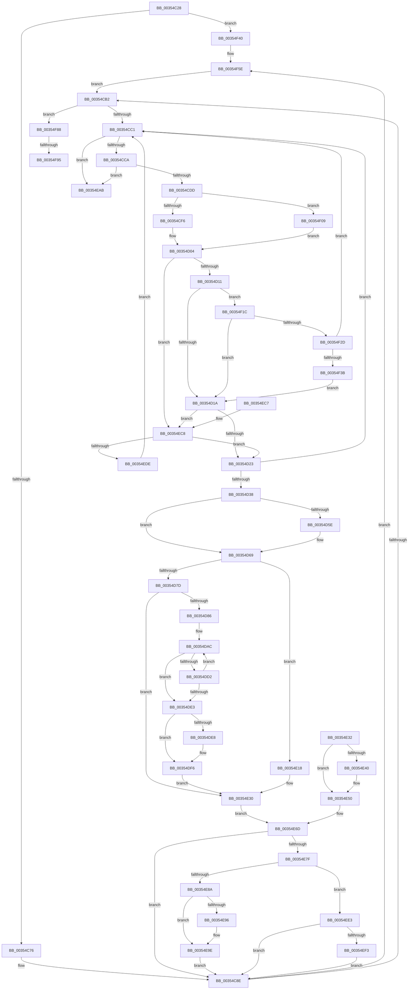

# CcAsyncLazywriteWorker

- RVA: `0x00354C28`–`0x00354FA5` (길이 `893` bytes)
- VA: `0x0000000140354C28`
- 실행 섹션: `.text`
- PDB 이름 있음: `예`; PDB Function 태그: `예`
- unwind 정보 RVA: `0x0007922C`
- 디코드: `190`개 명령, `893/893` bytes 표시
- 미해석 바이트: `0` (있으면 어셈블리에 `.byte`로 보존)

> 이 문서는 커널 이미지의 기계어와 PDB 기호를 분석해 생성했습니다. 4번과 5번은 함수 원형과 자료형을 바이너리 사용 방식에서 추정한 C 해석이며 원본 소스 복구 결과는 아닙니다.

## 1. Dependencies

- 직접 호출 지점: **13**; 고유 호출 대상: **12**
- 직접 호출자로 확인된 함수: **1**
- RIP 상대 이미지 참조: **2**

### Outgoing calls
- `0x00354CA2` → [KeAcquireInStackQueuedSpinLock](../27/KeAcquireInStackQueuedSpinLock_function_002757A0.md) (function, `0x002757A0`)
- `0x00354D29` → [CcFindNextWorkQueueEntry](CcFindNextWorkQueueEntry_function_00356BFC.md) (function, `0x00356BFC`)
- `0x00354D4D` → [KeReleaseInStackQueuedSpinLock](../34/KeReleaseInStackQueuedSpinLock_function_00342CE0.md) (function, `0x00342CE0`)
- `0x00354D63` → [CcPerfLogWorkItemDequeue](CcPerfLogWorkItemDequeue_function_0035877C.md) (function, `0x0035877C`)
- `0x00354DC1` → [CcWriteBehindAsync](CcWriteBehindAsync_function_003549E8.md) (function, `0x003549E8`)
- `0x00354DEB` → [CcRepostToSynchronousLazywriter](CcRepostToSynchronousLazywriter_function_0035492C.md) (function, `0x0035492C`)
- `0x00354E26` → [KeSetEvent](../33/KeSetEvent_function_0033F310.md) (function, `0x0033F310`)
- `0x00354E99` → [CcPerfLogWorkItemComplete](CcPerfLogWorkItemComplete_function_00358710.md) (function, `0x00358710`)
- `0x00354EA1` → [CcFreeWorkQueueEntry](CcFreeWorkQueueEntry_function_0035723C.md) (function, `0x0035723C`)
- `0x00354EB0` → [KeReleaseInStackQueuedSpinLock](../34/KeReleaseInStackQueuedSpinLock_function_00342CE0.md) (function, `0x00342CE0`)
- `0x00354EFF` → [CcPerfLogWorkItemEnqueue](CcPerfLogWorkItemEnqueue_function_00357340.md) (function, `0x00357340`)
- `0x00354F58` → [KeBugCheckEx](../4F/KeBugCheckEx_function_004FD660.md) (function, `0x004FD660`)
- `0x00354F7E` → [CcReEngageWorkerThreads](../57/CcReEngageWorkerThreads_function_0057BEB0.md) (function, `0x0057BEB0`)

### Direct callers
- [CcAsyncLazywriteWorkerThread](../4B/CcAsyncLazywriteWorkerThread_function_004B2130.md) at `0x004B21A2`

### Static image references
- `0x00354CE9` → RVA `0x00E65B88` (`.data`; read)
- `0x00354D52` → RVA `0x00FC6B10` (`ALMOSTRO`; read)

## 2. Other-region calls and transfers

- 다른 실행 섹션으로 향하는 call: **0**
- call이 아닌 외부 분기/꼬리 이동: **2**
  - `0x00354F8F` → [sub_006E27A4](../6E/Unknown_function_006E27A4.md) (`tail-transfer`)
  - `0x00354FA0` → [sub_006E27A4](../6E/Unknown_function_006E27A4.md) (`tail-transfer`)

## 3. Assembly (complete function range)

```asm
00354C28  4C 8B DC                        mov r11, rsp
00354C2B  56                              push rsi
00354C2C  57                              push rdi
00354C2D  41 54                           push r12
00354C2F  41 55                           push r13
00354C31  41 56                           push r14
00354C33  41 57                           push r15
00354C35  48 81 EC B8 00 00 00            sub rsp, 0xb8
00354C3C  33 F6                           xor esi, esi
00354C3E  33 FF                           xor edi, edi
00354C40  40 88 74 24 30                  mov byte ptr [rsp + 0x30], sil
00354C45  21 74 24 4C                     and dword ptr [rsp + 0x4c], esi
00354C49  0F 57 C0                        xorps xmm0, xmm0
00354C4C  33 C0                           xor eax, eax
00354C4E  0F 11 44 24 60                  movups xmmword ptr [rsp + 0x60], xmm0
00354C53  49 89 43 88                     mov qword ptr [r11 - 0x78], rax
00354C57  0F 57 C9                        xorps xmm1, xmm1
00354C5A  41 0F 11 4B A8                  movups xmmword ptr [r11 - 0x58], xmm1
00354C5F  49 89 43 B8                     mov qword ptr [r11 - 0x48], rax
00354C63  21 44 24 48                     and dword ptr [rsp + 0x48], eax
00354C67  48 21 44 24 50                  and qword ptr [rsp + 0x50], rax
00354C6C  83 79 20 07                     cmp dword ptr [rcx + 0x20], 7
00354C70  0F 85 CA 02 00 00               jne 0x140354f40
00354C76  4C 8B 69 38                     mov r13, qword ptr [rcx + 0x38]
00354C7A  4C 89 AC 24 00 01 00 00         mov qword ptr [rsp + 0x100], r13
00354C82  4C 8B 71 48                     mov r14, qword ptr [rcx + 0x48]
00354C86  4C 89 B4 24 08 01 00 00         mov qword ptr [rsp + 0x108], r14
00354C8E  45 32 FF                        xor r15b, r15b
00354C91  83 64 24 40 00                  and dword ptr [rsp + 0x40], 0
00354C96  49 8D 8D 40 03 00 00            lea rcx, [r13 + 0x340]
00354C9D  48 8D 54 24 60                  lea rdx, [rsp + 0x60]
00354CA2  E8 F9 0A F2 FF                  call 0x1402757a0
00354CA7  44 38 7C 24 30                  cmp byte ptr [rsp + 0x30], r15b
00354CAC  0F 85 AC 02 00 00               jne 0x140354f5e
00354CB2  48 81 7C 24 50 5E 8A 00 00      cmp qword ptr [rsp + 0x50], 0x8a5e
00354CBB  0F 84 C7 02 00 00               je 0x140354f88
00354CC1  45 84 FF                        test r15b, r15b
00354CC4  0F 85 E1 01 00 00               jne 0x140354eab
00354CCA  41 B7 01                        mov r15b, 1
00354CCD  49 8D B6 38 01 00 00            lea rsi, [r14 + 0x138]
00354CD4  48 39 36                        cmp qword ptr [rsi], rsi
00354CD7  0F 84 CE 01 00 00               je 0x140354eab
00354CDD  48 89 B4 24 F8 00 00 00         mov qword ptr [rsp + 0xf8], rsi
00354CE5  49 8B 4E 10                     mov rcx, qword ptr [r14 + 0x10]
00354CE9  80 3D 98 0E B1 00 00            cmp byte ptr [rip + 0xb10e98], 0
00354CF0  0F 84 13 02 00 00               je 0x140354f09
00354CF6  48 8D 81 28 03 00 00            lea rax, [rcx + 0x328]
00354CFD  48 8D 91 08 03 00 00            lea rdx, [rcx + 0x308]
00354D04  49 8D 4E 68                     lea rcx, [r14 + 0x68]
00354D08  48 3B F1                        cmp rsi, rcx
00354D0B  0F 84 B7 01 00 00               je 0x140354ec8
00354D11  83 38 00                        cmp dword ptr [rax], 0
00354D14  0F 87 02 02 00 00               ja 0x140354f1c
00354D1A  48 3B F1                        cmp rsi, rcx
00354D1D  0F 84 A5 01 00 00               je 0x140354ec8
00354D23  4C 8B C6                        mov r8, rsi
00354D26  49 8B D6                        mov rdx, r14
00354D29  E8 CE 1E 00 00                  call 0x140356bfc
00354D2E  48 89 44 24 38                  mov qword ptr [rsp + 0x38], rax
00354D33  48 85 C0                        test rax, rax
00354D36  74 89                           je 0x140354cc1
00354D38  4D 8D BE BC 00 00 00            lea r15, [r14 + 0xbc]
00354D3F  4C 89 7C 24 58                  mov qword ptr [rsp + 0x58], r15
00354D44  F0 41 FF 07                     lock inc dword ptr [r15]
00354D48  48 8D 4C 24 60                  lea rcx, [rsp + 0x60]
00354D4D  E8 8E DF FE FF                  call 0x140342ce0
00354D52  F7 05 B4 1D C7 00 00 00 02 00   test dword ptr [rip + 0xc71db4], 0x20000
00354D5C  74 0B                           je 0x140354d69
00354D5E  48 8B 4C 24 38                  mov rcx, qword ptr [rsp + 0x38]
00354D63  E8 14 3A 00 00                  call 0x14035877c
00354D68  90                              nop
00354D69  48 8B 44 24 38                  mov rax, qword ptr [rsp + 0x38]
00354D6E  8B 88 80 00 00 00               mov ecx, dword ptr [rax + 0x80]
00354D74  83 F9 04                        cmp ecx, 4
00354D77  0F 84 9B 00 00 00               je 0x140354e18
00354D7D  83 F9 07                        cmp ecx, 7
00354D80  0F 85 AA 00 00 00               jne 0x140354e30
00354D86  65 48 8B 0C 25 88 01 00 00      mov rcx, qword ptr gs:[0x188]
00354D8F  48 89 4C 24 78                  mov qword ptr [rsp + 0x78], rcx
00354D94  8B 81 A4 05 00 00               mov eax, dword ptr [rcx + 0x5a4]
00354D9A  83 C8 02                        or eax, 2
00354D9D  89 81 A4 05 00 00               mov dword ptr [rcx + 0x5a4], eax
00354DA3  4C 8B 64 24 38                  mov r12, qword ptr [rsp + 0x38]
00354DA8  8B 7C 24 40                     mov edi, dword ptr [rsp + 0x40]
00354DAC  4C 89 64 24 50                  mov qword ptr [rsp + 0x50], r12
00354DB1  4C 8D 84 24 90 00 00 00         lea r8, [rsp + 0x90]
00354DB9  48 8D 54 24 48                  lea rdx, [rsp + 0x48]
00354DBE  49 8B CC                        mov rcx, r12
00354DC1  E8 22 FC FF FF                  call 0x1403549e8
00354DC6  89 84 24 F0 00 00 00            mov dword ptr [rsp + 0xf0], eax
00354DCD  83 FF 0A                        cmp edi, 0xa
00354DD0  73 11                           jae 0x140354de3
00354DD2  FF C7                           inc edi
00354DD4  89 7C 24 40                     mov dword ptr [rsp + 0x40], edi
00354DD8  48 81 7C 24 50 5E 8A 00 00      cmp qword ptr [rsp + 0x50], 0x8a5e
00354DE1  74 C9                           je 0x140354dac
00354DE3  83 F8 02                        cmp eax, 2
00354DE6  75 0E                           jne 0x140354df6
00354DE8  49 8B CC                        mov rcx, r12
00354DEB  E8 3C FB FF FF                  call 0x14035492c
00354DF0  48 83 64 24 38 00               and qword ptr [rsp + 0x38], 0
00354DF6  65 48 8B 0C 25 88 01 00 00      mov rcx, qword ptr gs:[0x188]
00354DFF  48 89 8C 24 80 00 00 00         mov qword ptr [rsp + 0x80], rcx
00354E07  8B 81 A4 05 00 00               mov eax, dword ptr [rcx + 0x5a4]
00354E0D  83 E0 FD                        and eax, 0xfffffffd
00354E10  89 81 A4 05 00 00               mov dword ptr [rcx + 0x5a4], eax
00354E16  EB 18                           jmp 0x140354e30
00354E18  45 33 C0                        xor r8d, r8d
00354E1B  33 D2                           xor edx, edx
00354E1D  48 8B 4C 24 38                  mov rcx, qword ptr [rsp + 0x38]
00354E22  48 8B 49 10                     mov rcx, qword ptr [rcx + 0x10]
00354E26  E8 E5 A4 FE FF                  call 0x14033f310
00354E2B  C6 44 24 30 01                  mov byte ptr [rsp + 0x30], 1
00354E30  EB 3B                           jmp 0x140354e6d
00354E32  48 8B 44 24 38                  mov rax, qword ptr [rsp + 0x38]
00354E37  83 B8 80 00 00 00 07            cmp dword ptr [rax + 0x80], 7
00354E3E  75 10                           jne 0x140354e50
00354E40  65 48 8B 04 25 88 01 00 00      mov rax, qword ptr gs:[0x188]
00354E49  83 A0 A4 05 00 00 FD            and dword ptr [rax + 0x5a4], 0xfffffffd
00354E50  48 8B B4 24 F8 00 00 00         mov rsi, qword ptr [rsp + 0xf8]
00354E58  4C 8B AC 24 00 01 00 00         mov r13, qword ptr [rsp + 0x100]
00354E60  4C 8B B4 24 08 01 00 00         mov r14, qword ptr [rsp + 0x108]
00354E68  4C 8B 7C 24 58                  mov r15, qword ptr [rsp + 0x58]
00354E6D  F0 41 FF 0F                     lock dec dword ptr [r15]
00354E71  48 8B 7C 24 38                  mov rdi, qword ptr [rsp + 0x38]
00354E76  48 85 FF                        test rdi, rdi
00354E79  0F 84 0F FE FF FF               je 0x140354c8e
00354E7F  48 81 7C 24 50 5E 8A 00 00      cmp qword ptr [rsp + 0x50], 0x8a5e
00354E88  74 59                           je 0x140354ee3
00354E8A  F7 05 7C 1C C7 00 00 00 02 00   test dword ptr [rip + 0xc71c7c], 0x20000
00354E94  74 08                           je 0x140354e9e
00354E96  48 8B CF                        mov rcx, rdi
00354E99  E8 72 38 00 00                  call 0x140358710
00354E9E  48 8B CF                        mov rcx, rdi
00354EA1  E8 96 23 00 00                  call 0x14035723c
00354EA6  E9 E3 FD FF FF                  jmp 0x140354c8e
00354EAB  48 8D 4C 24 60                  lea rcx, [rsp + 0x60]
00354EB0  E8 2B DE FE FF                  call 0x140342ce0
00354EB5  48 81 C4 B8 00 00 00            add rsp, 0xb8
00354EBC  41 5F                           pop r15
00354EBE  41 5E                           pop r14
00354EC0  41 5D                           pop r13
00354EC2  41 5C                           pop r12
00354EC4  5F                              pop rdi
00354EC5  5E                              pop rsi
00354EC6  C3                              ret
00354EC7  CC                              int3
00354EC8  41 8B 86 BC 00 00 00            mov eax, dword ptr [r14 + 0xbc]
00354ECF  FF C0                           inc eax
00354ED1  41 3B 85 08 05 00 00            cmp eax, dword ptr [r13 + 0x508]
00354ED8  0F 86 45 FE FF FF               jbe 0x140354d23
00354EDE  E9 DE FD FF FF                  jmp 0x140354cc1
00354EE3  F7 05 23 1C C7 00 00 00 02 00   test dword ptr [rip + 0xc71c23], 0x20000
00354EED  0F 84 9B FD FF FF               je 0x140354c8e
00354EF3  45 33 C9                        xor r9d, r9d
00354EF6  41 B0 01                        mov r8b, 1
00354EF9  48 8B D7                        mov rdx, rdi
00354EFC  48 8B CE                        mov rcx, rsi
00354EFF  E8 3C 24 00 00                  call 0x140357340
00354F04  E9 85 FD FF FF                  jmp 0x140354c8e
00354F09  49 8D 85 68 03 00 00            lea rax, [r13 + 0x368]
00354F10  49 8D 95 48 03 00 00            lea rdx, [r13 + 0x348]
00354F17  E9 E8 FD FF FF                  jmp 0x140354d04
00354F1C  41 8B 86 C0 00 00 00            mov eax, dword ptr [r14 + 0xc0]
00354F23  FF C0                           inc eax
00354F25  3B 02                           cmp eax, dword ptr [rdx]
00354F27  0F 82 ED FD FF FF               jb 0x140354d1a
00354F2D  41 83 BE 98 00 00 00 00         cmp dword ptr [r14 + 0x98], 0
00354F35  0F 84 86 FD FF FF               je 0x140354cc1
00354F3B  E9 DA FD FF FF                  jmp 0x140354d1a
00354F40  48 21 44 24 20                  and qword ptr [rsp + 0x20], rax
00354F45  45 33 C9                        xor r9d, r9d
00354F48  BA 39 02 00 00                  mov edx, 0x239
00354F4D  41 8D 49 34                     lea ecx, [r9 + 0x34]
00354F51  49 C7 C0 20 04 00 C0            mov r8, 0xffffffffc0000420
00354F58  E8 03 87 1A 00                  call 0x1404fd660
00354F5D  CC                              int3
00354F5E  45 88 BE C4 00 00 00            mov byte ptr [r14 + 0xc4], r15b
00354F65  44 88 7C 24 30                  mov byte ptr [rsp + 0x30], r15b
00354F6A  45 8B 8E B8 00 00 00            mov r9d, dword ptr [r14 + 0xb8]
00354F71  45 8B 86 B4 00 00 00            mov r8d, dword ptr [r14 + 0xb4]
00354F78  49 8B D6                        mov rdx, r14
00354F7B  49 8B CD                        mov rcx, r13
00354F7E  E8 2D 6F 22 00                  call 0x14057beb0
00354F83  E9 2A FD FF FF                  jmp 0x140354cb2
00354F88  83 BF 80 00 00 00 07            cmp dword ptr [rdi + 0x80], 7
00354F8F  0F 85 0F D8 38 00               jne 0x1406e27a4
00354F95  48 8B 47 18                     mov rax, qword ptr [rdi + 0x18]
00354F99  48 89 B8 F8 01 00 00            mov qword ptr [rax + 0x1f8], rdi
00354FA0  E9 FF D7 38 00                  jmp 0x1406e27a4
```

## 4. C-style interpretation (structured pseudocode)

```c
__int64 __fastcall CcAsyncLazywriteWorker(__int64 a1, __int64 a2, __int64 a3, int a4)
{
    __int64 result;
    __int64 v_r15;
    __int64 v_rdi;
    __int64 v_rsi;
    __int64 v_rsp;
    unsigned __int64 v_stack_m58;
    unsigned __int64 v_stack_m68;
    unsigned __int64 v_stack_m70;
    unsigned __int64 v_stack_m88;
    unsigned __int64 v_stack_m90;
    unsigned __int64 v_stack_m98;
    unsigned int v_stack_m9C;
    unsigned int v_stack_mA0;
    unsigned int v_stack_mA8;
    unsigned __int64 v_stack_mB0;
    unsigned __int8 v_stack_mB8;
    unsigned __int64 v_stack_p10;
    unsigned __int64 v_stack_p18;
    unsigned __int64 v_stack_p20;
    unsigned __int8 v_stack_p30;
    unsigned int v_stack_p8;

    v_rsp = (v_rsp) - (184);
    v_rsi = 0;
    v_rdi = 0;
    v_stack_mB8 = 0;
    result = 0;
    v_stack_m88 = v_xmm0;
    *(unsigned __int64 *)(v_rsp - 120) = 0;
    *(unsigned __int64 *)(v_rsp - 88) = v_xmm1;
    *(unsigned __int64 *)(v_rsp - 72) = 0;
    if ((*(unsigned int *)(a1 + 32)) != 7) goto loc_00354F40;
    v_stack_p18 = *(unsigned __int64 *)(a1 + 56);
    v_stack_p20 = *(unsigned __int64 *)(a1 + 72);
loc_00354C8E:
    v_r15 = 0;
    result = KeAcquireInStackQueuedSpinLock(*(unsigned __int64 *)(a1 + 56) + 832, v_stack_m88, a3, a4);
    if (v_stack_mB8 != 0) goto loc_00354F5E;
loc_00354CB2:
    if (v_stack_m98 == 0x8A5EULL) goto loc_00354F88;
loc_00354CC1:
    if (0 != 0) goto loc_00354EAB;
    if ((*(unsigned __int64 *)(*(unsigned __int64 *)(a1 + 72) + 312)) == (*(unsigned __int64 *)(a1 + 72) + 312)) goto loc_00354EAB;
    v_stack_p10 = *(unsigned __int64 *)(a1 + 72) + 312;
    if ((*(unsigned __int8 *)(v_rip + 11603608)) == 0) goto loc_00354F09;
loc_00354D04:
    if ((*(unsigned __int64 *)(a1 + 72) + 312) == (*(unsigned __int64 *)(a1 + 72) + 104)) goto loc_00354EC8;
    if ((*(unsigned int *)(*(unsigned __int64 *)(*(unsigned __int64 *)(a1 + 72) + 16) + 808)) > 0) goto loc_00354F1C;
loc_00354D1A:
    if ((*(unsigned __int64 *)(a1 + 72) + 312) == (*(unsigned __int64 *)(a1 + 72) + 104)) goto loc_00354EC8;
loc_00354D23:
    result = CcFindNextWorkQueueEntry(*(unsigned __int64 *)(a1 + 72) + 104, *(unsigned __int64 *)(a1 + 72), *(unsigned __int64 *)(a1 + 72) + 312, a4);
    v_stack_mB0 = result;
    if (result == 0) goto loc_00354CC1;
    v_stack_m90 = *(unsigned __int64 *)(a1 + 72) + 188;
    result = KeReleaseInStackQueuedSpinLock(v_stack_m88, *(unsigned __int64 *)(a1 + 72), *(unsigned __int64 *)(a1 + 72) + 312, a4);
    if (((*(unsigned int *)(v_rip + 13049268)) & (0x20000ULL)) != 0) {
        a1 = v_stack_mB0;
        result = CcPerfLogWorkItemDequeue(a1, *(unsigned __int64 *)(a1 + 72), *(unsigned __int64 *)(a1 + 72) + 312, a4);
    }
    if (((unsigned int)((unsigned int)(*(unsigned int *)(v_stack_mB0 + 128)))) == 4) goto loc_00354E18;
    if (((unsigned int)((unsigned int)(*(unsigned int *)(v_stack_mB0 + 128)))) != 7) goto loc_00354E30;
    v_stack_m70 = *(unsigned __int64 *)(gs_base + (0 + 392));
    result = (unsigned int)(((unsigned int)(*(unsigned int *)(*(unsigned __int64 *)(gs_base + (0 + 392)) + 1444))) | (2));
    *(unsigned int *)(*(unsigned __int64 *)(gs_base + (0 + 392)) + 1444) = (unsigned int)(result);
loc_00354DAC:
    v_stack_m98 = v_stack_mB0;
    result = CcWriteBehindAsync(v_stack_mB0, v_stack_mA0, v_stack_m58, a4);
    v_stack_p8 = (unsigned int)(result);
    if (((unsigned int)((unsigned int)(v_stack_mA8))) >= 10) goto loc_00354DE3;
    v_rdi = (unsigned int)(((unsigned int)(v_stack_mA8)) + 1);
    v_stack_mA8 = (unsigned int)(v_rdi);
    if (v_stack_m98 == 0x8A5EULL) goto loc_00354DAC;
loc_00354DE3:
    if (((unsigned int)(result)) == 2) {
        a1 = v_stack_mB0;
        result = CcRepostToSynchronousLazywriter(a1, v_stack_mA0, v_stack_m58, a4);
    }
    v_stack_m68 = *(unsigned __int64 *)(gs_base + (0 + 392));
    result = (unsigned int)(((unsigned int)(*(unsigned int *)(*(unsigned __int64 *)(gs_base + (0 + 392)) + 1444))) & (0xFFFFFFFDULL));
    *(unsigned int *)(*(unsigned __int64 *)(gs_base + (0 + 392)) + 1444) = (unsigned int)(result);
    goto loc_00354E30;
loc_00354E18:
    a3 = 0;
    a2 = 0;
    result = KeSetEvent(*(unsigned __int64 *)(v_stack_mB0 + 16), a2, a3, a4);
    v_stack_mB8 = 1;
loc_00354E30:
    goto loc_00354E6D;
loc_00354E6D:
    if (v_stack_mB0 == 0) goto loc_00354C8E;
    if (v_stack_m98 == 0x8A5EULL) goto loc_00354EE3;
    if (((*(unsigned int *)(v_rip + 13048956)) & (0x20000ULL)) != 0) {
        a1 = v_stack_mB0;
        result = CcPerfLogWorkItemComplete(a1, a2, a3, a4);
    }
    result = CcFreeWorkQueueEntry(v_stack_mB0, a2, a3, a4);
    goto loc_00354C8E;
loc_00354EAB:
    result = KeReleaseInStackQueuedSpinLock(v_stack_m88, a2, a3, a4);
    v_rsp = (v_rsp) + (184);
    return result;
loc_00354EC8:
    result = (unsigned int)(((unsigned int)(*(unsigned int *)(*(unsigned __int64 *)(a1 + 72) + 188))) + 1);
    if (((unsigned int)(result)) <= (*(unsigned int *)(*(unsigned __int64 *)(a1 + 56) + 1288))) goto loc_00354D23;
    goto loc_00354CC1;
loc_00354EE3:
    if (((*(unsigned int *)(v_rip + 13048867)) & (0x20000ULL)) == 0) goto loc_00354C8E;
    a4 = 0;
    result = CcPerfLogWorkItemEnqueue(*(unsigned __int64 *)(a1 + 72) + 312, v_stack_mB0, 1, a4);
    goto loc_00354C8E;
loc_00354F09:
    goto loc_00354D04;
loc_00354F1C:
    result = (unsigned int)(((unsigned int)(*(unsigned int *)(*(unsigned __int64 *)(a1 + 72) + 192))) + 1);
    if (((unsigned int)(result)) < (*(unsigned int *)(*(unsigned __int64 *)(a1 + 56) + 840))) goto loc_00354D1A;
    if ((*(unsigned int *)(*(unsigned __int64 *)(a1 + 72) + 152)) == 0) goto loc_00354CC1;
    goto loc_00354D1A;
loc_00354F40:
    a4 = 0;
    result = KeBugCheckEx(a4 + 52, 569, 0xFFFFFFFFC0000420ULL, a4);
loc_00354F5E:
    *(unsigned __int8 *)(*(unsigned __int64 *)(a1 + 72) + 196) = (unsigned __int8)(*(unsigned __int64 *)(a1 + 72) + 188);
    v_stack_p30 = (unsigned __int8)(*(unsigned __int64 *)(a1 + 72) + 188);
    result = CcReEngageWorkerThreads(*(unsigned __int64 *)(a1 + 56), *(unsigned __int64 *)(a1 + 72), (unsigned int)(*(unsigned int *)(*(unsigned __int64 *)(a1 + 72) + 180)), (unsigned int)(*(unsigned int *)(*(unsigned __int64 *)(a1 + 72) + 184)));
    goto loc_00354CB2;
loc_00354F88:
    *(unsigned __int64 *)(*(unsigned __int64 *)(v_stack_mB0 + 24) + 504) = v_stack_mB0;
}
```

## 5. (Beta) C Style

```c
int64_t CcAsyncLazywriteWorker(void *Arg1, int64_t Arg2, int64_t Arg3, int32_t Arg4)
{
    uint8_t *arg1 = (uint8_t *)Arg1;

    int64_t result;
    int64_t local_r15;
    int64_t local_rdi;
    int64_t local_rsi;
    int64_t local_rsp;
    uint64_t v_stack_m58;
    uint64_t v_stack_m68;
    uint64_t v_stack_m70;
    uint64_t v_stack_m88;
    uint64_t v_stack_m90;
    uint64_t v_stack_m98;
    uint32_t v_stack_m9C;
    uint32_t v_stack_mA0;
    uint32_t v_stack_mA8;
    uint64_t v_stack_mB0;
    uint8_t v_stack_mB8;
    uint64_t v_stack_p10;
    uint64_t v_stack_p18;
    uint64_t v_stack_p20;
    uint8_t v_stack_p30;
    uint32_t v_stack_p8;

    local_rsp = (local_rsp) - (184);
    local_rsi = 0;
    local_rdi = 0;
    v_stack_mB8 = 0;
    result = 0;
    v_stack_m88 = v_xmm0;
    *(uint64_t *)(local_rsp - 0x78) = 0;
    *(uint64_t *)(local_rsp - 0x58) = v_xmm1;
    *(uint64_t *)(local_rsp - 0x48) = 0;
    if ((*(uint32_t *)(arg1 + 0x20)) != 7) goto loc_00354F40;
    v_stack_p18 = *(uint64_t *)(arg1 + 0x38);
    v_stack_p20 = *(uint64_t *)(arg1 + 0x48);
loc_00354C8E:
    local_r15 = 0;
    result = KeAcquireInStackQueuedSpinLock(*(uint64_t *)(arg1 + 0x38) + 832, v_stack_m88, Arg3, Arg4);
    if (v_stack_mB8 != 0) goto loc_00354F5E;
loc_00354CB2:
    if (v_stack_m98 == 0x8A5EULL) goto loc_00354F88;
loc_00354CC1:
    if (0 != 0) goto loc_00354EAB;
    if ((*(uint64_t *)(*(uint64_t *)(arg1 + 0x48) + 0x138)) == (*(uint64_t *)(arg1 + 0x48) + 312)) goto loc_00354EAB;
    v_stack_p10 = *(uint64_t *)(arg1 + 0x48) + 312;
    if ((*(uint8_t *)(v_rip + 0xB10E98)) == 0) goto loc_00354F09;
loc_00354D04:
    if ((*(uint64_t *)(arg1 + 0x48) + 312) == (*(uint64_t *)(arg1 + 0x48) + 104)) goto loc_00354EC8;
    if ((*(uint32_t *)(*(uint64_t *)(*(uint64_t *)(arg1 + 0x48) + 0x10) + 0x328)) > 0) goto loc_00354F1C;
loc_00354D1A:
    if ((*(uint64_t *)(arg1 + 0x48) + 312) == (*(uint64_t *)(arg1 + 0x48) + 104)) goto loc_00354EC8;
loc_00354D23:
    result = CcFindNextWorkQueueEntry(*(uint64_t *)(arg1 + 0x48) + 104, *(uint64_t *)(arg1 + 0x48), *(uint64_t *)(arg1 + 0x48) + 312, Arg4);
    v_stack_mB0 = result;
    if (result == 0) goto loc_00354CC1;
    v_stack_m90 = *(uint64_t *)(arg1 + 0x48) + 188;
    result = KeReleaseInStackQueuedSpinLock(v_stack_m88, *(uint64_t *)(arg1 + 0x48), *(uint64_t *)(arg1 + 0x48) + 312, Arg4);
    if (((*(uint32_t *)(v_rip + 0xC71DB4)) & (0x20000ULL)) != 0) {
        Arg1 = v_stack_mB0;
        result = CcPerfLogWorkItemDequeue(Arg1, *(uint64_t *)(arg1 + 0x48), *(uint64_t *)(arg1 + 0x48) + 312, Arg4);
    }
    if (((uint32_t)((uint32_t)(*(uint32_t *)(v_stack_mB0 + 0x80)))) == 4) goto loc_00354E18;
    if (((uint32_t)((uint32_t)(*(uint32_t *)(v_stack_mB0 + 0x80)))) != 7) goto loc_00354E30;
    v_stack_m70 = *(uint64_t *)(gs_base + (0 + 0x188));
    result = (uint32_t)(((uint32_t)(*(uint32_t *)(*(uint64_t *)(gs_base + (0 + 0x188)) + 0x5A4))) | (2));
    *(uint32_t *)(*(uint64_t *)(gs_base + (0 + 0x188)) + 0x5A4) = (uint32_t)(result);
loc_00354DAC:
    v_stack_m98 = v_stack_mB0;
    result = CcWriteBehindAsync(v_stack_mB0, v_stack_mA0, v_stack_m58, Arg4);
    v_stack_p8 = (uint32_t)(result);
    if (((uint32_t)((uint32_t)(v_stack_mA8))) >= 10) goto loc_00354DE3;
    local_rdi = (uint32_t)(((uint32_t)(v_stack_mA8)) + 1);
    v_stack_mA8 = (uint32_t)(local_rdi);
    if (v_stack_m98 == 0x8A5EULL) goto loc_00354DAC;
loc_00354DE3:
    if (((uint32_t)(result)) == 2) {
        Arg1 = v_stack_mB0;
        result = CcRepostToSynchronousLazywriter(Arg1, v_stack_mA0, v_stack_m58, Arg4);
    }
    v_stack_m68 = *(uint64_t *)(gs_base + (0 + 0x188));
    result = (uint32_t)(((uint32_t)(*(uint32_t *)(*(uint64_t *)(gs_base + (0 + 0x188)) + 0x5A4))) & (0xFFFFFFFDULL));
    *(uint32_t *)(*(uint64_t *)(gs_base + (0 + 0x188)) + 0x5A4) = (uint32_t)(result);
    goto loc_00354E30;
loc_00354E18:
    Arg3 = 0;
    Arg2 = 0;
    result = KeSetEvent(*(uint64_t *)(v_stack_mB0 + 0x10), Arg2, Arg3, Arg4);
    v_stack_mB8 = 1;
loc_00354E30:
    goto loc_00354E6D;
loc_00354E6D:
    if (v_stack_mB0 == 0) goto loc_00354C8E;
    if (v_stack_m98 == 0x8A5EULL) goto loc_00354EE3;
    if (((*(uint32_t *)(v_rip + 0xC71C7C)) & (0x20000ULL)) != 0) {
        Arg1 = v_stack_mB0;
        result = CcPerfLogWorkItemComplete(Arg1, Arg2, Arg3, Arg4);
    }
    result = CcFreeWorkQueueEntry(v_stack_mB0, Arg2, Arg3, Arg4);
    goto loc_00354C8E;
loc_00354EAB:
    result = KeReleaseInStackQueuedSpinLock(v_stack_m88, Arg2, Arg3, Arg4);
    local_rsp = (local_rsp) + (184);
    return result;
loc_00354EC8:
    result = (uint32_t)(((uint32_t)(*(uint32_t *)(*(uint64_t *)(arg1 + 0x48) + 0xBC))) + 1);
    if (((uint32_t)(result)) <= (*(uint32_t *)(*(uint64_t *)(arg1 + 0x38) + 0x508))) goto loc_00354D23;
    goto loc_00354CC1;
loc_00354EE3:
    if (((*(uint32_t *)(v_rip + 0xC71C23)) & (0x20000ULL)) == 0) goto loc_00354C8E;
    Arg4 = 0;
    result = CcPerfLogWorkItemEnqueue(*(uint64_t *)(arg1 + 0x48) + 312, v_stack_mB0, 1, Arg4);
    goto loc_00354C8E;
loc_00354F09:
    goto loc_00354D04;
loc_00354F1C:
    result = (uint32_t)(((uint32_t)(*(uint32_t *)(*(uint64_t *)(arg1 + 0x48) + 0xC0))) + 1);
    if (((uint32_t)(result)) < (*(uint32_t *)(*(uint64_t *)(arg1 + 0x38) + 0x348))) goto loc_00354D1A;
    if ((*(uint32_t *)(*(uint64_t *)(arg1 + 0x48) + 0x98)) == 0) goto loc_00354CC1;
    goto loc_00354D1A;
loc_00354F40:
    Arg4 = 0;
    result = KeBugCheckEx(Arg4 + 52, 569, 0xFFFFFFFFC0000420ULL, Arg4);
loc_00354F5E:
    *(uint8_t *)(*(uint64_t *)(arg1 + 0x48) + 0xC4) = (uint8_t)(*(uint64_t *)(arg1 + 0x48) + 188);
    v_stack_p30 = (uint8_t)(*(uint64_t *)(arg1 + 0x48) + 188);
    result = CcReEngageWorkerThreads(*(uint64_t *)(arg1 + 0x38), *(uint64_t *)(arg1 + 0x48), (uint32_t)(*(uint32_t *)(*(uint64_t *)(arg1 + 0x48) + 0xB4)), (uint32_t)(*(uint32_t *)(*(uint64_t *)(arg1 + 0x48) + 0xB8)));
    goto loc_00354CB2;
loc_00354F88:
    *(uint64_t *)(*(uint64_t *)(v_stack_mB0 + 0x18) + 0x1F8) = v_stack_mB0;
}
```

### 관측된 메모리 오프셋

구조체 형식이 확인되지 않은 접근은 인자 기준의 오프셋으로만 기록했습니다.

| 기준 인자 | 오프셋 표현 | 폭 (bit) | 접근 |
|---|---:|---:|---|
| `Arg1` | `+ 0x20` | `32` | `R` |
| `Arg1` | `+ 0x38` | `64` | `R` |
| `Arg1` | `+ 0x48` | `64` | `R` |

## 6. Execution-region graph

[열기: 2D/3D 그래프와 함수 탐색 컨트롤 패널](../../../control-panel.html?section=text&rva=0x00354C28&view=graph)

- 2D 그래프는 위에서 아래로 흐르고, 3D 그래프는 빈 공간을 드래그해 회전합니다. Shift+드래그는 이동, 휠은 확대·축소, 함수 노드 선택은 대상 보고서 이동입니다.

### Static fallback


