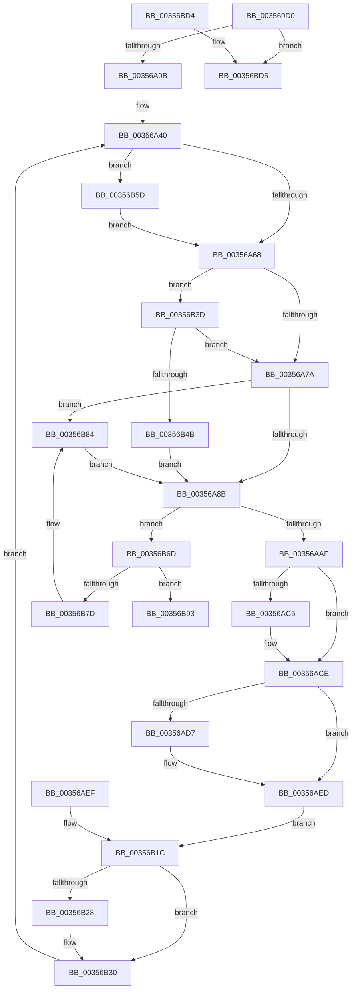

# CcCachemapUninitWorkerThread

- RVA: `0x003569D0`–`0x00356BF4` (길이 `548` bytes)
- VA: `0x00000001403569D0`
- 실행 섹션: `.text`
- PDB 이름 있음: `예`; PDB Function 태그: `아니요`
- unwind 정보 RVA: `0x00079524`
- 디코드: `123`개 명령, `548/548` bytes 표시
- 미해석 바이트: `0` (있으면 어셈블리에 `.byte`로 보존)

> 이 문서는 커널 이미지의 기계어와 PDB 기호를 분석해 생성했습니다. 4번과 5번은 함수 원형과 자료형을 바이너리 사용 방식에서 추정한 C 해석이며 원본 소스 복구 결과는 아닙니다.

## 1. Dependencies

- 직접 호출 지점: **12**; 고유 호출 대상: **11**
- 직접 호출자로 확인된 함수: **0**
- RIP 상대 이미지 참조: **4**

### Outgoing calls
- `0x00356A96` → [CcFindNextWorkQueueEntry](CcFindNextWorkQueueEntry_function_00356BFC.md) (function, `0x00356BFC`)
- `0x00356AB4` → [KeReleaseInStackQueuedSpinLock](../34/KeReleaseInStackQueuedSpinLock_function_00342CE0.md) (function, `0x00342CE0`)
- `0x00356AC8` → [CcPerfLogWorkItemDequeue](CcPerfLogWorkItemDequeue_function_0035877C.md) (function, `0x0035877C`)
- `0x00356AE8` → [CcWriteBehind](CcWriteBehind_function_00356EAC.md) (function, `0x00356EAC`)
- `0x00356B2B` → [CcPerfLogWorkItemComplete](CcPerfLogWorkItemComplete_function_00358710.md) (function, `0x00358710`)
- `0x00356B33` → [CcFreeWorkQueueEntry](CcFreeWorkQueueEntry_function_0035723C.md) (function, `0x0035723C`)
- `0x00356B53` → [KiAcquireQueuedSpinLockInstrumented](../27/KiAcquireQueuedSpinLockInstrumented_function_00275850.md) (function, `0x00275850`)
- `0x00356B63` → [KiRaiseIrqlProcessIrqlFlags](../4F/KiRaiseIrqlProcessIrqlFlags_function_004F56FC.md) (function, `0x004F56FC`)
- `0x00356B89` → [KxWaitForLockOwnerShip](../25/KxWaitForLockOwnerShip_function_00257EB0.md) (function, `0x00257EB0`)
- `0x00356BAD` → [KeReleaseInStackQueuedSpinLock](../34/KeReleaseInStackQueuedSpinLock_function_00342CE0.md) (function, `0x00342CE0`)
- `0x00356BBD` → [CcDereferencePartitionAndPrivateVolumeCacheMap](../38/CcDereferencePartitionAndPrivateVolumeCacheMap_function_0038B94C.md) (function, `0x0038B94C`)
- `0x00356BEE` → [KeBugCheckEx](../4F/KeBugCheckEx_function_004FD660.md) (function, `0x004FD660`)

### Direct callers
- 이 함수 시작 RVA로 연결되는 직접 call은 확인되지 않았습니다. 간접 호출은 완전히 역산할 수 없습니다.

### Static image references
- `0x00356A5B` → RVA `0x00FC6D20` (`ALMOSTRO`; read)
- `0x00356A6D` → RVA `0x00FC6B06` (`ALMOSTRO`; read)
- `0x00356AB9` → RVA `0x00FC6B10` (`ALMOSTRO`; read)
- `0x00356B3D` → RVA `0x00F0DE58` (`.data`; read)

## 2. Other-region calls and transfers

- 다른 실행 섹션으로 향하는 call: **0**
- 별도 외부 분기/꼬리 이동을 확인하지 못했습니다.

## 3. Assembly (complete function range)

```asm
003569D0  48 8B C4                        mov rax, rsp
003569D3  56                              push rsi
003569D4  57                              push rdi
003569D5  41 54                           push r12
003569D7  41 55                           push r13
003569D9  41 56                           push r14
003569DB  41 57                           push r15
003569DD  48 81 EC 88 00 00 00            sub rsp, 0x88
003569E4  48 8B F9                        mov rdi, rcx
003569E7  83 60 9C 00                     and dword ptr [rax - 0x64], 0
003569EB  48 89 8C 24 D8 00 00 00         mov qword ptr [rsp + 0xd8], rcx
003569F3  48 83 60 B8 00                  and qword ptr [rax - 0x48], 0
003569F8  83 60 98 00                     and dword ptr [rax - 0x68], 0
003569FC  48 83 60 A0 00                  and qword ptr [rax - 0x60], 0
00356A01  83 79 20 05                     cmp dword ptr [rcx + 0x20], 5
00356A05  0F 85 CA 01 00 00               jne 0x140356bd5
00356A0B  4C 8B 69 38                     mov r13, qword ptr [rcx + 0x38]
00356A0F  4C 89 6C 24 30                  mov qword ptr [rsp + 0x30], r13
00356A14  4C 8B 71 48                     mov r14, qword ptr [rcx + 0x48]
00356A18  4C 89 74 24 38                  mov qword ptr [rsp + 0x38], r14
00356A1D  48 8B 41 40                     mov rax, qword ptr [rcx + 0x40]
00356A21  48 89 84 24 C0 00 00 00         mov qword ptr [rsp + 0xc0], rax
00356A29  48 89 44 24 40                  mov qword ptr [rsp + 0x40], rax
00356A2E  49 8D 46 78                     lea rax, [r14 + 0x78]
00356A32  48 89 84 24 C8 00 00 00         mov qword ptr [rsp + 0xc8], rax
00356A3A  41 BC 02 00 00 00               mov r12d, 2
00356A40  49 8D B5 40 03 00 00            lea rsi, [r13 + 0x340]
00356A47  48 89 74 24 68                  mov qword ptr [rsp + 0x68], rsi
00356A4C  48 83 64 24 60 00               and qword ptr [rsp + 0x60], 0
00356A52  90                              nop
00356A53  45 0F 20 C7                     mov r15, cr8
00356A57  45 0F 22 C4                     mov cr8, r12
00356A5B  83 3D BE 02 C7 00 00            cmp dword ptr [rip + 0xc702be], 0
00356A62  0F 85 F5 00 00 00               jne 0x140356b5d
00356A68  44 88 7C 24 70                  mov byte ptr [rsp + 0x70], r15b
00356A6D  F6 05 92 00 C7 00 21            test byte ptr [rip + 0xc70092], 0x21
00356A74  0F 85 C3 00 00 00               jne 0x140356b3d
00356A7A  48 8D 54 24 60                  lea rdx, [rsp + 0x60]
00356A7F  48 87 16                        xchg qword ptr [rsi], rdx
00356A82  48 85 D2                        test rdx, rdx
00356A85  0F 85 F9 00 00 00               jne 0x140356b84
00356A8B  4C 8B 84 24 C8 00 00 00         mov r8, qword ptr [rsp + 0xc8]
00356A93  49 8B D6                        mov rdx, r14
00356A96  E8 61 01 00 00                  call 0x140356bfc
00356A9B  48 8B F0                        mov rsi, rax
00356A9E  48 89 84 24 D0 00 00 00         mov qword ptr [rsp + 0xd0], rax
00356AA6  48 85 C0                        test rax, rax
00356AA9  0F 84 BE 00 00 00               je 0x140356b6d
00356AAF  48 8D 4C 24 60                  lea rcx, [rsp + 0x60]
00356AB4  E8 27 C2 FE FF                  call 0x140342ce0
00356AB9  F7 05 4D 00 C7 00 00 00 02 00   test dword ptr [rip + 0xc7004d], 0x20000
00356AC3  74 09                           je 0x140356ace
00356AC5  48 8B CE                        mov rcx, rsi
00356AC8  E8 AF 1C 00 00                  call 0x14035877c
00356ACD  90                              nop
00356ACE  44 39 A6 80 00 00 00            cmp dword ptr [rsi + 0x80], r12d
00356AD5  75 16                           jne 0x140356aed
00356AD7  48 89 74 24 58                  mov qword ptr [rsp + 0x58], rsi
00356ADC  4D 8B C6                        mov r8, r14
00356ADF  48 8D 54 24 50                  lea rdx, [rsp + 0x50]
00356AE4  48 8B 4E 10                     mov rcx, qword ptr [rsi + 0x10]
00356AE8  E8 BF 03 00 00                  call 0x140356eac
00356AED  EB 2D                           jmp 0x140356b1c
00356AEF  41 BC 02 00 00 00               mov r12d, 2
00356AF5  48 8B B4 24 D0 00 00 00         mov rsi, qword ptr [rsp + 0xd0]
00356AFD  48 8B BC 24 D8 00 00 00         mov rdi, qword ptr [rsp + 0xd8]
00356B05  4C 8B 6C 24 30                  mov r13, qword ptr [rsp + 0x30]
00356B0A  4C 8B 74 24 38                  mov r14, qword ptr [rsp + 0x38]
00356B0F  48 8B 44 24 40                  mov rax, qword ptr [rsp + 0x40]
00356B14  48 89 84 24 C0 00 00 00         mov qword ptr [rsp + 0xc0], rax
00356B1C  F7 05 EA FF C6 00 00 00 02 00   test dword ptr [rip + 0xc6ffea], 0x20000
00356B26  74 08                           je 0x140356b30
00356B28  48 8B CE                        mov rcx, rsi
00356B2B  E8 E0 1B 00 00                  call 0x140358710
00356B30  48 8B CE                        mov rcx, rsi
00356B33  E8 04 07 00 00                  call 0x14035723c
00356B38  E9 03 FF FF FF                  jmp 0x140356a40
00356B3D  8B 05 15 73 BB 00               mov eax, dword ptr [rip + 0xbb7315]
00356B43  85 C0                           test eax, eax
00356B45  0F 85 2F FF FF FF               jne 0x140356a7a
00356B4B  48 8B D6                        mov rdx, rsi
00356B4E  48 8D 4C 24 60                  lea rcx, [rsp + 0x60]
00356B53  E8 F8 EC F1 FF                  call 0x140275850
00356B58  E9 2E FF FF FF                  jmp 0x140356a8b
00356B5D  41 8A D4                        mov dl, r12b
00356B60  41 8A CF                        mov cl, r15b
00356B63  E8 94 EB 19 00                  call 0x1404f56fc
00356B68  E9 FB FE FF FF                  jmp 0x140356a68
00356B6D  49 8D 86 A0 00 00 00            lea rax, [r14 + 0xa0]
00356B74  48 8B 48 08                     mov rcx, qword ptr [rax + 8]
00356B78  48 39 01                        cmp qword ptr [rcx], rax
00356B7B  74 16                           je 0x140356b93
00356B7D  B9 03 00 00 00                  mov ecx, 3
00356B82  CD 29                           int 0x29
00356B84  48 8D 4C 24 60                  lea rcx, [rsp + 0x60]
00356B89  E8 22 13 F0 FF                  call 0x140257eb0
00356B8E  E9 F8 FE FF FF                  jmp 0x140356a8b
00356B93  48 89 07                        mov qword ptr [rdi], rax
00356B96  48 89 4F 08                     mov qword ptr [rdi + 8], rcx
00356B9A  48 89 39                        mov qword ptr [rcx], rdi
00356B9D  48 89 78 08                     mov qword ptr [rax + 8], rdi
00356BA1  41 FF 8E B0 00 00 00            dec dword ptr [r14 + 0xb0]
00356BA8  48 8D 4C 24 60                  lea rcx, [rsp + 0x60]
00356BAD  E8 2E C1 FE FF                  call 0x140342ce0
00356BB2  48 8B 94 24 C0 00 00 00         mov rdx, qword ptr [rsp + 0xc0]
00356BBA  49 8B CD                        mov rcx, r13
00356BBD  E8 8A 4D 03 00                  call 0x14038b94c
00356BC2  48 81 C4 88 00 00 00            add rsp, 0x88
00356BC9  41 5F                           pop r15
00356BCB  41 5E                           pop r14
00356BCD  41 5D                           pop r13
00356BCF  41 5C                           pop r12
00356BD1  5F                              pop rdi
00356BD2  5E                              pop rsi
00356BD3  C3                              ret
00356BD4  CC                              int3
00356BD5  48 83 64 24 20 00               and qword ptr [rsp + 0x20], 0
00356BDB  45 33 C9                        xor r9d, r9d
00356BDE  BA FD 1C 00 00                  mov edx, 0x1cfd
00356BE3  41 8D 49 34                     lea ecx, [r9 + 0x34]
00356BE7  49 C7 C0 20 04 00 C0            mov r8, 0xffffffffc0000420
00356BEE  E8 6D 6A 1A 00                  call 0x1404fd660
00356BF3  90                              nop
```

## 4. C-style interpretation (structured pseudocode)

```c
__int64 __fastcall CcCachemapUninitWorkerThread(__int64 a1, __int64 a2, __int64 a3, int a4)
{
    __int64 result;
    __int64 v_rsp;
    unsigned __int8 v_stack_m48;
    unsigned __int64 v_stack_m50;
    unsigned __int64 v_stack_m58;
    unsigned __int64 v_stack_m60;
    unsigned __int64 v_stack_m68;
    unsigned __int64 v_stack_m78;
    unsigned __int64 v_stack_m80;
    unsigned __int64 v_stack_m88;
    unsigned __int64 v_stack_p10;
    unsigned __int64 v_stack_p18;
    unsigned __int64 v_stack_p20;
    unsigned __int64 v_stack_p8;

    v_rsp = (v_rsp) - (136);
    v_stack_p20 = a1;
    if ((*(unsigned int *)(a1 + 32)) != 5) goto loc_00356BD5;
    v_stack_m88 = *(unsigned __int64 *)(a1 + 56);
    v_stack_m80 = *(unsigned __int64 *)(a1 + 72);
    v_stack_p8 = *(unsigned __int64 *)(a1 + 64);
    v_stack_m78 = *(unsigned __int64 *)(a1 + 64);
    v_stack_p10 = *(unsigned __int64 *)(a1 + 72) + 120;
loc_00356A40:
    v_stack_m50 = *(unsigned __int64 *)(a1 + 56) + 832;
    if ((*(unsigned int *)(v_rip + 13042366)) != 0) goto loc_00356B5D;
loc_00356A68:
    v_stack_m48 = (unsigned __int8)(v_cr8);
    if (((*(unsigned __int8 *)(v_rip + 13041810)) & (33)) != 0) goto loc_00356B3D;
loc_00356A7A:
    if (v_stack_m58 != 0) goto loc_00356B84;
loc_00356A8B:
    result = CcFindNextWorkQueueEntry(a1, *(unsigned __int64 *)(a1 + 72), v_stack_p10, a4);
    v_stack_p18 = result;
    if (result == 0) goto loc_00356B6D;
    result = KeReleaseInStackQueuedSpinLock(v_stack_m58, *(unsigned __int64 *)(a1 + 72), v_stack_p10, a4);
    if (((*(unsigned int *)(v_rip + 13041741)) & (0x20000ULL)) != 0) {
        a1 = result;
        result = CcPerfLogWorkItemDequeue(a1, *(unsigned __int64 *)(a1 + 72), v_stack_p10, a4);
    }
    if ((*(unsigned int *)(result + 128)) == 2) {
        v_stack_m60 = result;
        a3 = *(unsigned __int64 *)(a1 + 72);
        a2 = v_stack_m68;
        a1 = *(unsigned __int64 *)(result + 16);
        result = CcWriteBehind(a1, a2, a3, a4);
    }
    goto loc_00356B1C;
loc_00356B1C:
    if (((*(unsigned int *)(v_rip + 13041642)) & (0x20000ULL)) != 0) {
        a1 = result;
        result = CcPerfLogWorkItemComplete(a1, a2, a3, a4);
    }
    result = CcFreeWorkQueueEntry(result, a2, a3, a4);
    goto loc_00356A40;
loc_00356B3D:
    if ((unsigned int)((unsigned int)(*(unsigned int *)(v_rip + 12284693))) != 0) goto loc_00356A7A;
    result = KiAcquireQueuedSpinLockInstrumented(v_stack_m58, result, a3, a4);
    goto loc_00356A8B;
loc_00356B5D:
    result = KiRaiseIrqlProcessIrqlFlags((unsigned __int8)(v_cr8), 2, a3, a4);
    goto loc_00356A68;
loc_00356B6D:
    if ((*(unsigned __int64 *)(*(unsigned __int64 *)(*(unsigned __int64 *)(a1 + 72) + 160 + 8))) == (*(unsigned __int64 *)(a1 + 72) + 160)) goto loc_00356B93;
loc_00356B84:
    result = KxWaitForLockOwnerShip(v_stack_m58, 2, a3, a4);
    goto loc_00356A8B;
loc_00356B93:
    *(unsigned __int64 *)(a1) = result;
    *(unsigned __int64 *)(a1 + 8) = v_stack_m58;
    *(unsigned __int64 *)(v_stack_m58) = a1;
    *(unsigned __int64 *)(result + 8) = a1;
    result = KeReleaseInStackQueuedSpinLock(v_stack_m58, 2, a3, a4);
    result = CcDereferencePartitionAndPrivateVolumeCacheMap(*(unsigned __int64 *)(a1 + 56), v_stack_p8, a3, a4);
    v_rsp = (v_rsp) + (136);
    return result;
loc_00356BD5:
    a4 = 0;
    result = KeBugCheckEx(a4 + 52, (unsigned int)(0x1CFDULL), 0xFFFFFFFFC0000420ULL, a4);
    return result;
}
```

## 5. (Beta) C Style

```c
int64_t CcCachemapUninitWorkerThread(void *Arg1, int64_t Arg2, int64_t Arg3, int32_t Arg4)
{
    uint8_t *arg1 = (uint8_t *)Arg1;

    int64_t result;
    int64_t local_rsp;
    uint8_t v_stack_m48;
    uint64_t v_stack_m50;
    uint64_t v_stack_m58;
    uint64_t v_stack_m60;
    uint64_t v_stack_m68;
    uint64_t v_stack_m78;
    uint64_t v_stack_m80;
    uint64_t v_stack_m88;
    uint64_t v_stack_p10;
    uint64_t v_stack_p18;
    uint64_t v_stack_p20;
    uint64_t v_stack_p8;

    local_rsp = (local_rsp) - (136);
    v_stack_p20 = Arg1;
    if ((*(uint32_t *)(arg1 + 0x20)) != 5) goto loc_00356BD5;
    v_stack_m88 = *(uint64_t *)(arg1 + 0x38);
    v_stack_m80 = *(uint64_t *)(arg1 + 0x48);
    v_stack_p8 = *(uint64_t *)(arg1 + 0x40);
    v_stack_m78 = *(uint64_t *)(arg1 + 0x40);
    v_stack_p10 = *(uint64_t *)(arg1 + 0x48) + 120;
loc_00356A40:
    v_stack_m50 = *(uint64_t *)(arg1 + 0x38) + 832;
    if ((*(uint32_t *)(v_rip + 0xC702BE)) != 0) goto loc_00356B5D;
loc_00356A68:
    v_stack_m48 = (uint8_t)(v_cr8);
    if (((*(uint8_t *)(v_rip + 0xC70092)) & (33)) != 0) goto loc_00356B3D;
loc_00356A7A:
    if (v_stack_m58 != 0) goto loc_00356B84;
loc_00356A8B:
    result = CcFindNextWorkQueueEntry(Arg1, *(uint64_t *)(arg1 + 0x48), v_stack_p10, Arg4);
    v_stack_p18 = result;
    if (result == 0) goto loc_00356B6D;
    result = KeReleaseInStackQueuedSpinLock(v_stack_m58, *(uint64_t *)(arg1 + 0x48), v_stack_p10, Arg4);
    if (((*(uint32_t *)(v_rip + 0xC7004D)) & (0x20000ULL)) != 0) {
        Arg1 = result;
        result = CcPerfLogWorkItemDequeue(Arg1, *(uint64_t *)(arg1 + 0x48), v_stack_p10, Arg4);
    }
    if ((*(uint32_t *)(result + 0x80)) == 2) {
        v_stack_m60 = result;
        Arg3 = *(uint64_t *)(arg1 + 0x48);
        Arg2 = v_stack_m68;
        Arg1 = *(uint64_t *)(result + 0x10);
        result = CcWriteBehind(Arg1, Arg2, Arg3, Arg4);
    }
    goto loc_00356B1C;
loc_00356B1C:
    if (((*(uint32_t *)(v_rip + 0xC6FFEA)) & (0x20000ULL)) != 0) {
        Arg1 = result;
        result = CcPerfLogWorkItemComplete(Arg1, Arg2, Arg3, Arg4);
    }
    result = CcFreeWorkQueueEntry(result, Arg2, Arg3, Arg4);
    goto loc_00356A40;
loc_00356B3D:
    if ((uint32_t)((uint32_t)(*(uint32_t *)(v_rip + 0xBB7315))) != 0) goto loc_00356A7A;
    result = KiAcquireQueuedSpinLockInstrumented(v_stack_m58, result, Arg3, Arg4);
    goto loc_00356A8B;
loc_00356B5D:
    result = KiRaiseIrqlProcessIrqlFlags((uint8_t)(v_cr8), 2, Arg3, Arg4);
    goto loc_00356A68;
loc_00356B6D:
    if ((*(uint64_t *)(*(uint64_t *)(*(uint64_t *)(arg1 + 0x48) + 0xA0 + 0x8))) == (*(uint64_t *)(arg1 + 0x48) + 160)) goto loc_00356B93;
loc_00356B84:
    result = KxWaitForLockOwnerShip(v_stack_m58, 2, Arg3, Arg4);
    goto loc_00356A8B;
loc_00356B93:
    *(uint64_t *)(arg1) = result;
    *(uint64_t *)(arg1 + 0x8) = v_stack_m58;
    *(void **)(v_stack_m58) = Arg1;
    *(void **)(result + 0x8) = Arg1;
    result = KeReleaseInStackQueuedSpinLock(v_stack_m58, 2, Arg3, Arg4);
    result = CcDereferencePartitionAndPrivateVolumeCacheMap(*(uint64_t *)(arg1 + 0x38), v_stack_p8, Arg3, Arg4);
    local_rsp = (local_rsp) + (136);
    return result;
loc_00356BD5:
    Arg4 = 0;
    result = KeBugCheckEx(Arg4 + 52, (uint32_t)(0x1CFDULL), 0xFFFFFFFFC0000420ULL, Arg4);
    return result;
}
```

### 관측된 메모리 오프셋

구조체 형식이 확인되지 않은 접근은 인자 기준의 오프셋으로만 기록했습니다.

| 기준 인자 | 오프셋 표현 | 폭 (bit) | 접근 |
|---|---:|---:|---|
| `Arg1` | `+ 0x0` | `64` | `W` |
| `Arg1` | `+ 0x8` | `64` | `W` |
| `Arg1` | `+ 0x20` | `32` | `R` |
| `Arg1` | `+ 0x38` | `64` | `R` |
| `Arg1` | `+ 0x40` | `64` | `R` |
| `Arg1` | `+ 0x48` | `64` | `R` |

## 6. Execution-region graph

[열기: 2D/3D 그래프와 함수 탐색 컨트롤 패널](../../../control-panel.html?section=text&rva=0x003569D0&view=graph)

- 2D 그래프는 위에서 아래로 흐르고, 3D 그래프는 빈 공간을 드래그해 회전합니다. Shift+드래그는 이동, 휠은 확대·축소, 함수 노드 선택은 대상 보고서 이동입니다.

### Static fallback


