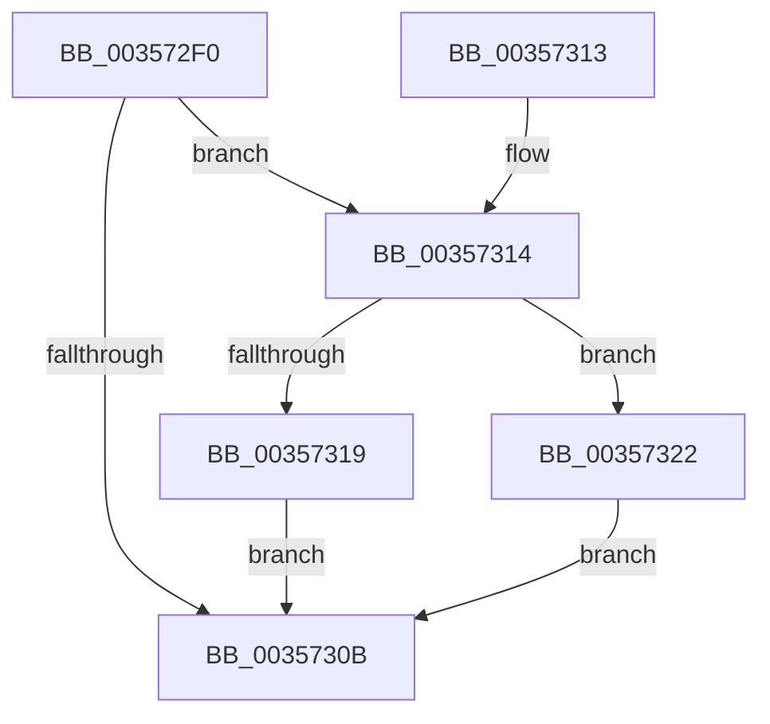

# CcDereferencePartition

- RVA: `0x003572F0`–`0x00357337` (길이 `71` bytes)
- VA: `0x00000001403572F0`
- 실행 섹션: `.text`
- PDB 이름 있음: `예`; PDB Function 태그: `아니요`
- unwind 정보 RVA: `0x000795DC`
- 디코드: `23`개 명령, `71/71` bytes 표시
- 미해석 바이트: `0` (있으면 어셈블리에 `.byte`로 보존)

> 이 문서는 커널 이미지의 기계어와 PDB 기호를 분석해 생성했습니다. 4번과 5번은 함수 원형과 자료형을 바이너리 사용 방식에서 추정한 C 해석이며 원본 소스 복구 결과는 아닙니다.

## 1. Dependencies

- 직접 호출 지점: **1**; 고유 호출 대상: **1**
- 직접 호출자로 확인된 함수: **11**
- RIP 상대 이미지 참조: **0**

### Outgoing calls
- `0x00357330` → [KeSetEvent](../33/KeSetEvent_function_0033F310.md) (function, `0x0033F310`)

### Direct callers
- [CcGetDirtyPages](../2F/CcGetDirtyPages_function_002F0720.md) at `0x002F07C7`
- [CcForEachPartition](../2F/CcForEachPartition_function_002F0828.md) at `0x002F08DE`
- [CcFreeWorkQueueEntry](CcFreeWorkQueueEntry_function_0035723C.md) at `0x0035727B`
- [CcZeroData](../38/CcZeroData_function_00387F00.md) at `0x003881CF`
- [CcCoalescingCallBack](../3C/CcCoalescingCallBack_function_003CA040.md) at `0x003CA0E0`
- [CcReapPrivateVolumeCachemapWorkerThread](../3C/CcReapPrivateVolumeCachemapWorkerThread_function_003CF320.md) at `0x003CF3CB`
- [CcIsThereDirtyData](../48/CcIsThereDirtyData_function_0048BE30.md) at `0x0048BED1`
- [CcQueueLazyWriteScanThread](../57/CcQueueLazyWriteScanThread_function_0057BBD0.md) at `0x0057BE30`
- [CcDeferWrite](../57/CcDeferWrite_function_0057C860.md) at `0x0057C9A2`
- [CcDeletePartition](../57/CcDeletePartition_function_0057DE9C.md) at `0x0057DEE0`
- [CcZeroData$fin$0](../6D/CcZeroData_fin_0_function_006D2335.md) at `0x006D2348`

### Static image references
- 디코드된 RIP-relative 메모리 참조가 없습니다.

## 2. Other-region calls and transfers

- 다른 실행 섹션으로 향하는 call: **0**
- 별도 외부 분기/꼬리 이동을 확인하지 못했습니다.

## 3. Assembly (complete function range)

```asm
003572F0  40 53                           push rbx
003572F2  48 83 EC 20                     sub rsp, 0x20
003572F6  48 83 C8 FF                     or rax, 0xffffffffffffffff
003572FA  F0 48 0F C1 81 10 05 00 00      lock xadd qword ptr [rcx + 0x510], rax
00357303  33 DB                           xor ebx, ebx
00357305  48 83 E8 01                     sub rax, 1
00357309  7E 09                           jle 0x140357314
0035730B  8A C3                           mov al, bl
0035730D  48 83 C4 20                     add rsp, 0x20
00357311  5B                              pop rbx
00357312  C3                              ret
00357313  CC                              int3
00357314  48 85 C0                        test rax, rax
00357317  74 09                           je 0x140357322
00357319  B9 0E 00 00 00                  mov ecx, 0xe
0035731E  CD 29                           int 0x29
00357320  EB E9                           jmp 0x14035730b
00357322  48 81 C1 30 05 00 00            add rcx, 0x530
00357329  45 33 C0                        xor r8d, r8d
0035732C  33 D2                           xor edx, edx
0035732E  B3 01                           mov bl, 1
00357330  E8 DB 7F FE FF                  call 0x14033f310
00357335  EB D4                           jmp 0x14035730b
```

## 4. C-style interpretation (structured pseudocode)

```c
__int64 __fastcall CcDereferencePartition(__int64 a1, int a2, int a3)
{
    __int64 result;
    __int64 v_rbx;
    __int64 v_rsp;

    v_rsp = (v_rsp) - (32);
    result = (result) | (-1);
    v_rbx = 0;
    result = (result) - (1);
    if (condition_is_less_or_equal) goto loc_00357314;
loc_0035730B:
    v_rsp = (v_rsp) + (32);
    return 0;
loc_00357314:
    if (0 == 0) goto loc_00357322;
    goto loc_0035730B;
loc_00357322:
    a1 = (14) + (0x530ULL);
    a3 = 0;
    a2 = 0;
    result = KeSetEvent(a1, a2, a3, a4);
    goto loc_0035730B;
}
```

## 5. (Beta) C Style

```c
int64_t CcDereferencePartition(void *Arg1, int32_t Arg2, int32_t Arg3)
{
    uint8_t *arg1 = (uint8_t *)Arg1;

    int64_t result;
    int64_t local_rbx;
    int64_t local_rsp;

    local_rsp = (local_rsp) - (32);
    result = (result) | (-1);
    local_rbx = 0;
    result = (result) - (1);
    if (condition_is_less_or_equal) goto loc_00357314;
loc_0035730B:
    local_rsp = (local_rsp) + (32);
    return 0;
loc_00357314:
    if (0 == 0) goto loc_00357322;
    goto loc_0035730B;
loc_00357322:
    Arg1 = (14) + (0x530ULL);
    Arg3 = 0;
    Arg2 = 0;
    result = KeSetEvent(Arg1, Arg2, Arg3, a4);
    goto loc_0035730B;
}
```

### 관측된 메모리 오프셋

구조체 형식이 확인되지 않은 접근은 인자 기준의 오프셋으로만 기록했습니다.

| 기준 인자 | 오프셋 표현 | 폭 (bit) | 접근 |
|---|---:|---:|---|
| `Arg1` | `+ 0x510` | `64` | `R/W` |

## 6. Execution-region graph

[열기: 2D/3D 그래프와 함수 탐색 컨트롤 패널](../../../control-panel.html?section=text&rva=0x003572F0&view=graph)

- 2D 그래프는 위에서 아래로 흐르고, 3D 그래프는 빈 공간을 드래그해 회전합니다. Shift+드래그는 이동, 휠은 확대·축소, 함수 노드 선택은 대상 보고서 이동입니다.

### Static fallback


