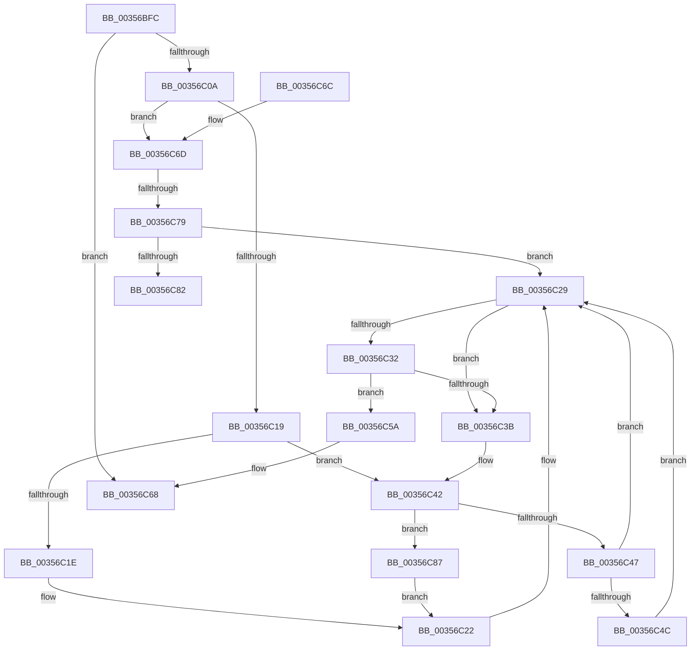

# CcFindNextWorkQueueEntry

- RVA: `0x00356BFC`–`0x00356C8D` (길이 `145` bytes)
- VA: `0x0000000140356BFC`
- 실행 섹션: `.text`
- PDB 이름 있음: `예`; PDB Function 태그: `예`
- unwind 정보 RVA: `0x000DB714`
- 디코드: `44`개 명령, `145/145` bytes 표시
- 미해석 바이트: `0` (있으면 어셈블리에 `.byte`로 보존)

> 이 문서는 커널 이미지의 기계어와 PDB 기호를 분석해 생성했습니다. 4번과 5번은 함수 원형과 자료형을 바이너리 사용 방식에서 추정한 C 해석이며 원본 소스 복구 결과는 아닙니다.

## 1. Dependencies

- 직접 호출 지점: **0**; 고유 호출 대상: **0**
- 직접 호출자로 확인된 함수: **6**
- RIP 상대 이미지 참조: **0**

### Outgoing calls
- 직접 디코드된 call 명령이 없습니다.

### Direct callers
- [CcAsyncLazywriteWorker](CcAsyncLazywriteWorker_function_00354C28.md) at `0x00354D29`
- [CcCachemapUninitWorkerThread](CcCachemapUninitWorkerThread_function_003569D0.md) at `0x00356A96`
- [CcCompleteAsyncReadWorker](../45/CcCompleteAsyncReadWorker_function_0045D9C0.md) at `0x0045DA8E`
- [CcAsyncReadWorker](../45/CcAsyncReadWorker_function_0045DB10.md) at `0x0045DD7F`
- [CcWorkerThread](../48/CcWorkerThread_function_0048F0F0.md) at `0x0048F21B`
- [CcCompleteAsyncLazywriteWorker](../57/CcCompleteAsyncLazywriteWorker_function_0057F6AC.md) at `0x0057F710`

### Static image references
- 디코드된 RIP-relative 메모리 참조가 없습니다.

## 2. Other-region calls and transfers

- 다른 실행 섹션으로 향하는 call: **0**
- call이 아닌 외부 분기/꼬리 이동: **2**
  - `0x00356C73` → `0x006E2974` (`tail-transfer`)
  - `0x00356C82` → `0x006E2974` (`tail-transfer`)

## 3. Assembly (complete function range)

```asm
00356BFC  4D 8B 08                        mov r9, qword ptr [r8]
00356BFF  45 33 DB                        xor r11d, r11d
00356C02  45 8B D3                        mov r10d, r11d
00356C05  4D 3B C8                        cmp r9, r8
00356C08  74 5E                           je 0x140356c68
00356C0A  41 8B 81 80 00 00 00            mov eax, dword ptr [r9 + 0x80]
00356C11  4D 8B D1                        mov r10, r9
00356C14  83 F8 04                        cmp eax, 4
00356C17  74 54                           je 0x140356c6d
00356C19  83 F8 02                        cmp eax, 2
00356C1C  75 24                           jne 0x140356c42
00356C1E  49 8B 41 10                     mov rax, qword ptr [r9 + 0x10]
00356C22  4C 89 98 F8 01 00 00            mov qword ptr [rax + 0x1f8], r11
00356C29  49 8B 01                        mov rax, qword ptr [r9]
00356C2C  4C 39 48 08                     cmp qword ptr [rax + 8], r9
00356C30  75 09                           jne 0x140356c3b
00356C32  49 8B 49 08                     mov rcx, qword ptr [r9 + 8]
00356C36  4C 39 09                        cmp qword ptr [rcx], r9
00356C39  74 1F                           je 0x140356c5a
00356C3B  B9 03 00 00 00                  mov ecx, 3
00356C40  CD 29                           int 0x29
00356C42  83 F8 07                        cmp eax, 7
00356C45  74 40                           je 0x140356c87
00356C47  83 F8 01                        cmp eax, 1
00356C4A  75 DD                           jne 0x140356c29
00356C4C  49 8B 41 10                     mov rax, qword ptr [r9 + 0x10]
00356C50  48 8B 48 30                     mov rcx, qword ptr [rax + 0x30]
00356C54  4C 89 59 70                     mov qword ptr [rcx + 0x70], r11
00356C58  EB CF                           jmp 0x140356c29
00356C5A  48 89 01                        mov qword ptr [rcx], rax
00356C5D  48 89 48 08                     mov qword ptr [rax + 8], rcx
00356C61  4D 89 59 08                     mov qword ptr [r9 + 8], r11
00356C65  4D 89 19                        mov qword ptr [r9], r11
00356C68  49 8B C2                        mov rax, r10
00356C6B  C3                              ret
00356C6C  CC                              int3
00356C6D  8B 42 30                        mov eax, dword ptr [rdx + 0x30]
00356C70  83 F8 01                        cmp eax, 1
00356C73  0F 87 FB BC 38 00               ja 0x1406e2974
00356C79  83 BA 98 00 00 00 01            cmp dword ptr [rdx + 0x98], 1
00356C80  76 A7                           jbe 0x140356c29
00356C82  E9 ED BC 38 00                  jmp 0x1406e2974
00356C87  49 8B 41 18                     mov rax, qword ptr [r9 + 0x18]
00356C8B  EB 95                           jmp 0x140356c22
```

## 4. C-style interpretation (structured pseudocode)

```c
__int64 __fastcall CcFindNextWorkQueueEntry(__int64 a1, __int64 a2, __int64 a3)
{
    __int64 v_r11;

    v_r11 = 0;
    if ((*(unsigned __int64 *)(a3)) == a3) goto loc_00356C68;
    if (((unsigned int)((unsigned int)(*(unsigned int *)(*(unsigned __int64 *)(a3) + 128)))) == 4) goto loc_00356C6D;
    if (((unsigned int)((unsigned int)(*(unsigned int *)(*(unsigned __int64 *)(a3) + 128)))) != 2) goto loc_00356C42;
loc_00356C22:
    *(unsigned __int64 *)(*(unsigned __int64 *)(*(unsigned __int64 *)(a3) + 16) + 504) = 0;
loc_00356C29:
    if ((*(unsigned __int64 *)(*(unsigned __int64 *)(*(unsigned __int64 *)(a3)) + 8)) != (*(unsigned __int64 *)(a3))) goto loc_00356C3B;
    if ((*(unsigned __int64 *)(*(unsigned __int64 *)(*(unsigned __int64 *)(a3) + 8))) == (*(unsigned __int64 *)(a3))) goto loc_00356C5A;
loc_00356C3B:
loc_00356C42:
    if (((unsigned int)(*(unsigned __int64 *)(*(unsigned __int64 *)(a3)))) == 7) goto loc_00356C87;
    if (((unsigned int)(*(unsigned __int64 *)(*(unsigned __int64 *)(a3)))) != 1) goto loc_00356C29;
    *(unsigned __int64 *)(*(unsigned __int64 *)(*(unsigned __int64 *)(*(unsigned __int64 *)(a3) + 16) + 48) + 112) = 0;
    goto loc_00356C29;
loc_00356C5A:
    *(unsigned __int64 *)(*(unsigned __int64 *)(*(unsigned __int64 *)(*(unsigned __int64 *)(a3) + 16) + 48)) = *(unsigned __int64 *)(*(unsigned __int64 *)(a3) + 16);
    *(unsigned __int64 *)(*(unsigned __int64 *)(*(unsigned __int64 *)(a3) + 16) + 8) = *(unsigned __int64 *)(*(unsigned __int64 *)(*(unsigned __int64 *)(a3) + 16) + 48);
    *(unsigned __int64 *)(*(unsigned __int64 *)(a3) + 8) = 0;
    *(unsigned __int64 *)(*(unsigned __int64 *)(a3)) = 0;
loc_00356C68:
    return *(unsigned __int64 *)(a3);
loc_00356C6D:
    if ((*(unsigned int *)(a2 + 152)) <= 1) goto loc_00356C29;
loc_00356C87:
    goto loc_00356C22;
}
```

## 5. (Beta) C Style

```c
int64_t CcFindNextWorkQueueEntry(int64_t Arg1, void *Arg2, void *Arg3)
{
    uint8_t *arg2 = (uint8_t *)Arg2;
    uint8_t *arg3 = (uint8_t *)Arg3;

    int64_t local_r11;

    local_r11 = 0;
    if ((*(uint64_t *)(arg3)) == Arg3) goto loc_00356C68;
    if (((uint32_t)((uint32_t)(*(uint32_t *)(*(uint64_t *)(arg3) + 0x80)))) == 4) goto loc_00356C6D;
    if (((uint32_t)((uint32_t)(*(uint32_t *)(*(uint64_t *)(arg3) + 0x80)))) != 2) goto loc_00356C42;
loc_00356C22:
    *(uint64_t *)(*(uint64_t *)(*(uint64_t *)(arg3) + 0x10) + 0x1F8) = 0;
loc_00356C29:
    if ((*(uint64_t *)(*(uint64_t *)(*(uint64_t *)(arg3)) + 0x8)) != (*(uint64_t *)(arg3))) goto loc_00356C3B;
    if ((*(uint64_t *)(*(uint64_t *)(*(uint64_t *)(arg3) + 0x8))) == (*(uint64_t *)(arg3))) goto loc_00356C5A;
loc_00356C3B:
loc_00356C42:
    if (((uint32_t)(*(uint64_t *)(*(uint64_t *)(arg3)))) == 7) goto loc_00356C87;
    if (((uint32_t)(*(uint64_t *)(*(uint64_t *)(arg3)))) != 1) goto loc_00356C29;
    *(uint64_t *)(*(uint64_t *)(*(uint64_t *)(*(uint64_t *)(arg3) + 0x10) + 0x30) + 0x70) = 0;
    goto loc_00356C29;
loc_00356C5A:
    *(uint64_t *)(*(uint64_t *)(*(uint64_t *)(*(uint64_t *)(arg3) + 0x10) + 0x30)) = *(uint64_t *)(*(uint64_t *)(arg3) + 0x10);
    *(uint64_t *)(*(uint64_t *)(*(uint64_t *)(arg3) + 0x10) + 0x8) = *(uint64_t *)(*(uint64_t *)(*(uint64_t *)(arg3) + 0x10) + 0x30);
    *(uint64_t *)(*(uint64_t *)(arg3) + 0x8) = 0;
    *(uint64_t *)(*(uint64_t *)(arg3)) = 0;
loc_00356C68:
    return *(uint64_t *)(arg3);
loc_00356C6D:
    if ((*(uint32_t *)(arg2 + 0x98)) <= 1) goto loc_00356C29;
loc_00356C87:
    goto loc_00356C22;
}
```

### 관측된 메모리 오프셋

구조체 형식이 확인되지 않은 접근은 인자 기준의 오프셋으로만 기록했습니다.

| 기준 인자 | 오프셋 표현 | 폭 (bit) | 접근 |
|---|---:|---:|---|
| `Arg2` | `+ 0x30` | `32` | `R` |
| `Arg2` | `+ 0x98` | `32` | `R` |
| `Arg3` | `+ 0x0` | `64` | `R` |

## 6. Execution-region graph

[열기: 2D/3D 그래프와 함수 탐색 컨트롤 패널](../../../control-panel.html?section=text&rva=0x00356BFC&view=graph)

- 2D 그래프는 위에서 아래로 흐르고, 3D 그래프는 빈 공간을 드래그해 회전합니다. Shift+드래그는 이동, 휠은 확대·축소, 함수 노드 선택은 대상 보고서 이동입니다.

### Static fallback


