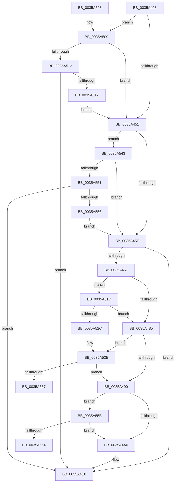

# CcFlushCacheAcquireRange

- RVA: `0x0035A408`–`0x0035A569` (길이 `353` bytes)
- VA: `0x000000014035A408`
- 실행 섹션: `.text`
- PDB 이름 있음: `예`; PDB Function 태그: `예`
- unwind 정보 RVA: `0x0007993C`
- 디코드: `94`개 명령, `353/353` bytes 표시
- 미해석 바이트: `0` (있으면 어셈블리에 `.byte`로 보존)

> 이 문서는 커널 이미지의 기계어와 PDB 기호를 분석해 생성했습니다. 4번과 5번은 함수 원형과 자료형을 바이너리 사용 방식에서 추정한 C 해석이며 원본 소스 복구 결과는 아닙니다.

## 1. Dependencies

- 직접 호출 지점: **2**; 고유 호출 대상: **2**
- 직접 호출자로 확인된 함수: **4**
- RIP 상대 이미지 참조: **0**

### Outgoing calls
- `0x0035A4D6` → [CcAcquireByteRangeForWrite](../40/CcAcquireByteRangeForWrite_function_00401E74.md) (function, `0x00401E74`)
- `0x0035A51F` → [CcAmILowPriorityWriter](../45/CcAmILowPriorityWriter_function_0045F784.md) (function, `0x0045F784`)

### Direct callers
- [CcWriteBehindAsync](CcWriteBehindAsync_function_003549E8.md) at `0x00354AB3`
- [CcWriteBehindInternal](CcWriteBehindInternal_function_00357540.md) at `0x00357622`
- [CcFlushCachePriv](CcFlushCachePriv_function_0035B040.md) at `0x0035B166`
- [CcWriteBehindAsyncFlushOneRange](../57/CcWriteBehindAsyncFlushOneRange_function_0057FAEC.md) at `0x0057FB2E`

### Static image references
- 디코드된 RIP-relative 메모리 참조가 없습니다.

## 2. Other-region calls and transfers

- 다른 실행 섹션으로 향하는 call: **0**
- call이 아닌 외부 분기/꼬리 이동: **2**
  - `0x0035A53E` → [sub_006E2C20](../6E/Unknown_function_006E2C20.md) (`tail-transfer`)
  - `0x0035A564` → [sub_006E2C20](../6E/Unknown_function_006E2C20.md) (`tail-transfer`)

## 3. Assembly (complete function range)

```asm
0035A408  48 89 5C 24 10                  mov qword ptr [rsp + 0x10], rbx
0035A40D  48 89 6C 24 18                  mov qword ptr [rsp + 0x18], rbp
0035A412  48 89 74 24 20                  mov qword ptr [rsp + 0x20], rsi
0035A417  57                              push rdi
0035A418  41 54                           push r12
0035A41A  41 55                           push r13
0035A41C  41 56                           push r14
0035A41E  41 57                           push r15
0035A420  48 83 EC 50                     sub rsp, 0x50
0035A424  48 8B 71 10                     mov rsi, qword ptr [rcx + 0x10]
0035A428  33 DB                           xor ebx, ebx
0035A42A  40 8A A9 84 00 00 00            mov bpl, byte ptr [rcx + 0x84]
0035A431  48 8B F9                        mov rdi, rcx
0035A434  44 8A B1 85 00 00 00            mov r14b, byte ptr [rcx + 0x85]
0035A43B  4C 8B 61 60                     mov r12, qword ptr [rcx + 0x60]
0035A43F  8B 86 C8 00 00 00               mov eax, dword ptr [rsi + 0xc8]
0035A445  4C 8B 69 58                     mov r13, qword ptr [rcx + 0x58]
0035A449  85 C0                           test eax, eax
0035A44B  0F 84 B8 00 00 00               je 0x14035a509
0035A451  48 8B 46 08                     mov rax, qword ptr [rsi + 8]
0035A455  48 85 C0                        test rax, rax
0035A458  0F 84 E5 00 00 00               je 0x14035a543
0035A45E  39 59 40                        cmp dword ptr [rcx + 0x40], ebx
0035A461  0F 85 81 00 00 00               jne 0x14035a4e8
0035A467  8A 81 C9 00 00 00               mov al, byte ptr [rcx + 0xc9]
0035A46D  48 81 C1 D0 00 00 00            add rcx, 0xd0
0035A474  F6 D8                           neg al
0035A476  4D 1B FF                        sbb r15, r15
0035A479  4C 23 F9                        and r15, rcx
0035A47C  40 84 ED                        test bpl, bpl
0035A47F  0F 85 97 00 00 00               jne 0x14035a51c
0035A485  8A D3                           mov dl, bl
0035A487  40 84 ED                        test bpl, bpl
0035A48A  0F 85 9E 00 00 00               jne 0x14035a52e
0035A490  48 8D 4F 30                     lea rcx, [rdi + 0x30]
0035A494  44 8B 01                        mov r8d, dword ptr [rcx]
0035A497  40 84 ED                        test bpl, bpl
0035A49A  0F 85 BB 00 00 00               jne 0x14035a55b
0035A4A0  49 F7 DC                        neg r12
0035A4A3  48 8D 47 20                     lea rax, [rdi + 0x20]
0035A4A7  4D 1B DB                        sbb r11, r11
0035A4AA  4C 23 D8                        and r11, rax
0035A4AD  4C 89 7C 24 40                  mov qword ptr [rsp + 0x40], r15
0035A4B2  48 8D 47 78                     lea rax, [rdi + 0x78]
0035A4B6  88 54 24 38                     mov byte ptr [rsp + 0x38], dl
0035A4BA  4C 8D 57 28                     lea r10, [rdi + 0x28]
0035A4BE  48 89 44 24 30                  mov qword ptr [rsp + 0x30], rax
0035A4C3  4D 8B CD                        mov r9, r13
0035A4C6  48 89 4C 24 28                  mov qword ptr [rsp + 0x28], rcx
0035A4CB  49 8B D3                        mov rdx, r11
0035A4CE  48 8B CE                        mov rcx, rsi
0035A4D1  4C 89 54 24 20                  mov qword ptr [rsp + 0x20], r10
0035A4D6  E8 99 79 0A 00                  call 0x140401e74
0035A4DB  84 C0                           test al, al
0035A4DD  0F B6 DB                        movzx ebx, bl
0035A4E0  B8 01 00 00 00                  mov eax, 1
0035A4E5  0F 45 D8                        cmovne ebx, eax
0035A4E8  4C 8D 5C 24 50                  lea r11, [rsp + 0x50]
0035A4ED  8A C3                           mov al, bl
0035A4EF  49 8B 5B 38                     mov rbx, qword ptr [r11 + 0x38]
0035A4F3  49 8B 6B 40                     mov rbp, qword ptr [r11 + 0x40]
0035A4F7  49 8B 73 48                     mov rsi, qword ptr [r11 + 0x48]
0035A4FB  49 8B E3                        mov rsp, r11
0035A4FE  41 5F                           pop r15
0035A500  41 5E                           pop r14
0035A502  41 5D                           pop r13
0035A504  41 5C                           pop r12
0035A506  5F                              pop rdi
0035A507  C3                              ret
0035A508  CC                              int3
0035A509  40 84 ED                        test bpl, bpl
0035A50C  0F 84 3F FF FF FF               je 0x14035a451
0035A512  45 84 F6                        test r14b, r14b
0035A515  74 D1                           je 0x14035a4e8
0035A517  E9 35 FF FF FF                  jmp 0x14035a451
0035A51C  48 8B CE                        mov rcx, rsi
0035A51F  E8 60 52 10 00                  call 0x14045f784
0035A524  84 C0                           test al, al
0035A526  0F 84 59 FF FF FF               je 0x14035a485
0035A52C  B2 01                           mov dl, 1
0035A52E  45 84 F6                        test r14b, r14b
0035A531  0F 85 59 FF FF FF               jne 0x14035a490
0035A537  44 8B C3                        mov r8d, ebx
0035A53A  48 8D 4F 30                     lea rcx, [rdi + 0x30]
0035A53E  E9 DD 86 38 00                  jmp 0x1406e2c20
0035A543  8B 86 98 00 00 00               mov eax, dword ptr [rsi + 0x98]
0035A549  A8 04                           test al, 4
0035A54B  0F 85 0D FF FF FF               jne 0x14035a45e
0035A551  39 5E 70                        cmp dword ptr [rsi + 0x70], ebx
0035A554  74 92                           je 0x14035a4e8
0035A556  E9 03 FF FF FF                  jmp 0x14035a45e
0035A55B  45 84 F6                        test r14b, r14b
0035A55E  0F 85 3C FF FF FF               jne 0x14035a4a0
0035A564  E9 B7 86 38 00                  jmp 0x1406e2c20
```

## 4. C-style interpretation (structured pseudocode)

```c
__int64 __fastcall CcFlushCacheAcquireRange(__int64 a1)
{
    __int64 result;
    __int64 v_r11;
    __int64 v_r12;
    __int64 v_r15;
    __int64 v_rbx;
    __int64 v_rsp;
    unsigned __int64 v_stack_m28;
    unsigned __int64 v_stack_m38;
    unsigned __int8 v_stack_m40;
    unsigned __int64 v_stack_m48;
    unsigned __int64 v_stack_m50;
    unsigned __int64 v_stack_m58;
    unsigned __int64 v_stack_p10;
    unsigned __int64 v_stack_p18;
    unsigned __int64 v_stack_p20;

    v_stack_p10 = v_rbx;
    v_stack_p18 = v_rbp;
    v_stack_p20 = v_rsi;
    v_rsp = (v_rsp) - (80);
    v_rbx = 0;
    if ((unsigned int)((unsigned int)(*(unsigned int *)(*(unsigned __int64 *)(a1 + 16) + 200))) == 0) goto loc_0035A509;
loc_0035A451:
    if (*(unsigned __int64 *)(*(unsigned __int64 *)(a1 + 16) + 8) == 0) goto loc_0035A543;
loc_0035A45E:
    if ((*(unsigned int *)(a1 + 64)) != 0) goto loc_0035A4E8;
    a1 = (a1) + (208);
    result = (unsigned __int8)(-(*(unsigned __int8 *)(a1 + 201)));
    v_r15 = (v_r15) & (a1);
    if ((unsigned __int8)(*(unsigned __int8 *)(a1 + 132)) != 0) goto loc_0035A51C;
loc_0035A485:
    if ((unsigned __int8)(*(unsigned __int8 *)(a1 + 132)) != 0) goto loc_0035A52E;
loc_0035A490:
    if ((unsigned __int8)(*(unsigned __int8 *)(a1 + 132)) != 0) goto loc_0035A55B;
loc_0035A4A0:
    v_r12 = -(*(unsigned __int64 *)(a1 + 96));
    v_r11 = (v_r11) & (a1 + 32);
    v_stack_m38 = v_r15;
    v_stack_m40 = 0;
    v_stack_m48 = a1 + 120;
    v_stack_m50 = a1 + 48;
    v_stack_m58 = a1 + 40;
    result = CcAcquireByteRangeForWrite(*(unsigned __int64 *)(a1 + 16), v_r11, (unsigned int)(*(unsigned int *)(a1 + 48)), *(unsigned __int64 *)(a1 + 88));
    v_rbx = 0;
    if ((unsigned __int8)(result) != 0) { v_rbx = 1; }
loc_0035A4E8:
    return (unsigned __int8)(v_rbx);
loc_0035A509:
    if ((unsigned __int8)(*(unsigned __int64 *)(v_stack_m28 + 64)) == 0) goto loc_0035A451;
    if ((unsigned __int8)(*(unsigned __int8 *)(a1 + 133)) == 0) goto loc_0035A4E8;
    goto loc_0035A451;
loc_0035A51C:
    result = CcAmILowPriorityWriter(*(unsigned __int64 *)(v_stack_m28 + 72), v_r11, (unsigned int)(*(unsigned int *)(a1 + 48)), *(unsigned __int64 *)(a1 + 88));
    if ((unsigned __int8)(result) == 0) goto loc_0035A485;
loc_0035A52E:
    if ((unsigned __int8)(*(unsigned __int8 *)(a1 + 133)) != 0) goto loc_0035A490;
loc_0035A543:
    if ((((unsigned __int8)((unsigned int)(*(unsigned int *)(*(unsigned __int64 *)(v_stack_m28 + 72) + 152)))) & (4)) != 0) goto loc_0035A45E;
    if ((*(unsigned int *)(*(unsigned __int64 *)(v_stack_m28 + 72) + 112)) == ((unsigned int)(*(unsigned __int64 *)(v_stack_m28 + 56)))) goto loc_0035A4E8;
    goto loc_0035A45E;
loc_0035A55B:
    if ((unsigned __int8)(*(unsigned __int8 *)(a1 + 133)) != 0) goto loc_0035A4A0;
}
```

## 5. (Beta) C Style

```c
int64_t CcFlushCacheAcquireRange(void *Arg1)
{
    uint8_t *arg1 = (uint8_t *)Arg1;

    int64_t result;
    int64_t local_r11;
    int64_t local_r12;
    int64_t local_r15;
    int64_t local_rbx;
    int64_t local_rsp;
    uint64_t v_stack_m28;
    uint64_t v_stack_m38;
    uint8_t v_stack_m40;
    uint64_t v_stack_m48;
    uint64_t v_stack_m50;
    uint64_t v_stack_m58;
    uint64_t v_stack_p10;
    uint64_t v_stack_p18;
    uint64_t v_stack_p20;

    v_stack_p10 = local_rbx;
    v_stack_p18 = local_rbp;
    v_stack_p20 = local_rsi;
    local_rsp = (local_rsp) - (80);
    local_rbx = 0;
    if ((uint32_t)((uint32_t)(*(uint32_t *)(*(uint64_t *)(arg1 + 0x10) + 0xC8))) == 0) goto loc_0035A509;
loc_0035A451:
    if (*(uint64_t *)(*(uint64_t *)(arg1 + 0x10) + 0x8) == 0) goto loc_0035A543;
loc_0035A45E:
    if ((*(uint32_t *)(arg1 + 0x40)) != 0) goto loc_0035A4E8;
    Arg1 = (Arg1) + (208);
    result = (uint8_t)(-(*(uint8_t *)(arg1 + 0xC9)));
    local_r15 = (local_r15) & (Arg1);
    if ((uint8_t)(*(uint8_t *)(arg1 + 0x84)) != 0) goto loc_0035A51C;
loc_0035A485:
    if ((uint8_t)(*(uint8_t *)(arg1 + 0x84)) != 0) goto loc_0035A52E;
loc_0035A490:
    if ((uint8_t)(*(uint8_t *)(arg1 + 0x84)) != 0) goto loc_0035A55B;
loc_0035A4A0:
    local_r12 = -(*(uint64_t *)(arg1 + 0x60));
    local_r11 = (local_r11) & (Arg1 + 32);
    v_stack_m38 = local_r15;
    v_stack_m40 = 0;
    v_stack_m48 = Arg1 + 120;
    v_stack_m50 = Arg1 + 48;
    v_stack_m58 = Arg1 + 40;
    result = CcAcquireByteRangeForWrite(*(uint64_t *)(arg1 + 0x10), local_r11, (uint32_t)(*(uint32_t *)(arg1 + 0x30)), *(uint64_t *)(arg1 + 0x58));
    local_rbx = 0;
    if ((uint8_t)(result) != 0) { local_rbx = 1; }
loc_0035A4E8:
    return (uint8_t)(local_rbx);
loc_0035A509:
    if ((uint8_t)(*(uint64_t *)(v_stack_m28 + 0x40)) == 0) goto loc_0035A451;
    if ((uint8_t)(*(uint8_t *)(arg1 + 0x85)) == 0) goto loc_0035A4E8;
    goto loc_0035A451;
loc_0035A51C:
    result = CcAmILowPriorityWriter(*(uint64_t *)(v_stack_m28 + 0x48), local_r11, (uint32_t)(*(uint32_t *)(arg1 + 0x30)), *(uint64_t *)(arg1 + 0x58));
    if ((uint8_t)(result) == 0) goto loc_0035A485;
loc_0035A52E:
    if ((uint8_t)(*(uint8_t *)(arg1 + 0x85)) != 0) goto loc_0035A490;
loc_0035A543:
    if ((((uint8_t)((uint32_t)(*(uint32_t *)(*(uint64_t *)(v_stack_m28 + 0x48) + 0x98)))) & (4)) != 0) goto loc_0035A45E;
    if ((*(uint32_t *)(*(uint64_t *)(v_stack_m28 + 0x48) + 0x70)) == ((uint32_t)(*(uint64_t *)(v_stack_m28 + 0x38)))) goto loc_0035A4E8;
    goto loc_0035A45E;
loc_0035A55B:
    if ((uint8_t)(*(uint8_t *)(arg1 + 0x85)) != 0) goto loc_0035A4A0;
}
```

### 관측된 메모리 오프셋

구조체 형식이 확인되지 않은 접근은 인자 기준의 오프셋으로만 기록했습니다.

| 기준 인자 | 오프셋 표현 | 폭 (bit) | 접근 |
|---|---:|---:|---|
| `Arg1` | `+ 0x0` | `32` | `R` |
| `Arg1` | `+ 0x10` | `64` | `R` |
| `Arg1` | `+ 0x20` | `64` | `R` |
| `Arg1` | `+ 0x28` | `64` | `R` |
| `Arg1` | `+ 0x30` | `64` | `R` |
| `Arg1` | `+ 0x40` | `32` | `R` |
| `Arg1` | `+ 0x58` | `64` | `R` |
| `Arg1` | `+ 0x60` | `64` | `R` |
| `Arg1` | `+ 0x78` | `64` | `R` |
| `Arg1` | `+ 0x84` | `8` | `R` |
| `Arg1` | `+ 0x85` | `8` | `R` |
| `Arg1` | `+ 0xC9` | `8` | `R` |

## 6. Execution-region graph

[열기: 2D/3D 그래프와 함수 탐색 컨트롤 패널](../../../control-panel.html?section=text&rva=0x0035A408&view=graph)

- 2D 그래프는 위에서 아래로 흐르고, 3D 그래프는 빈 공간을 드래그해 회전합니다. Shift+드래그는 이동, 휠은 확대·축소, 함수 노드 선택은 대상 보고서 이동입니다.

### Static fallback


