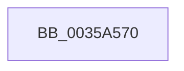

# CcFlushCachePostProcess

- RVA: `0x0035A570`–`0x0035A582` (길이 `18` bytes)
- VA: `0x000000014035A570`
- 실행 섹션: `.text`
- PDB 이름 있음: `예`; PDB Function 태그: `예`
- unwind 정보 RVA: `0x0007996C`
- 디코드: `6`개 명령, `18/18` bytes 표시
- 미해석 바이트: `0` (있으면 어셈블리에 `.byte`로 보존)

> 이 문서는 커널 이미지의 기계어와 PDB 기호를 분석해 생성했습니다. 4번과 5번은 함수 원형과 자료형을 바이너리 사용 방식에서 추정한 C 해석이며 원본 소스 복구 결과는 아닙니다.

## 1. Dependencies

- 직접 호출 지점: **0**; 고유 호출 대상: **0**
- 직접 호출자로 확인된 함수: **4**
- RIP 상대 이미지 참조: **0**

### Outgoing calls
- 직접 디코드된 call 명령이 없습니다.

### Direct callers
- [CcWriteBehindAsync](CcWriteBehindAsync_function_003549E8.md) at `0x00354B0D`
- [CcWriteBehindInternal](CcWriteBehindInternal_function_00357540.md) at `0x00357652`
- [CcFlushCachePriv](CcFlushCachePriv_function_0035B040.md) at `0x0035B194`
- [CcQueueAsyncLazywriteCompletion](../57/CcQueueAsyncLazywriteCompletion_function_0057FA60.md) at `0x0057FA94`

### Static image references
- 디코드된 RIP-relative 메모리 참조가 없습니다.

## 2. Other-region calls and transfers

- 다른 실행 섹션으로 향하는 call: **0**
- 별도 외부 분기/꼬리 이동을 확인하지 못했습니다.

## 3. Assembly (complete function range)

```asm
0035A570  4C 8B DC                        mov r11, rsp
0035A573  41 57                           push r15
0035A575  48 83 EC 60                     sub rsp, 0x60
0035A579  4C 8B 79 70                     mov r15, qword ptr [rcx + 0x70]
0035A57D  33 C0                           xor eax, eax
0035A57F  0F 57 C0                        xorps xmm0, xmm0
```

## 4. C-style interpretation (structured pseudocode)

```c
__int64 __fastcall CcFlushCachePostProcess(__int64 a1)
{
    __int64 result;
    __int64 v_rsp;

    v_rsp = (v_rsp) - (96);
    result = 0;
    return result;
}
```

## 5. (Beta) C Style

```c
int64_t CcFlushCachePostProcess(void *Arg1)
{
    uint8_t *arg1 = (uint8_t *)Arg1;

    int64_t result;
    int64_t local_rsp;

    local_rsp = (local_rsp) - (96);
    result = 0;
    return result;
}
```

### 관측된 메모리 오프셋

구조체 형식이 확인되지 않은 접근은 인자 기준의 오프셋으로만 기록했습니다.

| 기준 인자 | 오프셋 표현 | 폭 (bit) | 접근 |
|---|---:|---:|---|
| `Arg1` | `+ 0x70` | `64` | `R` |

## 6. Execution-region graph

[열기: 2D/3D 그래프와 함수 탐색 컨트롤 패널](../../../control-panel.html?section=text&rva=0x0035A570&view=graph)

- 2D 그래프는 위에서 아래로 흐르고, 3D 그래프는 빈 공간을 드래그해 회전합니다. Shift+드래그는 이동, 휠은 확대·축소, 함수 노드 선택은 대상 보고서 이동입니다.

### Static fallback


