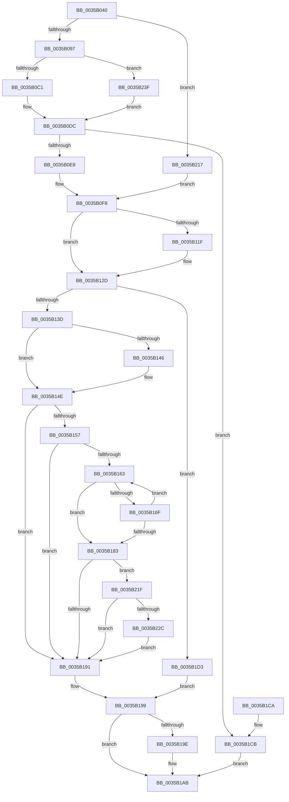

# CcFlushCachePriv

- RVA: `0x0035B040`–`0x0035B291` (길이 `593` bytes)
- VA: `0x000000014035B040`
- 실행 섹션: `.text`
- PDB 이름 있음: `예`; PDB Function 태그: `아니요`
- unwind 정보 RVA: `0x00079AAC`
- 디코드: `133`개 명령, `593/593` bytes 표시
- 미해석 바이트: `0` (있으면 어셈블리에 `.byte`로 보존)

> 이 문서는 커널 이미지의 기계어와 PDB 기호를 분석해 생성했습니다. 4번과 5번은 함수 원형과 자료형을 바이너리 사용 방식에서 추정한 C 해석이며 원본 소스 복구 결과는 아닙니다.

## 1. Dependencies

- 직접 호출 지점: **11**; 고유 호출 대상: **11**
- 직접 호출자로 확인된 함수: **8**
- RIP 상대 이미지 참조: **2**

### Outgoing calls
- `0x0035B0D7` → [ExpAllocatePoolWithTagFromNode](ExpAllocatePoolWithTagFromNode_function_0035B970.md) (function, `0x0035B970`)
- `0x0035B0F3` → [memset](../6C/memset_function_006C6C40.md) (function, `0x006C6C40`)
- `0x0035B130` → [CcFlushCachePreProcess](CcFlushCachePreProcess_function_0035A9B0.md) (function, `0x0035A9B0`)
- `0x0035B166` → [CcFlushCacheAcquireRange](CcFlushCacheAcquireRange_function_0035A408.md) (function, `0x0035A408`)
- `0x0035B172` → [CcFlushCacheOneRange](../23/CcFlushCacheOneRange_function_00236A30.md) (function, `0x00236A30`)
- `0x0035B17A` → [CcFlushCachePostProcessOneRange](CcFlushCachePostProcessOneRange_function_00359710.md) (function, `0x00359710`)
- `0x0035B194` → [CcFlushCachePostProcess](CcFlushCachePostProcess_function_0035A570.md) (function, `0x0035A570`)
- `0x0035B1A6` → [ExFreePoolWithTag](../../poolcode/B8/ExFreePoolWithTag_function_00B82870.md) (function, `0x00B82870`)
- `0x0035B210` → [DbgPrintEx](DbgPrintEx_function_00359290.md) (function, `0x00359290`)
- `0x0035B22E` → [KeQueryPerformanceCounter](../37/KeQueryPerformanceCounter_function_0037E7E0.md) (function, `0x0037E7E0`)
- `0x0035B287` → [VfHandlePoolAlloc](../../pagevrfy/BB/VfHandlePoolAlloc_function_00BB8A90.md) (function, `0x00BB8A90`)

### Direct callers
- [CcZeroData](../38/CcZeroData_function_00387F00.md) at `0x003880D2`
- [CcMapAndCopyInToCache](../3C/CcMapAndCopyInToCache_function_003CA7F0.md) at `0x003CAEF8`
- [CcMapAndCopyInToCache](../3C/CcMapAndCopyInToCache_function_003CA7F0.md) at `0x003CB1DB`
- [CcZeroEndOfLastPage](../45/CcZeroEndOfLastPage_function_00453584.md) at `0x0045364B`
- [CcFlushCacheToLsn](../48/CcFlushCacheToLsn_function_00485230.md) at `0x0048524C`
- [CcFlushCache](../48/CcFlushCache_function_00486020.md) at `0x00486037`
- [CcCoherencyFlushAndPurgeCache](../48/CcCoherencyFlushAndPurgeCache_function_0048E3D0.md) at `0x0048E447`
- [MiFlushDataSection](../48/MiFlushDataSection_function_0048ED88.md) at `0x0048EE31`
- [CcMapAndCopyInToCache$fin$1](../6D/CcMapAndCopyInToCache_fin_1_function_006D2AF9.md) at `0x006D2C3D`

### Static image references
- `0x0035B0AC` → RVA `0x00FC6BD0` (`ALMOSTRO`; read)
- `0x0035B1DC` → RVA `0x006C7E00` (` ?? ::FNODOBFM::`string'`; read)

## 2. Other-region calls and transfers

- 다른 실행 섹션으로 향하는 call: **2**
  - `0x0035B1A6` → [ExFreePoolWithTag](../../poolcode/B8/ExFreePoolWithTag_function_00B82870.md) (`.text` → `POOLCODE`)
  - `0x0035B287` → [VfHandlePoolAlloc](../../pagevrfy/BB/VfHandlePoolAlloc_function_00BB8A90.md) (`.text` → `PAGEVRFY`)
- 별도 외부 분기/꼬리 이동을 확인하지 못했습니다.

## 3. Assembly (complete function range)

```asm
0035B040  48 89 5C 24 08                  mov qword ptr [rsp + 8], rbx
0035B045  48 89 6C 24 10                  mov qword ptr [rsp + 0x10], rbp
0035B04A  48 89 74 24 18                  mov qword ptr [rsp + 0x18], rsi
0035B04F  48 89 7C 24 20                  mov qword ptr [rsp + 0x20], rdi
0035B054  41 54                           push r12
0035B056  41 56                           push r14
0035B058  41 57                           push r15
0035B05A  48 83 EC 60                     sub rsp, 0x60
0035B05E  48 8B 84 24 A8 00 00 00         mov rax, qword ptr [rsp + 0xa8]
0035B066  48 8D 7C 24 50                  lea rdi, [rsp + 0x50]
0035B06B  48 8B B4 24 B0 00 00 00         mov rsi, qword ptr [rsp + 0xb0]
0035B073  48 85 C0                        test rax, rax
0035B076  0F 57 C0                        xorps xmm0, xmm0
0035B079  4D 8B F1                        mov r14, r9
0035B07C  48 0F 45 F8                     cmovne rdi, rax
0035B080  41 8B E8                        mov ebp, r8d
0035B083  4C 8B FA                        mov r15, rdx
0035B086  4C 8B E1                        mov r12, rcx
0035B089  0F 11 44 24 50                  movups xmmword ptr [rsp + 0x50], xmm0
0035B08E  48 85 F6                        test rsi, rsi
0035B091  0F 85 80 01 00 00               jne 0x14035b217
0035B097  65 48 8B 04 25 20 00 00 00      mov rax, qword ptr gs:[0x20]
0035B0A0  0F 11 44 24 40                  movups xmmword ptr [rsp + 0x40], xmm0
0035B0A5  48 8B 88 C0 00 00 00            mov rcx, qword ptr [rax + 0xc0]
0035B0AC  8B 05 1E BB C6 00               mov eax, dword ptr [rip + 0xc6bb1e]
0035B0B2  0F B7 91 8A 00 00 00            movzx edx, word ptr [rcx + 0x8a]
0035B0B9  A8 08                           test al, 8
0035B0BB  0F 85 7E 01 00 00               jne 0x14035b23f
0035B0C1  44 8B CA                        mov r9d, edx
0035B0C4  8D 4E 42                        lea ecx, [rsi + 0x42]
0035B0C7  41 0F BA E9 1F                  bts r9d, 0x1f
0035B0CC  BA 10 01 00 00                  mov edx, 0x110
0035B0D1  41 B8 43 63 57 42               mov r8d, 0x42576343
0035B0D7  E8 94 08 00 00                  call 0x14035b970
0035B0DC  48 8B D8                        mov rbx, rax
0035B0DF  48 85 C0                        test rax, rax
0035B0E2  0F 84 E3 00 00 00               je 0x14035b1cb
0035B0E8  33 D2                           xor edx, edx
0035B0EA  41 B8 10 01 00 00               mov r8d, 0x110
0035B0F0  48 8B C8                        mov rcx, rax
0035B0F3  E8 48 BB 36 00                  call 0x1406c6c40
0035B0F8  0F B6 84 24 A0 00 00 00         movzx eax, byte ptr [rsp + 0xa0]
0035B100  88 43 6C                        mov byte ptr [rbx + 0x6c], al
0035B103  4C 89 7B 60                     mov qword ptr [rbx + 0x60], r15
0035B107  89 6B 68                        mov dword ptr [rbx + 0x68], ebp
0035B10A  48 89 7B 70                     mov qword ptr [rbx + 0x70], rdi
0035B10E  4C 89 63 18                     mov qword ptr [rbx + 0x18], r12
0035B112  48 C7 43 48 00 00 00 00         mov qword ptr [rbx + 0x48], 0
0035B11A  4D 85 F6                        test r14, r14
0035B11D  74 0E                           je 0x14035b12d
0035B11F  49 8B 06                        mov rax, qword ptr [r14]
0035B122  48 8D 4B 50                     lea rcx, [rbx + 0x50]
0035B126  48 89 01                        mov qword ptr [rcx], rax
0035B129  48 89 4B 58                     mov qword ptr [rbx + 0x58], rcx
0035B12D  48 8B CB                        mov rcx, rbx
0035B130  E8 7B F8 FF FF                  call 0x14035a9b0
0035B135  84 C0                           test al, al
0035B137  0F 84 96 00 00 00               je 0x14035b1d3
0035B13D  80 BB 84 00 00 00 00            cmp byte ptr [rbx + 0x84], 0
0035B144  74 08                           je 0x14035b14e
0035B146  48 C7 43 60 00 00 00 00         mov qword ptr [rbx + 0x60], 0
0035B14E  48 8B 43 10                     mov rax, qword ptr [rbx + 0x10]
0035B152  48 85 C0                        test rax, rax
0035B155  74 3A                           je 0x14035b191
0035B157  F7 80 98 00 00 00 00 00 00 04   test dword ptr [rax + 0x98], 0x4000000
0035B161  75 2E                           jne 0x14035b191
0035B163  48 8B CB                        mov rcx, rbx
0035B166  E8 9D F2 FF FF                  call 0x14035a408
0035B16B  84 C0                           test al, al
0035B16D  74 14                           je 0x14035b183
0035B16F  48 8B CB                        mov rcx, rbx
0035B172  E8 B9 B8 ED FF                  call 0x140236a30
0035B177  48 8B CB                        mov rcx, rbx
0035B17A  E8 91 E5 FF FF                  call 0x140359710
0035B17F  84 C0                           test al, al
0035B181  75 E0                           jne 0x14035b163
0035B183  48 83 BB E8 00 00 00 00         cmp qword ptr [rbx + 0xe8], 0
0035B18B  0F 85 8E 00 00 00               jne 0x14035b21f
0035B191  48 8B CB                        mov rcx, rbx
0035B194  E8 D7 F3 FF FF                  call 0x14035a570
0035B199  48 3B DE                        cmp rbx, rsi
0035B19C  74 0D                           je 0x14035b1ab
0035B19E  BA 43 63 57 42                  mov edx, 0x42576343
0035B1A3  48 8B CB                        mov rcx, rbx
0035B1A6  E8 C5 76 82 00                  call 0x140b82870
0035B1AB  4C 8D 5C 24 60                  lea r11, [rsp + 0x60]
0035B1B0  49 8B 5B 20                     mov rbx, qword ptr [r11 + 0x20]
0035B1B4  49 8B 6B 28                     mov rbp, qword ptr [r11 + 0x28]
0035B1B8  49 8B 73 30                     mov rsi, qword ptr [r11 + 0x30]
0035B1BC  49 8B 7B 38                     mov rdi, qword ptr [r11 + 0x38]
0035B1C0  49 8B E3                        mov rsp, r11
0035B1C3  41 5F                           pop r15
0035B1C5  41 5E                           pop r14
0035B1C7  41 5C                           pop r12
0035B1C9  C3                              ret
0035B1CA  CC                              int3
0035B1CB  C7 07 9A 00 00 C0               mov dword ptr [rdi], 0xc000009a
0035B1D1  EB D8                           jmp 0x14035b1ab
0035B1D3  65 48 8B 0C 25 88 01 00 00      mov rcx, qword ptr gs:[0x188]
0035B1DC  4C 8D 05 1D CC 36 00            lea r8, [rip + 0x36cc1d]
0035B1E3  65 4C 8B 0C 25 88 01 00 00      mov r9, qword ptr gs:[0x188]
0035B1EC  BA 03 00 00 00                  mov edx, 3
0035B1F1  8B 07                           mov eax, dword ptr [rdi]
0035B1F3  89 44 24 30                     mov dword ptr [rsp + 0x30], eax
0035B1F7  8B 81 10 05 00 00               mov eax, dword ptr [rcx + 0x510]
0035B1FD  45 8B 89 08 05 00 00            mov r9d, dword ptr [r9 + 0x508]
0035B204  8D 4A 7C                        lea ecx, [rdx + 0x7c]
0035B207  4C 89 64 24 28                  mov qword ptr [rsp + 0x28], r12
0035B20C  89 44 24 20                     mov dword ptr [rsp + 0x20], eax
0035B210  E8 7B E0 FF FF                  call 0x140359290
0035B215  EB 82                           jmp 0x14035b199
0035B217  48 8B DE                        mov rbx, rsi
0035B21A  E9 D9 FE FF FF                  jmp 0x14035b0f8
0035B21F  83 BB F8 00 00 00 00            cmp dword ptr [rbx + 0xf8], 0
0035B226  0F 84 65 FF FF FF               je 0x14035b191
0035B22C  33 C9                           xor ecx, ecx
0035B22E  E8 AD 35 02 00                  call 0x14037e7e0
0035B233  48 89 83 F0 00 00 00            mov qword ptr [rbx + 0xf0], rax
0035B23A  E9 52 FF FF FF                  jmp 0x14035b191
0035B23F  48 8B 44 24 78                  mov rax, qword ptr [rsp + 0x78]
0035B244  BA 42 00 00 00                  mov edx, 0x42
0035B249  48 89 44 24 38                  mov qword ptr [rsp + 0x38], rax
0035B24E  33 C9                           xor ecx, ecx
0035B250  48 8D 44 24 40                  lea rax, [rsp + 0x40]
0035B255  C7 44 24 30 01 00 00 00         mov dword ptr [rsp + 0x30], 1
0035B25D  48 89 44 24 28                  mov qword ptr [rsp + 0x28], rax
0035B262  41 B9 43 63 57 42               mov r9d, 0x42576343
0035B268  41 B8 10 01 00 00               mov r8d, 0x110
0035B26E  C7 44 24 20 00 00 00 00         mov dword ptr [rsp + 0x20], 0
0035B276  48 C7 44 24 40 01 00 00 00      mov qword ptr [rsp + 0x40], 1
0035B27F  C7 44 24 48 20 00 00 00         mov dword ptr [rsp + 0x48], 0x20
0035B287  E8 04 D8 85 00                  call 0x140bb8a90
0035B28C  E9 4B FE FF FF                  jmp 0x14035b0dc
```

## 4. C-style interpretation (structured pseudocode)

```c
__int64 __fastcall CcFlushCachePriv(__int64 a1, __int64 a2, int a3, __int64 a4, unsigned __int8 a5, __int64 a6, __int64 a7)
{
    __int64 result;
    __int64 v_rdi;
    __int64 v_rsp;
    unsigned __int64 v_stack_m18;
    unsigned __int64 v_stack_m20;
    unsigned __int64 v_stack_m28;
    unsigned int v_stack_m30;
    unsigned __int64 v_stack_m38;
    unsigned int v_stack_m40;
    unsigned __int64 v_stack_p10;
    unsigned __int64 v_stack_p18;
    unsigned __int64 v_stack_p20;
    unsigned __int64 v_stack_p8;

    v_stack_p8 = v_rbx;
    v_stack_p10 = v_rbp;
    v_stack_p18 = v_rsi;
    v_stack_p20 = v_rdi;
    v_rsp = (v_rsp) - (96);
    v_rdi = v_stack_m28;
    if (a6 != 0) { v_rdi = a6; }
    v_stack_m28 = v_xmm0;
    if (a7 != 0) goto loc_0035B217;
    v_stack_m38 = v_xmm0;
    if ((((unsigned __int8)((unsigned int)(*(unsigned int *)(v_rip + 13024030)))) & (8)) != 0) goto loc_0035B23F;
    result = ExpAllocatePoolWithTagFromNode(a7 + 66, 272, (unsigned int)(0x42576343ULL), (unsigned int)((unsigned int)(*(unsigned __int16 *)(*(unsigned __int64 *)(*(unsigned __int64 *)(gs_base + (0 + 32)) + 192) + 138))));
loc_0035B0DC:
    if (result == 0) goto loc_0035B1CB;
    a2 = 0;
    result = memset(result, a2, 272, (unsigned int)((unsigned int)(*(unsigned __int16 *)(*(unsigned __int64 *)(*(unsigned __int64 *)(gs_base + (0 + 32)) + 192) + 138))));
loc_0035B0F8:
    *(unsigned __int8 *)(result + 108) = a5;
    *(unsigned __int64 *)(result + 96) = 0;
    *(unsigned int *)(result + 104) = (unsigned int)((unsigned int)(a3));
    *(unsigned __int64 *)(result + 112) = v_rdi;
    *(unsigned __int64 *)(result + 24) = a1;
    *(unsigned __int64 *)(result + 72) = 0;
    result = a5;
    if (a4 != 0) {
        result = *(unsigned __int64 *)(a4);
        a1 = result + 80;
        *(unsigned __int64 *)(a1) = result;
        *(unsigned __int64 *)(result + 88) = a1;
    }
    result = CcFlushCachePreProcess(result, a2, 272, (unsigned int)((unsigned int)(*(unsigned __int16 *)(*(unsigned __int64 *)(*(unsigned __int64 *)(gs_base + (0 + 32)) + 192) + 138))));
    if ((unsigned __int8)(result) == 0) goto loc_0035B1D3;
    if ((*(unsigned __int8 *)(result + 132)) != 0) {
        *(unsigned __int64 *)(result + 96) = 0;
    }
    if (*(unsigned __int64 *)(result + 16) == 0) goto loc_0035B191;
    if (((*(unsigned int *)(*(unsigned __int64 *)(result + 16) + 152)) & (0x4000000ULL)) != 0) goto loc_0035B191;
loc_0035B163:
    result = CcFlushCacheAcquireRange(result, a2, 272, (unsigned int)((unsigned int)(*(unsigned __int16 *)(*(unsigned __int64 *)(*(unsigned __int64 *)(gs_base + (0 + 32)) + 192) + 138))));
    if ((unsigned __int8)(result) == 0) goto loc_0035B183;
    result = CcFlushCacheOneRange(result, a2, 272, (unsigned int)((unsigned int)(*(unsigned __int16 *)(*(unsigned __int64 *)(*(unsigned __int64 *)(gs_base + (0 + 32)) + 192) + 138))));
    result = CcFlushCachePostProcessOneRange(result, a2, 272, (unsigned int)((unsigned int)(*(unsigned __int16 *)(*(unsigned __int64 *)(*(unsigned __int64 *)(gs_base + (0 + 32)) + 192) + 138))));
    if ((unsigned __int8)(result) != 0) goto loc_0035B163;
loc_0035B183:
    if ((*(unsigned __int64 *)(result + 232)) != 0) goto loc_0035B21F;
loc_0035B191:
    result = CcFlushCachePostProcess(result, a2, 272, (unsigned int)((unsigned int)(*(unsigned __int16 *)(*(unsigned __int64 *)(*(unsigned __int64 *)(gs_base + (0 + 32)) + 192) + 138))));
loc_0035B199:
    if (result != a7) {
        a2 = 0x42576343ULL;
        a1 = result;
        result = ExFreePoolWithTag(a1, a2, 272, (unsigned int)((unsigned int)(*(unsigned __int16 *)(*(unsigned __int64 *)(*(unsigned __int64 *)(gs_base + (0 + 32)) + 192) + 138))));
    }
    return result;
loc_0035B1CB:
    *(unsigned int *)(*(unsigned __int64 *)(v_stack_m18 + 56)) = 0xC000009AULL;
    goto loc_0035B1AB;
loc_0035B1D3:
    v_stack_m30 = (unsigned int)((unsigned int)(*(unsigned int *)(*(unsigned __int64 *)(v_stack_m18 + 56))));
    v_stack_m38 = a1;
    v_stack_m40 = (unsigned int)((unsigned int)(*(unsigned int *)(*(unsigned __int64 *)(gs_base + (0 + 392)) + 1296)));
    result = DbgPrintEx(3 + 124, 3, v_rip + 3591197, (unsigned int)(*(unsigned int *)(*(unsigned __int64 *)(gs_base + (0 + 392)) + 1288)));
    goto loc_0035B199;
loc_0035B217:
    goto loc_0035B0F8;
loc_0035B21F:
    if ((*(unsigned int *)(*(unsigned __int64 *)(v_stack_m18 + 48) + 248)) == 0) goto loc_0035B191;
    a1 = 0;
    result = KeQueryPerformanceCounter(a1, 3, v_rip + 3591197, (unsigned int)(*(unsigned int *)(*(unsigned __int64 *)(gs_base + (0 + 392)) + 1288)));
    *(unsigned __int64 *)(*(unsigned __int64 *)(v_stack_m18 + 48) + 240) = result;
    goto loc_0035B191;
loc_0035B23F:
    v_stack_m28 = v_stack_p18;
    a1 = 0;
    v_stack_m30 = 1;
    v_stack_m38 = v_stack_m20;
    v_stack_m40 = 0;
    v_stack_m20 = 1;
    v_stack_m18 = 32;
    result = VfHandlePoolAlloc(a1, 66, 272, (unsigned int)(0x42576343ULL));
    goto loc_0035B0DC;
}
```

## 5. (Beta) C Style

```c
int64_t CcFlushCachePriv(int64_t Arg1, int64_t Arg2, int32_t Arg3, int64_t Arg4, uint8_t Arg5, int64_t Arg6, int64_t Arg7)
{
    int64_t result;
    int64_t local_rdi;
    int64_t local_rsp;
    uint64_t v_stack_m18;
    uint64_t v_stack_m20;
    uint64_t v_stack_m28;
    uint32_t v_stack_m30;
    uint64_t v_stack_m38;
    uint32_t v_stack_m40;
    uint64_t v_stack_p10;
    uint64_t v_stack_p18;
    uint64_t v_stack_p20;
    uint64_t v_stack_p8;

    v_stack_p8 = local_rbx;
    v_stack_p10 = local_rbp;
    v_stack_p18 = local_rsi;
    v_stack_p20 = local_rdi;
    local_rsp = (local_rsp) - (96);
    local_rdi = v_stack_m28;
    if (Arg6 != 0) { local_rdi = Arg6; }
    v_stack_m28 = v_xmm0;
    if (Arg7 != 0) goto loc_0035B217;
    v_stack_m38 = v_xmm0;
    if ((((uint8_t)((uint32_t)(*(uint32_t *)(v_rip + 0xC6BB1E)))) & (8)) != 0) goto loc_0035B23F;
    result = ExpAllocatePoolWithTagFromNode(Arg7 + 66, 272, (uint32_t)(0x42576343ULL), (uint32_t)((uint32_t)(*(uint16_t *)(*(uint64_t *)(*(uint64_t *)(gs_base + (0 + 0x20)) + 0xC0) + 0x8A))));
loc_0035B0DC:
    if (result == 0) goto loc_0035B1CB;
    Arg2 = 0;
    result = memset(result, Arg2, 272, (uint32_t)((uint32_t)(*(uint16_t *)(*(uint64_t *)(*(uint64_t *)(gs_base + (0 + 0x20)) + 0xC0) + 0x8A))));
loc_0035B0F8:
    *(uint8_t *)(result + 0x6C) = Arg5;
    *(uint64_t *)(result + 0x60) = 0;
    *(uint32_t *)(result + 0x68) = (uint32_t)((uint32_t)(Arg3));
    *(uint64_t *)(result + 0x70) = local_rdi;
    *(uint64_t *)(result + 0x18) = Arg1;
    *(uint64_t *)(result + 0x48) = 0;
    result = Arg5;
    if (Arg4 != 0) {
        result = *(uint64_t *)(Arg4);
        Arg1 = result + 80;
        *(uint64_t *)(Arg1) = result;
        *(uint64_t *)(result + 0x58) = Arg1;
    }
    result = CcFlushCachePreProcess(result, Arg2, 272, (uint32_t)((uint32_t)(*(uint16_t *)(*(uint64_t *)(*(uint64_t *)(gs_base + (0 + 0x20)) + 0xC0) + 0x8A))));
    if ((uint8_t)(result) == 0) goto loc_0035B1D3;
    if ((*(uint8_t *)(result + 0x84)) != 0) {
        *(uint64_t *)(result + 0x60) = 0;
    }
    if (*(uint64_t *)(result + 0x10) == 0) goto loc_0035B191;
    if (((*(uint32_t *)(*(uint64_t *)(result + 0x10) + 0x98)) & (0x4000000ULL)) != 0) goto loc_0035B191;
loc_0035B163:
    result = CcFlushCacheAcquireRange(result, Arg2, 272, (uint32_t)((uint32_t)(*(uint16_t *)(*(uint64_t *)(*(uint64_t *)(gs_base + (0 + 0x20)) + 0xC0) + 0x8A))));
    if ((uint8_t)(result) == 0) goto loc_0035B183;
    result = CcFlushCacheOneRange(result, Arg2, 272, (uint32_t)((uint32_t)(*(uint16_t *)(*(uint64_t *)(*(uint64_t *)(gs_base + (0 + 0x20)) + 0xC0) + 0x8A))));
    result = CcFlushCachePostProcessOneRange(result, Arg2, 272, (uint32_t)((uint32_t)(*(uint16_t *)(*(uint64_t *)(*(uint64_t *)(gs_base + (0 + 0x20)) + 0xC0) + 0x8A))));
    if ((uint8_t)(result) != 0) goto loc_0035B163;
loc_0035B183:
    if ((*(uint64_t *)(result + 0xE8)) != 0) goto loc_0035B21F;
loc_0035B191:
    result = CcFlushCachePostProcess(result, Arg2, 272, (uint32_t)((uint32_t)(*(uint16_t *)(*(uint64_t *)(*(uint64_t *)(gs_base + (0 + 0x20)) + 0xC0) + 0x8A))));
loc_0035B199:
    if (result != Arg7) {
        Arg2 = 0x42576343ULL;
        Arg1 = result;
        result = ExFreePoolWithTag(Arg1, Arg2, 272, (uint32_t)((uint32_t)(*(uint16_t *)(*(uint64_t *)(*(uint64_t *)(gs_base + (0 + 0x20)) + 0xC0) + 0x8A))));
    }
    return result;
loc_0035B1CB:
    *(uint32_t *)(*(uint64_t *)(v_stack_m18 + 0x38)) = 0xC000009AULL;
    goto loc_0035B1AB;
loc_0035B1D3:
    v_stack_m30 = (uint32_t)((uint32_t)(*(uint32_t *)(*(uint64_t *)(v_stack_m18 + 0x38))));
    v_stack_m38 = Arg1;
    v_stack_m40 = (uint32_t)((uint32_t)(*(uint32_t *)(*(uint64_t *)(gs_base + (0 + 0x188)) + 0x510)));
    result = DbgPrintEx(3 + 124, 3, v_rip + 3591197, (uint32_t)(*(uint32_t *)(*(uint64_t *)(gs_base + (0 + 0x188)) + 0x508)));
    goto loc_0035B199;
loc_0035B217:
    goto loc_0035B0F8;
loc_0035B21F:
    if ((*(uint32_t *)(*(uint64_t *)(v_stack_m18 + 0x30) + 0xF8)) == 0) goto loc_0035B191;
    Arg1 = 0;
    result = KeQueryPerformanceCounter(Arg1, 3, v_rip + 3591197, (uint32_t)(*(uint32_t *)(*(uint64_t *)(gs_base + (0 + 0x188)) + 0x508)));
    *(uint64_t *)(*(uint64_t *)(v_stack_m18 + 0x30) + 0xF0) = result;
    goto loc_0035B191;
loc_0035B23F:
    v_stack_m28 = v_stack_p18;
    Arg1 = 0;
    v_stack_m30 = 1;
    v_stack_m38 = v_stack_m20;
    v_stack_m40 = 0;
    v_stack_m20 = 1;
    v_stack_m18 = 32;
    result = VfHandlePoolAlloc(Arg1, 66, 272, (uint32_t)(0x42576343ULL));
    goto loc_0035B0DC;
}
```

## 6. Execution-region graph

[열기: 2D/3D 그래프와 함수 탐색 컨트롤 패널](../../../control-panel.html?section=text&rva=0x0035B040&view=graph)

- 2D 그래프는 위에서 아래로 흐르고, 3D 그래프는 빈 공간을 드래그해 회전합니다. Shift+드래그는 이동, 휠은 확대·축소, 함수 노드 선택은 대상 보고서 이동입니다.

### Static fallback


