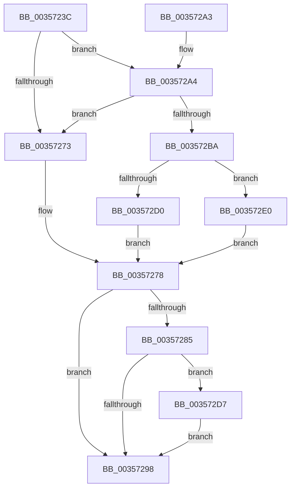

# CcFreeWorkQueueEntry

- RVA: `0x0035723C`–`0x003572E7` (길이 `171` bytes)
- VA: `0x000000014035723C`
- 실행 섹션: `.text`
- PDB 이름 있음: `예`; PDB Function 태그: `아니요`
- unwind 정보 RVA: `0x000795CC`
- 디코드: `46`개 명령, `171/171` bytes 표시
- 미해석 바이트: `0` (있으면 어셈블리에 `.byte`로 보존)

> 이 문서는 커널 이미지의 기계어와 PDB 기호를 분석해 생성했습니다. 4번과 5번은 함수 원형과 자료형을 바이너리 사용 방식에서 추정한 C 해석이며 원본 소스 복구 결과는 아닙니다.

## 1. Dependencies

- 직접 호출 지점: **4**; 고유 호출 대상: **4**
- 직접 호출자로 확인된 함수: **14**
- RIP 상대 이미지 참조: **1**

### Outgoing calls
- `0x00357273` → [ExpInterlockedPushEntrySList](../6B/ExpInterlockedPushEntrySList_function_006BA5B0.md) (function, `0x006BA5B0`)
- `0x0035727B` → [CcDereferencePartition](CcDereferencePartition_function_003572F0.md) (function, `0x003572F0`)
- `0x003572D0` → [ExFreePool](../../poolcode/B8/ExFreePool_function_00B82850.md) (function, `0x00B82850`)
- `0x003572E0` → [guard_dispatch_icall](../6B/guard_dispatch_icall_function_006BAAD0.md) (function, `0x006BAAD0`)

### Direct callers
- [CcAsyncLazywriteWorker](CcAsyncLazywriteWorker_function_00354C28.md) at `0x00354EA1`
- [CcCachemapUninitWorkerThread](CcCachemapUninitWorkerThread_function_003569D0.md) at `0x00356B33`
- [CcWriteBehind](CcWriteBehind_function_00356EAC.md) at `0x00357031`
- [CcMapAndCopyInToCache](../3C/CcMapAndCopyInToCache_function_003CA7F0.md) at `0x003CB38D`
- [CcPostWorkQueueAsyncRead](../45/CcPostWorkQueueAsyncRead_function_0045D624.md) at `0x0045D74A`
- [CcCompleteAsyncReadWorker](../45/CcCompleteAsyncReadWorker_function_0045D9C0.md) at `0x0045DA30`
- [CcAsyncReadWorker](../45/CcAsyncReadWorker_function_0045DB10.md) at `0x0045DEF8`
- [CcAsyncReadWorker](../45/CcAsyncReadWorker_function_0045DB10.md) at `0x0045DF6D`
- [CcWaitForUninitializeCacheMap](../46/CcWaitForUninitializeCacheMap_function_004633F0.md) at `0x0046363E`
- [CcWorkerThread](../48/CcWorkerThread_function_0048F0F0.md) at `0x0048F4A7`
- [CcSerializeWithLazyWriter](../4B/CcSerializeWithLazyWriter_function_004B4490.md) at `0x004B4544`
- [CcQuickLazyWriteScanForVolume](../4B/CcQuickLazyWriteScanForVolume_function_004BFEE0.md) at `0x004BFF32`
- [CcAsyncLazywriteWorkerMulti](../4D/CcAsyncLazywriteWorkerMulti_function_004D1574.md) at `0x004D189D`
- [CcCompleteAsyncWriteBehind](../57/CcCompleteAsyncWriteBehind_function_0057F824.md) at `0x0057F9BB`
- [sub_006E8840](../6E/Unknown_function_006E8840.md) at `0x006E8918`

### Static image references
- `0x003572C1` → RVA `0x00B82850` (`ExFreePool`; read)

## 2. Other-region calls and transfers

- 다른 실행 섹션으로 향하는 call: **1**
  - `0x003572D0` → [ExFreePool](../../poolcode/B8/ExFreePool_function_00B82850.md) (`.text` → `POOLCODE`)
- 별도 외부 분기/꼬리 이동을 확인하지 못했습니다.

## 3. Assembly (complete function range)

```asm
0035723C  48 89 5C 24 08                  mov qword ptr [rsp + 8], rbx
00357241  57                              push rdi
00357242  48 83 EC 20                     sub rsp, 0x20
00357246  65 4C 8B 04 25 20 00 00 00      mov r8, qword ptr gs:[0x20]
0035724F  48 8B D1                        mov rdx, rcx
00357252  48 8B B9 88 00 00 00            mov rdi, qword ptr [rcx + 0x88]
00357259  48 8B 99 90 00 00 00            mov rbx, qword ptr [rcx + 0x90]
00357260  49 8B 88 60 08 00 00            mov rcx, qword ptr [r8 + 0x860]
00357267  FF 41 1C                        inc dword ptr [rcx + 0x1c]
0035726A  0F B7 41 10                     movzx eax, word ptr [rcx + 0x10]
0035726E  66 39 01                        cmp word ptr [rcx], ax
00357271  73 31                           jae 0x1403572a4
00357273  E8 38 33 36 00                  call 0x1406ba5b0
00357278  48 8B CF                        mov rcx, rdi
0035727B  E8 70 00 00 00                  call 0x1403572f0
00357280  48 85 DB                        test rbx, rbx
00357283  74 13                           je 0x140357298
00357285  48 83 C8 FF                     or rax, 0xffffffffffffffff
00357289  F0 48 0F C1 43 08               lock xadd qword ptr [rbx + 8], rax
0035728F  48 FF C8                        dec rax
00357292  48 83 F8 FF                     cmp rax, -1
00357296  7E 3F                           jle 0x1403572d7
00357298  48 8B 5C 24 30                  mov rbx, qword ptr [rsp + 0x30]
0035729D  48 83 C4 20                     add rsp, 0x20
003572A1  5F                              pop rdi
003572A2  C3                              ret
003572A3  CC                              int3
003572A4  FF 41 20                        inc dword ptr [rcx + 0x20]
003572A7  49 8B 88 68 08 00 00            mov rcx, qword ptr [r8 + 0x868]
003572AE  FF 41 1C                        inc dword ptr [rcx + 0x1c]
003572B1  0F B7 41 10                     movzx eax, word ptr [rcx + 0x10]
003572B5  66 39 01                        cmp word ptr [rcx], ax
003572B8  72 B9                           jb 0x140357273
003572BA  FF 41 20                        inc dword ptr [rcx + 0x20]
003572BD  48 8B 41 38                     mov rax, qword ptr [rcx + 0x38]
003572C1  48 8D 0D 88 B5 82 00            lea rcx, [rip + 0x82b588]
003572C8  48 3B C1                        cmp rax, rcx
003572CB  48 8B CA                        mov rcx, rdx
003572CE  75 10                           jne 0x1403572e0
003572D0  E8 7B B5 82 00                  call 0x140b82850
003572D5  EB A1                           jmp 0x140357278
003572D7  B9 0E 00 00 00                  mov ecx, 0xe
003572DC  CD 29                           int 0x29
003572DE  EB B8                           jmp 0x140357298
003572E0  E8 EB 37 36 00                  call 0x1406baad0
003572E5  EB 91                           jmp 0x140357278
```

## 4. C-style interpretation (structured pseudocode)

```c
__int64 __fastcall CcFreeWorkQueueEntry(__int64 a1)
{
    __int64 result;
    __int64 v_rsp;
    unsigned __int64 v_stack_p8;

    v_stack_p8 = v_rbx;
    v_rsp = (v_rsp) - (32);
    if ((*(unsigned __int16 *)(*(unsigned __int64 *)(*(unsigned __int64 *)(gs_base + (0 + 32)) + 2144))) >= ((unsigned __int16)(*(unsigned __int16 *)(*(unsigned __int64 *)(*(unsigned __int64 *)(gs_base + (0 + 32)) + 2144) + 16)))) goto loc_003572A4;
loc_00357273:
    result = ExpInterlockedPushEntrySList(*(unsigned __int64 *)(*(unsigned __int64 *)(gs_base + (0 + 32)) + 2144), a1, *(unsigned __int64 *)(gs_base + (0 + 32)), a4);
loc_00357278:
    result = CcDereferencePartition(*(unsigned __int64 *)(a1 + 136), a1, *(unsigned __int64 *)(gs_base + (0 + 32)), a4);
    if (*(unsigned __int64 *)(a1 + 144) == 0) goto loc_00357298;
    result = (result) | (-1);
    result = (result) - 1;
    if (result <= -1) goto loc_003572D7;
loc_00357298:
    v_rsp = (v_rsp) + (32);
    return result;
loc_003572A4:
    if ((*(unsigned __int16 *)(*(unsigned __int64 *)(*(unsigned __int64 *)(gs_base + (0 + 32)) + 2152))) < ((unsigned __int16)(*(unsigned __int16 *)(*(unsigned __int64 *)(*(unsigned __int64 *)(gs_base + (0 + 32)) + 2152) + 16)))) goto loc_00357273;
    if ((*(unsigned __int64 *)(*(unsigned __int64 *)(*(unsigned __int64 *)(gs_base + (0 + 32)) + 2152) + 56)) != (v_rip + 8566152)) goto loc_003572E0;
    result = ExFreePool(a1, a1, *(unsigned __int64 *)(gs_base + (0 + 32)), a4);
    goto loc_00357278;
loc_003572D7:
    goto loc_00357298;
loc_003572E0:
    result = guard_dispatch_icall(14, a1, *(unsigned __int64 *)(gs_base + (0 + 32)), a4);
    goto loc_00357278;
}
```

## 5. (Beta) C Style

```c
int64_t CcFreeWorkQueueEntry(void *Arg1)
{
    uint8_t *arg1 = (uint8_t *)Arg1;

    int64_t result;
    int64_t local_rsp;
    uint64_t v_stack_p8;

    v_stack_p8 = local_rbx;
    local_rsp = (local_rsp) - (32);
    if ((*(uint16_t *)(*(uint64_t *)(*(uint64_t *)(gs_base + (0 + 0x20)) + 0x860))) >= ((uint16_t)(*(uint16_t *)(*(uint64_t *)(*(uint64_t *)(gs_base + (0 + 0x20)) + 0x860) + 0x10)))) goto loc_003572A4;
loc_00357273:
    result = ExpInterlockedPushEntrySList(*(uint64_t *)(*(uint64_t *)(gs_base + (0 + 0x20)) + 0x860), Arg1, *(uint64_t *)(gs_base + (0 + 0x20)), a4);
loc_00357278:
    result = CcDereferencePartition(*(uint64_t *)(arg1 + 0x88), Arg1, *(uint64_t *)(gs_base + (0 + 0x20)), a4);
    if (*(uint64_t *)(arg1 + 0x90) == 0) goto loc_00357298;
    result = (result) | (-1);
    result = (result) - 1;
    if (result <= -1) goto loc_003572D7;
loc_00357298:
    local_rsp = (local_rsp) + (32);
    return result;
loc_003572A4:
    if ((*(uint16_t *)(*(uint64_t *)(*(uint64_t *)(gs_base + (0 + 0x20)) + 0x868))) < ((uint16_t)(*(uint16_t *)(*(uint64_t *)(*(uint64_t *)(gs_base + (0 + 0x20)) + 0x868) + 0x10)))) goto loc_00357273;
    if ((*(uint64_t *)(*(uint64_t *)(*(uint64_t *)(gs_base + (0 + 0x20)) + 0x868) + 0x38)) != (v_rip + 8566152)) goto loc_003572E0;
    result = ExFreePool(Arg1, Arg1, *(uint64_t *)(gs_base + (0 + 0x20)), a4);
    goto loc_00357278;
loc_003572D7:
    goto loc_00357298;
loc_003572E0:
    result = guard_dispatch_icall(14, Arg1, *(uint64_t *)(gs_base + (0 + 0x20)), a4);
    goto loc_00357278;
}
```

### 관측된 메모리 오프셋

구조체 형식이 확인되지 않은 접근은 인자 기준의 오프셋으로만 기록했습니다.

| 기준 인자 | 오프셋 표현 | 폭 (bit) | 접근 |
|---|---:|---:|---|
| `Arg1` | `+ 0x88` | `64` | `R` |
| `Arg1` | `+ 0x90` | `64` | `R` |

## 6. Execution-region graph

[열기: 2D/3D 그래프와 함수 탐색 컨트롤 패널](../../../control-panel.html?section=text&rva=0x0035723C&view=graph)

- 2D 그래프는 위에서 아래로 흐르고, 3D 그래프는 빈 공간을 드래그해 회전합니다. Shift+드래그는 이동, 휠은 확대·축소, 함수 노드 선택은 대상 보고서 이동입니다.

### Static fallback


