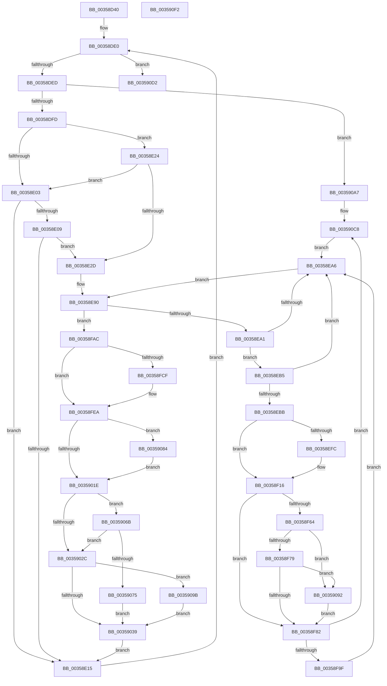

# CcGetDirtyPagesHelper

- RVA: `0x00358D40`–`0x003590F3` (길이 `947` bytes)
- VA: `0x0000000140358D40`
- 실행 섹션: `.text`
- PDB 이름 있음: `예`; PDB Function 태그: `아니요`
- unwind 정보 RVA: `0x000797E4`
- 디코드: `225`개 명령, `947/947` bytes 표시
- 미해석 바이트: `0` (있으면 어셈블리에 `.byte`로 보존)

> 이 문서는 커널 이미지의 기계어와 PDB 기호를 분석해 생성했습니다. 4번과 5번은 함수 원형과 자료형을 바이너리 사용 방식에서 추정한 C 해석이며 원본 소스 복구 결과는 아닙니다.

## 1. Dependencies

- 직접 호출 지점: **16**; 고유 호출 대상: **12**
- 직접 호출자로 확인된 함수: **1**
- RIP 상대 이미지 참조: **3**

### Outgoing calls
- `0x00358DBB` → [KeAcquireInStackQueuedSpinLock](../27/KeAcquireInStackQueuedSpinLock_function_002757A0.md) (function, `0x002757A0`)
- `0x00358E55` → [KeReleaseInStackQueuedSpinLock](../34/KeReleaseInStackQueuedSpinLock_function_00342CE0.md) (function, `0x00342CE0`)
- `0x00358E5D` → [CcReferenceSharedCacheMapFileObject](../23/CcReferenceSharedCacheMapFileObject_function_002379BC.md) (function, `0x002379BC`)
- `0x00358E74` → [ExAcquireFastMutex](../20/ExAcquireFastMutex_function_0020E5A0.md) (function, `0x0020E5A0`)
- `0x00358EF2` → [ExReleaseFastMutex](../25/ExReleaseFastMutex_function_002519C0.md) (function, `0x002519C0`)
- `0x00358F09` → [CcUnpinFileDataEx](CcUnpinFileDataEx_function_00359DEC.md) (function, `0x00359DEC`)
- `0x00358F55` → [guard_dispatch_icall](../6B/guard_dispatch_icall_function_006BAAD0.md) (function, `0x006BAAD0`)
- `0x00358F89` → [ExAcquireFastMutex](../20/ExAcquireFastMutex_function_0020E5A0.md) (function, `0x0020E5A0`)
- `0x00358FB3` → [ExReleaseFastMutex](../25/ExReleaseFastMutex_function_002519C0.md) (function, `0x002519C0`)
- `0x00358FC5` → [ObFastDereferenceObjectDeferDelete](../23/ObFastDereferenceObjectDeferDelete_function_002378C0.md) (function, `0x002378C0`)
- `0x00358FDC` → [CcUnpinFileDataEx](CcUnpinFileDataEx_function_00359DEC.md) (function, `0x00359DEC`)
- `0x0035907D` → [KiAcquireQueuedSpinLockInstrumented](../27/KiAcquireQueuedSpinLockInstrumented_function_00275850.md) (function, `0x00275850`)
- `0x0035908B` → [KiRaiseIrqlProcessIrqlFlags](../4F/KiRaiseIrqlProcessIrqlFlags_function_004F56FC.md) (function, `0x004F56FC`)
- `0x003590A0` → [KxWaitForLockOwnerShip](../25/KxWaitForLockOwnerShip_function_00257EB0.md) (function, `0x00257EB0`)
- `0x003590C3` → [KeBugCheckEx](../4F/KeBugCheckEx_function_004FD660.md) (function, `0x004FD660`)
- `0x003590D7` → [KeReleaseInStackQueuedSpinLock](../34/KeReleaseInStackQueuedSpinLock_function_00342CE0.md) (function, `0x00342CE0`)

### Direct callers
- [CcGetDirtyPages](../2F/CcGetDirtyPages_function_002F0720.md) at `0x002F07BD`

### Static image references
- `0x00359015` → RVA `0x00FC6D20` (`ALMOSTRO`; read)
- `0x00359023` → RVA `0x00FC6B06` (`ALMOSTRO`; read)
- `0x0035906B` → RVA `0x00F0DE58` (`.data`; read)

## 2. Other-region calls and transfers

- 다른 실행 섹션으로 향하는 call: **0**
- 별도 외부 분기/꼬리 이동을 확인하지 못했습니다.

## 3. Assembly (complete function range)

```asm
00358D40  48 8B C4                        mov rax, rsp
00358D43  4C 89 40 18                     mov qword ptr [rax + 0x18], r8
00358D47  48 89 48 08                     mov qword ptr [rax + 8], rcx
00358D4B  53                              push rbx
00358D4C  56                              push rsi
00358D4D  57                              push rdi
00358D4E  41 54                           push r12
00358D50  41 55                           push r13
00358D52  41 56                           push r14
00358D54  41 57                           push r15
00358D56  48 81 EC B0 00 00 00            sub rsp, 0xb0
00358D5D  4C 8B E1                        mov r12, rcx
00358D60  33 DB                           xor ebx, ebx
00358D62  48 89 5C 24 58                  mov qword ptr [rsp + 0x58], rbx
00358D67  48 89 5C 24 40                  mov qword ptr [rsp + 0x40], rbx
00358D6C  48 89 58 98                     mov qword ptr [rax - 0x68], rbx
00358D70  48 89 5C 24 50                  mov qword ptr [rsp + 0x50], rbx
00358D75  48 89 58 90                     mov qword ptr [rax - 0x70], rbx
00358D79  0F 57 C0                        xorps xmm0, xmm0
00358D7C  33 C9                           xor ecx, ecx
00358D7E  0F 11 44 24 60                  movups xmmword ptr [rsp + 0x60], xmm0
00358D83  48 89 48 88                     mov qword ptr [rax - 0x78], rcx
00358D87  49 8B 48 10                     mov rcx, qword ptr [r8 + 0x10]
00358D8B  48 89 8C 24 90 00 00 00         mov qword ptr [rsp + 0x90], rcx
00358D93  49 8B 48 18                     mov rcx, qword ptr [r8 + 0x18]
00358D97  48 89 8C 24 88 00 00 00         mov qword ptr [rsp + 0x88], rcx
00358D9F  4D 8B 28                        mov r13, qword ptr [r8]
00358DA2  49 8B 40 08                     mov rax, qword ptr [r8 + 8]
00358DA6  48 89 84 24 98 00 00 00         mov qword ptr [rsp + 0x98], rax
00358DAE  49 8D 8C 24 00 03 00 00         lea rcx, [r12 + 0x300]
00358DB6  48 8D 54 24 60                  lea rdx, [rsp + 0x60]
00358DBB  E8 E0 C9 F1 FF                  call 0x1402757a0
00358DC0  49 81 C4 D0 02 00 00            add r12, 0x2d0
00358DC7  49 8B 0C 24                     mov rcx, qword ptr [r12]
00358DCB  48 83 E9 78                     sub rcx, 0x78
00358DCF  48 89 4C 24 48                  mov qword ptr [rsp + 0x48], rcx
00358DD4  BE FD 02 00 00                  mov esi, 0x2fd
00358DD9  0F 1F 80 00 00 00 00            nop dword ptr [rax]
00358DE0  48 8D 41 78                     lea rax, [rcx + 0x78]
00358DE4  49 3B C4                        cmp rax, r12
00358DE7  0F 84 E5 02 00 00               je 0x1403590d2
00358DED  8B 81 98 00 00 00               mov eax, dword ptr [rcx + 0x98]
00358DF3  0F BA E0 0B                     bt eax, 0xb
00358DF7  0F 82 AA 02 00 00               jb 0x1403590a7
00358DFD  0F BA E0 19                     bt eax, 0x19
00358E01  72 21                           jb 0x140358e24
00358E03  0F BA E0 18                     bt eax, 0x18
00358E07  73 0C                           jae 0x140358e15
00358E09  48 8B 81 F8 00 00 00            mov rax, qword ptr [rcx + 0xf8]
00358E10  4C 39 28                        cmp qword ptr [rax], r13
00358E13  74 18                           je 0x140358e2d
00358E15  48 8B 49 78                     mov rcx, qword ptr [rcx + 0x78]
00358E19  48 83 E9 78                     sub rcx, 0x78
00358E1D  48 89 4C 24 48                  mov qword ptr [rsp + 0x48], rcx
00358E22  EB BC                           jmp 0x140358de0
00358E24  4C 39 A9 F8 00 00 00            cmp qword ptr [rcx + 0xf8], r13
00358E2B  75 D6                           jne 0x140358e03
00358E2D  8B 41 04                        mov eax, dword ptr [rcx + 4]
00358E30  FF C0                           inc eax
00358E32  89 41 04                        mov dword ptr [rcx + 4], eax
00358E35  48 8B 7C 24 48                  mov rdi, qword ptr [rsp + 0x48]
00358E3A  8B 87 20 02 00 00               mov eax, dword ptr [rdi + 0x220]
00358E40  FF C0                           inc eax
00358E42  89 87 20 02 00 00               mov dword ptr [rdi + 0x220], eax
00358E48  8B 47 70                        mov eax, dword ptr [rdi + 0x70]
00358E4B  FF C0                           inc eax
00358E4D  89 47 70                        mov dword ptr [rdi + 0x70], eax
00358E50  48 8D 4C 24 60                  lea rcx, [rsp + 0x60]
00358E55  E8 86 9E FE FF                  call 0x140342ce0
00358E5A  48 8B CF                        mov rcx, rdi
00358E5D  E8 5A EB ED FF                  call 0x1402379bc
00358E62  4C 8B F8                        mov r15, rax
00358E65  48 89 84 24 A0 00 00 00         mov qword ptr [rsp + 0xa0], rax
00358E6D  48 8D 8F 20 01 00 00            lea rcx, [rdi + 0x120]
00358E74  E8 27 57 EB FF                  call 0x14020e5a0
00358E79  48 8B 5F 10                     mov rbx, qword ptr [rdi + 0x10]
00358E7D  48 83 EB 10                     sub rbx, 0x10
00358E81  48 89 5C 24 58                  mov qword ptr [rsp + 0x58], rbx
00358E86  4C 8B 74 24 40                  mov r14, qword ptr [rsp + 0x40]
00358E8B  0F 1F 44 00 00                  nop dword ptr [rax + rax]
00358E90  48 8D 53 10                     lea rdx, [rbx + 0x10]
00358E94  48 8D 4F 10                     lea rcx, [rdi + 0x10]
00358E98  48 3B D1                        cmp rdx, rcx
00358E9B  0F 84 0B 01 00 00               je 0x140358fac
00358EA1  66 39 33                        cmp word ptr [rbx], si
00358EA4  74 0F                           je 0x140358eb5
00358EA6  48 8B 5B 10                     mov rbx, qword ptr [rbx + 0x10]
00358EAA  48 83 EB 10                     sub rbx, 0x10
00358EAE  48 89 5C 24 58                  mov qword ptr [rsp + 0x58], rbx
00358EB3  EB DB                           jmp 0x140358e90
00358EB5  80 7B 02 00                     cmp byte ptr [rbx + 2], 0
00358EB9  74 EB                           je 0x140358ea6
00358EBB  48 8B 43 08                     mov rax, qword ptr [rbx + 8]
00358EBF  48 89 84 24 80 00 00 00         mov qword ptr [rsp + 0x80], rax
00358EC7  8B 73 04                        mov esi, dword ptr [rbx + 4]
00358ECA  89 B4 24 08 01 00 00            mov dword ptr [rsp + 0x108], esi
00358ED1  48 8B 43 28                     mov rax, qword ptr [rbx + 0x28]
00358ED5  48 89 44 24 50                  mov qword ptr [rsp + 0x50], rax
00358EDA  48 8B 43 30                     mov rax, qword ptr [rbx + 0x30]
00358EDE  48 89 44 24 78                  mov qword ptr [rsp + 0x78], rax
00358EE3  8B 43 40                        mov eax, dword ptr [rbx + 0x40]
00358EE6  FF C0                           inc eax
00358EE8  89 43 40                        mov dword ptr [rbx + 0x40], eax
00358EEB  48 8D 8F 20 01 00 00            lea rcx, [rdi + 0x120]
00358EF2  E8 C9 8A EF FF                  call 0x1402519c0
00358EF7  4D 85 F6                        test r14, r14
00358EFA  74 1A                           je 0x140358f16
00358EFC  41 B8 01 00 00 00               mov r8d, 1
00358F02  41 0F B6 D0                     movzx edx, r8b
00358F06  49 8B CE                        mov rcx, r14
00358F09  E8 DE 0E 00 00                  call 0x140359dec
00358F0E  45 33 F6                        xor r14d, r14d
00358F11  4C 89 74 24 40                  mov qword ptr [rsp + 0x40], r14
00358F16  48 8B 84 24 88 00 00 00         mov rax, qword ptr [rsp + 0x88]
00358F1E  48 89 44 24 30                  mov qword ptr [rsp + 0x30], rax
00358F23  48 8B 84 24 90 00 00 00         mov rax, qword ptr [rsp + 0x90]
00358F2B  48 89 44 24 28                  mov qword ptr [rsp + 0x28], rax
00358F30  48 8D 44 24 78                  lea rax, [rsp + 0x78]
00358F35  48 89 44 24 20                  mov qword ptr [rsp + 0x20], rax
00358F3A  4C 8D 4C 24 50                  lea r9, [rsp + 0x50]
00358F3F  44 8B C6                        mov r8d, esi
00358F42  48 8D 94 24 80 00 00 00         lea rdx, [rsp + 0x80]
00358F4A  49 8B CF                        mov rcx, r15
00358F4D  48 8B 84 24 98 00 00 00         mov rax, qword ptr [rsp + 0x98]
00358F55  E8 76 1B 36 00                  call 0x1406baad0
00358F5A  48 8B 44 24 50                  mov rax, qword ptr [rsp + 0x50]
00358F5F  48 85 C0                        test rax, rax
00358F62  74 1E                           je 0x140358f82
00358F64  48 8B 94 24 00 01 00 00         mov rdx, qword ptr [rsp + 0x100]
00358F6C  48 8B 4A 20                     mov rcx, qword ptr [rdx + 0x20]
00358F70  48 85 C9                        test rcx, rcx
00358F73  0F 84 19 01 00 00               je 0x140359092
00358F79  48 3B C1                        cmp rax, rcx
00358F7C  0F 8C 10 01 00 00               jl 0x140359092
00358F82  48 8D 8F 20 01 00 00            lea rcx, [rdi + 0x120]
00358F89  E8 12 56 EB FF                  call 0x14020e5a0
00358F8E  8B 43 40                        mov eax, dword ptr [rbx + 0x40]
00358F91  BE FD 02 00 00                  mov esi, 0x2fd
00358F96  83 F8 01                        cmp eax, 1
00358F99  0F 87 29 01 00 00               ja 0x1403590c8
00358F9F  4C 8B F3                        mov r14, rbx
00358FA2  48 89 5C 24 40                  mov qword ptr [rsp + 0x40], rbx
00358FA7  E9 FA FE FF FF                  jmp 0x140358ea6
00358FAC  48 8D 8F 20 01 00 00            lea rcx, [rdi + 0x120]
00358FB3  E8 08 8A EF FF                  call 0x1402519c0
00358FB8  48 8D 4F 60                     lea rcx, [rdi + 0x60]
00358FBC  41 B8 43 63 53 63               mov r8d, 0x63536343
00358FC2  49 8B D7                        mov rdx, r15
00358FC5  E8 F6 E8 ED FF                  call 0x1402378c0
00358FCA  4D 85 F6                        test r14, r14
00358FCD  74 1B                           je 0x140358fea
00358FCF  41 B8 01 00 00 00               mov r8d, 1
00358FD5  41 0F B6 D0                     movzx edx, r8b
00358FD9  49 8B CE                        mov rcx, r14
00358FDC  E8 0B 0E 00 00                  call 0x140359dec
00358FE1  48 C7 44 24 40 00 00 00 00      mov qword ptr [rsp + 0x40], 0
00358FEA  48 8B 9C 24 F0 00 00 00         mov rbx, qword ptr [rsp + 0xf0]
00358FF2  48 81 C3 00 03 00 00            add rbx, 0x300
00358FF9  48 89 5C 24 68                  mov qword ptr [rsp + 0x68], rbx
00358FFE  48 C7 44 24 60 00 00 00 00      mov qword ptr [rsp + 0x60], 0
00359007  90                              nop
00359008  44 0F 20 C7                     mov rdi, cr8
0035900C  B8 02 00 00 00                  mov eax, 2
00359011  44 0F 22 C0                     mov cr8, rax
00359015  83 3D 04 DD C6 00 00            cmp dword ptr [rip + 0xc6dd04], 0
0035901C  75 66                           jne 0x140359084
0035901E  40 88 7C 24 70                  mov byte ptr [rsp + 0x70], dil
00359023  F6 05 DC DA C6 00 21            test byte ptr [rip + 0xc6dadc], 0x21
0035902A  75 3F                           jne 0x14035906b
0035902C  48 8D 54 24 60                  lea rdx, [rsp + 0x60]
00359031  48 87 13                        xchg qword ptr [rbx], rdx
00359034  48 85 D2                        test rdx, rdx
00359037  75 62                           jne 0x14035909b
00359039  48 8B 4C 24 48                  mov rcx, qword ptr [rsp + 0x48]
0035903E  8B 41 04                        mov eax, dword ptr [rcx + 4]
00359041  FF C8                           dec eax
00359043  89 41 04                        mov dword ptr [rcx + 4], eax
00359046  48 8B 4C 24 48                  mov rcx, qword ptr [rsp + 0x48]
0035904B  8B 81 20 02 00 00               mov eax, dword ptr [rcx + 0x220]
00359051  FF C8                           dec eax
00359053  89 81 20 02 00 00               mov dword ptr [rcx + 0x220], eax
00359059  8B 41 70                        mov eax, dword ptr [rcx + 0x70]
0035905C  FF C8                           dec eax
0035905E  89 41 70                        mov dword ptr [rcx + 0x70], eax
00359061  BE FD 02 00 00                  mov esi, 0x2fd
00359066  E9 AA FD FF FF                  jmp 0x140358e15
0035906B  8B 05 E7 4D BB 00               mov eax, dword ptr [rip + 0xbb4de7]
00359071  85 C0                           test eax, eax
00359073  75 B7                           jne 0x14035902c
00359075  48 8B D3                        mov rdx, rbx
00359078  48 8D 4C 24 60                  lea rcx, [rsp + 0x60]
0035907D  E8 CE C7 F1 FF                  call 0x140275850
00359082  EB B5                           jmp 0x140359039
00359084  0F B6 D0                        movzx edx, al
00359087  40 0F B6 CF                     movzx ecx, dil
0035908B  E8 6C C6 19 00                  call 0x1404f56fc
00359090  EB 8C                           jmp 0x14035901e
00359092  48 89 42 20                     mov qword ptr [rdx + 0x20], rax
00359096  E9 E7 FE FF FF                  jmp 0x140358f82
0035909B  48 8D 4C 24 60                  lea rcx, [rsp + 0x60]
003590A0  E8 0B EE EF FF                  call 0x140257eb0
003590A5  EB 92                           jmp 0x140359039
003590A7  48 C7 44 24 20 00 00 00 00      mov qword ptr [rsp + 0x20], 0
003590B0  45 33 C9                        xor r9d, r9d
003590B3  BA 38 03 00 00                  mov edx, 0x338
003590B8  41 8D 49 34                     lea ecx, [r9 + 0x34]
003590BC  49 C7 C0 20 04 00 C0            mov r8, 0xffffffffc0000420
003590C3  E8 98 45 1A 00                  call 0x1404fd660
003590C8  FF C8                           dec eax
003590CA  89 43 40                        mov dword ptr [rbx + 0x40], eax
003590CD  E9 D4 FD FF FF                  jmp 0x140358ea6
003590D2  48 8D 4C 24 60                  lea rcx, [rsp + 0x60]
003590D7  E8 04 9C FE FF                  call 0x140342ce0
003590DC  90                              nop
003590DD  B0 01                           mov al, 1
003590DF  48 81 C4 B0 00 00 00            add rsp, 0xb0
003590E6  41 5F                           pop r15
003590E8  41 5E                           pop r14
003590EA  41 5D                           pop r13
003590EC  41 5C                           pop r12
003590EE  5F                              pop rdi
003590EF  5E                              pop rsi
003590F0  5B                              pop rbx
003590F1  C3                              ret
003590F2  CC                              int3
```

## 4. C-style interpretation (structured pseudocode)

```c
__int64 __fastcall CcGetDirtyPagesHelper(__int64 a1, __int64 a2, __int64 a3)
{
    __int64 result;
    __int64 v_r12;
    __int64 v_r14;
    __int64 v_rbx;
    __int64 v_rsp;
    unsigned __int64 v_stack_m48;
    unsigned __int64 v_stack_m50;
    unsigned __int64 v_stack_m58;
    unsigned __int64 v_stack_m60;
    unsigned __int64 v_stack_m68;
    unsigned __int64 v_stack_m70;
    unsigned __int8 v_stack_m78;
    unsigned __int64 v_stack_m80;
    unsigned __int64 v_stack_m88;
    unsigned __int64 v_stack_m90;
    unsigned __int64 v_stack_m98;
    unsigned __int64 v_stack_mA0;
    unsigned __int64 v_stack_mA8;
    unsigned __int64 v_stack_mB8;
    unsigned __int64 v_stack_mC0;
    unsigned __int64 v_stack_mC8;
    unsigned __int64 v_stack_p18;
    unsigned int v_stack_p20;
    unsigned __int64 v_stack_p8;

    *(unsigned __int64 *)(v_rsp + 24) = a3;
    *(unsigned __int64 *)(v_rsp + 8) = a1;
    v_rsp = (v_rsp) - (176);
    v_rbx = 0;
    v_stack_m90 = 0;
    v_stack_mA8 = 0;
    *(unsigned __int64 *)(v_rsp - 104) = 0;
    v_stack_m98 = 0;
    *(unsigned __int64 *)(v_rsp - 112) = 0;
    a1 = 0;
    v_stack_m88 = v_xmm0;
    *(unsigned __int64 *)(v_rsp - 120) = 0;
    v_stack_m58 = *(unsigned __int64 *)(a3 + 16);
    v_stack_m60 = *(unsigned __int64 *)(a3 + 24);
    v_stack_m50 = *(unsigned __int64 *)(a3 + 8);
    result = KeAcquireInStackQueuedSpinLock(a1 + 768, v_stack_m88, a3, a4);
    v_r12 = (a1) + (720);
    a1 = (*(unsigned __int64 *)(v_r12)) - (120);
    v_stack_mA0 = a1;
loc_00358DE0:
    if ((a1 + 120) == v_r12) goto loc_003590D2;
    if ((a1 + 120) < v_r12) goto loc_003590A7;
    if ((a1 + 120) < v_r12) goto loc_00358E24;
loc_00358E03:
    if ((a1 + 120) >= v_r12) goto loc_00358E15;
    if ((*(unsigned __int64 *)(*(unsigned __int64 *)(a1 + 248))) == (*(unsigned __int64 *)(a3))) goto loc_00358E2D;
loc_00358E15:
    a1 = (*(unsigned __int64 *)(a1 + 120)) - (120);
    v_stack_mA0 = a1;
    goto loc_00358DE0;
loc_00358E24:
    if ((*(unsigned __int64 *)(a1 + 248)) != (*(unsigned __int64 *)(a3))) goto loc_00358E03;
loc_00358E2D:
    result = (unsigned int)(((unsigned int)(*(unsigned int *)(a1 + 4))) + 1);
    *(unsigned int *)(a1 + 4) = (unsigned int)(result);
    result = (unsigned int)(((unsigned int)(*(unsigned int *)(v_stack_mA0 + 544))) + 1);
    *(unsigned int *)(v_stack_mA0 + 544) = (unsigned int)(result);
    result = (unsigned int)(((unsigned int)(*(unsigned int *)(v_stack_mA0 + 112))) + 1);
    *(unsigned int *)(v_stack_mA0 + 112) = (unsigned int)(result);
    result = KeReleaseInStackQueuedSpinLock(v_stack_m88, v_stack_m88, a3, a4);
    result = CcReferenceSharedCacheMapFileObject(v_stack_mA0, v_stack_m88, a3, a4);
    v_stack_m48 = result;
    result = ExAcquireFastMutex(v_stack_mA0 + 288, v_stack_m88, a3, a4);
    v_rbx = (*(unsigned __int64 *)(v_stack_mA0 + 16)) - (16);
    v_stack_m90 = v_rbx;
loc_00358E90:
    if ((v_rbx + 16) == (v_stack_mA0 + 16)) goto loc_00358FAC;
    if ((*(unsigned __int16 *)(v_rbx)) == 765) goto loc_00358EB5;
loc_00358EA6:
    v_rbx = (*(unsigned __int64 *)(v_rbx + 16)) - (16);
    v_stack_m90 = v_rbx;
    goto loc_00358E90;
loc_00358EB5:
    if ((*(unsigned __int8 *)(v_rbx + 2)) == 0) goto loc_00358EA6;
    v_stack_m68 = *(unsigned __int64 *)(v_rbx + 8);
    v_stack_p20 = (unsigned int)((unsigned int)(*(unsigned int *)(v_rbx + 4)));
    v_stack_m98 = *(unsigned __int64 *)(v_rbx + 40);
    v_stack_m70 = *(unsigned __int64 *)(v_rbx + 48);
    result = (unsigned int)(((unsigned int)(*(unsigned int *)(v_rbx + 64))) + 1);
    *(unsigned int *)(v_rbx + 64) = (unsigned int)(result);
    result = ExReleaseFastMutex(v_stack_mA0 + 288, v_rbx + 16, a3, a4);
    v_r14 = v_stack_mA8;
    if (v_stack_mA8 != 0) {
        a3 = 1;
        a2 = (unsigned __int8)(a3);
        a1 = v_stack_mA8;
        result = CcUnpinFileDataEx(a1, a2, a3, a4);
        v_r14 = 0;
        v_stack_mA8 = 0;
    }
    v_stack_mB8 = v_stack_m60;
    v_stack_mC0 = v_stack_m58;
    v_stack_mC8 = v_stack_m70;
    result = guard_dispatch_icall(result, v_stack_m68, (unsigned int)((unsigned int)((unsigned int)(*(unsigned int *)(v_rbx + 4)))), v_stack_m98);
    if (v_stack_m98 == 0) goto loc_00358F82;
    if (*(unsigned __int64 *)(v_stack_p18 + 32) == 0) goto loc_00359092;
    if (v_stack_m98 < (*(unsigned __int64 *)(v_stack_p18 + 32))) goto loc_00359092;
loc_00358F82:
    result = ExAcquireFastMutex(v_stack_mA0 + 288, v_stack_p18, (unsigned int)((unsigned int)((unsigned int)(*(unsigned int *)(v_rbx + 4)))), v_stack_m98);
    if (((unsigned int)((unsigned int)(*(unsigned int *)(v_rbx + 64)))) > 1) goto loc_003590C8;
    v_stack_mA8 = v_rbx;
    goto loc_00358EA6;
loc_00358FAC:
    result = ExReleaseFastMutex(v_stack_mA0 + 288, v_stack_p18, (unsigned int)((unsigned int)((unsigned int)(*(unsigned int *)(v_rbx + 4)))), v_stack_m98);
    result = ObFastDereferenceObjectDeferDelete(v_stack_mA0 + 96, result, (unsigned int)(0x63536343ULL), v_stack_m98);
    if (v_rbx != 0) {
        a3 = 1;
        a2 = (unsigned __int8)(a3);
        a1 = v_rbx;
        result = CcUnpinFileDataEx(a1, a2, a3, v_stack_m98);
        v_stack_mA8 = 0;
    }
    v_rbx = (v_stack_p8) + (768);
    v_stack_m80 = v_rbx;
    v_stack_m88 = 0;
    if ((*(unsigned int *)(v_rip + 13032708)) != 0) goto loc_00359084;
loc_0035901E:
    v_stack_m78 = (unsigned __int8)(v_cr8);
    if (((*(unsigned __int8 *)(v_rip + 13032156)) & (33)) != 0) goto loc_0035906B;
loc_0035902C:
    if (v_stack_m88 != 0) goto loc_0035909B;
loc_00359039:
    result = (unsigned int)(((unsigned int)(*(unsigned int *)(v_stack_mA0 + 4))) - 1);
    *(unsigned int *)(v_stack_mA0 + 4) = (unsigned int)(result);
    result = (unsigned int)(((unsigned int)(*(unsigned int *)(v_stack_mA0 + 544))) - 1);
    *(unsigned int *)(v_stack_mA0 + 544) = (unsigned int)(result);
    result = (unsigned int)(((unsigned int)(*(unsigned int *)(v_stack_mA0 + 112))) - 1);
    *(unsigned int *)(v_stack_mA0 + 112) = (unsigned int)(result);
    goto loc_00358E15;
loc_0035906B:
    if ((unsigned int)((unsigned int)(*(unsigned int *)(v_rip + 12275175))) != 0) goto loc_0035902C;
    result = KiAcquireQueuedSpinLockInstrumented(v_stack_m88, v_rbx, a3, v_stack_m98);
    goto loc_00359039;
loc_00359084:
    result = KiRaiseIrqlProcessIrqlFlags((unsigned __int8)(v_cr8), (unsigned __int8)(result), a3, v_stack_m98);
    goto loc_0035901E;
loc_00359092:
    *(unsigned __int64 *)((unsigned __int8)(result) + 32) = result;
    goto loc_00358F82;
loc_0035909B:
    result = KxWaitForLockOwnerShip(v_stack_m88, (unsigned __int8)(result), a3, v_stack_m98);
    goto loc_00359039;
loc_003590A7:
    v_stack_mC8 = 0;
    a4 = 0;
    result = KeBugCheckEx(a4 + 52, 824, 0xFFFFFFFFC0000420ULL, a4);
loc_003590C8:
    result = (unsigned int)((result) - 1);
    *(unsigned int *)(v_rbx + 64) = (unsigned int)(result);
    goto loc_00358EA6;
loc_003590D2:
    result = KeReleaseInStackQueuedSpinLock(v_stack_m88, 824, 0xFFFFFFFFC0000420ULL, a4);
    v_rsp = (v_rsp) + (176);
    return 1;
}
```

## 5. (Beta) C Style

```c
int64_t CcGetDirtyPagesHelper(void *Arg1, int64_t Arg2, void *Arg3)
{
    uint8_t *arg1 = (uint8_t *)Arg1;
    uint8_t *arg3 = (uint8_t *)Arg3;

    int64_t result;
    int64_t local_r12;
    int64_t local_r14;
    int64_t local_rbx;
    int64_t local_rsp;
    uint64_t v_stack_m48;
    uint64_t v_stack_m50;
    uint64_t v_stack_m58;
    uint64_t v_stack_m60;
    uint64_t v_stack_m68;
    uint64_t v_stack_m70;
    uint8_t v_stack_m78;
    uint64_t v_stack_m80;
    uint64_t v_stack_m88;
    uint64_t v_stack_m90;
    uint64_t v_stack_m98;
    uint64_t v_stack_mA0;
    uint64_t v_stack_mA8;
    uint64_t v_stack_mB8;
    uint64_t v_stack_mC0;
    uint64_t v_stack_mC8;
    uint64_t v_stack_p18;
    uint32_t v_stack_p20;
    uint64_t v_stack_p8;

    *(void **)(local_rsp + 0x18) = Arg3;
    *(void **)(local_rsp + 0x8) = Arg1;
    local_rsp = (local_rsp) - (176);
    local_rbx = 0;
    v_stack_m90 = 0;
    v_stack_mA8 = 0;
    *(uint64_t *)(local_rsp - 0x68) = 0;
    v_stack_m98 = 0;
    *(uint64_t *)(local_rsp - 0x70) = 0;
    Arg1 = 0;
    v_stack_m88 = v_xmm0;
    *(uint64_t *)(local_rsp - 0x78) = 0;
    v_stack_m58 = *(uint64_t *)(arg3 + 0x10);
    v_stack_m60 = *(uint64_t *)(arg3 + 0x18);
    v_stack_m50 = *(uint64_t *)(arg3 + 0x8);
    result = KeAcquireInStackQueuedSpinLock(Arg1 + 768, v_stack_m88, Arg3, a4);
    local_r12 = (Arg1) + (720);
    Arg1 = (*(uint64_t *)(local_r12)) - (120);
    v_stack_mA0 = Arg1;
loc_00358DE0:
    if ((Arg1 + 120) == local_r12) goto loc_003590D2;
    if ((Arg1 + 120) < local_r12) goto loc_003590A7;
    if ((Arg1 + 120) < local_r12) goto loc_00358E24;
loc_00358E03:
    if ((Arg1 + 120) >= local_r12) goto loc_00358E15;
    if ((*(uint64_t *)(*(uint64_t *)(arg1 + 0xF8))) == (*(uint64_t *)(arg3))) goto loc_00358E2D;
loc_00358E15:
    Arg1 = (*(uint64_t *)(arg1 + 0x78)) - (120);
    v_stack_mA0 = Arg1;
    goto loc_00358DE0;
loc_00358E24:
    if ((*(uint64_t *)(arg1 + 0xF8)) != (*(uint64_t *)(arg3))) goto loc_00358E03;
loc_00358E2D:
    result = (uint32_t)(((uint32_t)(*(uint32_t *)(arg1 + 0x4))) + 1);
    *(uint32_t *)(arg1 + 0x4) = (uint32_t)(result);
    result = (uint32_t)(((uint32_t)(*(uint32_t *)(v_stack_mA0 + 0x220))) + 1);
    *(uint32_t *)(v_stack_mA0 + 0x220) = (uint32_t)(result);
    result = (uint32_t)(((uint32_t)(*(uint32_t *)(v_stack_mA0 + 0x70))) + 1);
    *(uint32_t *)(v_stack_mA0 + 0x70) = (uint32_t)(result);
    result = KeReleaseInStackQueuedSpinLock(v_stack_m88, v_stack_m88, Arg3, a4);
    result = CcReferenceSharedCacheMapFileObject(v_stack_mA0, v_stack_m88, Arg3, a4);
    v_stack_m48 = result;
    result = ExAcquireFastMutex(v_stack_mA0 + 288, v_stack_m88, Arg3, a4);
    local_rbx = (*(uint64_t *)(v_stack_mA0 + 0x10)) - (16);
    v_stack_m90 = local_rbx;
loc_00358E90:
    if ((local_rbx + 16) == (v_stack_mA0 + 16)) goto loc_00358FAC;
    if ((*(uint16_t *)(local_rbx)) == 765) goto loc_00358EB5;
loc_00358EA6:
    local_rbx = (*(uint64_t *)(local_rbx + 0x10)) - (16);
    v_stack_m90 = local_rbx;
    goto loc_00358E90;
loc_00358EB5:
    if ((*(uint8_t *)(local_rbx + 0x2)) == 0) goto loc_00358EA6;
    v_stack_m68 = *(uint64_t *)(local_rbx + 0x8);
    v_stack_p20 = (uint32_t)((uint32_t)(*(uint32_t *)(local_rbx + 0x4)));
    v_stack_m98 = *(uint64_t *)(local_rbx + 0x28);
    v_stack_m70 = *(uint64_t *)(local_rbx + 0x30);
    result = (uint32_t)(((uint32_t)(*(uint32_t *)(local_rbx + 0x40))) + 1);
    *(uint32_t *)(local_rbx + 0x40) = (uint32_t)(result);
    result = ExReleaseFastMutex(v_stack_mA0 + 288, local_rbx + 16, Arg3, a4);
    local_r14 = v_stack_mA8;
    if (v_stack_mA8 != 0) {
        Arg3 = 1;
        Arg2 = (uint8_t)(Arg3);
        Arg1 = v_stack_mA8;
        result = CcUnpinFileDataEx(Arg1, Arg2, Arg3, a4);
        local_r14 = 0;
        v_stack_mA8 = 0;
    }
    v_stack_mB8 = v_stack_m60;
    v_stack_mC0 = v_stack_m58;
    v_stack_mC8 = v_stack_m70;
    result = guard_dispatch_icall(result, v_stack_m68, (uint32_t)((uint32_t)((uint32_t)(*(uint32_t *)(local_rbx + 0x4)))), v_stack_m98);
    if (v_stack_m98 == 0) goto loc_00358F82;
    if (*(uint64_t *)(v_stack_p18 + 0x20) == 0) goto loc_00359092;
    if (v_stack_m98 < (*(uint64_t *)(v_stack_p18 + 0x20))) goto loc_00359092;
loc_00358F82:
    result = ExAcquireFastMutex(v_stack_mA0 + 288, v_stack_p18, (uint32_t)((uint32_t)((uint32_t)(*(uint32_t *)(local_rbx + 0x4)))), v_stack_m98);
    if (((uint32_t)((uint32_t)(*(uint32_t *)(local_rbx + 0x40)))) > 1) goto loc_003590C8;
    v_stack_mA8 = local_rbx;
    goto loc_00358EA6;
loc_00358FAC:
    result = ExReleaseFastMutex(v_stack_mA0 + 288, v_stack_p18, (uint32_t)((uint32_t)((uint32_t)(*(uint32_t *)(local_rbx + 0x4)))), v_stack_m98);
    result = ObFastDereferenceObjectDeferDelete(v_stack_mA0 + 96, result, (uint32_t)(0x63536343ULL), v_stack_m98);
    if (local_rbx != 0) {
        Arg3 = 1;
        Arg2 = (uint8_t)(Arg3);
        Arg1 = local_rbx;
        result = CcUnpinFileDataEx(Arg1, Arg2, Arg3, v_stack_m98);
        v_stack_mA8 = 0;
    }
    local_rbx = (v_stack_p8) + (768);
    v_stack_m80 = local_rbx;
    v_stack_m88 = 0;
    if ((*(uint32_t *)(v_rip + 0xC6DD04)) != 0) goto loc_00359084;
loc_0035901E:
    v_stack_m78 = (uint8_t)(v_cr8);
    if (((*(uint8_t *)(v_rip + 0xC6DADC)) & (33)) != 0) goto loc_0035906B;
loc_0035902C:
    if (v_stack_m88 != 0) goto loc_0035909B;
loc_00359039:
    result = (uint32_t)(((uint32_t)(*(uint32_t *)(v_stack_mA0 + 0x4))) - 1);
    *(uint32_t *)(v_stack_mA0 + 0x4) = (uint32_t)(result);
    result = (uint32_t)(((uint32_t)(*(uint32_t *)(v_stack_mA0 + 0x220))) - 1);
    *(uint32_t *)(v_stack_mA0 + 0x220) = (uint32_t)(result);
    result = (uint32_t)(((uint32_t)(*(uint32_t *)(v_stack_mA0 + 0x70))) - 1);
    *(uint32_t *)(v_stack_mA0 + 0x70) = (uint32_t)(result);
    goto loc_00358E15;
loc_0035906B:
    if ((uint32_t)((uint32_t)(*(uint32_t *)(v_rip + 0xBB4DE7))) != 0) goto loc_0035902C;
    result = KiAcquireQueuedSpinLockInstrumented(v_stack_m88, local_rbx, Arg3, v_stack_m98);
    goto loc_00359039;
loc_00359084:
    result = KiRaiseIrqlProcessIrqlFlags((uint8_t)(v_cr8), (uint8_t)(result), Arg3, v_stack_m98);
    goto loc_0035901E;
loc_00359092:
    *(uint64_t *)((uint8_t)(result) + 0x20) = result;
    goto loc_00358F82;
loc_0035909B:
    result = KxWaitForLockOwnerShip(v_stack_m88, (uint8_t)(result), Arg3, v_stack_m98);
    goto loc_00359039;
loc_003590A7:
    v_stack_mC8 = 0;
    a4 = 0;
    result = KeBugCheckEx(a4 + 52, 824, 0xFFFFFFFFC0000420ULL, a4);
loc_003590C8:
    result = (uint32_t)((result) - 1);
    *(uint32_t *)(local_rbx + 0x40) = (uint32_t)(result);
    goto loc_00358EA6;
loc_003590D2:
    result = KeReleaseInStackQueuedSpinLock(v_stack_m88, 824, 0xFFFFFFFFC0000420ULL, a4);
    local_rsp = (local_rsp) + (176);
    return 1;
}
```

### 관측된 메모리 오프셋

구조체 형식이 확인되지 않은 접근은 인자 기준의 오프셋으로만 기록했습니다.

| 기준 인자 | 오프셋 표현 | 폭 (bit) | 접근 |
|---|---:|---:|---|
| `Arg1` | `+ 0x0` | `64` | `R` |
| `Arg1` | `+ 0x300` | `64` | `R` |
| `Arg3` | `+ 0x0` | `64` | `R` |
| `Arg3` | `+ 0x8` | `64` | `R` |
| `Arg3` | `+ 0x10` | `64` | `R` |
| `Arg3` | `+ 0x18` | `64` | `R` |

## 6. Execution-region graph

[열기: 2D/3D 그래프와 함수 탐색 컨트롤 패널](../../../control-panel.html?section=text&rva=0x00358D40&view=graph)

- 2D 그래프는 위에서 아래로 흐르고, 3D 그래프는 빈 공간을 드래그해 회전합니다. Shift+드래그는 이동, 휠은 확대·축소, 함수 노드 선택은 대상 보고서 이동입니다.

### Static fallback


