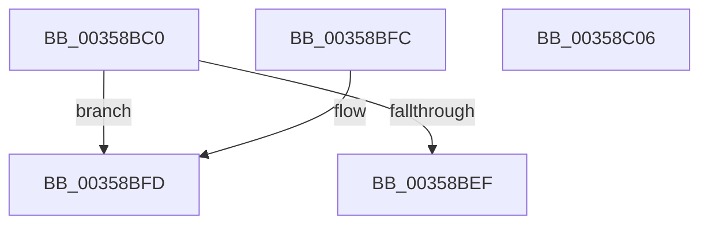

# CcGetNodeForReadAhead

- RVA: `0x00358BC0`–`0x00358C07` (길이 `71` bytes)
- VA: `0x0000000140358BC0`
- 실행 섹션: `.text`
- PDB 이름 있음: `예`; PDB Function 태그: `아니요`
- unwind 정보 RVA: `0x000DB714`
- 디코드: `15`개 명령, `71/71` bytes 표시
- 미해석 바이트: `0` (있으면 어셈블리에 `.byte`로 보존)

> 이 문서는 커널 이미지의 기계어와 PDB 기호를 분석해 생성했습니다. 4번과 5번은 함수 원형과 자료형을 바이너리 사용 방식에서 추정한 C 해석이며 원본 소스 복구 결과는 아닙니다.

## 1. Dependencies

- 직접 호출 지점: **0**; 고유 호출 대상: **0**
- 직접 호출자로 확인된 함수: **2**
- RIP 상대 이미지 참조: **2**

### Outgoing calls
- 직접 디코드된 call 명령이 없습니다.

### Direct callers
- [CcAsyncCopyRead](CcAsyncCopyRead_function_00358880.md) at `0x003588EF`
- [CcCopyReadEx](../45/CcCopyReadEx_function_0045E160.md) at `0x0045E215`

### Static image references
- `0x00358BE0` → RVA `0x00E0A874` (`.data`; read)
- `0x00358BE6` → RVA `0x00E65B88` (`.data`; read)

## 2. Other-region calls and transfers

- 다른 실행 섹션으로 향하는 call: **0**
- 별도 외부 분기/꼬리 이동을 확인하지 못했습니다.

## 3. Assembly (complete function range)

```asm
00358BC0  65 48 8B 04 25 20 00 00 00      mov rax, qword ptr gs:[0x20]
00358BC9  4C 8B 81 18 02 00 00            mov r8, qword ptr [rcx + 0x218]
00358BD0  48 8B 90 C0 00 00 00            mov rdx, qword ptr [rax + 0xc0]
00358BD7  0F B7 82 8A 00 00 00            movzx eax, word ptr [rdx + 0x8a]
00358BDE  33 D2                           xor edx, edx
00358BE0  F7 35 8E 1C AB 00               div dword ptr [rip + 0xab1c8e]
00358BE6  80 3D 9B CF B0 00 00            cmp byte ptr [rip + 0xb0cf9b], 0
00358BED  74 0E                           je 0x140358bfd
00358BEF  48 8B 81 58 02 00 00            mov rax, qword ptr [rcx + 0x258]
00358BF6  48 8B 44 D0 40                  mov rax, qword ptr [rax + rdx*8 + 0x40]
00358BFB  C3                              ret
00358BFC  CC                              int3
00358BFD  49 8B 84 D0 80 00 00 00         mov rax, qword ptr [r8 + rdx*8 + 0x80]
00358C05  C3                              ret
00358C06  CC                              int3
```

## 4. C-style interpretation (structured pseudocode)

```c
__int64 __fastcall CcGetNodeForReadAhead(__int64 a1)
{
    a2 = 0;
    if ((*(unsigned __int8 *)(v_rip + 11587483)) == 0) goto loc_00358BFD;
    return *(unsigned __int64 *)(*(unsigned __int64 *)(a1 + 600) + a2 * 8 + 64);
loc_00358BFD:
    return *(unsigned __int64 *)(*(unsigned __int64 *)(a1 + 536) + a2 * 8 + 128);
}
```

## 5. (Beta) C Style

```c
int64_t CcGetNodeForReadAhead(void *Arg1)
{
    uint8_t *arg1 = (uint8_t *)Arg1;

    a2 = 0;
    if ((*(uint8_t *)(v_rip + 0xB0CF9B)) == 0) goto loc_00358BFD;
    return *(uint64_t *)(*(uint64_t *)(arg1 + 0x258) + a2 * 8 + 0x40);
loc_00358BFD:
    return *(uint64_t *)(*(uint64_t *)(arg1 + 0x218) + a2 * 8 + 0x80);
}
```

### 관측된 메모리 오프셋

구조체 형식이 확인되지 않은 접근은 인자 기준의 오프셋으로만 기록했습니다.

| 기준 인자 | 오프셋 표현 | 폭 (bit) | 접근 |
|---|---:|---:|---|
| `Arg1` | `+ 0x218` | `64` | `R` |
| `Arg1` | `+ 0x258` | `64` | `R` |

## 6. Execution-region graph

[열기: 2D/3D 그래프와 함수 탐색 컨트롤 패널](../../../control-panel.html?section=text&rva=0x00358BC0&view=graph)

- 2D 그래프는 위에서 아래로 흐르고, 3D 그래프는 빈 공간을 드래그해 회전합니다. Shift+드래그는 이동, 휠은 확대·축소, 함수 노드 선택은 대상 보고서 이동입니다.

### Static fallback


