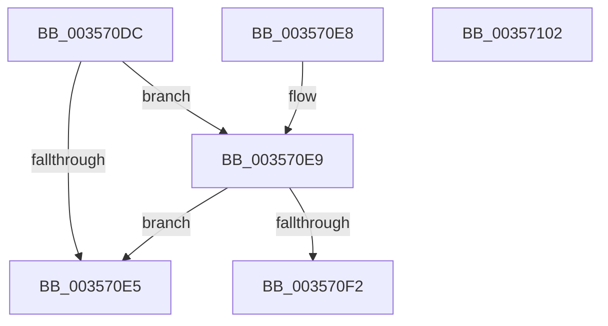

# CcIsWriteBehindThreadpoolAtLowPriority

- RVA: `0x003570DC`–`0x00357103` (길이 `39` bytes)
- VA: `0x00000001403570DC`
- 실행 섹션: `.text`
- PDB 이름 있음: `예`; PDB Function 태그: `아니요`
- unwind 정보 RVA: `0x000DB714`
- 디코드: `12`개 명령, `39/39` bytes 표시
- 미해석 바이트: `0` (있으면 어셈블리에 `.byte`로 보존)

> 이 문서는 커널 이미지의 기계어와 PDB 기호를 분석해 생성했습니다. 4번과 5번은 함수 원형과 자료형을 바이너리 사용 방식에서 추정한 C 해석이며 원본 소스 복구 결과는 아닙니다.

## 1. Dependencies

- 직접 호출 지점: **0**; 고유 호출 대상: **0**
- 직접 호출자로 확인된 함수: **10**
- RIP 상대 이미지 참조: **2**

### Outgoing calls
- 직접 디코드된 call 명령이 없습니다.

### Direct callers
- [CcWriteBehind](CcWriteBehind_function_00356EAC.md) at `0x00356FEC`
- [CcWriteBehindPreProcess](CcWriteBehindPreProcess_function_00357784.md) at `0x0035783A`
- [CcShouldWorkOnThisQueue](CcShouldWorkOnThisQueue_function_003587E8.md) at `0x00358826`
- [CcAdjustWriteBehindThreadPoolIfNeeded](../38/CcAdjustWriteBehindThreadPoolIfNeeded_function_00386D94.md) at `0x00386E19`
- [CcWorkerThread](../48/CcWorkerThread_function_0048F0F0.md) at `0x0048F25B`
- [CcComputeNextScanTime](../4A/CcComputeNextScanTime_function_004A2574.md) at `0x004A2587`
- [CcApplyLowIoPriorityToThread](../4A/CcApplyLowIoPriorityToThread_function_004A4210.md) at `0x004A4269`
- [sub_006E294A](../6E/Unknown_function_006E294A.md) at `0x006E295B`
- [sub_006E4CFE](../6E/Unknown_function_006E4CFE.md) at `0x006E4D43`
- [sub_006F937E](../6F/Unknown_function_006F937E.md) at `0x006F93E4`

### Static image references
- `0x003570DC` → RVA `0x00E65B88` (`.data`; read)
- `0x003570E9` → RVA `0x00E0A874` (`.data`; read)

## 2. Other-region calls and transfers

- 다른 실행 섹션으로 향하는 call: **0**
- 별도 외부 분기/꼬리 이동을 확인하지 못했습니다.

## 3. Assembly (complete function range)

```asm
003570DC  80 3D A5 EA B0 00 00            cmp byte ptr [rip + 0xb0eaa5], 0
003570E3  74 04                           je 0x1403570e9
003570E5  32 C0                           xor al, al
003570E7  C3                              ret
003570E8  CC                              int3
003570E9  83 3D 84 37 AB 00 01            cmp dword ptr [rip + 0xab3784], 1
003570F0  77 F3                           ja 0x1403570e5
003570F2  8B 81 48 03 00 00               mov eax, dword ptr [rcx + 0x348]
003570F8  39 81 08 05 00 00               cmp dword ptr [rcx + 0x508], eax
003570FE  0F 92 C0                        setb al
00357101  C3                              ret
00357102  CC                              int3
```

## 4. C-style interpretation (structured pseudocode)

```c
__int64 __fastcall CcIsWriteBehindThreadpoolAtLowPriority(__int64 a1)
{
    __int64 result;

    if ((*(unsigned __int8 *)(v_rip + 11594405)) == 0) goto loc_003570E9;
loc_003570E5:
    result = 0;
    return result;
loc_003570E9:
    if ((*(unsigned int *)(v_rip + 11220868)) > 1) goto loc_003570E5;
    result = ((*(unsigned int *)(a1 + 1288)) < ((unsigned int)((unsigned int)(*(unsigned int *)(a1 + 840))))) ? 1 : 0;
    return result;
}
```

## 5. (Beta) C Style

```c
int64_t CcIsWriteBehindThreadpoolAtLowPriority(void *Arg1)
{
    uint8_t *arg1 = (uint8_t *)Arg1;

    int64_t result;

    if ((*(uint8_t *)(v_rip + 0xB0EAA5)) == 0) goto loc_003570E9;
loc_003570E5:
    result = 0;
    return result;
loc_003570E9:
    if ((*(uint32_t *)(v_rip + 0xAB3784)) > 1) goto loc_003570E5;
    result = ((*(uint32_t *)(arg1 + 0x508)) < ((uint32_t)((uint32_t)(*(uint32_t *)(arg1 + 0x348))))) ? 1 : 0;
    return result;
}
```

### 관측된 메모리 오프셋

구조체 형식이 확인되지 않은 접근은 인자 기준의 오프셋으로만 기록했습니다.

| 기준 인자 | 오프셋 표현 | 폭 (bit) | 접근 |
|---|---:|---:|---|
| `Arg1` | `+ 0x348` | `32` | `R` |
| `Arg1` | `+ 0x508` | `32` | `R` |

## 6. Execution-region graph

[열기: 2D/3D 그래프와 함수 탐색 컨트롤 패널](../../../control-panel.html?section=text&rva=0x003570DC&view=graph)

- 2D 그래프는 위에서 아래로 흐르고, 3D 그래프는 빈 공간을 드래그해 회전합니다. Shift+드래그는 이동, 휠은 확대·축소, 함수 노드 선택은 대상 보고서 이동입니다.

### Static fallback


