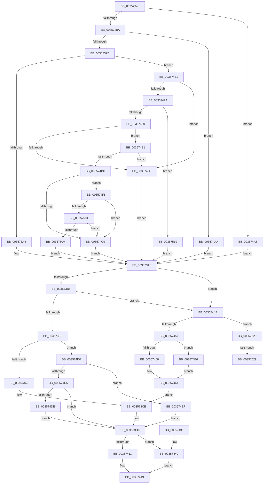

# CcPerfLogWorkItemEnqueue

- RVA: `0x00357340`–`0x00357532` (길이 `498` bytes)
- VA: `0x0000000140357340`
- 실행 섹션: `.text`
- PDB 이름 있음: `예`; PDB Function 태그: `예`
- unwind 정보 RVA: `0x000795E8`
- 디코드: `128`개 명령, `498/498` bytes 표시
- 미해석 바이트: `0` (있으면 어셈블리에 `.byte`로 보존)

> 이 문서는 커널 이미지의 기계어와 PDB 기호를 분석해 생성했습니다. 4번과 5번은 함수 원형과 자료형을 바이너리 사용 방식에서 추정한 C 해석이며 원본 소스 복구 결과는 아닙니다.

## 1. Dependencies

- 직접 호출 지점: **2**; 고유 호출 대상: **2**
- 직접 호출자로 확인된 함수: **8**
- RIP 상대 이미지 참조: **1**

### Outgoing calls
- `0x00357419` → [EtwTraceKernelEvent](../23/EtwTraceKernelEvent_function_00235350.md) (function, `0x00235350`)
- `0x00357425` → [_security_check_cookie](../6A/_security_check_cookie_function_006AC640.md) (function, `0x006AC640`)

### Direct callers
- [CcAsyncLazywriteWorker](CcAsyncLazywriteWorker_function_00354C28.md) at `0x00354EFF`
- [CcPostWorkQueueCachemapUninit](CcPostWorkQueueCachemapUninit_function_00356C94.md) at `0x00356CF3`
- [CcPostWorkQueueAsyncRead](../45/CcPostWorkQueueAsyncRead_function_0045D624.md) at `0x0045D95A`
- [CcWorkerThread](../48/CcWorkerThread_function_0048F0F0.md) at `0x0048F42F`
- [CcPostWorkQueueAsyncLazywrite](../4B/CcPostWorkQueueAsyncLazywrite_function_004BA17C.md) at `0x004BA2AC`
- [CcPostWorkQueueSpecial](../4C/CcPostWorkQueueSpecial_function_004C046C.md) at `0x004C04DF`
- [CcWaitForCurrentLazyWriterActivityOnNode](../57/CcWaitForCurrentLazyWriterActivityOnNode_function_0057C618.md) at `0x0057C6C3`
- [sub_006E294A](../6E/Unknown_function_006E294A.md) at `0x006E294D`

### Static image references
- `0x00357355` → RVA `0x00E0A740` (`.data`; read)

## 2. Other-region calls and transfers

- 다른 실행 섹션으로 향하는 call: **0**
- call이 아닌 외부 분기/꼬리 이동: **2**
  - `0x00357523` → [sub_006E2A72](../6E/Unknown_function_006E2A72.md) (`tail-transfer`)
  - `0x0035752D` → [sub_006E2A72 + 0x4](../6E/Unknown_function_006E2A72.md) (`tail-transfer`)

## 3. Assembly (complete function range)

```asm
00357340  48 89 5C 24 08                  mov qword ptr [rsp + 8], rbx
00357345  48 89 74 24 18                  mov qword ptr [rsp + 0x18], rsi
0035734A  55                              push rbp
0035734B  57                              push rdi
0035734C  41 56                           push r14
0035734E  48 8B EC                        mov rbp, rsp
00357351  48 83 EC 60                     sub rsp, 0x60
00357355  48 8B 05 E4 33 AB 00            mov rax, qword ptr [rip + 0xab33e4]
0035735C  48 33 C4                        xor rax, rsp
0035735F  48 89 45 F8                     mov qword ptr [rbp - 8], rax
00357363  33 C0                           xor eax, eax
00357365  48 8B FA                        mov rdi, rdx
00357368  48 8B 92 98 00 00 00            mov rdx, qword ptr [rdx + 0x98]
0035736F  0F 57 C0                        xorps xmm0, xmm0
00357372  48 89 45 E0                     mov qword ptr [rbp - 0x20], rax
00357376  45 8A F0                        mov r14b, r8b
00357379  0F 11 45 D0                     movups xmmword ptr [rbp - 0x30], xmm0
0035737D  48 8D 42 48                     lea rax, [rdx + 0x48]
00357381  48 3B C8                        cmp rcx, rax
00357384  0F 84 19 01 00 00               je 0x1403574a3
0035738A  48 8D 42 78                     lea rax, [rdx + 0x78]
0035738E  48 3B C8                        cmp rcx, rax
00357391  0F 84 13 01 00 00               je 0x1403574aa
00357397  48 8D 42 58                     lea rax, [rdx + 0x58]
0035739B  48 3B C8                        cmp rcx, rax
0035739E  0F 85 CD 00 00 00               jne 0x140357471
003573A4  B3 02                           mov bl, 2
003573A6  8B 87 80 00 00 00               mov eax, dword ptr [rdi + 0x80]
003573AC  83 F8 02                        cmp eax, 2
003573AF  0F 84 95 00 00 00               je 0x14035744a
003573B5  83 F8 07                        cmp eax, 7
003573B8  0F 84 8C 00 00 00               je 0x14035744a
003573BE  83 F8 01                        cmp eax, 1
003573C1  0F 85 09 01 00 00               jne 0x1403574d0
003573C7  88 45 E1                        mov byte ptr [rbp - 0x1f], al
003573CA  48 8B 47 10                     mov rax, qword ptr [rdi + 0x10]
003573CE  48 8B 48 18                     mov rcx, qword ptr [rax + 0x18]
003573D2  48 89 4D D8                     mov qword ptr [rbp - 0x28], rcx
003573D6  88 5D E0                        mov byte ptr [rbp - 0x20], bl
003573D9  48 89 7D D0                     mov qword ptr [rbp - 0x30], rdi
003573DD  44 88 75 E2                     mov byte ptr [rbp - 0x1e], r14b
003573E1  44 0F 20 C0                     mov rax, cr8
003573E5  83 65 F4 00                     and dword ptr [rbp - 0xc], 0
003573E9  48 8D 4D E8                     lea rcx, [rbp - 0x18]
003573ED  3C 02                           cmp al, 2
003573EF  C7 45 F0 18 00 00 00            mov dword ptr [rbp - 0x10], 0x18
003573F6  48 8D 45 D0                     lea rax, [rbp - 0x30]
003573FA  41 B9 00 16 00 00               mov r9d, 0x1600
00357400  48 89 45 E8                     mov qword ptr [rbp - 0x18], rax
00357404  BA 01 00 00 00                  mov edx, 1
00357409  41 B8 00 00 02 80               mov r8d, 0x80020000
0035740F  73 2F                           jae 0x140357440
00357411  C7 44 24 20 02 19 50 00         mov dword ptr [rsp + 0x20], 0x501902
00357419  E8 32 DF ED FF                  call 0x140235350
0035741E  48 8B 4D F8                     mov rcx, qword ptr [rbp - 8]
00357422  48 33 CC                        xor rcx, rsp
00357425  E8 16 52 35 00                  call 0x1406ac640
0035742A  4C 8D 5C 24 60                  lea r11, [rsp + 0x60]
0035742F  49 8B 5B 20                     mov rbx, qword ptr [r11 + 0x20]
00357433  49 8B 73 30                     mov rsi, qword ptr [r11 + 0x30]
00357437  49 8B E3                        mov rsp, r11
0035743A  41 5E                           pop r14
0035743C  5F                              pop rdi
0035743D  5D                              pop rbp
0035743E  C3                              ret
0035743F  CC                              int3
00357440  C7 44 24 20 02 01 50 00         mov dword ptr [rsp + 0x20], 0x500102
00357448  EB CF                           jmp 0x140357419
0035744A  C6 45 E1 02                     mov byte ptr [rbp - 0x1f], 2
0035744E  45 84 C9                        test r9b, r9b
00357451  0F 84 C9 00 00 00               je 0x140357520
00357457  83 F8 02                        cmp eax, 2
0035745A  0F 85 86 00 00 00               jne 0x1403574e6
00357460  48 8B 47 10                     mov rax, qword ptr [rdi + 0x10]
00357464  48 8B 40 60                     mov rax, qword ptr [rax + 0x60]
00357468  48 83 E0 F0                     and rax, 0xfffffffffffffff0
0035746C  E9 5D FF FF FF                  jmp 0x1403573ce
00357471  48 8D 42 68                     lea rax, [rdx + 0x68]
00357475  48 3B C8                        cmp rcx, rax
00357478  74 22                           je 0x14035749c
0035747A  48 8B 87 88 00 00 00            mov rax, qword ptr [rdi + 0x88]
00357481  48 05 50 03 00 00               add rax, 0x350
00357487  48 3B C8                        cmp rcx, rax
0035748A  0F 84 89 00 00 00               je 0x140357519
00357490  48 8D 82 38 01 00 00            lea rax, [rdx + 0x138]
00357497  48 3B C8                        cmp rcx, rax
0035749A  75 15                           jne 0x1403574b1
0035749C  B3 03                           mov bl, 3
0035749E  E9 03 FF FF FF                  jmp 0x1403573a6
003574A3  B3 01                           mov bl, 1
003574A5  E9 FC FE FF FF                  jmp 0x1403573a6
003574AA  B3 07                           mov bl, 7
003574AC  E9 F5 FE FF FF                  jmp 0x1403573a6
003574B1  48 8D 82 80 01 00 00            lea rax, [rdx + 0x180]
003574B8  48 3B C8                        cmp rcx, rax
003574BB  74 DF                           je 0x14035749c
003574BD  4C 8B 82 00 01 00 00            mov r8, qword ptr [rdx + 0x100]
003574C4  49 3B C8                        cmp rcx, r8
003574C7  75 2F                           jne 0x1403574f8
003574C9  B3 05                           mov bl, 5
003574CB  E9 D6 FE FF FF                  jmp 0x1403573a6
003574D0  83 F8 03                        cmp eax, 3
003574D3  74 1A                           je 0x1403574ef
003574D5  83 F8 04                        cmp eax, 4
003574D8  0F 85 F8 FE FF FF               jne 0x1403573d6
003574DE  88 45 E1                        mov byte ptr [rbp - 0x1f], al
003574E1  E9 F0 FE FF FF                  jmp 0x1403573d6
003574E6  48 8B 47 18                     mov rax, qword ptr [rdi + 0x18]
003574EA  E9 75 FF FF FF                  jmp 0x140357464
003574EF  C6 45 E1 03                     mov byte ptr [rbp - 0x1f], 3
003574F3  E9 DE FE FF FF                  jmp 0x1403573d6
003574F8  49 8D 40 10                     lea rax, [r8 + 0x10]
003574FC  48 3B C8                        cmp rcx, rax
003574FF  74 C8                           je 0x1403574c9
00357501  49 8D 40 20                     lea rax, [r8 + 0x20]
00357505  48 3B C8                        cmp rcx, rax
00357508  74 BF                           je 0x1403574c9
0035750A  48 F7 D9                        neg rcx
0035750D  1A DB                           sbb bl, bl
0035750F  F6 D3                           not bl
00357511  80 E3 06                        and bl, 6
00357514  E9 8D FE FF FF                  jmp 0x1403573a6
00357519  B3 04                           mov bl, 4
0035751B  E9 86 FE FF FF                  jmp 0x1403573a6
00357520  83 F8 02                        cmp eax, 2
00357523  0F 85 49 B5 38 00               jne 0x1406e2a72
00357529  48 8B 77 10                     mov rsi, qword ptr [rdi + 0x10]
0035752D  E9 44 B5 38 00                  jmp 0x1406e2a76
```

## 4. C-style interpretation (structured pseudocode)

```c
__int64 __fastcall CcPerfLogWorkItemEnqueue(__int64 a1, __int64 a2, unsigned __int8 a3)
{
    __int64 result;
    __int64 v_rbx;
    __int64 v_rsp;
    unsigned __int64 v_stack_m18;
    unsigned __int64 v_stack_m20;
    unsigned int v_stack_m24;
    unsigned int v_stack_m28;
    unsigned __int64 v_stack_m30;
    unsigned __int8 v_stack_m36;
    unsigned __int8 v_stack_m37;
    unsigned __int64 v_stack_m38;
    unsigned __int64 v_stack_m40;
    unsigned __int64 v_stack_m48;
    unsigned int v_stack_m58;
    unsigned __int64 v_stack_p18;
    unsigned __int64 v_stack_p8;

    v_stack_p8 = v_rbx;
    v_stack_p18 = v_rsi;
    v_rsp = (v_rsp) - (96);
    result = (*(unsigned __int64 *)(v_rip + 11219940)) ^ (v_rsp);
    v_stack_m20 = result;
    result = 0;
    v_stack_m38 = 0;
    v_stack_m48 = v_xmm0;
    if (a1 == (*(unsigned __int64 *)(a2 + 152) + 72)) goto loc_003574A3;
    if (a1 == (*(unsigned __int64 *)(a2 + 152) + 120)) goto loc_003574AA;
    if (a1 != (*(unsigned __int64 *)(a2 + 152) + 88)) goto loc_00357471;
loc_003573A6:
    if (((unsigned int)((unsigned int)(*(unsigned int *)(a2 + 128)))) == 2) goto loc_0035744A;
    if (((unsigned int)((unsigned int)(*(unsigned int *)(a2 + 128)))) == 7) goto loc_0035744A;
    if (((unsigned int)((unsigned int)(*(unsigned int *)(a2 + 128)))) != 1) goto loc_003574D0;
    v_stack_m37 = (unsigned __int8)((unsigned int)(*(unsigned int *)(a2 + 128)));
loc_003573CE:
    v_stack_m40 = *(unsigned __int64 *)(*(unsigned __int64 *)(a2 + 16) + 24);
loc_003573D6:
    v_stack_m38 = 2;
    v_stack_m48 = a2;
    v_stack_m36 = a3;
    v_stack_m28 = 24;
    v_stack_m30 = v_stack_m48;
    if (((unsigned __int8)(v_cr8)) >= 2) goto loc_00357440;
    v_stack_m58 = 0x501902ULL;
loc_00357419:
    result = EtwTraceKernelEvent(v_stack_m30, 1, (unsigned int)(0x80020000ULL), (unsigned int)(0x1600ULL));
    a1 = (v_stack_m20) ^ (v_rsp);
    result = _security_check_cookie(a1, 1, (unsigned int)(0x80020000ULL), (unsigned int)(0x1600ULL));
    return result;
loc_00357440:
    v_stack_m40 = 0x500102ULL;
    goto loc_00357419;
loc_0035744A:
    v_stack_m37 = 2;
    if ((unsigned __int8)((unsigned int)(0x1600ULL)) == 0) goto loc_00357520;
    if (((unsigned int)(result)) != 2) goto loc_003574E6;
loc_00357464:
    result = (*(unsigned __int64 *)(*(unsigned __int64 *)(a2 + 16) + 96)) & (-16);
    goto loc_003573CE;
loc_00357471:
    if (a1 == (1 + 104)) goto loc_0035749C;
    result = (*(unsigned __int64 *)(a2 + 136)) + (848);
    if (a1 == result) goto loc_00357519;
    if (a1 != (1 + 312)) goto loc_003574B1;
loc_0035749C:
    goto loc_003573A6;
loc_003574A3:
    goto loc_003573A6;
loc_003574AA:
    goto loc_003573A6;
loc_003574B1:
    if (a1 == (1 + 384)) goto loc_0035749C;
    if (a1 != (*(unsigned __int64 *)(1 + 256))) goto loc_003574F8;
loc_003574C9:
    goto loc_003573A6;
loc_003574D0:
    if (((unsigned int)(1 + 384)) == 3) goto loc_003574EF;
    if (((unsigned int)(1 + 384)) != 4) goto loc_003573D6;
    v_stack_m37 = (unsigned __int8)(1 + 384);
    goto loc_003573D6;
loc_003574E6:
    goto loc_00357464;
loc_003574EF:
    v_stack_m37 = 3;
    goto loc_003573D6;
loc_003574F8:
    if (a1 == (*(unsigned __int64 *)(1 + 256) + 16)) goto loc_003574C9;
    if (a1 == (*(unsigned __int64 *)(1 + 256) + 32)) goto loc_003574C9;
    a1 = -(a1);
    v_rbx = (unsigned __int8)(~(5));
    v_rbx = (unsigned __int8)((v_rbx) & (6));
    goto loc_003573A6;
loc_00357519:
    goto loc_003573A6;
loc_00357520:
}
```

## 5. (Beta) C Style

```c
int64_t CcPerfLogWorkItemEnqueue(int64_t Arg1, void *Arg2, uint8_t Arg3)
{
    uint8_t *arg2 = (uint8_t *)Arg2;

    int64_t result;
    int64_t local_rbx;
    int64_t local_rsp;
    uint64_t v_stack_m18;
    uint64_t v_stack_m20;
    uint32_t v_stack_m24;
    uint32_t v_stack_m28;
    uint64_t v_stack_m30;
    uint8_t v_stack_m36;
    uint8_t v_stack_m37;
    uint64_t v_stack_m38;
    uint64_t v_stack_m40;
    uint64_t v_stack_m48;
    uint32_t v_stack_m58;
    uint64_t v_stack_p18;
    uint64_t v_stack_p8;

    v_stack_p8 = local_rbx;
    v_stack_p18 = local_rsi;
    local_rsp = (local_rsp) - (96);
    result = (*(uint64_t *)(v_rip + 0xAB33E4)) ^ (local_rsp);
    v_stack_m20 = result;
    result = 0;
    v_stack_m38 = 0;
    v_stack_m48 = v_xmm0;
    if (Arg1 == (*(uint64_t *)(arg2 + 0x98) + 72)) goto loc_003574A3;
    if (Arg1 == (*(uint64_t *)(arg2 + 0x98) + 120)) goto loc_003574AA;
    if (Arg1 != (*(uint64_t *)(arg2 + 0x98) + 88)) goto loc_00357471;
loc_003573A6:
    if (((uint32_t)((uint32_t)(*(uint32_t *)(arg2 + 0x80)))) == 2) goto loc_0035744A;
    if (((uint32_t)((uint32_t)(*(uint32_t *)(arg2 + 0x80)))) == 7) goto loc_0035744A;
    if (((uint32_t)((uint32_t)(*(uint32_t *)(arg2 + 0x80)))) != 1) goto loc_003574D0;
    v_stack_m37 = (uint8_t)((uint32_t)(*(uint32_t *)(arg2 + 0x80)));
loc_003573CE:
    v_stack_m40 = *(uint64_t *)(*(uint64_t *)(arg2 + 0x10) + 0x18);
loc_003573D6:
    v_stack_m38 = 2;
    v_stack_m48 = Arg2;
    v_stack_m36 = Arg3;
    v_stack_m28 = 24;
    v_stack_m30 = v_stack_m48;
    if (((uint8_t)(v_cr8)) >= 2) goto loc_00357440;
    v_stack_m58 = 0x501902ULL;
loc_00357419:
    result = EtwTraceKernelEvent(v_stack_m30, 1, (uint32_t)(0x80020000ULL), (uint32_t)(0x1600ULL));
    Arg1 = (v_stack_m20) ^ (local_rsp);
    result = _security_check_cookie(Arg1, 1, (uint32_t)(0x80020000ULL), (uint32_t)(0x1600ULL));
    return result;
loc_00357440:
    v_stack_m40 = 0x500102ULL;
    goto loc_00357419;
loc_0035744A:
    v_stack_m37 = 2;
    if ((uint8_t)((uint32_t)(0x1600ULL)) == 0) goto loc_00357520;
    if (((uint32_t)(result)) != 2) goto loc_003574E6;
loc_00357464:
    result = (*(uint64_t *)(*(uint64_t *)(arg2 + 0x10) + 0x60)) & (-16);
    goto loc_003573CE;
loc_00357471:
    if (Arg1 == (1 + 104)) goto loc_0035749C;
    result = (*(uint64_t *)(arg2 + 0x88)) + (848);
    if (Arg1 == result) goto loc_00357519;
    if (Arg1 != (1 + 312)) goto loc_003574B1;
loc_0035749C:
    goto loc_003573A6;
loc_003574A3:
    goto loc_003573A6;
loc_003574AA:
    goto loc_003573A6;
loc_003574B1:
    if (Arg1 == (1 + 384)) goto loc_0035749C;
    if (Arg1 != (*(uint64_t *)(1 + 0x100))) goto loc_003574F8;
loc_003574C9:
    goto loc_003573A6;
loc_003574D0:
    if (((uint32_t)(1 + 384)) == 3) goto loc_003574EF;
    if (((uint32_t)(1 + 384)) != 4) goto loc_003573D6;
    v_stack_m37 = (uint8_t)(1 + 384);
    goto loc_003573D6;
loc_003574E6:
    goto loc_00357464;
loc_003574EF:
    v_stack_m37 = 3;
    goto loc_003573D6;
loc_003574F8:
    if (Arg1 == (*(uint64_t *)(1 + 0x100) + 16)) goto loc_003574C9;
    if (Arg1 == (*(uint64_t *)(1 + 0x100) + 32)) goto loc_003574C9;
    Arg1 = -(Arg1);
    local_rbx = (uint8_t)(~(5));
    local_rbx = (uint8_t)((local_rbx) & (6));
    goto loc_003573A6;
loc_00357519:
    goto loc_003573A6;
loc_00357520:
}
```

### 관측된 메모리 오프셋

구조체 형식이 확인되지 않은 접근은 인자 기준의 오프셋으로만 기록했습니다.

| 기준 인자 | 오프셋 표현 | 폭 (bit) | 접근 |
|---|---:|---:|---|
| `Arg2` | `+ 0x10` | `64` | `R` |
| `Arg2` | `+ 0x18` | `64` | `R` |
| `Arg2` | `+ 0x80` | `32` | `R` |
| `Arg2` | `+ 0x88` | `64` | `R` |
| `Arg2` | `+ 0x98` | `64` | `R` |

## 6. Execution-region graph

[열기: 2D/3D 그래프와 함수 탐색 컨트롤 패널](../../../control-panel.html?section=text&rva=0x00357340&view=graph)

- 2D 그래프는 위에서 아래로 흐르고, 3D 그래프는 빈 공간을 드래그해 회전합니다. Shift+드래그는 이동, 휠은 확대·축소, 함수 노드 선택은 대상 보고서 이동입니다.

### Static fallback


