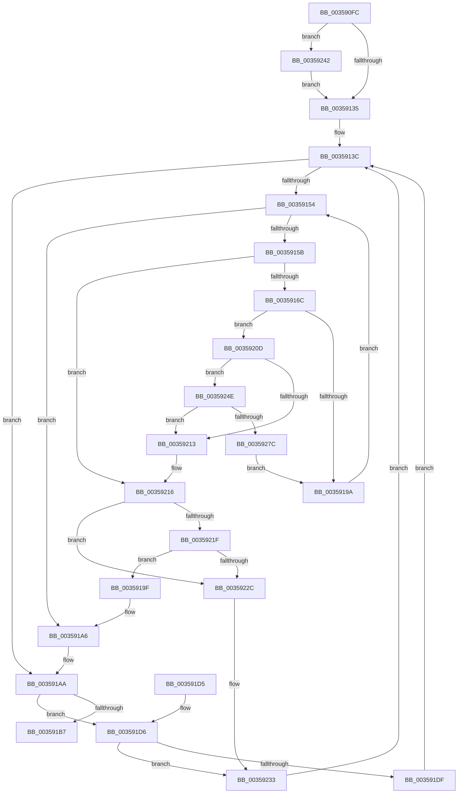

# CcPostDeferredWrites

- RVA: `0x003590FC`–`0x00359281` (길이 `389` bytes)
- VA: `0x00000001403590FC`
- 실행 섹션: `.text`
- PDB 이름 있음: `예`; PDB Function 태그: `아니요`
- unwind 정보 RVA: `0x00079824`
- 디코드: `104`개 명령, `389/389` bytes 표시
- 미해석 바이트: `0` (있으면 어셈블리에 `.byte`로 보존)

> 이 문서는 커널 이미지의 기계어와 PDB 기호를 분석해 생성했습니다. 4번과 5번은 함수 원형과 자료형을 바이너리 사용 방식에서 추정한 C 해석이며 원본 소스 복구 결과는 아닙니다.

## 1. Dependencies

- 직접 호출 지점: **7**; 고유 호출 대상: **7**
- 직접 호출자로 확인된 함수: **13**
- RIP 상대 이미지 참조: **3**

### Outgoing calls
- `0x00359141` → [KeAcquireSpinLockRaiseToDpc](../20/KeAcquireSpinLockRaiseToDpc_function_00208470.md) (function, `0x00208470`)
- `0x00359191` → [CcCanIWriteStreamEx](../38/CcCanIWriteStreamEx_function_0038993C.md) (function, `0x0038993C`)
- `0x003591AD` → [KeReleaseSpinLock](../39/KeReleaseSpinLock_function_00392BA0.md) (function, `0x00392BA0`)
- `0x003591EB` → [guard_dispatch_icall](../6B/guard_dispatch_icall_function_006BAAD0.md) (function, `0x006BAAD0`)
- `0x003591F8` → [ExFreePoolWithTag](../../poolcode/B8/ExFreePoolWithTag_function_00B82870.md) (function, `0x00B82870`)
- `0x00359203` → [CcDereferencePartitionAndPrivateVolumeCacheMap](../38/CcDereferencePartitionAndPrivateVolumeCacheMap_function_0038B94C.md) (function, `0x0038B94C`)
- `0x00359238` → [KeSetEvent](../33/KeSetEvent_function_0033F310.md) (function, `0x0033F310`)

### Direct callers
- [CcFlushCachePostProcessOneRange](CcFlushCachePostProcessOneRange_function_00359710.md) at `0x00359A19`
- [sub_0035A818](Unknown_function_0035A818.md) at `0x0035A82E`
- [CcCanIWrite](../38/CcCanIWrite_function_00388250.md) at `0x00388632`
- [CcLazyWriteScanVolume](../38/CcLazyWriteScanVolume_function_00388DC0.md) at `0x00389218`
- [CcLazyWriteScan](../3C/CcLazyWriteScan_function_003C9394.md) at `0x003C9ABD`
- [CcReapPrivateVolumeCachemap](../3C/CcReapPrivateVolumeCachemap_function_003CF1B8.md) at `0x003CF281`
- [CcNotifyOfMappedWriteComplete](../40/CcNotifyOfMappedWriteComplete_function_0040873C.md) at `0x004087EF`
- [CcUnpinRepinnedBcb](../49/CcUnpinRepinnedBcb_function_0049F560.md) at `0x0049F679`
- [CcDeductDirtyPagesFromExternalCache](../4A/CcDeductDirtyPagesFromExternalCache_function_004A65D0.md) at `0x004A66A6`
- [CcDeferWrite](../57/CcDeferWrite_function_0057C860.md) at `0x0057C96E`
- [CcPostDeferredWritesOnVolumeHelper](../57/CcPostDeferredWritesOnVolumeHelper_function_0057DCB0.md) at `0x0057DCB4`
- [CcExitPartition](../57/CcExitPartition_function_0057E340.md) at `0x0057E480`
- [sub_006E4F4E](../6E/Unknown_function_006E4F4E.md) at `0x006E4F8C`

### Static image references
- `0x00359122` → RVA `0x00E65B88` (`.data`; read)
- `0x0035924E` → RVA `0x00E65B6C` (`.data`; read)
- `0x00359269` → RVA `0x00FC6AA0` (`ALMOSTRO`; read)

## 2. Other-region calls and transfers

- 다른 실행 섹션으로 향하는 call: **1**
  - `0x003591F8` → [ExFreePoolWithTag](../../poolcode/B8/ExFreePoolWithTag_function_00B82870.md) (`.text` → `POOLCODE`)
- 별도 외부 분기/꼬리 이동을 확인하지 못했습니다.

## 3. Assembly (complete function range)

```asm
003590FC  48 89 5C 24 10                  mov qword ptr [rsp + 0x10], rbx
00359101  48 89 6C 24 18                  mov qword ptr [rsp + 0x18], rbp
00359106  48 89 74 24 20                  mov qword ptr [rsp + 0x20], rsi
0035910B  57                              push rdi
0035910C  41 54                           push r12
0035910E  41 55                           push r13
00359110  41 56                           push r14
00359112  41 57                           push r15
00359114  48 83 EC 40                     sub rsp, 0x40
00359118  45 33 ED                        xor r13d, r13d
0035911B  4C 8D B2 50 04 00 00            lea r14, [rdx + 0x450]
00359122  44 38 2D 5F CA B0 00            cmp byte ptr [rip + 0xb0ca5f], r13b
00359129  4C 8B FA                        mov r15, rdx
0035912C  48 8B E9                        mov rbp, rcx
0035912F  0F 84 0D 01 00 00               je 0x140359242
00359135  4C 8D A1 C0 04 00 00            lea r12, [rcx + 0x4c0]
0035913C  49 8B CC                        mov rcx, r12
0035913F  33 F6                           xor esi, esi
00359141  E8 2A F3 EA FF                  call 0x140208470
00359146  49 8B 3E                        mov rdi, qword ptr [r14]
00359149  8A D0                           mov dl, al
0035914B  88 44 24 70                     mov byte ptr [rsp + 0x70], al
0035914F  49 3B FE                        cmp rdi, r14
00359152  74 56                           je 0x1403591aa
00359154  33 F6                           xor esi, esi
00359156  49 3B FE                        cmp rdi, r14
00359159  74 4B                           je 0x1403591a6
0035915B  80 BD 0E 05 00 00 01            cmp byte ptr [rbp + 0x50e], 1
00359162  48 8D 77 E8                     lea rsi, [rdi - 0x18]
00359166  0F 87 AA 00 00 00               ja 0x140359216
0035916C  44 8B 4E 10                     mov r9d, dword ptr [rsi + 0x10]
00359170  49 8B D7                        mov rdx, r15
00359173  48 83 64 24 30 00               and qword ptr [rsp + 0x30], 0
00359179  48 8B CD                        mov rcx, rbp
0035917C  4C 8B 46 08                     mov r8, qword ptr [rsi + 8]
00359180  C7 44 24 28 02 00 00 00         mov dword ptr [rsp + 0x28], 2
00359188  43 8D 1C 29                     lea ebx, [r9 + r13]
0035918C  44 89 6C 24 20                  mov dword ptr [rsp + 0x20], r13d
00359191  E8 A6 07 03 00                  call 0x14038993c
00359196  84 C0                           test al, al
00359198  75 73                           jne 0x14035920d
0035919A  48 8B 3F                        mov rdi, qword ptr [rdi]
0035919D  EB B5                           jmp 0x140359154
0035919F  48 89 08                        mov qword ptr [rax], rcx
003591A2  48 89 41 08                     mov qword ptr [rcx + 8], rax
003591A6  8A 54 24 70                     mov dl, byte ptr [rsp + 0x70]
003591AA  49 8B CC                        mov rcx, r12
003591AD  E8 EE 99 03 00                  call 0x140392ba0
003591B2  48 85 F6                        test rsi, rsi
003591B5  75 1F                           jne 0x1403591d6
003591B7  4C 8D 5C 24 40                  lea r11, [rsp + 0x40]
003591BC  49 8B 5B 38                     mov rbx, qword ptr [r11 + 0x38]
003591C0  49 8B 6B 40                     mov rbp, qword ptr [r11 + 0x40]
003591C4  49 8B 73 48                     mov rsi, qword ptr [r11 + 0x48]
003591C8  49 8B E3                        mov rsp, r11
003591CB  41 5F                           pop r15
003591CD  41 5E                           pop r14
003591CF  41 5D                           pop r13
003591D1  41 5C                           pop r12
003591D3  5F                              pop rdi
003591D4  C3                              ret
003591D5  CC                              int3
003591D6  48 8B 4E 28                     mov rcx, qword ptr [rsi + 0x28]
003591DA  48 85 C9                        test rcx, rcx
003591DD  75 54                           jne 0x140359233
003591DF  48 8B 46 30                     mov rax, qword ptr [rsi + 0x30]
003591E3  48 8B 56 40                     mov rdx, qword ptr [rsi + 0x40]
003591E7  48 8B 4E 38                     mov rcx, qword ptr [rsi + 0x38]
003591EB  E8 E0 18 36 00                  call 0x1406baad0
003591F0  BA 43 63 44 77                  mov edx, 0x77446343
003591F5  48 8B CE                        mov rcx, rsi
003591F8  E8 73 96 82 00                  call 0x140b82870
003591FD  49 8B D7                        mov rdx, r15
00359200  48 8B CD                        mov rcx, rbp
00359203  E8 44 27 03 00                  call 0x14038b94c
00359208  E9 2F FF FF FF                  jmp 0x14035913c
0035920D  80 7E 58 00                     cmp byte ptr [rsi + 0x58], 0
00359211  75 3B                           jne 0x14035924e
00359213  44 8B EB                        mov r13d, ebx
00359216  48 8B 0F                        mov rcx, qword ptr [rdi]
00359219  48 39 79 08                     cmp qword ptr [rcx + 8], rdi
0035921D  75 0D                           jne 0x14035922c
0035921F  48 8B 47 08                     mov rax, qword ptr [rdi + 8]
00359223  48 39 38                        cmp qword ptr [rax], rdi
00359226  0F 84 73 FF FF FF               je 0x14035919f
0035922C  B9 03 00 00 00                  mov ecx, 3
00359231  CD 29                           int 0x29
00359233  45 33 C0                        xor r8d, r8d
00359236  33 D2                           xor edx, edx
00359238  E8 D3 60 FE FF                  call 0x14033f310
0035923D  E9 FA FE FF FF                  jmp 0x14035913c
00359242  4C 8D B1 90 04 00 00            lea r14, [rcx + 0x490]
00359249  E9 E7 FE FF FF                  jmp 0x140359135
0035924E  8B 05 18 C9 B0 00               mov eax, dword ptr [rip + 0xb0c918]
00359254  33 D2                           xor edx, edx
00359256  69 C0 10 27 00 00               imul eax, eax, 0x2710
0035925C  48 B9 20 03 00 00 80 F7 FF FF   movabs rcx, 0xfffff78000000320
00359266  48 8B 09                        mov rcx, qword ptr [rcx]
00359269  44 8B 05 30 D8 C6 00            mov r8d, dword ptr [rip + 0xc6d830]
00359270  49 F7 F0                        div r8
00359273  48 03 46 60                     add rax, qword ptr [rsi + 0x60]
00359277  48 3B C8                        cmp rcx, rax
0035927A  7D 97                           jge 0x140359213
0035927C  E9 19 FF FF FF                  jmp 0x14035919a
```

## 4. C-style interpretation (structured pseudocode)

```c
__int64 __fastcall CcPostDeferredWrites(__int64 a1, __int64 a2)
{
    __int64 result;
    __int64 v_r13;
    __int64 v_rsi;
    __int64 v_rsp;
    unsigned __int64 v_stack_m28;
    unsigned __int64 v_stack_m38;
    unsigned int v_stack_m40;
    unsigned int v_stack_m48;
    unsigned __int64 v_stack_p10;
    unsigned __int64 v_stack_p18;
    unsigned __int64 v_stack_p20;
    unsigned __int8 v_stack_p8;

    v_stack_p10 = v_rbx;
    v_stack_p18 = v_rbp;
    v_stack_p20 = v_rsi;
    v_rsp = (v_rsp) - (64);
    v_r13 = 0;
    if ((*(unsigned __int8 *)(v_rip + 11586143)) == 0) goto loc_00359242;
loc_00359135:
loc_0035913C:
    v_rsi = 0;
    result = KeAcquireSpinLockRaiseToDpc(a1 + 1216, a2, a3, a4);
    v_stack_p8 = (unsigned __int8)(result);
    if ((*(unsigned __int64 *)(a2 + 1104)) == (a2 + 1104)) goto loc_003591AA;
loc_00359154:
    v_rsi = 0;
    if ((*(unsigned __int64 *)(a2 + 1104)) == (a2 + 1104)) goto loc_003591A6;
    if ((*(unsigned __int8 *)(a1 + 1294)) > 1) goto loc_00359216;
    v_stack_m40 = 2;
    v_stack_m48 = 0;
    result = CcCanIWriteStreamEx(a1, a2, *(unsigned __int64 *)(*(unsigned __int64 *)(a2 + 1104) - 24 + 8), (unsigned int)(*(unsigned int *)(*(unsigned __int64 *)(a2 + 1104) - 24 + 16)));
    if ((unsigned __int8)(result) != 0) goto loc_0035920D;
loc_0035919A:
    goto loc_00359154;
loc_0035919F:
    *(unsigned __int64 *)(result) = a1;
    *(unsigned __int64 *)(a1 + 8) = result;
loc_003591A6:
loc_003591AA:
    result = KeReleaseSpinLock(a1 + 1216, v_stack_p8, *(unsigned __int64 *)(*(unsigned __int64 *)(a2 + 1104) - 24 + 8), (unsigned int)(*(unsigned int *)(*(unsigned __int64 *)(a2 + 1104) - 24 + 16)));
    if (*(unsigned __int64 *)(a2 + 1104) - 24 != 0) goto loc_003591D6;
    return result;
loc_003591D6:
    if (*(unsigned __int64 *)(*(unsigned __int64 *)(v_stack_m28 + 72) + 40) != 0) goto loc_00359233;
    result = guard_dispatch_icall(*(unsigned __int64 *)(*(unsigned __int64 *)(v_stack_m28 + 72) + 56), *(unsigned __int64 *)(*(unsigned __int64 *)(v_stack_m28 + 72) + 64), *(unsigned __int64 *)(*(unsigned __int64 *)(a2 + 1104) - 24 + 8), (unsigned int)(*(unsigned int *)(*(unsigned __int64 *)(a2 + 1104) - 24 + 16)));
    result = ExFreePoolWithTag(*(unsigned __int64 *)(v_stack_m28 + 72), (unsigned int)(0x77446343ULL), *(unsigned __int64 *)(*(unsigned __int64 *)(a2 + 1104) - 24 + 8), (unsigned int)(*(unsigned int *)(*(unsigned __int64 *)(a2 + 1104) - 24 + 16)));
    result = CcDereferencePartitionAndPrivateVolumeCacheMap(*(unsigned __int64 *)(v_stack_m28 + 64), a2, *(unsigned __int64 *)(*(unsigned __int64 *)(a2 + 1104) - 24 + 8), (unsigned int)(*(unsigned int *)(*(unsigned __int64 *)(a2 + 1104) - 24 + 16)));
    goto loc_0035913C;
loc_0035920D:
    if ((*(unsigned __int8 *)(*(unsigned __int64 *)(v_stack_m28 + 72) + 88)) != 0) goto loc_0035924E;
loc_00359213:
loc_00359216:
    if ((*(unsigned __int64 *)(*(unsigned __int64 *)(*(unsigned __int64 *)(*(unsigned __int64 *)(a2 + 1104))) + 8)) != (*(unsigned __int64 *)(*(unsigned __int64 *)(a2 + 1104)))) goto loc_0035922C;
    if ((*(unsigned __int64 *)(*(unsigned __int64 *)(*(unsigned __int64 *)(*(unsigned __int64 *)(a2 + 1104)) + 8))) == (*(unsigned __int64 *)(*(unsigned __int64 *)(a2 + 1104)))) goto loc_0035919F;
loc_0035922C:
loc_00359233:
    a3 = 0;
    a2 = 0;
    result = KeSetEvent(3, a2, a3, (unsigned int)(*(unsigned int *)(*(unsigned __int64 *)(a2 + 1104) - 24 + 16)));
    goto loc_0035913C;
loc_00359242:
    goto loc_00359135;
loc_0035924E:
    a2 = 0;
    result = (unsigned int)(((unsigned int)(*(unsigned int *)(v_rip + 11585816))) * ((unsigned int)((unsigned int)(*(unsigned int *)(v_rip + 11585816)))));
    result = (result) + (*(unsigned __int64 *)(*(unsigned __int64 *)(v_stack_m28 + 72) + 96));
    if ((*(unsigned __int64 *)(3)) >= result) goto loc_00359213;
    goto loc_0035919A;
}
```

## 5. (Beta) C Style

```c
int64_t CcPostDeferredWrites(void *Arg1, void *Arg2)
{
    uint8_t *arg1 = (uint8_t *)Arg1;
    uint8_t *arg2 = (uint8_t *)Arg2;

    int64_t result;
    int64_t local_r13;
    int64_t local_rsi;
    int64_t local_rsp;
    uint64_t v_stack_m28;
    uint64_t v_stack_m38;
    uint32_t v_stack_m40;
    uint32_t v_stack_m48;
    uint64_t v_stack_p10;
    uint64_t v_stack_p18;
    uint64_t v_stack_p20;
    uint8_t v_stack_p8;

    v_stack_p10 = local_rbx;
    v_stack_p18 = local_rbp;
    v_stack_p20 = local_rsi;
    local_rsp = (local_rsp) - (64);
    local_r13 = 0;
    if ((*(uint8_t *)(v_rip + 0xB0CA5F)) == 0) goto loc_00359242;
loc_00359135:
loc_0035913C:
    local_rsi = 0;
    result = KeAcquireSpinLockRaiseToDpc(Arg1 + 1216, Arg2, a3, a4);
    v_stack_p8 = (uint8_t)(result);
    if ((*(uint64_t *)(arg2 + 0x450)) == (Arg2 + 1104)) goto loc_003591AA;
loc_00359154:
    local_rsi = 0;
    if ((*(uint64_t *)(arg2 + 0x450)) == (Arg2 + 1104)) goto loc_003591A6;
    if ((*(uint8_t *)(arg1 + 0x50E)) > 1) goto loc_00359216;
    v_stack_m40 = 2;
    v_stack_m48 = 0;
    result = CcCanIWriteStreamEx(Arg1, Arg2, *(uint64_t *)(*(uint64_t *)(arg2 + 0x450) - 0x18 + 0x8), (uint32_t)(*(uint32_t *)(*(uint64_t *)(arg2 + 0x450) - 0x18 + 0x10)));
    if ((uint8_t)(result) != 0) goto loc_0035920D;
loc_0035919A:
    goto loc_00359154;
loc_0035919F:
    *(void **)(result) = Arg1;
    *(uint64_t *)(arg1 + 0x8) = result;
loc_003591A6:
loc_003591AA:
    result = KeReleaseSpinLock(Arg1 + 1216, v_stack_p8, *(uint64_t *)(*(uint64_t *)(arg2 + 0x450) - 0x18 + 0x8), (uint32_t)(*(uint32_t *)(*(uint64_t *)(arg2 + 0x450) - 0x18 + 0x10)));
    if (*(uint64_t *)(arg2 + 0x450) - 24 != 0) goto loc_003591D6;
    return result;
loc_003591D6:
    if (*(uint64_t *)(*(uint64_t *)(v_stack_m28 + 0x48) + 0x28) != 0) goto loc_00359233;
    result = guard_dispatch_icall(*(uint64_t *)(*(uint64_t *)(v_stack_m28 + 0x48) + 0x38), *(uint64_t *)(*(uint64_t *)(v_stack_m28 + 0x48) + 0x40), *(uint64_t *)(*(uint64_t *)(arg2 + 0x450) - 0x18 + 0x8), (uint32_t)(*(uint32_t *)(*(uint64_t *)(arg2 + 0x450) - 0x18 + 0x10)));
    result = ExFreePoolWithTag(*(uint64_t *)(v_stack_m28 + 0x48), (uint32_t)(0x77446343ULL), *(uint64_t *)(*(uint64_t *)(arg2 + 0x450) - 0x18 + 0x8), (uint32_t)(*(uint32_t *)(*(uint64_t *)(arg2 + 0x450) - 0x18 + 0x10)));
    result = CcDereferencePartitionAndPrivateVolumeCacheMap(*(uint64_t *)(v_stack_m28 + 0x40), Arg2, *(uint64_t *)(*(uint64_t *)(arg2 + 0x450) - 0x18 + 0x8), (uint32_t)(*(uint32_t *)(*(uint64_t *)(arg2 + 0x450) - 0x18 + 0x10)));
    goto loc_0035913C;
loc_0035920D:
    if ((*(uint8_t *)(*(uint64_t *)(v_stack_m28 + 0x48) + 0x58)) != 0) goto loc_0035924E;
loc_00359213:
loc_00359216:
    if ((*(uint64_t *)(*(uint64_t *)(*(uint64_t *)(*(uint64_t *)(arg2 + 0x450))) + 0x8)) != (*(uint64_t *)(*(uint64_t *)(arg2 + 0x450)))) goto loc_0035922C;
    if ((*(uint64_t *)(*(uint64_t *)(*(uint64_t *)(*(uint64_t *)(arg2 + 0x450)) + 0x8))) == (*(uint64_t *)(*(uint64_t *)(arg2 + 0x450)))) goto loc_0035919F;
loc_0035922C:
loc_00359233:
    a3 = 0;
    Arg2 = 0;
    result = KeSetEvent(3, Arg2, a3, (uint32_t)(*(uint32_t *)(*(uint64_t *)(arg2 + 0x450) - 0x18 + 0x10)));
    goto loc_0035913C;
loc_00359242:
    goto loc_00359135;
loc_0035924E:
    Arg2 = 0;
    result = (uint32_t)(((uint32_t)(*(uint32_t *)(v_rip + 0xB0C918))) * ((uint32_t)((uint32_t)(*(uint32_t *)(v_rip + 0xB0C918)))));
    result = (result) + (*(uint64_t *)(*(uint64_t *)(v_stack_m28 + 0x48) + 0x60));
    if ((*(uint64_t *)(3)) >= result) goto loc_00359213;
    goto loc_0035919A;
}
```

### 관측된 메모리 오프셋

구조체 형식이 확인되지 않은 접근은 인자 기준의 오프셋으로만 기록했습니다.

| 기준 인자 | 오프셋 표현 | 폭 (bit) | 접근 |
|---|---:|---:|---|
| `Arg1` | `+ 0x490` | `64` | `R` |
| `Arg1` | `+ 0x4C0` | `64` | `R` |
| `Arg1` | `+ 0x50E` | `8` | `R` |
| `Arg2` | `+ 0x450` | `64` | `R` |

## 6. Execution-region graph

[열기: 2D/3D 그래프와 함수 탐색 컨트롤 패널](../../../control-panel.html?section=text&rva=0x003590FC&view=graph)

- 2D 그래프는 위에서 아래로 흐르고, 3D 그래프는 빈 공간을 드래그해 회전합니다. Shift+드래그는 이동, 휠은 확대·축소, 함수 노드 선택은 대상 보고서 이동입니다.

### Static fallback


