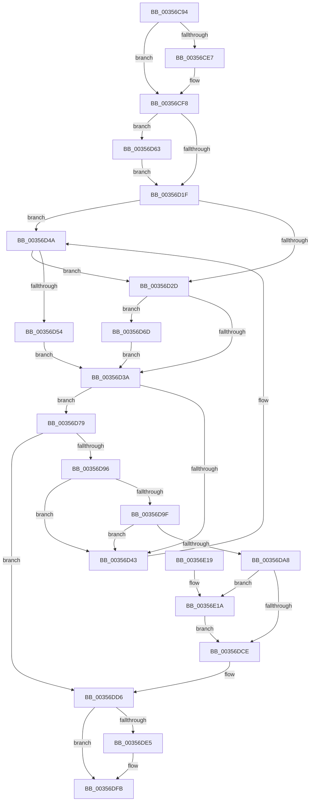

# CcPostWorkQueueCachemapUninit

- RVA: `0x00356C94`–`0x00356E23` (길이 `399` bytes)
- VA: `0x0000000140356C94`
- 실행 섹션: `.text`
- PDB 이름 있음: `예`; PDB Function 태그: `아니요`
- unwind 정보 RVA: `0x00079560`
- 디코드: `111`개 명령, `399/399` bytes 표시
- 미해석 바이트: `0` (있으면 어셈블리에 `.byte`로 보존)

> 이 문서는 커널 이미지의 기계어와 PDB 기호를 분석해 생성했습니다. 4번과 5번은 함수 원형과 자료형을 바이너리 사용 방식에서 추정한 C 해석이며 원본 소스 복구 결과는 아닙니다.

## 1. Dependencies

- 직접 호출 지점: **7**; 고유 호출 대상: **7**
- 직접 호출자로 확인된 함수: **1**
- RIP 상대 이미지 참조: **4**

### Outgoing calls
- `0x00356CF3` → [CcPerfLogWorkItemEnqueue](CcPerfLogWorkItemEnqueue_function_00357340.md) (function, `0x00357340`)
- `0x00356D5C` → [KiAcquireQueuedSpinLockInstrumented](../27/KiAcquireQueuedSpinLockInstrumented_function_00275850.md) (function, `0x00275850`)
- `0x00356D66` → [KiRaiseIrqlProcessIrqlFlags](../4F/KiRaiseIrqlProcessIrqlFlags_function_004F56FC.md) (function, `0x004F56FC`)
- `0x00356D72` → [KxWaitForLockOwnerShip](../25/KxWaitForLockOwnerShip_function_00257EB0.md) (function, `0x00257EB0`)
- `0x00356DD1` → [CcReferencePrivateVolumeCacheMap](CcReferencePrivateVolumeCacheMap_function_00357210.md) (function, `0x00357210`)
- `0x00356DDB` → [KeReleaseInStackQueuedSpinLock](../34/KeReleaseInStackQueuedSpinLock_function_00342CE0.md) (function, `0x00342CE0`)
- `0x00356DF6` → [ExQueueWorkItemToPartition](ExQueueWorkItemToPartition_function_00356E2C.md) (function, `0x00356E2C`)

### Direct callers
- [CcPostWorkQueue](CcPostWorkQueue_function_00356808.md) at `0x00356827`

### Static image references
- `0x00356CC2` → RVA `0x00FC6B10` (`ALMOSTRO`; read)
- `0x00356D17` → RVA `0x00FC6D20` (`ALMOSTRO`; read)
- `0x00356D1F` → RVA `0x00FC6B06` (`ALMOSTRO`; read)
- `0x00356D4A` → RVA `0x00F0DE58` (`.data`; read)

## 2. Other-region calls and transfers

- 다른 실행 섹션으로 향하는 call: **0**
- 별도 외부 분기/꼬리 이동을 확인하지 못했습니다.

## 3. Assembly (complete function range)

```asm
00356C94  4C 8B DC                        mov r11, rsp
00356C97  49 89 5B 08                     mov qword ptr [r11 + 8], rbx
00356C9B  49 89 6B 10                     mov qword ptr [r11 + 0x10], rbp
00356C9F  49 89 73 18                     mov qword ptr [r11 + 0x18], rsi
00356CA3  57                              push rdi
00356CA4  41 54                           push r12
00356CA6  41 55                           push r13
00356CA8  41 56                           push r14
00356CAA  41 57                           push r15
00356CAC  48 83 EC 40                     sub rsp, 0x40
00356CB0  4C 8B B9 88 00 00 00            mov r15, qword ptr [rcx + 0x88]
00356CB7  33 C0                           xor eax, eax
00356CB9  4C 8B A9 98 00 00 00            mov r13, qword ptr [rcx + 0x98]
00356CC0  33 DB                           xor ebx, ebx
00356CC2  F7 05 44 FE C6 00 00 00 02 00   test dword ptr [rip + 0xc6fe44], 0x20000
00356CCC  0F 57 C0                        xorps xmm0, xmm0
00356CCF  4C 8B A1 90 00 00 00            mov r12, qword ptr [rcx + 0x90]
00356CD6  48 8B EA                        mov rbp, rdx
00356CD9  0F 11 44 24 20                  movups xmmword ptr [rsp + 0x20], xmm0
00356CDE  49 89 43 C8                     mov qword ptr [r11 - 0x38], rax
00356CE2  48 8B F9                        mov rdi, rcx
00356CE5  74 11                           je 0x140356cf8
00356CE7  48 8B D1                        mov rdx, rcx
00356CEA  41 B1 01                        mov r9b, 1
00356CED  48 8B CD                        mov rcx, rbp
00356CF0  45 33 C0                        xor r8d, r8d
00356CF3  E8 48 06 00 00                  call 0x140357340
00356CF8  48 21 5C 24 20                  and qword ptr [rsp + 0x20], rbx
00356CFD  49 8D B7 40 03 00 00            lea rsi, [r15 + 0x340]
00356D04  48 89 74 24 28                  mov qword ptr [rsp + 0x28], rsi
00356D09  90                              nop
00356D0A  45 0F 20 C6                     mov r14, cr8
00356D0E  BA 02 00 00 00                  mov edx, 2
00356D13  44 0F 22 C2                     mov cr8, rdx
00356D17  39 1D 03 00 C7 00               cmp dword ptr [rip + 0xc70003], ebx
00356D1D  75 44                           jne 0x140356d63
00356D1F  F6 05 E0 FD C6 00 21            test byte ptr [rip + 0xc6fde0], 0x21
00356D26  44 88 74 24 30                  mov byte ptr [rsp + 0x30], r14b
00356D2B  75 1D                           jne 0x140356d4a
00356D2D  48 8D 54 24 20                  lea rdx, [rsp + 0x20]
00356D32  48 87 16                        xchg qword ptr [rsi], rdx
00356D35  48 85 D2                        test rdx, rdx
00356D38  75 33                           jne 0x140356d6d
00356D3A  48 8B 45 08                     mov rax, qword ptr [rbp + 8]
00356D3E  48 39 28                        cmp qword ptr [rax], rbp
00356D41  74 36                           je 0x140356d79
00356D43  B9 03 00 00 00                  mov ecx, 3
00356D48  CD 29                           int 0x29
00356D4A  8B 05 08 71 BB 00               mov eax, dword ptr [rip + 0xbb7108]
00356D50  85 C0                           test eax, eax
00356D52  75 D9                           jne 0x140356d2d
00356D54  48 8B D6                        mov rdx, rsi
00356D57  48 8D 4C 24 20                  lea rcx, [rsp + 0x20]
00356D5C  E8 EF EA F1 FF                  call 0x140275850
00356D61  EB D7                           jmp 0x140356d3a
00356D63  41 8A CE                        mov cl, r14b
00356D66  E8 91 E9 19 00                  call 0x1404f56fc
00356D6B  EB B2                           jmp 0x140356d1f
00356D6D  48 8D 4C 24 20                  lea rcx, [rsp + 0x20]
00356D72  E8 39 11 F0 FF                  call 0x140257eb0
00356D77  EB C1                           jmp 0x140356d3a
00356D79  48 89 47 08                     mov qword ptr [rdi + 8], rax
00356D7D  48 89 2F                        mov qword ptr [rdi], rbp
00356D80  48 89 38                        mov qword ptr [rax], rdi
00356D83  49 8D 85 A0 00 00 00            lea rax, [r13 + 0xa0]
00356D8A  48 89 7D 08                     mov qword ptr [rbp + 8], rdi
00356D8E  48 8B 08                        mov rcx, qword ptr [rax]
00356D91  48 3B C8                        cmp rcx, rax
00356D94  74 40                           je 0x140356dd6
00356D96  48 8B D9                        mov rbx, rcx
00356D99  48 39 41 08                     cmp qword ptr [rcx + 8], rax
00356D9D  75 A4                           jne 0x140356d43
00356D9F  48 8B 09                        mov rcx, qword ptr [rcx]
00356DA2  48 39 59 08                     cmp qword ptr [rcx + 8], rbx
00356DA6  75 9B                           jne 0x140356d43
00356DA8  48 89 08                        mov qword ptr [rax], rcx
00356DAB  48 89 41 08                     mov qword ptr [rcx + 8], rax
00356DAF  B9 01 00 00 00                  mov ecx, 1
00356DB4  41 01 8D B0 00 00 00            add dword ptr [r13 + 0xb0], ecx
00356DBB  8B C1                           mov eax, ecx
00356DBD  F0 49 0F C1 87 10 05 00 00      lock xadd qword ptr [r15 + 0x510], rax
00356DC6  48 03 C1                        add rax, rcx
00356DC9  48 3B C1                        cmp rax, rcx
00356DCC  7E 4C                           jle 0x140356e1a
00356DCE  49 8B CC                        mov rcx, r12
00356DD1  E8 3A 04 00 00                  call 0x140357210
00356DD6  48 8D 4C 24 20                  lea rcx, [rsp + 0x20]
00356DDB  E8 00 BF FE FF                  call 0x140342ce0
00356DE0  48 85 DB                        test rbx, rbx
00356DE3  74 16                           je 0x140356dfb
00356DE5  48 83 23 00                     and qword ptr [rbx], 0
00356DE9  33 D2                           xor edx, edx
00356DEB  4D 8B 4F 08                     mov r9, qword ptr [r15 + 8]
00356DEF  48 8B CB                        mov rcx, rbx
00356DF2  45 8B 45 18                     mov r8d, dword ptr [r13 + 0x18]
00356DF6  E8 31 00 00 00                  call 0x140356e2c
00356DFB  4C 8D 5C 24 40                  lea r11, [rsp + 0x40]
00356E00  49 8B 5B 30                     mov rbx, qword ptr [r11 + 0x30]
00356E04  49 8B 6B 38                     mov rbp, qword ptr [r11 + 0x38]
00356E08  49 8B 73 40                     mov rsi, qword ptr [r11 + 0x40]
00356E0C  49 8B E3                        mov rsp, r11
00356E0F  41 5F                           pop r15
00356E11  41 5E                           pop r14
00356E13  41 5D                           pop r13
00356E15  41 5C                           pop r12
00356E17  5F                              pop rdi
00356E18  C3                              ret
00356E19  CC                              int3
00356E1A  B9 0E 00 00 00                  mov ecx, 0xe
00356E1F  CD 29                           int 0x29
00356E21  EB AB                           jmp 0x140356dce
```

## 4. C-style interpretation (structured pseudocode)

```c
__int64 __fastcall CcPostWorkQueueCachemapUninit(__int64 a1, __int64 a2, int a3)
{
    __int64 result;
    __int64 v_rbx;
    __int64 v_rsp;
    unsigned __int64 v_stack_m28;
    unsigned __int8 v_stack_m38;
    unsigned __int64 v_stack_m40;
    unsigned __int64 v_stack_m48;

    *(unsigned __int64 *)(v_rsp + 8) = v_rbx;
    *(unsigned __int64 *)(v_rsp + 16) = v_rbp;
    *(unsigned __int64 *)(v_rsp + 24) = v_rsi;
    v_rsp = (v_rsp) - (64);
    result = 0;
    v_rbx = 0;
    v_stack_m48 = v_xmm0;
    *(unsigned __int64 *)(v_rsp - 56) = 0;
    if (((*(unsigned int *)(v_rip + 13041220)) & (0x20000ULL)) != 0) {
        a2 = a1;
        a4 = 1;
        a1 = a2;
        a3 = 0;
        result = CcPerfLogWorkItemEnqueue(a1, a2, a3, a4);
    }
    v_stack_m40 = *(unsigned __int64 *)(a1 + 136) + 832;
    if ((*(unsigned int *)(v_rip + 13041667)) != 0) goto loc_00356D63;
loc_00356D1F:
    v_stack_m38 = (unsigned __int8)(v_cr8);
    if (((*(unsigned __int8 *)(v_rip + 13041120)) & (33)) != 0) goto loc_00356D4A;
loc_00356D2D:
    if (v_stack_m48 != 0) goto loc_00356D6D;
loc_00356D3A:
    if ((*(unsigned __int64 *)(*(unsigned __int64 *)(a2 + 8))) == a2) goto loc_00356D79;
loc_00356D43:
loc_00356D4A:
    if ((unsigned int)((unsigned int)(*(unsigned int *)(v_rip + 12284168))) != 0) goto loc_00356D2D;
    result = KiAcquireQueuedSpinLockInstrumented(v_stack_m48, *(unsigned __int64 *)(a1 + 136) + 832, a3, a4);
    goto loc_00356D3A;
loc_00356D63:
    result = KiRaiseIrqlProcessIrqlFlags((unsigned __int8)(v_cr8), *(unsigned __int64 *)(a1 + 136) + 832, a3, a4);
    goto loc_00356D1F;
loc_00356D6D:
    result = KxWaitForLockOwnerShip(v_stack_m48, *(unsigned __int64 *)(a1 + 136) + 832, a3, a4);
    goto loc_00356D3A;
loc_00356D79:
    *(unsigned __int64 *)(a1 + 8) = result;
    *(unsigned __int64 *)(a1) = a2;
    *(unsigned __int64 *)(result) = a1;
    *(unsigned __int64 *)(a2 + 8) = a1;
    if ((*(unsigned __int64 *)(*(unsigned __int64 *)(a1 + 152) + 160)) == (*(unsigned __int64 *)(a1 + 152) + 160)) goto loc_00356DD6;
    if ((*(unsigned __int64 *)(*(unsigned __int64 *)(*(unsigned __int64 *)(a1 + 152) + 160) + 8)) != (*(unsigned __int64 *)(a1 + 152) + 160)) goto loc_00356D43;
    if ((*(unsigned __int64 *)(*(unsigned __int64 *)(*(unsigned __int64 *)(*(unsigned __int64 *)(a1 + 152) + 160)) + 8)) != (*(unsigned __int64 *)(*(unsigned __int64 *)(a1 + 152) + 160))) goto loc_00356D43;
    *(unsigned __int64 *)(*(unsigned __int64 *)(a1 + 152) + 160) = *(unsigned __int64 *)(*(unsigned __int64 *)(*(unsigned __int64 *)(a1 + 152) + 160));
    *(unsigned __int64 *)(*(unsigned __int64 *)(*(unsigned __int64 *)(*(unsigned __int64 *)(a1 + 152) + 160)) + 8) = *(unsigned __int64 *)(a1 + 152) + 160;
    result = (1) + (1);
    if (result <= 1) goto loc_00356E1A;
loc_00356DCE:
    result = CcReferencePrivateVolumeCacheMap(*(unsigned __int64 *)(a1 + 144), *(unsigned __int64 *)(a1 + 136) + 832, a3, a4);
loc_00356DD6:
    result = KeReleaseInStackQueuedSpinLock(v_stack_m48, *(unsigned __int64 *)(a1 + 136) + 832, a3, a4);
    if (*(unsigned __int64 *)(*(unsigned __int64 *)(a1 + 152) + 160) != 0) {
        a2 = 0;
        a4 = *(unsigned __int64 *)(*(unsigned __int64 *)(a1 + 136) + 8);
        a1 = *(unsigned __int64 *)(*(unsigned __int64 *)(a1 + 152) + 160);
        a3 = *(unsigned int *)(*(unsigned __int64 *)(a1 + 152) + 24);
        result = ExQueueWorkItemToPartition(a1, a2, a3, a4);
    }
    return result;
loc_00356E1A:
    goto loc_00356DCE;
}
```

## 5. (Beta) C Style

```c
int64_t CcPostWorkQueueCachemapUninit(void *Arg1, void *Arg2, int32_t Arg3)
{
    uint8_t *arg1 = (uint8_t *)Arg1;
    uint8_t *arg2 = (uint8_t *)Arg2;

    int64_t result;
    int64_t local_rbx;
    int64_t local_rsp;
    uint64_t v_stack_m28;
    uint8_t v_stack_m38;
    uint64_t v_stack_m40;
    uint64_t v_stack_m48;

    *(uint64_t *)(local_rsp + 0x8) = local_rbx;
    *(uint64_t *)(local_rsp + 0x10) = local_rbp;
    *(uint64_t *)(local_rsp + 0x18) = local_rsi;
    local_rsp = (local_rsp) - (64);
    result = 0;
    local_rbx = 0;
    v_stack_m48 = v_xmm0;
    *(uint64_t *)(local_rsp - 0x38) = 0;
    if (((*(uint32_t *)(v_rip + 0xC6FE44)) & (0x20000ULL)) != 0) {
        Arg2 = Arg1;
        a4 = 1;
        Arg1 = Arg2;
        Arg3 = 0;
        result = CcPerfLogWorkItemEnqueue(Arg1, Arg2, Arg3, a4);
    }
    v_stack_m40 = *(uint64_t *)(arg1 + 0x88) + 832;
    if ((*(uint32_t *)(v_rip + 0xC70003)) != 0) goto loc_00356D63;
loc_00356D1F:
    v_stack_m38 = (uint8_t)(v_cr8);
    if (((*(uint8_t *)(v_rip + 0xC6FDE0)) & (33)) != 0) goto loc_00356D4A;
loc_00356D2D:
    if (v_stack_m48 != 0) goto loc_00356D6D;
loc_00356D3A:
    if ((*(uint64_t *)(*(uint64_t *)(arg2 + 0x8))) == Arg2) goto loc_00356D79;
loc_00356D43:
loc_00356D4A:
    if ((uint32_t)((uint32_t)(*(uint32_t *)(v_rip + 0xBB7108))) != 0) goto loc_00356D2D;
    result = KiAcquireQueuedSpinLockInstrumented(v_stack_m48, *(uint64_t *)(arg1 + 0x88) + 832, Arg3, a4);
    goto loc_00356D3A;
loc_00356D63:
    result = KiRaiseIrqlProcessIrqlFlags((uint8_t)(v_cr8), *(uint64_t *)(arg1 + 0x88) + 832, Arg3, a4);
    goto loc_00356D1F;
loc_00356D6D:
    result = KxWaitForLockOwnerShip(v_stack_m48, *(uint64_t *)(arg1 + 0x88) + 832, Arg3, a4);
    goto loc_00356D3A;
loc_00356D79:
    *(uint64_t *)(arg1 + 0x8) = result;
    *(void **)(arg1) = Arg2;
    *(void **)(result) = Arg1;
    *(void **)(arg2 + 0x8) = Arg1;
    if ((*(uint64_t *)(*(uint64_t *)(arg1 + 0x98) + 0xA0)) == (*(uint64_t *)(arg1 + 0x98) + 160)) goto loc_00356DD6;
    if ((*(uint64_t *)(*(uint64_t *)(*(uint64_t *)(arg1 + 0x98) + 0xA0) + 0x8)) != (*(uint64_t *)(arg1 + 0x98) + 160)) goto loc_00356D43;
    if ((*(uint64_t *)(*(uint64_t *)(*(uint64_t *)(*(uint64_t *)(arg1 + 0x98) + 0xA0)) + 0x8)) != (*(uint64_t *)(*(uint64_t *)(arg1 + 0x98) + 0xA0))) goto loc_00356D43;
    *(uint64_t *)(*(uint64_t *)(arg1 + 0x98) + 0xA0) = *(uint64_t *)(*(uint64_t *)(*(uint64_t *)(arg1 + 0x98) + 0xA0));
    *(uint64_t *)(*(uint64_t *)(*(uint64_t *)(*(uint64_t *)(arg1 + 0x98) + 0xA0)) + 0x8) = *(uint64_t *)(arg1 + 0x98) + 160;
    result = (1) + (1);
    if (result <= 1) goto loc_00356E1A;
loc_00356DCE:
    result = CcReferencePrivateVolumeCacheMap(*(uint64_t *)(arg1 + 0x90), *(uint64_t *)(arg1 + 0x88) + 832, Arg3, a4);
loc_00356DD6:
    result = KeReleaseInStackQueuedSpinLock(v_stack_m48, *(uint64_t *)(arg1 + 0x88) + 832, Arg3, a4);
    if (*(uint64_t *)(*(uint64_t *)(arg1 + 0x98) + 0xA0) != 0) {
        Arg2 = 0;
        a4 = *(uint64_t *)(*(uint64_t *)(arg1 + 0x88) + 0x8);
        Arg1 = *(uint64_t *)(*(uint64_t *)(arg1 + 0x98) + 0xA0);
        Arg3 = *(uint32_t *)(*(uint64_t *)(arg1 + 0x98) + 0x18);
        result = ExQueueWorkItemToPartition(Arg1, Arg2, Arg3, a4);
    }
    return result;
loc_00356E1A:
    goto loc_00356DCE;
}
```

### 관측된 메모리 오프셋

구조체 형식이 확인되지 않은 접근은 인자 기준의 오프셋으로만 기록했습니다.

| 기준 인자 | 오프셋 표현 | 폭 (bit) | 접근 |
|---|---:|---:|---|
| `Arg1` | `+ 0x0` | `64` | `W` |
| `Arg1` | `+ 0x8` | `64` | `W` |
| `Arg1` | `+ 0x88` | `64` | `R` |
| `Arg1` | `+ 0x90` | `64` | `R` |
| `Arg1` | `+ 0x98` | `64` | `R` |
| `Arg2` | `+ 0x8` | `64` | `R` |
| `Arg2` | `+ 0x8` | `64` | `W` |

## 6. Execution-region graph

[열기: 2D/3D 그래프와 함수 탐색 컨트롤 패널](../../../control-panel.html?section=text&rva=0x00356C94&view=graph)

- 2D 그래프는 위에서 아래로 흐르고, 3D 그래프는 빈 공간을 드래그해 회전합니다. Shift+드래그는 이동, 휠은 확대·축소, 함수 노드 선택은 대상 보고서 이동입니다.

### Static fallback


