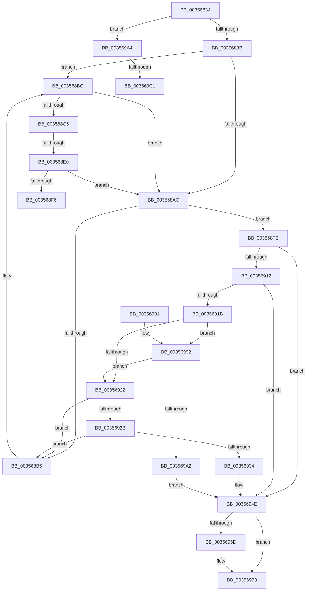

# CcPostWorkQueueRegular

- RVA: `0x00356834`–`0x003569C9` (길이 `405` bytes)
- VA: `0x0000000140356834`
- 실행 섹션: `.text`
- PDB 이름 있음: `예`; PDB Function 태그: `예`
- unwind 정보 RVA: `0x000794F4`
- 디코드: `110`개 명령, `405/405` bytes 표시
- 미해석 바이트: `0` (있으면 어셈블리에 `.byte`로 보존)

> 이 문서는 커널 이미지의 기계어와 PDB 기호를 분석해 생성했습니다. 4번과 5번은 함수 원형과 자료형을 바이너리 사용 방식에서 추정한 C 해석이며 원본 소스 복구 결과는 아닙니다.

## 1. Dependencies

- 직접 호출 지점: **4**; 고유 호출 대상: **4**
- 직접 호출자로 확인된 함수: **1**
- RIP 상대 이미지 참조: **1**

### Outgoing calls
- `0x003568A0` → [KeAcquireInStackQueuedSpinLock](../27/KeAcquireInStackQueuedSpinLock_function_002757A0.md) (function, `0x002757A0`)
- `0x00356949` → [CcReferencePartitionAndPrivateVolumeCacheMap](../38/CcReferencePartitionAndPrivateVolumeCacheMap_function_0038B9E0.md) (function, `0x0038B9E0`)
- `0x00356953` → [KeReleaseInStackQueuedSpinLock](../34/KeReleaseInStackQueuedSpinLock_function_00342CE0.md) (function, `0x00342CE0`)
- `0x0035696E` → [ExQueueWorkItemToPartition](ExQueueWorkItemToPartition_function_00356E2C.md) (function, `0x00356E2C`)

### Direct callers
- [CcPostWorkQueue](CcPostWorkQueue_function_00356808.md) at `0x0035681C`

### Static image references
- `0x00356862` → RVA `0x00FC6B10` (`ALMOSTRO`; read)

## 2. Other-region calls and transfers

- 다른 실행 섹션으로 향하는 call: **0**
- call이 아닌 외부 분기/꼬리 이동: **4**
  - `0x003568DA` → [sub_006E294A + 0xE](../6E/Unknown_function_006E294A.md) (`tail-transfer`)
  - `0x003568F6` → [sub_006E294A + 0xE](../6E/Unknown_function_006E294A.md) (`tail-transfer`)
  - `0x003569BB` → [sub_006E294A](../6E/Unknown_function_006E294A.md) (`tail-transfer`)
  - `0x003569C4` → [sub_006E294A + 0x3](../6E/Unknown_function_006E294A.md) (`tail-transfer`)

## 3. Assembly (complete function range)

```asm
00356834  4C 8B DC                        mov r11, rsp
00356837  49 89 5B 08                     mov qword ptr [r11 + 8], rbx
0035683B  49 89 6B 10                     mov qword ptr [r11 + 0x10], rbp
0035683F  49 89 73 18                     mov qword ptr [r11 + 0x18], rsi
00356843  57                              push rdi
00356844  41 54                           push r12
00356846  41 55                           push r13
00356848  41 56                           push r14
0035684A  41 57                           push r15
0035684C  48 83 EC 40                     sub rsp, 0x40
00356850  48 8B A9 88 00 00 00            mov rbp, qword ptr [rcx + 0x88]
00356857  33 C0                           xor eax, eax
00356859  48 8B B1 98 00 00 00            mov rsi, qword ptr [rcx + 0x98]
00356860  33 FF                           xor edi, edi
00356862  F7 05 A4 02 C7 00 00 00 02 00   test dword ptr [rip + 0xc702a4], 0x20000
0035686C  0F 57 C0                        xorps xmm0, xmm0
0035686F  4C 8B A9 90 00 00 00            mov r13, qword ptr [rcx + 0x90]
00356876  4C 8B FA                        mov r15, rdx
00356879  0F 11 44 24 20                  movups xmmword ptr [rsp + 0x20], xmm0
0035687E  49 89 43 C8                     mov qword ptr [r11 - 0x38], rax
00356882  48 8B D9                        mov rbx, rcx
00356885  0F 85 19 01 00 00               jne 0x1403569a4
0035688B  48 8D 8D 40 03 00 00            lea rcx, [rbp + 0x340]
00356892  4C 8B E3                        mov r12, rbx
00356895  48 8D 54 24 20                  lea rdx, [rsp + 0x20]
0035689A  41 BE 80 00 00 00               mov r14d, 0x80
003568A0  E8 FB EE F1 FF                  call 0x1402757a0
003568A5  41 83 3C 1E 03                  cmp dword ptr [r14 + rbx], 3
003568AA  74 10                           je 0x1403568bc
003568AC  49 8B 47 08                     mov rax, qword ptr [r15 + 8]
003568B0  4C 39 38                        cmp qword ptr [rax], r15
003568B3  74 46                           je 0x1403568fb
003568B5  B9 03 00 00 00                  mov ecx, 3
003568BA  CD 29                           int 0x29
003568BC  48 8D 46 68                     lea rax, [rsi + 0x68]
003568C0  48 39 00                        cmp qword ptr [rax], rax
003568C3  74 E7                           je 0x1403568ac
003568C5  48 8B 85 38 04 00 00            mov rax, qword ptr [rbp + 0x438]
003568CC  48 8B 95 20 04 00 00            mov rdx, qword ptr [rbp + 0x420]
003568D3  48 C1 E8 02                     shr rax, 2
003568D7  48 3B D0                        cmp rdx, rax
003568DA  0F 83 78 C0 38 00               jae 0x1406e2958
003568E0  48 8B 45 08                     mov rax, qword ptr [rbp + 8]
003568E4  48 8B 08                        mov rcx, qword ptr [rax]
003568E7  48 8B 81 00 49 00 00            mov rax, qword ptr [rcx + 0x4900]
003568EE  48 D1 E8                        shr rax, 1
003568F1  48 3B D0                        cmp rdx, rax
003568F4  76 B6                           jbe 0x1403568ac
003568F6  E9 5D C0 38 00                  jmp 0x1406e2958
003568FB  4C 89 3B                        mov qword ptr [rbx], r15
003568FE  48 89 43 08                     mov qword ptr [rbx + 8], rax
00356902  48 89 18                        mov qword ptr [rax], rbx
00356905  49 89 5F 08                     mov qword ptr [r15 + 8], rbx
00356909  40 38 BE C4 00 00 00            cmp byte ptr [rsi + 0xc4], dil
00356910  75 3C                           jne 0x14035694e
00356912  48 8D 4E 38                     lea rcx, [rsi + 0x38]
00356916  48 39 09                        cmp qword ptr [rcx], rcx
00356919  74 33                           je 0x14035694e
0035691B  43 83 3C 26 02                  cmp dword ptr [r14 + r12], 2
00356920  74 70                           je 0x140356992
00356922  48 8B 39                        mov rdi, qword ptr [rcx]
00356925  48 39 4F 08                     cmp qword ptr [rdi + 8], rcx
00356929  75 8A                           jne 0x1403568b5
0035692B  48 8B 07                        mov rax, qword ptr [rdi]
0035692E  48 39 78 08                     cmp qword ptr [rax + 8], rdi
00356932  75 81                           jne 0x1403568b5
00356934  48 89 01                        mov qword ptr [rcx], rax
00356937  49 8B D5                        mov rdx, r13
0035693A  48 89 48 08                     mov qword ptr [rax + 8], rcx
0035693E  48 8B CD                        mov rcx, rbp
00356941  8B 46 30                        mov eax, dword ptr [rsi + 0x30]
00356944  FF C0                           inc eax
00356946  89 46 30                        mov dword ptr [rsi + 0x30], eax
00356949  E8 92 50 03 00                  call 0x14038b9e0
0035694E  48 8D 4C 24 20                  lea rcx, [rsp + 0x20]
00356953  E8 88 C3 FE FF                  call 0x140342ce0
00356958  48 85 FF                        test rdi, rdi
0035695B  74 16                           je 0x140356973
0035695D  48 83 27 00                     and qword ptr [rdi], 0
00356961  33 D2                           xor edx, edx
00356963  4C 8B 4D 08                     mov r9, qword ptr [rbp + 8]
00356967  48 8B CF                        mov rcx, rdi
0035696A  44 8B 46 18                     mov r8d, dword ptr [rsi + 0x18]
0035696E  E8 B9 04 00 00                  call 0x140356e2c
00356973  4C 8D 5C 24 40                  lea r11, [rsp + 0x40]
00356978  49 8B 5B 30                     mov rbx, qword ptr [r11 + 0x30]
0035697C  49 8B 6B 38                     mov rbp, qword ptr [r11 + 0x38]
00356980  49 8B 73 40                     mov rsi, qword ptr [r11 + 0x40]
00356984  49 8B E3                        mov rsp, r11
00356987  41 5F                           pop r15
00356989  41 5E                           pop r14
0035698B  41 5D                           pop r13
0035698D  41 5C                           pop r12
0035698F  5F                              pop rdi
00356990  C3                              ret
00356991  CC                              int3
00356992  8B 86 BC 00 00 00               mov eax, dword ptr [rsi + 0xbc]
00356998  FF C0                           inc eax
0035699A  3B 85 08 05 00 00               cmp eax, dword ptr [rbp + 0x508]
003569A0  76 80                           jbe 0x140356922
003569A2  EB AA                           jmp 0x14035694e
003569A4  8B 81 80 00 00 00               mov eax, dword ptr [rcx + 0x80]
003569AA  45 33 C0                        xor r8d, r8d
003569AD  83 E8 02                        sub eax, 2
003569B0  48 8B D3                        mov rdx, rbx
003569B3  49 8B CF                        mov rcx, r15
003569B6  A9 FD FF FF FF                  test eax, 0xfffffffd
003569BB  0F 84 89 BF 38 00               je 0x1406e294a
003569C1  45 33 C9                        xor r9d, r9d
003569C4  E9 84 BF 38 00                  jmp 0x1406e294d
```

## 4. C-style interpretation (structured pseudocode)

```c
__int64 __fastcall CcPostWorkQueueRegular(__int64 a1, __int64 a2)
{
    __int64 result;
    __int64 v_rdi;
    __int64 v_rsp;
    unsigned __int64 v_stack_m28;
    unsigned __int64 v_stack_m48;

    *(unsigned __int64 *)(v_rsp + 8) = v_rbx;
    *(unsigned __int64 *)(v_rsp + 16) = v_rbp;
    *(unsigned __int64 *)(v_rsp + 24) = v_rsi;
    v_rsp = (v_rsp) - (64);
    result = 0;
    v_rdi = 0;
    v_stack_m48 = v_xmm0;
    *(unsigned __int64 *)(v_rsp - 56) = 0;
    if (((*(unsigned int *)(v_rip + 13042340)) & (0x20000ULL)) != 0) goto loc_003569A4;
    result = KeAcquireInStackQueuedSpinLock(*(unsigned __int64 *)(a1 + 136) + 832, v_stack_m48, a3, a4);
    if ((*(unsigned int *)(128 + a1 * 1)) == 3) goto loc_003568BC;
loc_003568AC:
    if ((*(unsigned __int64 *)(*(unsigned __int64 *)(a2 + 8))) == a2) goto loc_003568FB;
loc_003568B5:
loc_003568BC:
    if ((*(unsigned __int64 *)(*(unsigned __int64 *)(a1 + 152) + 104)) == (*(unsigned __int64 *)(a1 + 152) + 104)) goto loc_003568AC;
    result = (*(unsigned __int64 *)(*(unsigned __int64 *)(a1 + 136) + 1080)) >> (2);
    result = (*(unsigned __int64 *)(*(unsigned __int64 *)(*(unsigned __int64 *)(*(unsigned __int64 *)(a1 + 136) + 8)) + 18688)) >> (1);
    if ((*(unsigned __int64 *)(*(unsigned __int64 *)(a1 + 136) + 1056)) <= result) goto loc_003568AC;
loc_003568FB:
    *(unsigned __int64 *)(a1) = a2;
    *(unsigned __int64 *)(a1 + 8) = result;
    *(unsigned __int64 *)(result) = a1;
    *(unsigned __int64 *)(a2 + 8) = a1;
    if ((*(unsigned __int8 *)(*(unsigned __int64 *)(a1 + 152) + 196)) != 0) goto loc_0035694E;
    if ((*(unsigned __int64 *)(*(unsigned __int64 *)(a1 + 152) + 56)) == (*(unsigned __int64 *)(a1 + 152) + 56)) goto loc_0035694E;
    if ((*(unsigned int *)(128 + a1 * 1)) == 2) goto loc_00356992;
loc_00356922:
    if ((*(unsigned __int64 *)(*(unsigned __int64 *)(*(unsigned __int64 *)(a1 + 152) + 56) + 8)) != (*(unsigned __int64 *)(a1 + 152) + 56)) goto loc_003568B5;
    if ((*(unsigned __int64 *)(*(unsigned __int64 *)(*(unsigned __int64 *)(*(unsigned __int64 *)(a1 + 152) + 56)) + 8)) != (*(unsigned __int64 *)(*(unsigned __int64 *)(a1 + 152) + 56))) goto loc_003568B5;
    *(unsigned __int64 *)(*(unsigned __int64 *)(a1 + 152) + 56) = *(unsigned __int64 *)(*(unsigned __int64 *)(*(unsigned __int64 *)(a1 + 152) + 56));
    *(unsigned __int64 *)(*(unsigned __int64 *)(*(unsigned __int64 *)(*(unsigned __int64 *)(a1 + 152) + 56)) + 8) = *(unsigned __int64 *)(a1 + 152) + 56;
    result = (unsigned int)(((unsigned int)(*(unsigned int *)(*(unsigned __int64 *)(a1 + 152) + 48))) + 1);
    *(unsigned int *)(*(unsigned __int64 *)(a1 + 152) + 48) = (unsigned int)(result);
    result = CcReferencePartitionAndPrivateVolumeCacheMap(*(unsigned __int64 *)(a1 + 136), *(unsigned __int64 *)(a1 + 144), a3, a4);
loc_0035694E:
    result = KeReleaseInStackQueuedSpinLock(v_stack_m48, *(unsigned __int64 *)(a1 + 144), a3, a4);
    if (*(unsigned __int64 *)(*(unsigned __int64 *)(a1 + 152) + 56) != 0) {
        a2 = 0;
        a4 = *(unsigned __int64 *)(*(unsigned __int64 *)(a1 + 136) + 8);
        a1 = *(unsigned __int64 *)(*(unsigned __int64 *)(a1 + 152) + 56);
        a3 = *(unsigned int *)(*(unsigned __int64 *)(a1 + 152) + 24);
        result = ExQueueWorkItemToPartition(a1, a2, a3, a4);
    }
    return result;
loc_00356992:
    result = (unsigned int)(((unsigned int)(*(unsigned int *)(*(unsigned __int64 *)(v_stack_m28 + 64) + 188))) + 1);
    if (((unsigned int)(result)) <= (*(unsigned int *)(*(unsigned __int64 *)(v_stack_m28 + 56) + 1288))) goto loc_00356922;
    goto loc_0035694E;
loc_003569A4:
    a3 = 0;
    result = (unsigned int)(((unsigned int)(*(unsigned int *)(a1 + 128))) - (2));
    a4 = 0;
}
```

## 5. (Beta) C Style

```c
int64_t CcPostWorkQueueRegular(void *Arg1, void *Arg2)
{
    uint8_t *arg1 = (uint8_t *)Arg1;
    uint8_t *arg2 = (uint8_t *)Arg2;

    int64_t result;
    int64_t local_rdi;
    int64_t local_rsp;
    uint64_t v_stack_m28;
    uint64_t v_stack_m48;

    *(uint64_t *)(local_rsp + 0x8) = local_rbx;
    *(uint64_t *)(local_rsp + 0x10) = local_rbp;
    *(uint64_t *)(local_rsp + 0x18) = local_rsi;
    local_rsp = (local_rsp) - (64);
    result = 0;
    local_rdi = 0;
    v_stack_m48 = v_xmm0;
    *(uint64_t *)(local_rsp - 0x38) = 0;
    if (((*(uint32_t *)(v_rip + 0xC702A4)) & (0x20000ULL)) != 0) goto loc_003569A4;
    result = KeAcquireInStackQueuedSpinLock(*(uint64_t *)(arg1 + 0x88) + 832, v_stack_m48, a3, a4);
    if ((*(uint32_t *)(128 + arg1 * 1)) == 3) goto loc_003568BC;
loc_003568AC:
    if ((*(uint64_t *)(*(uint64_t *)(arg2 + 0x8))) == Arg2) goto loc_003568FB;
loc_003568B5:
loc_003568BC:
    if ((*(uint64_t *)(*(uint64_t *)(arg1 + 0x98) + 0x68)) == (*(uint64_t *)(arg1 + 0x98) + 104)) goto loc_003568AC;
    result = (*(uint64_t *)(*(uint64_t *)(arg1 + 0x88) + 0x438)) >> (2);
    result = (*(uint64_t *)(*(uint64_t *)(*(uint64_t *)(*(uint64_t *)(arg1 + 0x88) + 0x8)) + 0x4900)) >> (1);
    if ((*(uint64_t *)(*(uint64_t *)(arg1 + 0x88) + 0x420)) <= result) goto loc_003568AC;
loc_003568FB:
    *(void **)(arg1) = Arg2;
    *(uint64_t *)(arg1 + 0x8) = result;
    *(void **)(result) = Arg1;
    *(void **)(arg2 + 0x8) = Arg1;
    if ((*(uint8_t *)(*(uint64_t *)(arg1 + 0x98) + 0xC4)) != 0) goto loc_0035694E;
    if ((*(uint64_t *)(*(uint64_t *)(arg1 + 0x98) + 0x38)) == (*(uint64_t *)(arg1 + 0x98) + 56)) goto loc_0035694E;
    if ((*(uint32_t *)(128 + arg1 * 1)) == 2) goto loc_00356992;
loc_00356922:
    if ((*(uint64_t *)(*(uint64_t *)(*(uint64_t *)(arg1 + 0x98) + 0x38) + 0x8)) != (*(uint64_t *)(arg1 + 0x98) + 56)) goto loc_003568B5;
    if ((*(uint64_t *)(*(uint64_t *)(*(uint64_t *)(*(uint64_t *)(arg1 + 0x98) + 0x38)) + 0x8)) != (*(uint64_t *)(*(uint64_t *)(arg1 + 0x98) + 0x38))) goto loc_003568B5;
    *(uint64_t *)(*(uint64_t *)(arg1 + 0x98) + 0x38) = *(uint64_t *)(*(uint64_t *)(*(uint64_t *)(arg1 + 0x98) + 0x38));
    *(uint64_t *)(*(uint64_t *)(*(uint64_t *)(*(uint64_t *)(arg1 + 0x98) + 0x38)) + 0x8) = *(uint64_t *)(arg1 + 0x98) + 56;
    result = (uint32_t)(((uint32_t)(*(uint32_t *)(*(uint64_t *)(arg1 + 0x98) + 0x30))) + 1);
    *(uint32_t *)(*(uint64_t *)(arg1 + 0x98) + 0x30) = (uint32_t)(result);
    result = CcReferencePartitionAndPrivateVolumeCacheMap(*(uint64_t *)(arg1 + 0x88), *(uint64_t *)(arg1 + 0x90), a3, a4);
loc_0035694E:
    result = KeReleaseInStackQueuedSpinLock(v_stack_m48, *(uint64_t *)(arg1 + 0x90), a3, a4);
    if (*(uint64_t *)(*(uint64_t *)(arg1 + 0x98) + 0x38) != 0) {
        Arg2 = 0;
        a4 = *(uint64_t *)(*(uint64_t *)(arg1 + 0x88) + 0x8);
        Arg1 = *(uint64_t *)(*(uint64_t *)(arg1 + 0x98) + 0x38);
        a3 = *(uint32_t *)(*(uint64_t *)(arg1 + 0x98) + 0x18);
        result = ExQueueWorkItemToPartition(Arg1, Arg2, a3, a4);
    }
    return result;
loc_00356992:
    result = (uint32_t)(((uint32_t)(*(uint32_t *)(*(uint64_t *)(v_stack_m28 + 0x40) + 0xBC))) + 1);
    if (((uint32_t)(result)) <= (*(uint32_t *)(*(uint64_t *)(v_stack_m28 + 0x38) + 0x508))) goto loc_00356922;
    goto loc_0035694E;
loc_003569A4:
    a3 = 0;
    result = (uint32_t)(((uint32_t)(*(uint32_t *)(arg1 + 0x80))) - (2));
    a4 = 0;
}
```

### 관측된 메모리 오프셋

구조체 형식이 확인되지 않은 접근은 인자 기준의 오프셋으로만 기록했습니다.

| 기준 인자 | 오프셋 표현 | 폭 (bit) | 접근 |
|---|---:|---:|---|
| `Arg1` | `+ 0x0` | `64` | `W` |
| `Arg1` | `+ 0x8` | `64` | `W` |
| `Arg1` | `+ 0x80` | `32` | `R` |
| `Arg1` | `+ 0x88` | `64` | `R` |
| `Arg1` | `+ 0x90` | `64` | `R` |
| `Arg1` | `+ 0x98` | `64` | `R` |
| `Arg2` | `+ 0x8` | `64` | `R` |
| `Arg2` | `+ 0x8` | `64` | `W` |

## 6. Execution-region graph

[열기: 2D/3D 그래프와 함수 탐색 컨트롤 패널](../../../control-panel.html?section=text&rva=0x00356834&view=graph)

- 2D 그래프는 위에서 아래로 흐르고, 3D 그래프는 빈 공간을 드래그해 회전합니다. Shift+드래그는 이동, 휠은 확대·축소, 함수 노드 선택은 대상 보고서 이동입니다.

### Static fallback


