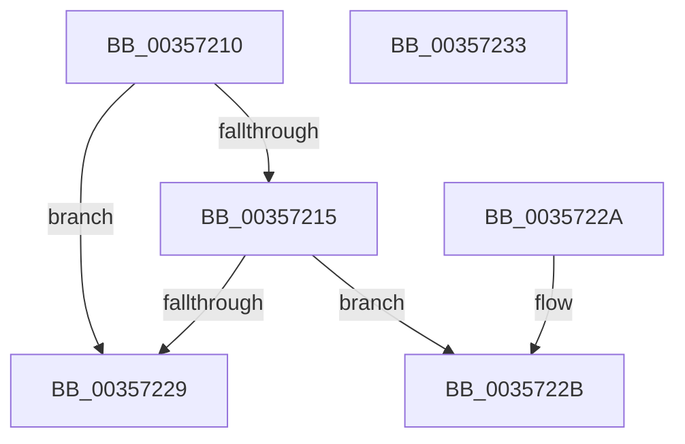

# CcReferencePrivateVolumeCacheMap

- RVA: `0x00357210`–`0x00357234` (길이 `36` bytes)
- VA: `0x0000000140357210`
- 실행 섹션: `.text`
- PDB 이름 있음: `예`; PDB Function 태그: `아니요`
- unwind 정보 RVA: `0x000DB714`
- 디코드: `13`개 명령, `36/36` bytes 표시
- 미해석 바이트: `0` (있으면 어셈블리에 `.byte`로 보존)

> 이 문서는 커널 이미지의 기계어와 PDB 기호를 분석해 생성했습니다. 4번과 5번은 함수 원형과 자료형을 바이너리 사용 방식에서 추정한 C 해석이며 원본 소스 복구 결과는 아닙니다.

## 1. Dependencies

- 직접 호출 지점: **0**; 고유 호출 대상: **0**
- 직접 호출자로 확인된 함수: **4**
- RIP 상대 이미지 참조: **0**

### Outgoing calls
- 직접 디코드된 call 명령이 없습니다.

### Direct callers
- [CcPostWorkQueueCachemapUninit](CcPostWorkQueueCachemapUninit_function_00356C94.md) at `0x00356DD1`
- [CcWriteBehind](CcWriteBehind_function_00356EAC.md) at `0x00356FC3`
- [CcAllocateWorkQueueEntry](CcAllocateWorkQueueEntry_function_0035710C.md) at `0x003571CB`
- [CcCanIWrite](../38/CcCanIWrite_function_00388250.md) at `0x00388301`

### Static image references
- 디코드된 RIP-relative 메모리 참조가 없습니다.

## 2. Other-region calls and transfers

- 다른 실행 섹션으로 향하는 call: **0**
- 별도 외부 분기/꼬리 이동을 확인하지 못했습니다.

## 3. Assembly (complete function range)

```asm
00357210  48 85 C9                        test rcx, rcx
00357213  74 14                           je 0x140357229
00357215  B8 01 00 00 00                  mov eax, 1
0035721A  F0 48 0F C1 41 08               lock xadd qword ptr [rcx + 8], rax
00357220  48 FF C0                        inc rax
00357223  48 83 F8 01                     cmp rax, 1
00357227  7E 02                           jle 0x14035722b
00357229  C3                              ret
0035722A  CC                              int3
0035722B  B9 0E 00 00 00                  mov ecx, 0xe
00357230  CD 29                           int 0x29
00357232  C3                              ret
00357233  CC                              int3
```

## 4. C-style interpretation (structured pseudocode)

```c
__int64 __fastcall CcReferencePrivateVolumeCacheMap(__int64 a1)
{
    __int64 result;

    if (a1 == 0) goto loc_00357229;
    result = (1) + 1;
    if (result <= 1) goto loc_0035722B;
loc_00357229:
    return result;
loc_0035722B:
    return result;
}
```

## 5. (Beta) C Style

```c
int64_t CcReferencePrivateVolumeCacheMap(int64_t Arg1)
{
    int64_t result;

    if (Arg1 == 0) goto loc_00357229;
    result = (1) + 1;
    if (result <= 1) goto loc_0035722B;
loc_00357229:
    return result;
loc_0035722B:
    return result;
}
```

## 6. Execution-region graph

[열기: 2D/3D 그래프와 함수 탐색 컨트롤 패널](../../../control-panel.html?section=text&rva=0x00357210&view=graph)

- 2D 그래프는 위에서 아래로 흐르고, 3D 그래프는 빈 공간을 드래그해 회전합니다. Shift+드래그는 이동, 휠은 확대·축소, 함수 노드 선택은 대상 보고서 이동입니다.

### Static fallback


