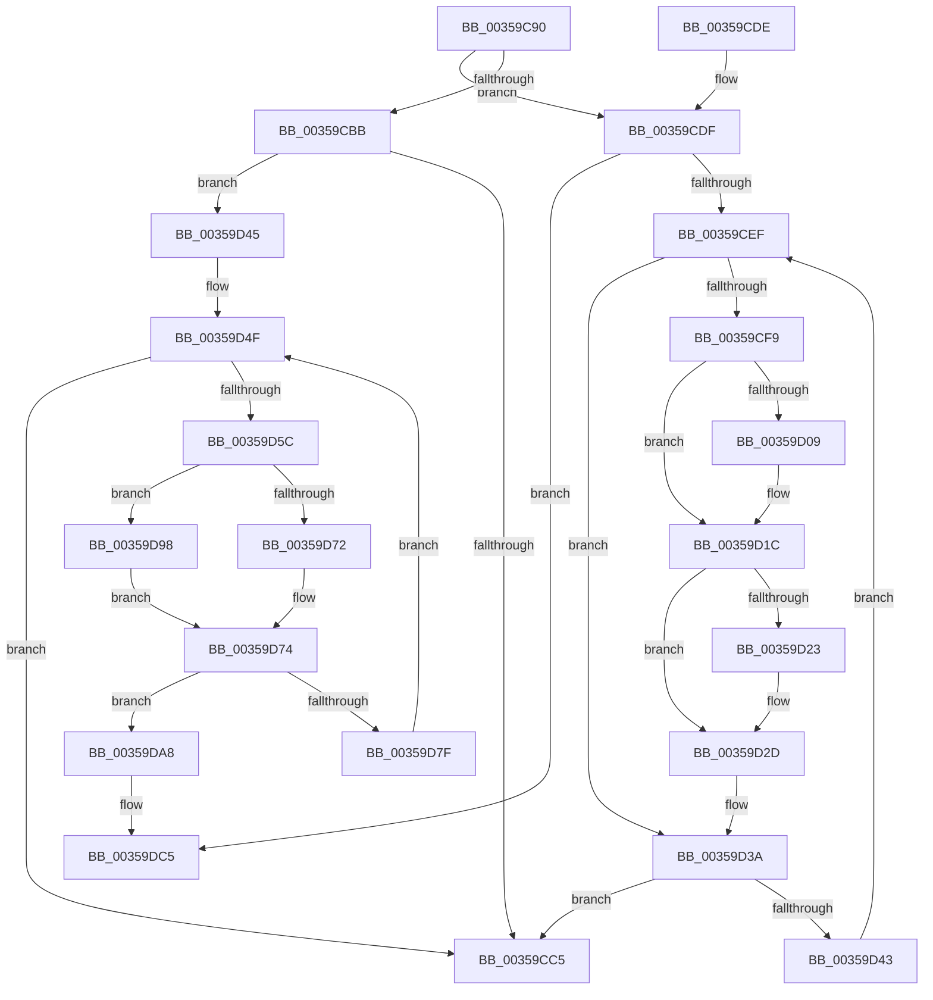

# CcReleaseByteRangeFromWrite

- RVA: `0x00359C90`–`0x00359DE3` (길이 `339` bytes)
- VA: `0x0000000140359C90`
- 실행 섹션: `.text`
- PDB 이름 있음: `예`; PDB Function 태그: `아니요`
- unwind 정보 RVA: `0x000798E4`
- 디코드: `95`개 명령, `339/339` bytes 표시
- 미해석 바이트: `0` (있으면 어셈블리에 `.byte`로 보존)

> 이 문서는 커널 이미지의 기계어와 PDB 기호를 분석해 생성했습니다. 4번과 5번은 함수 원형과 자료형을 바이너리 사용 방식에서 추정한 C 해석이며 원본 소스 복구 결과는 아닙니다.

## 1. Dependencies

- 직접 호출 지점: **6**; 고유 호출 대상: **4**
- 직접 호출자로 확인된 함수: **1**
- RIP 상대 이미지 참조: **0**

### Outgoing calls
- `0x00359D17` → [CcUnpinFileDataEx](CcUnpinFileDataEx_function_00359DEC.md) (function, `0x00359DEC`)
- `0x00359D28` → [CcSetDirtyPinnedData](CcSetDirtyPinnedData_function_0035A120.md) (function, `0x0035A120`)
- `0x00359D35` → [CcUnpinFileDataEx](CcUnpinFileDataEx_function_00359DEC.md) (function, `0x00359DEC`)
- `0x00359D8A` → [CcSetDirtyInMask](../3C/CcSetDirtyInMask_function_003CB688.md) (function, `0x003CB688`)
- `0x00359DBF` → [KeBugCheckEx](../4F/KeBugCheckEx_function_004FD660.md) (function, `0x004FD660`)
- `0x00359DDD` → [KeBugCheckEx](../4F/KeBugCheckEx_function_004FD660.md) (function, `0x004FD660`)

### Direct callers
- [CcNotifyOfMappedWriteComplete](../40/CcNotifyOfMappedWriteComplete_function_0040873C.md) at `0x004087DE`

### Static image references
- 디코드된 RIP-relative 메모리 참조가 없습니다.

## 2. Other-region calls and transfers

- 다른 실행 섹션으로 향하는 call: **0**
- 별도 외부 분기/꼬리 이동을 확인하지 못했습니다.

## 3. Assembly (complete function range)

```asm
00359C90  48 89 5C 24 08                  mov qword ptr [rsp + 8], rbx
00359C95  48 89 6C 24 10                  mov qword ptr [rsp + 0x10], rbp
00359C9A  48 89 74 24 18                  mov qword ptr [rsp + 0x18], rsi
00359C9F  57                              push rdi
00359CA0  41 54                           push r12
00359CA2  41 56                           push r14
00359CA4  48 83 EC 30                     sub rsp, 0x30
00359CA8  33 DB                           xor ebx, ebx
00359CAA  49 8B F9                        mov rdi, r9
00359CAD  41 8B F0                        mov esi, r8d
00359CB0  4C 8B F2                        mov r14, rdx
00359CB3  48 8B E9                        mov rbp, rcx
00359CB6  4D 85 C9                        test r9, r9
00359CB9  75 24                           jne 0x140359cdf
00359CBB  38 5C 24 70                     cmp byte ptr [rsp + 0x70], bl
00359CBF  0F 85 80 00 00 00               jne 0x140359d45
00359CC5  48 8B 5C 24 50                  mov rbx, qword ptr [rsp + 0x50]
00359CCA  48 8B 6C 24 58                  mov rbp, qword ptr [rsp + 0x58]
00359CCF  48 8B 74 24 60                  mov rsi, qword ptr [rsp + 0x60]
00359CD4  48 83 C4 30                     add rsp, 0x30
00359CD8  41 5E                           pop r14
00359CDA  41 5C                           pop r12
00359CDC  5F                              pop rdi
00359CDD  C3                              ret
00359CDE  CC                              int3
00359CDF  41 BC FD 02 00 00               mov r12d, 0x2fd
00359CE5  66 45 39 21                     cmp word ptr [r9], r12w
00359CE9  0F 85 D6 00 00 00               jne 0x140359dc5
00359CEF  48 8B 77 10                     mov rsi, qword ptr [rdi + 0x10]
00359CF3  66 44 39 27                     cmp word ptr [rdi], r12w
00359CF7  75 41                           jne 0x140359d3a
00359CF9  8B 95 98 00 00 00               mov edx, dword ptr [rbp + 0x98]
00359CFF  48 8B 5F 08                     mov rbx, qword ptr [rdi + 8]
00359D03  0F BA E2 09                     bt edx, 9
00359D07  73 13                           jae 0x140359d1c
00359D09  D1 EA                           shr edx, 1
00359D0B  41 B8 02 00 00 00               mov r8d, 2
00359D11  80 E2 01                        and dl, 1
00359D14  48 8B CF                        mov rcx, rdi
00359D17  E8 D0 00 00 00                  call 0x140359dec
00359D1C  80 7C 24 70 00                  cmp byte ptr [rsp + 0x70], 0
00359D21  74 0A                           je 0x140359d2d
00359D23  33 D2                           xor edx, edx
00359D25  48 8B CF                        mov rcx, rdi
00359D28  E8 F3 03 00 00                  call 0x14035a120
00359D2D  45 33 C0                        xor r8d, r8d
00359D30  B2 01                           mov dl, 1
00359D32  48 8B CF                        mov rcx, rdi
00359D35  E8 B2 00 00 00                  call 0x140359dec
00359D3A  48 8D 7E F0                     lea rdi, [rsi - 0x10]
00359D3E  49 39 1E                        cmp qword ptr [r14], rbx
00359D41  74 82                           je 0x140359cc5
00359D43  EB AA                           jmp 0x140359cef
00359D45  48 8B 1A                        mov rbx, qword ptr [rdx]
00359D48  49 C7 C6 00 00 00 FE            mov r14, 0xfffffffffe000000
00359D4F  48 89 5C 24 68                  mov qword ptr [rsp + 0x68], rbx
00359D54  85 F6                           test esi, esi
00359D56  0F 84 69 FF FF FF               je 0x140359cc5
00359D5C  8B CE                           mov ecx, esi
00359D5E  48 8B C3                        mov rax, rbx
00359D61  48 FF C9                        dec rcx
00359D64  49 23 C6                        and rax, r14
00359D67  48 03 CB                        add rcx, rbx
00359D6A  49 23 CE                        and rcx, r14
00359D6D  48 3B C1                        cmp rax, rcx
00359D70  72 26                           jb 0x140359d98
00359D72  8B FE                           mov edi, esi
00359D74  45 33 C9                        xor r9d, r9d
00359D77  81 FF 00 00 00 02               cmp edi, 0x2000000
00359D7D  77 29                           ja 0x140359da8
00359D7F  44 8B C7                        mov r8d, edi
00359D82  48 8D 54 24 68                  lea rdx, [rsp + 0x68]
00359D87  48 8B CD                        mov rcx, rbp
00359D8A  E8 F9 18 07 00                  call 0x1403cb688
00359D8F  8B C7                           mov eax, edi
00359D91  48 03 D8                        add rbx, rax
00359D94  2B F7                           sub esi, edi
00359D96  EB B7                           jmp 0x140359d4f
00359D98  8D BB FF FF FF 01               lea edi, [rbx + 0x1ffffff]
00359D9E  81 E7 00 00 00 FE               and edi, 0xfe000000
00359DA4  2B FB                           sub edi, ebx
00359DA6  EB CC                           jmp 0x140359d74
00359DA8  48 83 64 24 20 00               and qword ptr [rsp + 0x20], 0
00359DAE  BA 5F 15 00 00                  mov edx, 0x155f
00359DB3  B9 34 00 00 00                  mov ecx, 0x34
00359DB8  49 C7 C0 20 04 00 C0            mov r8, 0xffffffffc0000420
00359DBF  E8 9C 38 1A 00                  call 0x1404fd660
00359DC4  CC                              int3
00359DC5  48 21 5C 24 20                  and qword ptr [rsp + 0x20], rbx
00359DCA  45 33 C9                        xor r9d, r9d
00359DCD  BA 72 15 00 00                  mov edx, 0x1572
00359DD2  49 C7 C0 20 04 00 C0            mov r8, 0xffffffffc0000420
00359DD9  41 8D 49 34                     lea ecx, [r9 + 0x34]
00359DDD  E8 7E 38 1A 00                  call 0x1404fd660
00359DE2  CC                              int3
```

## 4. C-style interpretation (structured pseudocode)

```c
__int64 __fastcall CcReleaseByteRangeFromWrite(__int64 a1, __int64 a2, int a3, __int64 a4, unsigned __int8 a5)
{
    __int64 result;
    __int64 v_rbx;
    __int64 v_rdi;
    __int64 v_rsi;
    __int64 v_rsp;
    unsigned __int64 v_stack_p10;
    unsigned __int64 v_stack_p18;
    unsigned __int64 v_stack_p20;
    unsigned __int64 v_stack_p68;
    unsigned __int64 v_stack_p8;

    v_stack_p8 = v_rbx;
    v_stack_p10 = v_rbp;
    v_stack_p18 = v_rsi;
    v_rsp = (v_rsp) - (48);
    v_rbx = 0;
    if (a4 != 0) goto loc_00359CDF;
    if (a5 != 0) goto loc_00359D45;
loc_00359CC5:
    v_rsp = (v_rsp) + (48);
    return result;
loc_00359CDF:
    if ((*(unsigned __int16 *)(a4)) != 765) goto loc_00359DC5;
loc_00359CEF:
    if ((*(unsigned __int16 *)(a4)) != 765) goto loc_00359D3A;
    if ((*(unsigned __int16 *)(a4)) < 765) {
        a2 = (unsigned int)(((unsigned int)(*(unsigned int *)(v_stack_p10 + 152))) >> (1));
        a3 = 2;
        a2 = (unsigned __int8)((a2) & (1));
        a1 = a4;
        result = CcUnpinFileDataEx(a1, a2, a3, a4);
    }
    if (a5 != 0) {
        a2 = 0;
        a1 = a4;
        result = CcSetDirtyPinnedData(a1, a2, a3, a4);
    }
    a3 = 0;
    result = CcUnpinFileDataEx(a4, 1, a3, a4);
loc_00359D3A:
    if ((*(unsigned __int64 *)(a2)) == (*(unsigned __int64 *)(a4 + 8))) goto loc_00359CC5;
    goto loc_00359CEF;
loc_00359D45:
loc_00359D4F:
    v_stack_p68 = *(unsigned __int64 *)(1);
    if ((unsigned int)(*(unsigned __int64 *)(a4 + 16)) == 0) goto loc_00359CC5;
    a1 = ((unsigned int)((unsigned int)(*(unsigned __int64 *)(a4 + 16)))) - 1;
    result = (*(unsigned __int64 *)(1)) & (0xFFFFFFFFFE000000ULL);
    a1 = (a1) + (*(unsigned __int64 *)(1));
    a1 = (a1) & (0xFFFFFFFFFE000000ULL);
    if (result < a1) goto loc_00359D98;
loc_00359D74:
    a4 = 0;
    if (((unsigned int)((unsigned int)((unsigned int)(*(unsigned __int64 *)(a4 + 16))))) > 0x2000000ULL) goto loc_00359DA8;
    result = CcSetDirtyInMask(v_stack_p10, v_stack_p68, (unsigned int)((unsigned int)((unsigned int)((unsigned int)(*(unsigned __int64 *)(a4 + 16))))), a4);
    v_rbx = (*(unsigned __int64 *)(1)) + ((unsigned int)((unsigned int)((unsigned int)((unsigned int)(*(unsigned __int64 *)(a4 + 16))))));
    v_rsi = (unsigned int)((*(unsigned __int64 *)(a4 + 16)) - ((unsigned int)((unsigned int)((unsigned int)(*(unsigned __int64 *)(a4 + 16))))));
    goto loc_00359D4F;
loc_00359D98:
    v_rdi = (unsigned int)((v_rbx + 33554431) & (0xFE000000ULL));
    v_rdi = (unsigned int)((v_rdi) - ((unsigned int)(v_rbx)));
    goto loc_00359D74;
loc_00359DA8:
    result = KeBugCheckEx(52, (unsigned int)(0x155FULL), 0xFFFFFFFFC0000420ULL, a4);
loc_00359DC5:
    a4 = 0;
    result = KeBugCheckEx(a4 + 52, (unsigned int)(0x1572ULL), 0xFFFFFFFFC0000420ULL, a4);
    return result;
}
```

## 5. (Beta) C Style

```c
int64_t CcReleaseByteRangeFromWrite(void *Arg1, void *Arg2, int32_t Arg3, int64_t Arg4, uint8_t Arg5)
{
    uint8_t *arg1 = (uint8_t *)Arg1;
    uint8_t *arg2 = (uint8_t *)Arg2;

    int64_t result;
    int64_t local_rbx;
    int64_t local_rdi;
    int64_t local_rsi;
    int64_t local_rsp;
    uint64_t v_stack_p10;
    uint64_t v_stack_p18;
    uint64_t v_stack_p20;
    uint64_t v_stack_p68;
    uint64_t v_stack_p8;

    v_stack_p8 = local_rbx;
    v_stack_p10 = local_rbp;
    v_stack_p18 = local_rsi;
    local_rsp = (local_rsp) - (48);
    local_rbx = 0;
    if (Arg4 != 0) goto loc_00359CDF;
    if (Arg5 != 0) goto loc_00359D45;
loc_00359CC5:
    local_rsp = (local_rsp) + (48);
    return result;
loc_00359CDF:
    if ((*(uint16_t *)(Arg4)) != 765) goto loc_00359DC5;
loc_00359CEF:
    if ((*(uint16_t *)(Arg4)) != 765) goto loc_00359D3A;
    if ((*(uint16_t *)(Arg4)) < 765) {
        Arg2 = (uint32_t)(((uint32_t)(*(uint32_t *)(v_stack_p10 + 0x98))) >> (1));
        Arg3 = 2;
        Arg2 = (uint8_t)((Arg2) & (1));
        Arg1 = Arg4;
        result = CcUnpinFileDataEx(Arg1, Arg2, Arg3, Arg4);
    }
    if (Arg5 != 0) {
        Arg2 = 0;
        Arg1 = Arg4;
        result = CcSetDirtyPinnedData(Arg1, Arg2, Arg3, Arg4);
    }
    Arg3 = 0;
    result = CcUnpinFileDataEx(Arg4, 1, Arg3, Arg4);
loc_00359D3A:
    if ((*(uint64_t *)(arg2)) == (*(uint64_t *)(Arg4 + 0x8))) goto loc_00359CC5;
    goto loc_00359CEF;
loc_00359D45:
loc_00359D4F:
    v_stack_p68 = *(uint64_t *)(1);
    if ((uint32_t)(*(uint64_t *)(Arg4 + 0x10)) == 0) goto loc_00359CC5;
    Arg1 = ((uint32_t)((uint32_t)(*(uint64_t *)(Arg4 + 0x10)))) - 1;
    result = (*(uint64_t *)(1)) & (0xFFFFFFFFFE000000ULL);
    Arg1 = (Arg1) + (*(uint64_t *)(1));
    Arg1 = (Arg1) & (0xFFFFFFFFFE000000ULL);
    if (result < Arg1) goto loc_00359D98;
loc_00359D74:
    Arg4 = 0;
    if (((uint32_t)((uint32_t)((uint32_t)(*(uint64_t *)(Arg4 + 0x10))))) > 0x2000000ULL) goto loc_00359DA8;
    result = CcSetDirtyInMask(v_stack_p10, v_stack_p68, (uint32_t)((uint32_t)((uint32_t)((uint32_t)(*(uint64_t *)(Arg4 + 0x10))))), Arg4);
    local_rbx = (*(uint64_t *)(1)) + ((uint32_t)((uint32_t)((uint32_t)((uint32_t)(*(uint64_t *)(Arg4 + 0x10))))));
    local_rsi = (uint32_t)((*(uint64_t *)(Arg4 + 0x10)) - ((uint32_t)((uint32_t)((uint32_t)(*(uint64_t *)(Arg4 + 0x10))))));
    goto loc_00359D4F;
loc_00359D98:
    local_rdi = (uint32_t)((local_rbx + 33554431) & (0xFE000000ULL));
    local_rdi = (uint32_t)((local_rdi) - ((uint32_t)(local_rbx)));
    goto loc_00359D74;
loc_00359DA8:
    result = KeBugCheckEx(52, (uint32_t)(0x155FULL), 0xFFFFFFFFC0000420ULL, Arg4);
loc_00359DC5:
    Arg4 = 0;
    result = KeBugCheckEx(Arg4 + 52, (uint32_t)(0x1572ULL), 0xFFFFFFFFC0000420ULL, Arg4);
    return result;
}
```

### 관측된 메모리 오프셋

구조체 형식이 확인되지 않은 접근은 인자 기준의 오프셋으로만 기록했습니다.

| 기준 인자 | 오프셋 표현 | 폭 (bit) | 접근 |
|---|---:|---:|---|
| `Arg1` | `+ 0x98` | `32` | `R` |
| `Arg2` | `+ 0x0` | `64` | `R` |

## 6. Execution-region graph

[열기: 2D/3D 그래프와 함수 탐색 컨트롤 패널](../../../control-panel.html?section=text&rva=0x00359C90&view=graph)

- 2D 그래프는 위에서 아래로 흐르고, 3D 그래프는 빈 공간을 드래그해 회전합니다. Shift+드래그는 이동, 휠은 확대·축소, 함수 노드 선택은 대상 보고서 이동입니다.

### Static fallback


