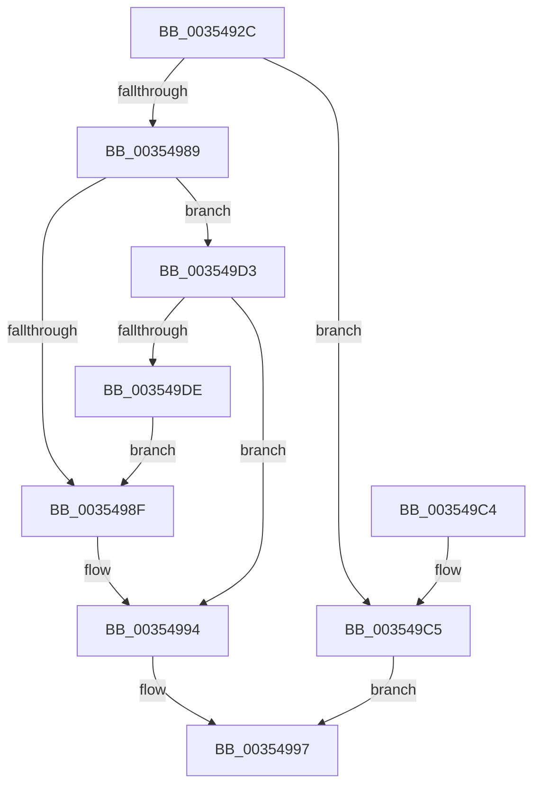

# CcRepostToSynchronousLazywriter

- RVA: `0x0035492C`–`0x003549E0` (길이 `180` bytes)
- VA: `0x000000014035492C`
- 실행 섹션: `.text`
- PDB 이름 있음: `예`; PDB Function 태그: `아니요`
- unwind 정보 RVA: `0x000791E8`
- 디코드: `44`개 명령, `180/180` bytes 표시
- 미해석 바이트: `0` (있으면 어셈블리에 `.byte`로 보존)

> 이 문서는 커널 이미지의 기계어와 PDB 기호를 분석해 생성했습니다. 4번과 5번은 함수 원형과 자료형을 바이너리 사용 방식에서 추정한 C 해석이며 원본 소스 복구 결과는 아닙니다.

## 1. Dependencies

- 직접 호출 지점: **3**; 고유 호출 대상: **3**
- 직접 호출자로 확인된 함수: **2**
- RIP 상대 이미지 참조: **0**

### Outgoing calls
- `0x00354978` → [KeAcquireInStackQueuedSpinLock](../27/KeAcquireInStackQueuedSpinLock_function_002757A0.md) (function, `0x002757A0`)
- `0x003549A5` → [CcPostWorkQueue](CcPostWorkQueue_function_00356808.md) (function, `0x00356808`)
- `0x003549AF` → [KeReleaseInStackQueuedSpinLock](../34/KeReleaseInStackQueuedSpinLock_function_00342CE0.md) (function, `0x00342CE0`)

### Direct callers
- [CcAsyncLazywriteWorker](CcAsyncLazywriteWorker_function_00354C28.md) at `0x00354DEB`
- [CcAsyncLazywriteWorkerMulti](../4D/CcAsyncLazywriteWorkerMulti_function_004D1574.md) at `0x004D18DC`

### Static image references
- 디코드된 RIP-relative 메모리 참조가 없습니다.

## 2. Other-region calls and transfers

- 다른 실행 섹션으로 향하는 call: **0**
- 별도 외부 분기/꼬리 이동을 확인하지 못했습니다.

## 3. Assembly (complete function range)

```asm
0035492C  4C 8B DC                        mov r11, rsp
0035492F  49 89 5B 08                     mov qword ptr [r11 + 8], rbx
00354933  49 89 73 10                     mov qword ptr [r11 + 0x10], rsi
00354937  57                              push rdi
00354938  48 83 EC 40                     sub rsp, 0x40
0035493C  48 8B 79 18                     mov rdi, qword ptr [rcx + 0x18]
00354940  49 8D 53 D8                     lea rdx, [r11 - 0x28]
00354944  48 8B B1 98 00 00 00            mov rsi, qword ptr [rcx + 0x98]
0035494B  48 8B D9                        mov rbx, rcx
0035494E  48 89 79 10                     mov qword ptr [rcx + 0x10], rdi
00354952  0F 57 C0                        xorps xmm0, xmm0
00354955  C7 81 80 00 00 00 02 00 00 00   mov dword ptr [rcx + 0x80], 2
0035495F  33 C0                           xor eax, eax
00354961  48 8B 89 88 00 00 00            mov rcx, qword ptr [rcx + 0x88]
00354968  0F 11 44 24 20                  movups xmmword ptr [rsp + 0x20], xmm0
0035496D  48 81 C1 00 03 00 00            add rcx, 0x300
00354974  49 89 43 E8                     mov qword ptr [r11 - 0x18], rax
00354978  E8 23 0E F2 FF                  call 0x1402757a0
0035497D  F7 87 98 00 00 00 00 00 01 00   test dword ptr [rdi + 0x98], 0x10000
00354987  75 3C                           jne 0x1403549c5
00354989  83 7F 04 00                     cmp dword ptr [rdi + 4], 0
0035498D  74 44                           je 0x1403549d3
0035498F  B9 68 00 00 00                  mov ecx, 0x68
00354994  48 8B C3                        mov rax, rbx
00354997  48 8D 14 0E                     lea rdx, [rsi + rcx]
0035499B  48 89 87 F8 01 00 00            mov qword ptr [rdi + 0x1f8], rax
003549A2  48 8B CB                        mov rcx, rbx
003549A5  E8 5E 1E 00 00                  call 0x140356808
003549AA  48 8D 4C 24 20                  lea rcx, [rsp + 0x20]
003549AF  E8 2C E3 FE FF                  call 0x140342ce0
003549B4  48 8B 5C 24 50                  mov rbx, qword ptr [rsp + 0x50]
003549B9  48 8B 74 24 58                  mov rsi, qword ptr [rsp + 0x58]
003549BE  48 83 C4 40                     add rsp, 0x40
003549C2  5F                              pop rdi
003549C3  C3                              ret
003549C4  CC                              int3
003549C5  48 8B C3                        mov rax, rbx
003549C8  B9 48 00 00 00                  mov ecx, 0x48
003549CD  48 83 C8 01                     or rax, 1
003549D1  EB C4                           jmp 0x140354997
003549D3  83 7F 70 00                     cmp dword ptr [rdi + 0x70], 0
003549D7  B9 78 00 00 00                  mov ecx, 0x78
003549DC  74 B6                           je 0x140354994
003549DE  EB AF                           jmp 0x14035498f
```

## 4. C-style interpretation (structured pseudocode)

```c
__int64 __fastcall CcRepostToSynchronousLazywriter(__int64 a1)
{
    __int64 result;
    __int64 v_rsp;
    unsigned __int64 v_stack_m28;
    unsigned __int64 v_stack_p10;
    unsigned __int64 v_stack_p8;

    *(unsigned __int64 *)(v_rsp + 8) = v_rbx;
    *(unsigned __int64 *)(v_rsp + 16) = v_rsi;
    v_rsp = (v_rsp) - (64);
    *(unsigned __int64 *)(a1 + 16) = *(unsigned __int64 *)(a1 + 24);
    *(unsigned int *)(a1 + 128) = 2;
    result = 0;
    v_stack_m28 = v_xmm0;
    a1 = (*(unsigned __int64 *)(a1 + 136)) + (768);
    *(unsigned __int64 *)(v_rsp - 24) = 0;
    result = KeAcquireInStackQueuedSpinLock(a1, v_rsp - 40, a3, a4);
    if (((*(unsigned int *)(*(unsigned __int64 *)(a1 + 24) + 152)) & (0x10000ULL)) != 0) goto loc_003549C5;
    if ((*(unsigned int *)(*(unsigned __int64 *)(a1 + 24) + 4)) == 0) goto loc_003549D3;
loc_0035498F:
loc_00354994:
loc_00354997:
    *(unsigned __int64 *)(*(unsigned __int64 *)(a1 + 24) + 504) = a1;
    result = CcPostWorkQueue(a1, *(unsigned __int64 *)(a1 + 152) + 104 * 1, a3, a4);
    result = KeReleaseInStackQueuedSpinLock(v_stack_m28, *(unsigned __int64 *)(a1 + 152) + 104 * 1, a3, a4);
    v_rsp = (v_rsp) + (64);
    return result;
loc_003549C5:
    result = (v_stack_p8) | (1);
    goto loc_00354997;
loc_003549D3:
    if ((*(unsigned int *)(*(unsigned __int64 *)(a1 + 24) + 112)) == 0) goto loc_00354994;
    goto loc_0035498F;
}
```

## 5. (Beta) C Style

```c
int64_t CcRepostToSynchronousLazywriter(void *Arg1)
{
    uint8_t *arg1 = (uint8_t *)Arg1;

    int64_t result;
    int64_t local_rsp;
    uint64_t v_stack_m28;
    uint64_t v_stack_p10;
    uint64_t v_stack_p8;

    *(uint64_t *)(local_rsp + 0x8) = local_rbx;
    *(uint64_t *)(local_rsp + 0x10) = local_rsi;
    local_rsp = (local_rsp) - (64);
    *(uint64_t *)(arg1 + 0x10) = *(uint64_t *)(arg1 + 0x18);
    *(uint32_t *)(arg1 + 0x80) = 2;
    result = 0;
    v_stack_m28 = v_xmm0;
    Arg1 = (*(uint64_t *)(arg1 + 0x88)) + (768);
    *(uint64_t *)(local_rsp - 0x18) = 0;
    result = KeAcquireInStackQueuedSpinLock(Arg1, local_rsp - 40, a3, a4);
    if (((*(uint32_t *)(*(uint64_t *)(arg1 + 0x18) + 0x98)) & (0x10000ULL)) != 0) goto loc_003549C5;
    if ((*(uint32_t *)(*(uint64_t *)(arg1 + 0x18) + 0x4)) == 0) goto loc_003549D3;
loc_0035498F:
loc_00354994:
loc_00354997:
    *(void **)(*(uint64_t *)(arg1 + 0x18) + 0x1F8) = Arg1;
    result = CcPostWorkQueue(Arg1, *(uint64_t *)(arg1 + 0x98) + 104 * 1, a3, a4);
    result = KeReleaseInStackQueuedSpinLock(v_stack_m28, *(uint64_t *)(arg1 + 0x98) + 104 * 1, a3, a4);
    local_rsp = (local_rsp) + (64);
    return result;
loc_003549C5:
    result = (v_stack_p8) | (1);
    goto loc_00354997;
loc_003549D3:
    if ((*(uint32_t *)(*(uint64_t *)(arg1 + 0x18) + 0x70)) == 0) goto loc_00354994;
    goto loc_0035498F;
}
```

### 관측된 메모리 오프셋

구조체 형식이 확인되지 않은 접근은 인자 기준의 오프셋으로만 기록했습니다.

| 기준 인자 | 오프셋 표현 | 폭 (bit) | 접근 |
|---|---:|---:|---|
| `Arg1` | `+ 0x10` | `64` | `W` |
| `Arg1` | `+ 0x18` | `64` | `R` |
| `Arg1` | `+ 0x80` | `32` | `W` |
| `Arg1` | `+ 0x88` | `64` | `R` |
| `Arg1` | `+ 0x98` | `64` | `R` |

## 6. Execution-region graph

[열기: 2D/3D 그래프와 함수 탐색 컨트롤 패널](../../../control-panel.html?section=text&rva=0x0035492C&view=graph)

- 2D 그래프는 위에서 아래로 흐르고, 3D 그래프는 빈 공간을 드래그해 회전합니다. Shift+드래그는 이동, 휠은 확대·축소, 함수 노드 선택은 대상 보고서 이동입니다.

### Static fallback


