# CcSetDirtyPinnedData

- RVA: `0x0035A120`–`0x0035A400` (길이 `736` bytes)
- VA: `0x000000014035A120`
- 실행 섹션: `.text`
- PDB 이름 있음: `예`; PDB Function 태그: `아니요`
- unwind 정보 RVA: `0x00079920`
- 디코드: `171`개 명령, `736/736` bytes 표시
- 미해석 바이트: `0` (있으면 어셈블리에 `.byte`로 보존)

> 이 문서는 커널 이미지의 기계어와 PDB 기호를 분석해 생성했습니다. 4번과 5번은 함수 원형과 자료형을 바이너리 사용 방식에서 추정한 C 해석이며 원본 소스 복구 결과는 아닙니다.

## 1. Dependencies

- 직접 호출 지점: **11**; 고유 호출 대상: **10**
- 직접 호출자로 확인된 함수: **5**
- RIP 상대 이미지 참조: **0**

### Outgoing calls
- `0x0035A18D` → [CcGetPrivateVolumeCacheMap](../38/CcGetPrivateVolumeCacheMap_function_0038B930.md) (function, `0x0038B930`)
- `0x0035A216` → [ExAcquireFastMutex](../20/ExAcquireFastMutex_function_0020E5A0.md) (function, `0x0020E5A0`)
- `0x0035A276` → [ExReleaseFastMutex](../25/ExReleaseFastMutex_function_002519C0.md) (function, `0x002519C0`)
- `0x0035A2A9` → [KeAcquireInStackQueuedSpinLock](../27/KeAcquireInStackQueuedSpinLock_function_002757A0.md) (function, `0x002757A0`)
- `0x0035A2BF` → [CcChargeDirtyPages](../3C/CcChargeDirtyPages_function_003CBEA0.md) (function, `0x003CBEA0`)
- `0x0035A2C9` → [KeReleaseInStackQueuedSpinLock](../34/KeReleaseInStackQueuedSpinLock_function_00342CE0.md) (function, `0x00342CE0`)
- `0x0035A34E` → [CcScheduleLazyWriteScan](../3C/CcScheduleLazyWriteScan_function_003CBD20.md) (function, `0x003CBD20`)
- `0x0035A356` → [CcInsertIntoDirtySharedCacheMapList](../3C/CcInsertIntoDirtySharedCacheMapList_function_003CD9D8.md) (function, `0x003CD9D8`)
- `0x0035A382` → [KeBugCheckEx](../4F/KeBugCheckEx_function_004FD660.md) (function, `0x004FD660`)
- `0x0035A3C2` → [CcSetDirtyInMask](../3C/CcSetDirtyInMask_function_003CB688.md) (function, `0x003CB688`)
- `0x0035A3FA` → [KeBugCheckEx](../4F/KeBugCheckEx_function_004FD660.md) (function, `0x004FD660`)

### Direct callers
- [CcZeroDataInCache](../29/CcZeroDataInCache_function_0029E894.md) at `0x0029E9C6`
- [CcFlushCachePostProcessOneRange](CcFlushCachePostProcessOneRange_function_00359710.md) at `0x00359904`
- [CcReleaseByteRangeFromWrite](CcReleaseByteRangeFromWrite_function_00359C90.md) at `0x00359D28`
- [CcUnpinRepinnedBcb](../49/CcUnpinRepinnedBcb_function_0049F560.md) at `0x0049F6FE`
- [CcPreparePinWrite](../../page/A4/CcPreparePinWrite_function_00A4C1C0.md) at `0x00A4C2F7`

### Static image references
- 디코드된 RIP-relative 메모리 참조가 없습니다.

## 2. Other-region calls and transfers

- 다른 실행 섹션으로 향하는 call: **0**
- 별도 외부 분기/꼬리 이동을 확인하지 못했습니다.

## 3. Assembly (complete function range)

```asm
0035A120  48 89 5C 24 10                  mov qword ptr [rsp + 0x10], rbx
0035A125  48 89 6C 24 18                  mov qword ptr [rsp + 0x18], rbp
0035A12A  56                              push rsi
0035A12B  41 54                           push r12
0035A12D  41 55                           push r13
0035A12F  41 56                           push r14
0035A131  41 57                           push r15
0035A133  48 83 EC 60                     sub rsp, 0x60
0035A137  33 C0                           xor eax, eax
0035A139  4C 8B C1                        mov r8, rcx
0035A13C  48 89 44 24 50                  mov qword ptr [rsp + 0x50], rax
0035A141  0F 57 C0                        xorps xmm0, xmm0
0035A144  0F B7 01                        movzx eax, word ptr [rcx]
0035A147  4C 8B F2                        mov r14, rdx
0035A14A  B9 FD 02 00 00                  mov ecx, 0x2fd
0035A14F  0F 11 44 24 40                  movups xmmword ptr [rsp + 0x40], xmm0
0035A154  8D 51 FD                        lea edx, [rcx - 3]
0035A157  66 3B C1                        cmp ax, cx
0035A15A  0F 85 00 02 00 00               jne 0x14035a360
0035A160  48 83 64 24 38 00               and qword ptr [rsp + 0x38], 0
0035A166  4C 8D 7C 24 30                  lea r15, [rsp + 0x30]
0035A16B  4C 89 44 24 30                  mov qword ptr [rsp + 0x30], r8
0035A170  4D 8B D0                        mov r10, r8
0035A173  66 3B C2                        cmp ax, dx
0035A176  0F 84 0C 02 00 00               je 0x14035a388
0035A17C  4D 8B 92 B0 00 00 00            mov r10, qword ptr [r10 + 0xb0]
0035A183  49 8B CA                        mov rcx, r10
0035A186  4D 8B AA 18 02 00 00            mov r13, qword ptr [r10 + 0x218]
0035A18D  E8 9E 17 03 00                  call 0x14038b930
0035A192  41 F7 82 98 00 00 00 00 00 00 01  test dword ptr [r10 + 0x98], 0x1000000
0035A19D  48 89 84 24 90 00 00 00         mov qword ptr [rsp + 0x90], rax
0035A1A5  74 18                           je 0x14035a1bf
0035A1A7  49 8B 8A F8 00 00 00            mov rcx, qword ptr [r10 + 0xf8]
0035A1AE  48 8B 89 88 00 00 00            mov rcx, qword ptr [rcx + 0x88]
0035A1B5  48 83 F9 FF                     cmp rcx, -1
0035A1B9  0F 84 D5 01 00 00               je 0x14035a394
0035A1BF  41 F7 82 98 00 00 00 00 02 00 00  test dword ptr [r10 + 0x98], 0x200
0035A1CA  0F 84 E4 01 00 00               je 0x14035a3b4
0035A1D0  49 8B 1F                        mov rbx, qword ptr [r15]
0035A1D3  48 85 DB                        test rbx, rbx
0035A1D6  75 1B                           jne 0x14035a1f3
0035A1D8  4C 8D 5C 24 60                  lea r11, [rsp + 0x60]
0035A1DD  49 8B 5B 38                     mov rbx, qword ptr [r11 + 0x38]
0035A1E1  49 8B 6B 40                     mov rbp, qword ptr [r11 + 0x40]
0035A1E5  49 8B E3                        mov rsp, r11
0035A1E8  41 5F                           pop r15
0035A1EA  41 5E                           pop r14
0035A1EC  41 5D                           pop r13
0035A1EE  41 5C                           pop r12
0035A1F0  5E                              pop rsi
0035A1F1  C3                              ret
0035A1F2  CC                              int3
0035A1F3  49 83 C7 08                     add r15, 8
0035A1F7  48 89 5C 24 30                  mov qword ptr [rsp + 0x30], rbx
0035A1FC  F6 C3 01                        test bl, 1
0035A1FF  0F 85 DC 01 00 00               jne 0x14035a3e1
0035A205  48 8B B3 B0 00 00 00            mov rsi, qword ptr [rbx + 0xb0]
0035A20C  4C 8D A6 20 01 00 00            lea r12, [rsi + 0x120]
0035A213  49 8B CC                        mov rcx, r12
0035A216  E8 85 43 EB FF                  call 0x14020e5a0
0035A21B  80 7B 02 00                     cmp byte ptr [rbx + 2], 0
0035A21F  74 5F                           je 0x14035a280
0035A221  4D 85 F6                        test r14, r14
0035A224  74 3F                           je 0x14035a265
0035A226  48 8B 4B 28                     mov rcx, qword ptr [rbx + 0x28]
0035A22A  49 8B 06                        mov rax, qword ptr [r14]
0035A22D  48 85 C9                        test rcx, rcx
0035A230  0F 84 96 01 00 00               je 0x14035a3cc
0035A236  48 3B C1                        cmp rax, rcx
0035A239  0F 8C 8D 01 00 00               jl 0x14035a3cc
0035A23F  48 8B 4B 30                     mov rcx, qword ptr [rbx + 0x30]
0035A243  48 85 C9                        test rcx, rcx
0035A246  0F 84 CB 00 00 00               je 0x14035a317
0035A24C  48 3B C1                        cmp rax, rcx
0035A24F  0F 8F C2 00 00 00               jg 0x14035a317
0035A255  48 8B 86 08 01 00 00            mov rax, qword ptr [rsi + 0x108]
0035A25C  49 39 06                        cmp qword ptr [r14], rax
0035A25F  0F 8F BB 00 00 00               jg 0x14035a320
0035A265  48 8B 43 20                     mov rax, qword ptr [rbx + 0x20]
0035A269  48 3B 46 30                     cmp rax, qword ptr [rsi + 0x30]
0035A26D  0F 8F 65 01 00 00               jg 0x14035a3d8
0035A273  49 8B CC                        mov rcx, r12
0035A276  E8 45 77 EF FF                  call 0x1402519c0
0035A27B  E9 50 FF FF FF                  jmp 0x14035a1d0
0035A280  8B 6B 04                        mov ebp, dword ptr [rbx + 4]
0035A283  C1 ED 0C                        shr ebp, 0xc
0035A286  C6 43 02 01                     mov byte ptr [rbx + 2], 1
0035A28A  4D 85 F6                        test r14, r14
0035A28D  74 0E                           je 0x14035a29d
0035A28F  49 8B 06                        mov rax, qword ptr [r14]
0035A292  48 89 43 28                     mov qword ptr [rbx + 0x28], rax
0035A296  49 8B 06                        mov rax, qword ptr [r14]
0035A299  48 89 43 30                     mov qword ptr [rbx + 0x30], rax
0035A29D  49 8D 8D 00 03 00 00            lea rcx, [r13 + 0x300]
0035A2A4  48 8D 54 24 40                  lea rdx, [rsp + 0x40]
0035A2A9  E8 F2 B4 F1 FF                  call 0x1402757a0
0035A2AE  83 7E 70 00                     cmp dword ptr [rsi + 0x70], 0
0035A2B2  74 7B                           je 0x14035a32f
0035A2B4  44 8B CD                        mov r9d, ebp
0035A2B7  45 33 C0                        xor r8d, r8d
0035A2BA  33 D2                           xor edx, edx
0035A2BC  48 8B CE                        mov rcx, rsi
0035A2BF  E8 DC 1B 07 00                  call 0x1403cbea0
0035A2C4  48 8D 4C 24 40                  lea rcx, [rsp + 0x40]
0035A2C9  E8 12 8A FE FF                  call 0x140342ce0
0035A2CE  F7 86 98 00 00 00 00 00 00 10   test dword ptr [rsi + 0x98], 0x10000000
0035A2D8  0F 84 43 FF FF FF               je 0x14035a221
0035A2DE  65 48 8B 04 25 88 01 00 00      mov rax, qword ptr gs:[0x188]
0035A2E7  C1 E5 0C                        shl ebp, 0xc
0035A2EA  8B D5                           mov edx, ebp
0035A2EC  48 8B 88 20 02 00 00            mov rcx, qword ptr [rax + 0x220]
0035A2F3  48 8B 81 38 06 00 00            mov rax, qword ptr [rcx + 0x638]
0035A2FA  48 85 C0                        test rax, rax
0035A2FD  74 0E                           je 0x14035a30d
0035A2FF  85 ED                           test ebp, ebp
0035A301  74 05                           je 0x14035a308
0035A303  F0 48 01 50 08                  lock add qword ptr [rax + 8], rdx
0035A308  F0 48 FF 40 18                  lock inc qword ptr [rax + 0x18]
0035A30D  48 8B 5C 24 30                  mov rbx, qword ptr [rsp + 0x30]
0035A312  E9 0A FF FF FF                  jmp 0x14035a221
0035A317  48 89 43 30                     mov qword ptr [rbx + 0x30], rax
0035A31B  E9 35 FF FF FF                  jmp 0x14035a255
0035A320  49 8B 06                        mov rax, qword ptr [r14]
0035A323  48 89 86 08 01 00 00            mov qword ptr [rsi + 0x108], rax
0035A32A  E9 36 FF FF FF                  jmp 0x14035a265
0035A32F  8B 86 98 00 00 00               mov eax, dword ptr [rsi + 0x98]
0035A335  A8 02                           test al, 2
0035A337  0F 85 77 FF FF FF               jne 0x14035a2b4
0035A33D  48 8B 94 24 90 00 00 00         mov rdx, qword ptr [rsp + 0x90]
0035A345  45 33 C9                        xor r9d, r9d
0035A348  45 33 C0                        xor r8d, r8d
0035A34B  49 8B CD                        mov rcx, r13
0035A34E  E8 CD 19 07 00                  call 0x1403cbd20
0035A353  48 8B CE                        mov rcx, rsi
0035A356  E8 7D 36 07 00                  call 0x1403cd9d8
0035A35B  E9 54 FF FF FF                  jmp 0x14035a2b4
0035A360  66 3B C2                        cmp ax, dx
0035A363  0F 84 F7 FD FF FF               je 0x14035a160
0035A369  48 83 64 24 20 00               and qword ptr [rsp + 0x20], 0
0035A36F  45 33 C9                        xor r9d, r9d
0035A372  BA 1D 0F 00 00                  mov edx, 0xf1d
0035A377  49 C7 C0 20 04 00 C0            mov r8, 0xffffffffc0000420
0035A37E  41 8D 49 34                     lea ecx, [r9 + 0x34]
0035A382  E8 D9 32 1A 00                  call 0x1404fd660
0035A387  CC                              int3
0035A388  4D 8D 78 10                     lea r15, [r8 + 0x10]
0035A38C  4D 8B 17                        mov r10, qword ptr [r15]
0035A38F  E9 E8 FD FF FF                  jmp 0x14035a17c
0035A394  48 BA 20 03 00 00 80 F7 FF FF   movabs rdx, 0xfffff78000000320
0035A39E  48 8B 12                        mov rdx, qword ptr [rdx]
0035A3A1  49 8B 82 F8 00 00 00            mov rax, qword ptr [r10 + 0xf8]
0035A3A8  48 89 90 88 00 00 00            mov qword ptr [rax + 0x88], rdx
0035A3AF  E9 0B FE FF FF                  jmp 0x14035a1bf
0035A3B4  49 8D 50 08                     lea rdx, [r8 + 8]
0035A3B8  45 33 C9                        xor r9d, r9d
0035A3BB  45 8B 40 04                     mov r8d, dword ptr [r8 + 4]
0035A3BF  49 8B CA                        mov rcx, r10
0035A3C2  E8 C1 12 07 00                  call 0x1403cb688
0035A3C7  E9 0C FE FF FF                  jmp 0x14035a1d8
0035A3CC  48 89 43 28                     mov qword ptr [rbx + 0x28], rax
0035A3D0  49 8B 06                        mov rax, qword ptr [r14]
0035A3D3  E9 67 FE FF FF                  jmp 0x14035a23f
0035A3D8  48 89 46 30                     mov qword ptr [rsi + 0x30], rax
0035A3DC  E9 92 FE FF FF                  jmp 0x14035a273
0035A3E1  48 83 64 24 20 00               and qword ptr [rsp + 0x20], 0
0035A3E7  45 33 C9                        xor r9d, r9d
0035A3EA  BA 7F 0F 00 00                  mov edx, 0xf7f
0035A3EF  49 C7 C0 20 04 00 C0            mov r8, 0xffffffffc0000420
0035A3F6  41 8D 49 34                     lea ecx, [r9 + 0x34]
0035A3FA  E8 61 32 1A 00                  call 0x1404fd660
0035A3FF  CC                              int3
```

## 4. C-style interpretation (structured pseudocode)

```c
__int64 __fastcall CcSetDirtyPinnedData(__int64 a1, __int64 a2)
{
    __int64 result;
    __int64 v_r15;
    __int64 v_rbp;
    __int64 v_rsp;
    unsigned __int64 v_stack_m20;
    unsigned __int64 v_stack_m28;
    unsigned __int64 v_stack_m30;
    unsigned __int64 v_stack_m38;
    unsigned __int64 v_stack_m40;
    unsigned __int64 v_stack_m48;
    unsigned __int64 v_stack_m50;
    unsigned __int64 v_stack_m58;
    unsigned __int64 v_stack_p10;
    unsigned __int64 v_stack_p18;
    unsigned __int64 v_stack_p30;
    unsigned __int64 v_stack_p8;

    v_stack_p10 = v_rbx;
    v_stack_p18 = v_rbp;
    v_rsp = (v_rsp) - (96);
    result = 0;
    v_stack_m38 = 0;
    v_stack_m48 = v_xmm0;
    if (((unsigned __int16)(*(unsigned __int16 *)(a1))) != 765) goto loc_0035A360;
loc_0035A160:
    v_stack_m58 = a1;
    if (((unsigned __int16)(*(unsigned __int16 *)(a1))) == ((unsigned __int16)(765 - 3))) goto loc_0035A388;
loc_0035A17C:
    result = CcGetPrivateVolumeCacheMap(*(unsigned __int64 *)(a1 + 176), 765 - 3, a1, a4);
    v_stack_p8 = result;
    if (((*(unsigned int *)(*(unsigned __int64 *)(a1 + 176) + 152)) & (0x1000000ULL)) == 0) goto loc_0035A1BF;
    if ((*(unsigned __int64 *)(*(unsigned __int64 *)(*(unsigned __int64 *)(a1 + 176) + 248) + 136)) == -1) goto loc_0035A394;
loc_0035A1BF:
    if (((*(unsigned int *)(*(unsigned __int64 *)(a1 + 176) + 152)) & (512)) == 0) goto loc_0035A3B4;
loc_0035A1D0:
    if (*(unsigned __int64 *)(v_stack_m58) != 0) goto loc_0035A1F3;
loc_0035A1D8:
    return result;
loc_0035A1F3:
    v_r15 = (v_stack_m58) + (8);
    v_stack_m30 = *(unsigned __int64 *)(v_stack_m28 + 56);
    if ((((unsigned __int8)(*(unsigned __int64 *)(v_stack_m28 + 56))) & (1)) != 0) goto loc_0035A3E1;
    result = ExAcquireFastMutex(*(unsigned __int64 *)(*(unsigned __int64 *)(v_stack_m28 + 56) + 176) + 288, 765 - 3, a1, a4);
    if ((*(unsigned __int8 *)(*(unsigned __int64 *)(v_stack_m28 + 56) + 2)) == 0) goto loc_0035A280;
loc_0035A221:
    if (a2 == 0) goto loc_0035A265;
    if (*(unsigned __int64 *)(*(unsigned __int64 *)(v_stack_m28 + 56) + 40) == 0) goto loc_0035A3CC;
    if ((*(unsigned __int64 *)(a2)) < (*(unsigned __int64 *)(*(unsigned __int64 *)(v_stack_m28 + 56) + 40))) goto loc_0035A3CC;
loc_0035A23F:
    if (*(unsigned __int64 *)(*(unsigned __int64 *)(v_stack_m28 + 56) + 48) == 0) goto loc_0035A317;
    if ((*(unsigned __int64 *)(a2)) > (*(unsigned __int64 *)(*(unsigned __int64 *)(v_stack_m28 + 56) + 48))) goto loc_0035A317;
loc_0035A255:
    if ((*(unsigned __int64 *)(a2)) > (*(unsigned __int64 *)(*(unsigned __int64 *)(*(unsigned __int64 *)(v_stack_m28 + 56) + 176) + 264))) goto loc_0035A320;
loc_0035A265:
    if ((*(unsigned __int64 *)(*(unsigned __int64 *)(v_stack_m28 + 56) + 32)) > (*(unsigned __int64 *)(*(unsigned __int64 *)(*(unsigned __int64 *)(v_stack_m28 + 56) + 176) + 48))) goto loc_0035A3D8;
loc_0035A273:
    result = ExReleaseFastMutex(*(unsigned __int64 *)(*(unsigned __int64 *)(v_stack_m28 + 56) + 176) + 288, 765 - 3, a1, a4);
    goto loc_0035A1D0;
loc_0035A280:
    v_rbp = (unsigned int)(((unsigned int)(*(unsigned int *)(*(unsigned __int64 *)(v_stack_m28 + 56) + 4))) >> (12));
    *(unsigned __int8 *)(*(unsigned __int64 *)(v_stack_m28 + 56) + 2) = 1;
    if (a2 != 0) {
        result = *(unsigned __int64 *)(a2);
        *(unsigned __int64 *)(*(unsigned __int64 *)(v_stack_m28 + 56) + 40) = result;
        result = *(unsigned __int64 *)(a2);
        *(unsigned __int64 *)(*(unsigned __int64 *)(v_stack_m28 + 56) + 48) = result;
    }
    result = KeAcquireInStackQueuedSpinLock(*(unsigned __int64 *)(*(unsigned __int64 *)(a1 + 176) + 536) + 768, v_stack_m20, a1, a4);
    if ((*(unsigned int *)(*(unsigned __int64 *)(*(unsigned __int64 *)(v_stack_m28 + 56) + 176) + 112)) == 0) goto loc_0035A32F;
loc_0035A2B4:
    a3 = 0;
    a2 = 0;
    result = CcChargeDirtyPages(*(unsigned __int64 *)(*(unsigned __int64 *)(v_stack_m28 + 56) + 176), a2, a3, (unsigned int)((unsigned int)(v_rbp)));
    result = KeReleaseInStackQueuedSpinLock(v_stack_m20, a2, a3, (unsigned int)((unsigned int)(v_rbp)));
    if (((*(unsigned int *)(*(unsigned __int64 *)(*(unsigned __int64 *)(v_stack_m28 + 56) + 176) + 152)) & (0x10000000ULL)) == 0) goto loc_0035A221;
    v_rbp = (unsigned int)((v_rbp) << (12));
    if (*(unsigned __int64 *)(*(unsigned __int64 *)(*(unsigned __int64 *)(gs_base + (0 + 392)) + 544) + 1592) == 0) goto loc_0035A30D;
    if ((unsigned int)(v_rbp) != 0) {
    }
loc_0035A30D:
    goto loc_0035A221;
loc_0035A317:
    *(unsigned __int64 *)(v_stack_m30 + 48) = *(unsigned __int64 *)(*(unsigned __int64 *)(*(unsigned __int64 *)(gs_base + (0 + 392)) + 544) + 1592);
    goto loc_0035A255;
loc_0035A320:
    *(unsigned __int64 *)(*(unsigned __int64 *)(*(unsigned __int64 *)(v_stack_m28 + 56) + 176) + 264) = *(unsigned __int64 *)(a2);
    goto loc_0035A265;
loc_0035A32F:
    if ((((unsigned __int8)((unsigned int)(*(unsigned int *)(*(unsigned __int64 *)(*(unsigned __int64 *)(v_stack_m28 + 56) + 176) + 152)))) & (2)) != 0) goto loc_0035A2B4;
    a4 = 0;
    a3 = 0;
    result = CcScheduleLazyWriteScan(*(unsigned __int64 *)(*(unsigned __int64 *)(a1 + 176) + 536), v_stack_p30, a3, a4);
    result = CcInsertIntoDirtySharedCacheMapList(*(unsigned __int64 *)(*(unsigned __int64 *)(v_stack_m28 + 56) + 176), v_stack_p30, a3, a4);
    goto loc_0035A2B4;
loc_0035A360:
    if (((unsigned __int16)(result)) == ((unsigned __int16)(v_stack_p30))) goto loc_0035A160;
    a4 = 0;
    result = KeBugCheckEx(a4 + 52, (unsigned int)(0xF1DULL), 0xFFFFFFFFC0000420ULL, a4);
loc_0035A388:
    goto loc_0035A17C;
loc_0035A394:
    *(unsigned __int64 *)(*(unsigned __int64 *)(*(unsigned __int64 *)(0xFFFFFFFFC0000420ULL + 16) + 248) + 136) = *(unsigned __int64 *)((unsigned int)(0xF1DULL));
    goto loc_0035A1BF;
loc_0035A3B4:
    a4 = 0;
    result = CcSetDirtyInMask(*(unsigned __int64 *)(0xFFFFFFFFC0000420ULL + 16), 0xFFFFFFFFC0000420ULL + 8, (unsigned int)(*(unsigned int *)(0xFFFFFFFFC0000420ULL + 4)), a4);
    goto loc_0035A1D8;
loc_0035A3CC:
    *(unsigned __int64 *)(v_stack_m30 + 40) = result;
    goto loc_0035A23F;
loc_0035A3D8:
    *(unsigned __int64 *)(*(unsigned __int64 *)(*(unsigned __int64 *)(v_stack_m28 + 56) + 176) + 48) = *(unsigned __int64 *)(a2);
    goto loc_0035A273;
loc_0035A3E1:
    a4 = 0;
    result = KeBugCheckEx(a4 + 52, (unsigned int)(0xF7FULL), 0xFFFFFFFFC0000420ULL, a4);
    return result;
}
```

## 5. (Beta) C Style

```c
int64_t CcSetDirtyPinnedData(void *Arg1, int64_t Arg2)
{
    uint8_t *arg1 = (uint8_t *)Arg1;

    int64_t result;
    int64_t local_r15;
    int64_t local_rbp;
    int64_t local_rsp;
    uint64_t v_stack_m20;
    uint64_t v_stack_m28;
    uint64_t v_stack_m30;
    uint64_t v_stack_m38;
    uint64_t v_stack_m40;
    uint64_t v_stack_m48;
    uint64_t v_stack_m50;
    uint64_t v_stack_m58;
    uint64_t v_stack_p10;
    uint64_t v_stack_p18;
    uint64_t v_stack_p30;
    uint64_t v_stack_p8;

    v_stack_p10 = local_rbx;
    v_stack_p18 = local_rbp;
    local_rsp = (local_rsp) - (96);
    result = 0;
    v_stack_m38 = 0;
    v_stack_m48 = v_xmm0;
    if (((uint16_t)(*(uint16_t *)(arg1))) != 765) goto loc_0035A360;
loc_0035A160:
    v_stack_m58 = Arg1;
    if (((uint16_t)(*(uint16_t *)(arg1))) == ((uint16_t)(765 - 3))) goto loc_0035A388;
loc_0035A17C:
    result = CcGetPrivateVolumeCacheMap(*(uint64_t *)(arg1 + 0xB0), 765 - 3, Arg1, a4);
    v_stack_p8 = result;
    if (((*(uint32_t *)(*(uint64_t *)(arg1 + 0xB0) + 0x98)) & (0x1000000ULL)) == 0) goto loc_0035A1BF;
    if ((*(uint64_t *)(*(uint64_t *)(*(uint64_t *)(arg1 + 0xB0) + 0xF8) + 0x88)) == -1) goto loc_0035A394;
loc_0035A1BF:
    if (((*(uint32_t *)(*(uint64_t *)(arg1 + 0xB0) + 0x98)) & (512)) == 0) goto loc_0035A3B4;
loc_0035A1D0:
    if (*(uint64_t *)(v_stack_m58) != 0) goto loc_0035A1F3;
loc_0035A1D8:
    return result;
loc_0035A1F3:
    local_r15 = (v_stack_m58) + (8);
    v_stack_m30 = *(uint64_t *)(v_stack_m28 + 0x38);
    if ((((uint8_t)(*(uint64_t *)(v_stack_m28 + 0x38))) & (1)) != 0) goto loc_0035A3E1;
    result = ExAcquireFastMutex(*(uint64_t *)(*(uint64_t *)(v_stack_m28 + 0x38) + 0xB0) + 288, 765 - 3, Arg1, a4);
    if ((*(uint8_t *)(*(uint64_t *)(v_stack_m28 + 0x38) + 0x2)) == 0) goto loc_0035A280;
loc_0035A221:
    if (Arg2 == 0) goto loc_0035A265;
    if (*(uint64_t *)(*(uint64_t *)(v_stack_m28 + 0x38) + 0x28) == 0) goto loc_0035A3CC;
    if ((*(uint64_t *)(Arg2)) < (*(uint64_t *)(*(uint64_t *)(v_stack_m28 + 0x38) + 0x28))) goto loc_0035A3CC;
loc_0035A23F:
    if (*(uint64_t *)(*(uint64_t *)(v_stack_m28 + 0x38) + 0x30) == 0) goto loc_0035A317;
    if ((*(uint64_t *)(Arg2)) > (*(uint64_t *)(*(uint64_t *)(v_stack_m28 + 0x38) + 0x30))) goto loc_0035A317;
loc_0035A255:
    if ((*(uint64_t *)(Arg2)) > (*(uint64_t *)(*(uint64_t *)(*(uint64_t *)(v_stack_m28 + 0x38) + 0xB0) + 0x108))) goto loc_0035A320;
loc_0035A265:
    if ((*(uint64_t *)(*(uint64_t *)(v_stack_m28 + 0x38) + 0x20)) > (*(uint64_t *)(*(uint64_t *)(*(uint64_t *)(v_stack_m28 + 0x38) + 0xB0) + 0x30))) goto loc_0035A3D8;
loc_0035A273:
    result = ExReleaseFastMutex(*(uint64_t *)(*(uint64_t *)(v_stack_m28 + 0x38) + 0xB0) + 288, 765 - 3, Arg1, a4);
    goto loc_0035A1D0;
loc_0035A280:
    local_rbp = (uint32_t)(((uint32_t)(*(uint32_t *)(*(uint64_t *)(v_stack_m28 + 0x38) + 0x4))) >> (12));
    *(uint8_t *)(*(uint64_t *)(v_stack_m28 + 0x38) + 0x2) = 1;
    if (Arg2 != 0) {
        result = *(uint64_t *)(Arg2);
        *(uint64_t *)(*(uint64_t *)(v_stack_m28 + 0x38) + 0x28) = result;
        result = *(uint64_t *)(Arg2);
        *(uint64_t *)(*(uint64_t *)(v_stack_m28 + 0x38) + 0x30) = result;
    }
    result = KeAcquireInStackQueuedSpinLock(*(uint64_t *)(*(uint64_t *)(arg1 + 0xB0) + 0x218) + 768, v_stack_m20, Arg1, a4);
    if ((*(uint32_t *)(*(uint64_t *)(*(uint64_t *)(v_stack_m28 + 0x38) + 0xB0) + 0x70)) == 0) goto loc_0035A32F;
loc_0035A2B4:
    a3 = 0;
    Arg2 = 0;
    result = CcChargeDirtyPages(*(uint64_t *)(*(uint64_t *)(v_stack_m28 + 0x38) + 0xB0), Arg2, a3, (uint32_t)((uint32_t)(local_rbp)));
    result = KeReleaseInStackQueuedSpinLock(v_stack_m20, Arg2, a3, (uint32_t)((uint32_t)(local_rbp)));
    if (((*(uint32_t *)(*(uint64_t *)(*(uint64_t *)(v_stack_m28 + 0x38) + 0xB0) + 0x98)) & (0x10000000ULL)) == 0) goto loc_0035A221;
    local_rbp = (uint32_t)((local_rbp) << (12));
    if (*(uint64_t *)(*(uint64_t *)(*(uint64_t *)(gs_base + (0 + 0x188)) + 0x220) + 0x638) == 0) goto loc_0035A30D;
    if ((uint32_t)(local_rbp) != 0) {
    }
loc_0035A30D:
    goto loc_0035A221;
loc_0035A317:
    *(uint64_t *)(v_stack_m30 + 0x30) = *(uint64_t *)(*(uint64_t *)(*(uint64_t *)(gs_base + (0 + 0x188)) + 0x220) + 0x638);
    goto loc_0035A255;
loc_0035A320:
    *(uint64_t *)(*(uint64_t *)(*(uint64_t *)(v_stack_m28 + 0x38) + 0xB0) + 0x108) = *(uint64_t *)(Arg2);
    goto loc_0035A265;
loc_0035A32F:
    if ((((uint8_t)((uint32_t)(*(uint32_t *)(*(uint64_t *)(*(uint64_t *)(v_stack_m28 + 0x38) + 0xB0) + 0x98)))) & (2)) != 0) goto loc_0035A2B4;
    a4 = 0;
    a3 = 0;
    result = CcScheduleLazyWriteScan(*(uint64_t *)(*(uint64_t *)(arg1 + 0xB0) + 0x218), v_stack_p30, a3, a4);
    result = CcInsertIntoDirtySharedCacheMapList(*(uint64_t *)(*(uint64_t *)(v_stack_m28 + 0x38) + 0xB0), v_stack_p30, a3, a4);
    goto loc_0035A2B4;
loc_0035A360:
    if (((uint16_t)(result)) == ((uint16_t)(v_stack_p30))) goto loc_0035A160;
    a4 = 0;
    result = KeBugCheckEx(a4 + 52, (uint32_t)(0xF1DULL), 0xFFFFFFFFC0000420ULL, a4);
loc_0035A388:
    goto loc_0035A17C;
loc_0035A394:
    *(uint64_t *)(*(uint64_t *)(*(uint64_t *)(0xFFFFFFFFC0000420ULL + 0x10) + 0xF8) + 0x88) = *(uint64_t *)((uint32_t)(0xF1DULL));
    goto loc_0035A1BF;
loc_0035A3B4:
    a4 = 0;
    result = CcSetDirtyInMask(*(uint64_t *)(0xFFFFFFFFC0000420ULL + 0x10), 0xFFFFFFFFC0000420ULL + 8, (uint32_t)(*(uint32_t *)(0xFFFFFFFFC0000420ULL + 0x4)), a4);
    goto loc_0035A1D8;
loc_0035A3CC:
    *(uint64_t *)(v_stack_m30 + 0x28) = result;
    goto loc_0035A23F;
loc_0035A3D8:
    *(uint64_t *)(*(uint64_t *)(*(uint64_t *)(v_stack_m28 + 0x38) + 0xB0) + 0x30) = *(uint64_t *)(Arg2);
    goto loc_0035A273;
loc_0035A3E1:
    a4 = 0;
    result = KeBugCheckEx(a4 + 52, (uint32_t)(0xF7FULL), 0xFFFFFFFFC0000420ULL, a4);
    return result;
}
```

### 관측된 메모리 오프셋

구조체 형식이 확인되지 않은 접근은 인자 기준의 오프셋으로만 기록했습니다.

| 기준 인자 | 오프셋 표현 | 폭 (bit) | 접근 |
|---|---:|---:|---|
| `Arg1` | `+ 0x0` | `16` | `R` |

## 6. Execution-region graph

[열기: 2D/3D 그래프와 함수 탐색 컨트롤 패널](../../../control-panel.html?section=text&rva=0x0035A120&view=graph)

- 2D 그래프는 위에서 아래로 흐르고, 3D 그래프는 빈 공간을 드래그해 회전합니다. Shift+드래그는 이동, 휠은 확대·축소, 함수 노드 선택은 대상 보고서 이동입니다.

### Static fallback

```mermaid
flowchart TD
  bb_0035A120[BB_0035A120]
  bb_0035A160[BB_0035A160]
  bb_0035A17C[BB_0035A17C]
  bb_0035A1A7[BB_0035A1A7]
  bb_0035A1BF[BB_0035A1BF]
  bb_0035A1D0[BB_0035A1D0]
  bb_0035A1D8[BB_0035A1D8]
  bb_0035A1F2[BB_0035A1F2]
  bb_0035A1F3[BB_0035A1F3]
  bb_0035A205[BB_0035A205]
  bb_0035A221[BB_0035A221]
  bb_0035A226[BB_0035A226]
  bb_0035A236[BB_0035A236]
  bb_0035A23F[BB_0035A23F]
  bb_0035A24C[BB_0035A24C]
  bb_0035A255[BB_0035A255]
  bb_0035A265[BB_0035A265]
  bb_0035A273[BB_0035A273]
  bb_0035A280[BB_0035A280]
  bb_0035A28F[BB_0035A28F]
  bb_0035A29D[BB_0035A29D]
  bb_0035A2B4[BB_0035A2B4]
  bb_0035A2DE[BB_0035A2DE]
  bb_0035A2FF[BB_0035A2FF]
  bb_0035A303[BB_0035A303]
  bb_0035A308[BB_0035A308]
  bb_0035A30D[BB_0035A30D]
  bb_0035A317[BB_0035A317]
  bb_0035A320[BB_0035A320]
  bb_0035A32F[BB_0035A32F]
  bb_0035A33D[BB_0035A33D]
  bb_0035A360[BB_0035A360]
  bb_0035A369[BB_0035A369]
  bb_0035A388[BB_0035A388]
  bb_0035A394[BB_0035A394]
  bb_0035A3B4[BB_0035A3B4]
  bb_0035A3CC[BB_0035A3CC]
  bb_0035A3D8[BB_0035A3D8]
  bb_0035A3E1[BB_0035A3E1]
  bb_0035A120 -->|branch| bb_0035A360
  bb_0035A120 -->|fallthrough| bb_0035A160
  bb_0035A160 -->|branch| bb_0035A388
  bb_0035A160 -->|fallthrough| bb_0035A17C
  bb_0035A17C -->|branch| bb_0035A1BF
  bb_0035A17C -->|fallthrough| bb_0035A1A7
  bb_0035A1A7 -->|branch| bb_0035A394
  bb_0035A1A7 -->|fallthrough| bb_0035A1BF
  bb_0035A1BF -->|branch| bb_0035A3B4
  bb_0035A1BF -->|fallthrough| bb_0035A1D0
  bb_0035A1D0 -->|branch| bb_0035A1F3
  bb_0035A1D0 -->|fallthrough| bb_0035A1D8
  bb_0035A1F2 -->|flow| bb_0035A1F3
  bb_0035A1F3 -->|branch| bb_0035A3E1
  bb_0035A1F3 -->|fallthrough| bb_0035A205
  bb_0035A205 -->|branch| bb_0035A280
  bb_0035A205 -->|fallthrough| bb_0035A221
  bb_0035A221 -->|branch| bb_0035A265
  bb_0035A221 -->|fallthrough| bb_0035A226
  bb_0035A226 -->|branch| bb_0035A3CC
  bb_0035A226 -->|fallthrough| bb_0035A236
  bb_0035A236 -->|branch| bb_0035A3CC
  bb_0035A236 -->|fallthrough| bb_0035A23F
  bb_0035A23F -->|branch| bb_0035A317
  bb_0035A23F -->|fallthrough| bb_0035A24C
  bb_0035A24C -->|branch| bb_0035A317
  bb_0035A24C -->|fallthrough| bb_0035A255
  bb_0035A255 -->|branch| bb_0035A320
  bb_0035A255 -->|fallthrough| bb_0035A265
  bb_0035A265 -->|branch| bb_0035A3D8
  bb_0035A265 -->|fallthrough| bb_0035A273
  bb_0035A273 -->|branch| bb_0035A1D0
  bb_0035A280 -->|branch| bb_0035A29D
  bb_0035A280 -->|fallthrough| bb_0035A28F
  bb_0035A28F -->|flow| bb_0035A29D
  bb_0035A29D -->|branch| bb_0035A32F
  bb_0035A29D -->|fallthrough| bb_0035A2B4
  bb_0035A2B4 -->|branch| bb_0035A221
  bb_0035A2B4 -->|fallthrough| bb_0035A2DE
  bb_0035A2DE -->|branch| bb_0035A30D
  bb_0035A2DE -->|fallthrough| bb_0035A2FF
  bb_0035A2FF -->|branch| bb_0035A308
  bb_0035A2FF -->|fallthrough| bb_0035A303
  bb_0035A303 -->|flow| bb_0035A308
  bb_0035A308 -->|flow| bb_0035A30D
  bb_0035A30D -->|branch| bb_0035A221
  bb_0035A317 -->|branch| bb_0035A255
  bb_0035A320 -->|branch| bb_0035A265
  bb_0035A32F -->|branch| bb_0035A2B4
  bb_0035A32F -->|fallthrough| bb_0035A33D
  bb_0035A33D -->|branch| bb_0035A2B4
  bb_0035A360 -->|branch| bb_0035A160
  bb_0035A360 -->|fallthrough| bb_0035A369
  bb_0035A369 -->|flow| bb_0035A388
  bb_0035A388 -->|branch| bb_0035A17C
  bb_0035A394 -->|branch| bb_0035A1BF
  bb_0035A3B4 -->|branch| bb_0035A1D8
  bb_0035A3CC -->|branch| bb_0035A23F
  bb_0035A3D8 -->|branch| bb_0035A273
```


