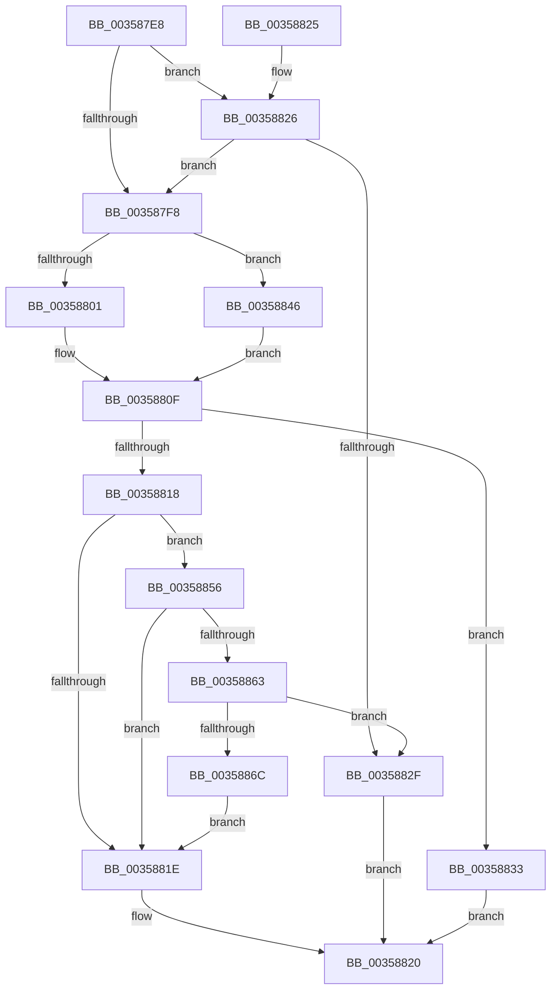

# CcShouldWorkOnThisQueue

- RVA: `0x003587E8`–`0x0035886E` (길이 `134` bytes)
- VA: `0x00000001403587E8`
- 실행 섹션: `.text`
- PDB 이름 있음: `예`; PDB Function 태그: `아니요`
- unwind 정보 RVA: `0x0005C948`
- 디코드: `38`개 명령, `134/134` bytes 표시
- 미해석 바이트: `0` (있으면 어셈블리에 `.byte`로 보존)

> 이 문서는 커널 이미지의 기계어와 PDB 기호를 분석해 생성했습니다. 4번과 5번은 함수 원형과 자료형을 바이너리 사용 방식에서 추정한 C 해석이며 원본 소스 복구 결과는 아닙니다.

## 1. Dependencies

- 직접 호출 지점: **1**; 고유 호출 대상: **1**
- 직접 호출자로 확인된 함수: **1**
- RIP 상대 이미지 참조: **1**

### Outgoing calls
- `0x00358826` → [CcIsWriteBehindThreadpoolAtLowPriority](CcIsWriteBehindThreadpoolAtLowPriority_function_003570DC.md) (function, `0x003570DC`)

### Direct callers
- [CcWorkerThread](../48/CcWorkerThread_function_0048F0F0.md) at `0x0048F20B`

### Static image references
- `0x003587F8` → RVA `0x00E65B88` (`.data`; read)

## 2. Other-region calls and transfers

- 다른 실행 섹션으로 향하는 call: **0**
- 별도 외부 분기/꼬리 이동을 확인하지 못했습니다.

## 3. Assembly (complete function range)

```asm
003587E8  48 83 EC 28                     sub rsp, 0x28
003587EC  4C 8B 52 10                     mov r10, qword ptr [rdx + 0x10]
003587F0  4D 8B D8                        mov r11, r8
003587F3  45 84 C9                        test r9b, r9b
003587F6  75 2E                           jne 0x140358826
003587F8  80 3D 89 D3 B0 00 00            cmp byte ptr [rip + 0xb0d389], 0
003587FF  74 45                           je 0x140358846
00358801  4D 8D 82 28 03 00 00            lea r8, [r10 + 0x328]
00358808  4D 8D 8A 08 03 00 00            lea r9, [r10 + 0x308]
0035880F  48 8D 42 68                     lea rax, [rdx + 0x68]
00358813  4C 3B D8                        cmp r11, rax
00358816  74 1B                           je 0x140358833
00358818  41 83 38 00                     cmp dword ptr [r8], 0
0035881C  77 38                           ja 0x140358856
0035881E  B0 01                           mov al, 1
00358820  48 83 C4 28                     add rsp, 0x28
00358824  C3                              ret
00358825  CC                              int3
00358826  E8 B1 E8 FF FF                  call 0x1403570dc
0035882B  84 C0                           test al, al
0035882D  74 C9                           je 0x1403587f8
0035882F  32 C0                           xor al, al
00358831  EB ED                           jmp 0x140358820
00358833  8B 82 BC 00 00 00               mov eax, dword ptr [rdx + 0xbc]
00358839  FF C0                           inc eax
0035883B  3B 81 08 05 00 00               cmp eax, dword ptr [rcx + 0x508]
00358841  0F 96 C0                        setbe al
00358844  EB DA                           jmp 0x140358820
00358846  4C 8D 81 68 03 00 00            lea r8, [rcx + 0x368]
0035884D  4C 8D 89 48 03 00 00            lea r9, [rcx + 0x348]
00358854  EB B9                           jmp 0x14035880f
00358856  8B 82 C0 00 00 00               mov eax, dword ptr [rdx + 0xc0]
0035885C  FF C0                           inc eax
0035885E  41 3B 01                        cmp eax, dword ptr [r9]
00358861  72 BB                           jb 0x14035881e
00358863  83 BA 98 00 00 00 00            cmp dword ptr [rdx + 0x98], 0
0035886A  74 C3                           je 0x14035882f
0035886C  EB B0                           jmp 0x14035881e
```

## 4. C-style interpretation (structured pseudocode)

```c
__int64 __fastcall CcShouldWorkOnThisQueue(__int64 a1, __int64 a2, __int64 a3, unsigned __int8 a4)
{
    __int64 result;
    __int64 v_rsp;

    v_rsp = (v_rsp) - (40);
    if (a4 != 0) goto loc_00358826;
loc_003587F8:
    if ((*(unsigned __int8 *)(v_rip + 11588489)) == 0) goto loc_00358846;
loc_0035880F:
    if (a3 == (a2 + 104)) goto loc_00358833;
    if ((*(unsigned int *)(*(unsigned __int64 *)(a2 + 16) + 808)) > 0) goto loc_00358856;
loc_0035881E:
loc_00358820:
    v_rsp = (v_rsp) + (40);
    return 1;
loc_00358826:
    result = CcIsWriteBehindThreadpoolAtLowPriority(a1, a2, *(unsigned __int64 *)(a2 + 16) + 808, *(unsigned __int64 *)(a2 + 16) + 776);
    if ((unsigned __int8)(result) == 0) goto loc_003587F8;
loc_0035882F:
    result = 0;
    goto loc_00358820;
loc_00358833:
    result = (unsigned int)(((unsigned int)(*(unsigned int *)(a2 + 188))) + 1);
    result = (((unsigned int)(result)) <= (*(unsigned int *)(a1 + 1288))) ? 1 : 0;
    goto loc_00358820;
loc_00358846:
    goto loc_0035880F;
loc_00358856:
    result = (unsigned int)(((unsigned int)(*(unsigned int *)(a2 + 192))) + 1);
    if (((unsigned int)(result)) < (*(unsigned int *)(a1 + 840))) goto loc_0035881E;
    if ((*(unsigned int *)(a2 + 152)) == 0) goto loc_0035882F;
    goto loc_0035881E;
}
```

## 5. (Beta) C Style

```c
int64_t CcShouldWorkOnThisQueue(int64_t Arg1, void *Arg2, int64_t Arg3, uint8_t Arg4)
{
    uint8_t *arg2 = (uint8_t *)Arg2;

    int64_t result;
    int64_t local_rsp;

    local_rsp = (local_rsp) - (40);
    if (Arg4 != 0) goto loc_00358826;
loc_003587F8:
    if ((*(uint8_t *)(v_rip + 0xB0D389)) == 0) goto loc_00358846;
loc_0035880F:
    if (Arg3 == (Arg2 + 104)) goto loc_00358833;
    if ((*(uint32_t *)(*(uint64_t *)(arg2 + 0x10) + 0x328)) > 0) goto loc_00358856;
loc_0035881E:
loc_00358820:
    local_rsp = (local_rsp) + (40);
    return 1;
loc_00358826:
    result = CcIsWriteBehindThreadpoolAtLowPriority(Arg1, Arg2, *(uint64_t *)(arg2 + 0x10) + 808, *(uint64_t *)(arg2 + 0x10) + 776);
    if ((uint8_t)(result) == 0) goto loc_003587F8;
loc_0035882F:
    result = 0;
    goto loc_00358820;
loc_00358833:
    result = (uint32_t)(((uint32_t)(*(uint32_t *)(arg2 + 0xBC))) + 1);
    result = (((uint32_t)(result)) <= (*(uint32_t *)(Arg1 + 0x508))) ? 1 : 0;
    goto loc_00358820;
loc_00358846:
    goto loc_0035880F;
loc_00358856:
    result = (uint32_t)(((uint32_t)(*(uint32_t *)(arg2 + 0xC0))) + 1);
    if (((uint32_t)(result)) < (*(uint32_t *)(Arg1 + 0x348))) goto loc_0035881E;
    if ((*(uint32_t *)(arg2 + 0x98)) == 0) goto loc_0035882F;
    goto loc_0035881E;
}
```

### 관측된 메모리 오프셋

구조체 형식이 확인되지 않은 접근은 인자 기준의 오프셋으로만 기록했습니다.

| 기준 인자 | 오프셋 표현 | 폭 (bit) | 접근 |
|---|---:|---:|---|
| `Arg2` | `+ 0x10` | `64` | `R` |

## 6. Execution-region graph

[열기: 2D/3D 그래프와 함수 탐색 컨트롤 패널](../../../control-panel.html?section=text&rva=0x003587E8&view=graph)

- 2D 그래프는 위에서 아래로 흐르고, 3D 그래프는 빈 공간을 드래그해 회전합니다. Shift+드래그는 이동, 휠은 확대·축소, 함수 노드 선택은 대상 보고서 이동입니다.

### Static fallback


