# CcUnpinFileDataEx

- RVA: `0x00359DEC`–`0x0035A113` (길이 `807` bytes)
- VA: `0x0000000140359DEC`
- 실행 섹션: `.text`
- PDB 이름 있음: `예`; PDB Function 태그: `아니요`
- unwind 정보 RVA: `0x00079900`
- 디코드: `216`개 명령, `807/807` bytes 표시
- 미해석 바이트: `0` (있으면 어셈블리에 `.byte`로 보존)

> 이 문서는 커널 이미지의 기계어와 PDB 기호를 분석해 생성했습니다. 4번과 5번은 함수 원형과 자료형을 바이너리 사용 방식에서 추정한 C 해석이며 원본 소스 복구 결과는 아닙니다.

## 1. Dependencies

- 직접 호출 지점: **19**; 고유 호출 대상: **15**
- 직접 호출자로 확인된 함수: **14**
- RIP 상대 이미지 참조: **0**

### Outgoing calls
- `0x00359E50` → [KeSetEvent](../33/KeSetEvent_function_0033F310.md) (function, `0x0033F310`)
- `0x00359EAD` → [ExAcquireFastMutex](../20/ExAcquireFastMutex_function_0020E5A0.md) (function, `0x0020E5A0`)
- `0x00359ED7` → [KeBugCheckEx](../4F/KeBugCheckEx_function_004FD660.md) (function, `0x004FD660`)
- `0x00359F13` → [KeAcquireInStackQueuedSpinLock](../27/KeAcquireInStackQueuedSpinLock_function_002757A0.md) (function, `0x002757A0`)
- `0x00359F1D` → [CcDeductDirtyPages](../38/CcDeductDirtyPages_function_0038C20C.md) (function, `0x0038C20C`)
- `0x00359F48` → [KeReleaseInStackQueuedSpinLock](../34/KeReleaseInStackQueuedSpinLock_function_00342CE0.md) (function, `0x00342CE0`)
- `0x00359F8F` → [KeSetEvent](../33/KeSetEvent_function_0033F310.md) (function, `0x0033F310`)
- `0x00359FAF` → [ExReleaseResourceLite](../25/ExReleaseResourceLite_function_0025FA10.md) (function, `0x0025FA10`)
- `0x00359FB7` → [ExReleaseFastMutex](../25/ExReleaseFastMutex_function_002519C0.md) (function, `0x002519C0`)
- `0x00359FD9` → [KeBugCheckEx](../4F/KeBugCheckEx_function_004FD660.md) (function, `0x004FD660`)
- `0x00359FEB` → [KeAbPreAcquire](../21/KeAbPreAcquire_function_00210230.md) (function, `0x00210230`)
- `0x0035A004` → [ExfAcquirePushLockExclusiveEx](../20/ExfAcquirePushLockExclusiveEx_function_0020FC90.md) (function, `0x0020FC90`)
- `0x0035A06F` → [KeAbPostRelease](../2E/KeAbPostRelease_function_002E1600.md) (function, `0x002E1600`)
- `0x0035A080` → [ExReleaseFastMutex](../25/ExReleaseFastMutex_function_002519C0.md) (function, `0x002519C0`)
- `0x0035A088` → [CcDeallocateBcb](../38/CcDeallocateBcb_function_0038BA24.md) (function, `0x0038BA24`)
- `0x0035A0C1` → [KeSetEvent](../33/KeSetEvent_function_0033F310.md) (function, `0x0033F310`)
- `0x0035A0D2` → [ExfReleasePushLock](../26/ExfReleasePushLock_function_002638D0.md) (function, `0x002638D0`)
- `0x0035A0F3` → [CcAdjustVacbLevelLockCount](../41/CcAdjustVacbLevelLockCount_function_0041F8A4.md) (function, `0x0041F8A4`)
- `0x0035A109` → [CcInsertIntoCleanSharedCacheMapList](../45/CcInsertIntoCleanSharedCacheMapList_function_004511CC.md) (function, `0x004511CC`)

### Direct callers
- [CcZeroDataInCache](../29/CcZeroDataInCache_function_0029E894.md) at `0x0029E9D5`
- [CcZeroDataInCache](../29/CcZeroDataInCache_function_0029E894.md) at `0x0029EA5A`
- [CcPinFileData](../33/CcPinFileData_function_0033FB40.md) at `0x00340B96`
- [CcGetDirtyPagesHelper](CcGetDirtyPagesHelper_function_00358D40.md) at `0x00358F09`
- [CcGetDirtyPagesHelper](CcGetDirtyPagesHelper_function_00358D40.md) at `0x00358FDC`
- [CcFlushCachePostProcessOneRange](CcFlushCachePostProcessOneRange_function_00359710.md) at `0x003598F5`
- [CcFlushCachePostProcessOneRange](CcFlushCachePostProcessOneRange_function_00359710.md) at `0x00359911`
- [CcReleaseByteRangeFromWrite](CcReleaseByteRangeFromWrite_function_00359C90.md) at `0x00359D17`
- [CcReleaseByteRangeFromWrite](CcReleaseByteRangeFromWrite_function_00359C90.md) at `0x00359D35`
- [CcAcquireByteRangeForWrite](../40/CcAcquireByteRangeForWrite_function_00401E74.md) at `0x00402543`
- [CcAcquireByteRangeForWrite](../40/CcAcquireByteRangeForWrite_function_00401E74.md) at `0x004025BC`
- [CcAcquireByteRangeForWrite](../40/CcAcquireByteRangeForWrite_function_00401E74.md) at `0x00402797`
- [CcAcquireByteRangeForWrite](../40/CcAcquireByteRangeForWrite_function_00401E74.md) at `0x004027F1`
- [CcUnpinRepinnedBcb](../49/CcUnpinRepinnedBcb_function_0049F560.md) at `0x0049F5FB`
- [CcUnpinRepinnedBcb](../49/CcUnpinRepinnedBcb_function_0049F560.md) at `0x0049F668`
- [CcUnpinRepinnedBcb](../49/CcUnpinRepinnedBcb_function_0049F560.md) at `0x0049F685`
- [CcUnpinRepinnedBcb](../49/CcUnpinRepinnedBcb_function_0049F560.md) at `0x0049F6AF`
- [CcZeroDataInCache$fin$0](../6D/CcZeroDataInCache_fin_0_function_006D1DBC.md) at `0x006D1DED`
- [CcPinFileData$fin$0](../6D/CcPinFileData_fin_0_function_006D20B0.md) at `0x006D2173`
- [CcGetDirtyPagesHelper$fin$0](../6D/CcGetDirtyPagesHelper_fin_0_function_006D2290.md) at `0x006D22AE`
- [CcMapDataForOverwrite$fin$0](../6D/CcMapDataForOverwrite_fin_0_function_006D350E.md) at `0x006D354C`
- [CcUnpinDataForThread](../../page/71/CcUnpinDataForThread_function_00710410.md) at `0x00710469`
- [CcUnpinData](../../page/9A/CcUnpinData_function_009A7A80.md) at `0x009A7A9A`
- [CcMapData$fin$0](../../page/B0/CcMapData_fin_0_function_00B0FE30.md) at `0x00B0FE79`

### Static image references
- 디코드된 RIP-relative 메모리 참조가 없습니다.

## 2. Other-region calls and transfers

- 다른 실행 섹션으로 향하는 call: **0**
- 별도 외부 분기/꼬리 이동을 확인하지 못했습니다.

## 3. Assembly (complete function range)

```asm
00359DEC  4C 8B DC                        mov r11, rsp
00359DEF  49 89 5B 08                     mov qword ptr [r11 + 8], rbx
00359DF3  49 89 6B 10                     mov qword ptr [r11 + 0x10], rbp
00359DF7  49 89 73 18                     mov qword ptr [r11 + 0x18], rsi
00359DFB  49 89 7B 20                     mov qword ptr [r11 + 0x20], rdi
00359DFF  41 55                           push r13
00359E01  41 56                           push r14
00359E03  41 57                           push r15
00359E05  48 83 EC 50                     sub rsp, 0x50
00359E09  33 C0                           xor eax, eax
00359E0B  49 63 D8                        movsxd rbx, r8d
00359E0E  0F 57 C0                        xorps xmm0, xmm0
00359E11  44 8A F2                        mov r14b, dl
00359E14  0F 11 44 24 30                  movups xmmword ptr [rsp + 0x30], xmm0
00359E19  49 89 43 D8                     mov qword ptr [r11 - 0x28], rax
00359E1D  48 8B F1                        mov rsi, rcx
00359E20  B8 FD 02 00 00                  mov eax, 0x2fd
00359E25  66 39 01                        cmp word ptr [rcx], ax
00359E28  74 52                           je 0x140359e7c
00359E2A  48 8B 69 08                     mov rbp, qword ptr [rcx + 8]
00359E2E  83 CB FF                        or ebx, 0xffffffff
00359E31  8B C3                           mov eax, ebx
00359E33  F0 0F C1 41 10                  lock xadd dword ptr [rcx + 0x10], eax
00359E38  03 C3                           add eax, ebx
00359E3A  66 85 C0                        test ax, ax
00359E3D  75 1D                           jne 0x140359e5c
00359E3F  48 8B 8D C0 00 00 00            mov rcx, qword ptr [rbp + 0xc0]
00359E46  48 85 C9                        test rcx, rcx
00359E49  74 0A                           je 0x140359e55
00359E4B  45 33 C0                        xor r8d, r8d
00359E4E  33 D2                           xor edx, edx
00359E50  E8 BB 54 FE FF                  call 0x14033f310
00359E55  F0 01 9D 28 02 00 00            lock add dword ptr [rbp + 0x228], ebx
00359E5C  4C 8D 5C 24 50                  lea r11, [rsp + 0x50]
00359E61  49 8B 5B 20                     mov rbx, qword ptr [r11 + 0x20]
00359E65  49 8B 6B 28                     mov rbp, qword ptr [r11 + 0x28]
00359E69  49 8B 73 30                     mov rsi, qword ptr [r11 + 0x30]
00359E6D  49 8B 7B 38                     mov rdi, qword ptr [r11 + 0x38]
00359E71  49 8B E3                        mov rsp, r11
00359E74  41 5F                           pop r15
00359E76  41 5E                           pop r14
00359E78  41 5D                           pop r13
00359E7A  C3                              ret
00359E7B  CC                              int3
00359E7C  48 8B A9 B0 00 00 00            mov rbp, qword ptr [rcx + 0xb0]
00359E83  F7 85 98 00 00 00 00 02 00 00   test dword ptr [rbp + 0x98], 0x200
00359E8D  4C 8B AD 18 02 00 00            mov r13, qword ptr [rbp + 0x218]
00359E94  0F 84 F8 01 00 00               je 0x14035a092
00359E9A  83 FB 01                        cmp ebx, 1
00359E9D  0F 84 EF 01 00 00               je 0x14035a092
00359EA3  4C 8D BD 20 01 00 00            lea r15, [rbp + 0x120]
00359EAA  49 8B CF                        mov rcx, r15
00359EAD  E8 EE 46 EB FF                  call 0x14020e5a0
00359EB2  33 FF                           xor edi, edi
00359EB4  8B CB                           mov ecx, ebx
00359EB6  85 DB                           test ebx, ebx
00359EB8  74 23                           je 0x140359edd
00359EBA  83 E9 01                        sub ecx, 1
00359EBD  74 1E                           je 0x140359edd
00359EBF  83 F9 01                        cmp ecx, 1
00359EC2  74 2B                           je 0x140359eef
00359EC4  4C 8B C3                        mov r8, rbx
00359EC7  48 89 7C 24 20                  mov qword ptr [rsp + 0x20], rdi
00359ECC  45 33 C9                        xor r9d, r9d
00359ECF  8D 4F 34                        lea ecx, [rdi + 0x34]
00359ED2  BA 97 04 02 00                  mov edx, 0x20497
00359ED7  E8 84 37 1A 00                  call 0x1404fd660
00359EDC  CC                              int3
00359EDD  8B 46 40                        mov eax, dword ptr [rsi + 0x40]
00359EE0  85 C0                           test eax, eax
00359EE2  0F 84 D9 00 00 00               je 0x140359fc1
00359EE8  FF C8                           dec eax
00359EEA  89 46 40                        mov dword ptr [rsi + 0x40], eax
00359EED  EB 5E                           jmp 0x140359f4d
00359EEF  40 38 7E 02                     cmp byte ptr [rsi + 2], dil
00359EF3  74 58                           je 0x140359f4d
00359EF5  8B 5E 04                        mov ebx, dword ptr [rsi + 4]
00359EF8  49 8D 8D 00 03 00 00            lea rcx, [r13 + 0x300]
00359EFF  48 8D 54 24 30                  lea rdx, [rsp + 0x30]
00359F04  C1 EB 0C                        shr ebx, 0xc
00359F07  40 88 7E 02                     mov byte ptr [rsi + 2], dil
00359F0B  48 89 7E 28                     mov qword ptr [rsi + 0x28], rdi
00359F0F  48 89 7E 30                     mov qword ptr [rsi + 0x30], rdi
00359F13  E8 88 B8 F1 FF                  call 0x1402757a0
00359F18  8B D3                           mov edx, ebx
00359F1A  48 8B CD                        mov rcx, rbp
00359F1D  E8 EA 22 03 00                  call 0x14038c20c
00359F22  41 8B 85 D0 03 00 00            mov eax, dword ptr [r13 + 0x3d0]
00359F29  8B C8                           mov ecx, eax
00359F2B  2B CB                           sub ecx, ebx
00359F2D  3B D8                           cmp ebx, eax
00359F2F  1B C0                           sbb eax, eax
00359F31  23 C1                           and eax, ecx
00359F33  41 89 85 D0 03 00 00            mov dword ptr [r13 + 0x3d0], eax
00359F3A  39 7D 70                        cmp dword ptr [rbp + 0x70], edi
00359F3D  0F 84 BA 01 00 00               je 0x14035a0fd
00359F43  48 8D 4C 24 30                  lea rcx, [rsp + 0x30]
00359F48  E8 93 8D FE FF                  call 0x140342ce0
00359F4D  39 7E 40                        cmp dword ptr [rsi + 0x40], edi
00359F50  75 54                           jne 0x140359fa6
00359F52  40 38 7E 02                     cmp byte ptr [rsi + 2], dil
00359F56  0F 84 83 00 00 00               je 0x140359fdf
00359F5C  48 39 BE B8 00 00 00            cmp qword ptr [rsi + 0xb8], rdi
00359F63  74 41                           je 0x140359fa6
00359F65  48 8B 4E 38                     mov rcx, qword ptr [rsi + 0x38]
00359F69  83 CB FF                        or ebx, 0xffffffff
00359F6C  8B C3                           mov eax, ebx
00359F6E  48 8B 69 08                     mov rbp, qword ptr [rcx + 8]
00359F72  F0 0F C1 41 10                  lock xadd dword ptr [rcx + 0x10], eax
00359F77  03 C3                           add eax, ebx
00359F79  66 85 C0                        test ax, ax
00359F7C  75 1D                           jne 0x140359f9b
00359F7E  48 8B 8D C0 00 00 00            mov rcx, qword ptr [rbp + 0xc0]
00359F85  48 85 C9                        test rcx, rcx
00359F88  74 0A                           je 0x140359f94
00359F8A  45 33 C0                        xor r8d, r8d
00359F8D  33 D2                           xor edx, edx
00359F8F  E8 7C 53 FE FF                  call 0x14033f310
00359F94  F0 01 9D 28 02 00 00            lock add dword ptr [rbp + 0x228], ebx
00359F9B  48 89 BE B8 00 00 00            mov qword ptr [rsi + 0xb8], rdi
00359FA2  48 89 7E 38                     mov qword ptr [rsi + 0x38], rdi
00359FA6  45 84 F6                        test r14b, r14b
00359FA9  75 09                           jne 0x140359fb4
00359FAB  48 8D 4E 48                     lea rcx, [rsi + 0x48]
00359FAF  E8 5C 5A F0 FF                  call 0x14025fa10
00359FB4  49 8B CF                        mov rcx, r15
00359FB7  E8 04 7A EF FF                  call 0x1402519c0
00359FBC  E9 9B FE FF FF                  jmp 0x140359e5c
00359FC1  45 33 C9                        xor r9d, r9d
00359FC4  48 89 7C 24 20                  mov qword ptr [rsp + 0x20], rdi
00359FC9  BA 60 04 00 00                  mov edx, 0x460
00359FCE  49 C7 C0 20 04 00 C0            mov r8, 0xffffffffc0000420
00359FD5  41 8D 49 34                     lea ecx, [r9 + 0x34]
00359FD9  E8 82 36 1A 00                  call 0x1404fd660
00359FDE  CC                              int3
00359FDF  4C 8D 75 68                     lea r14, [rbp + 0x68]
00359FE3  45 33 C0                        xor r8d, r8d
00359FE6  49 8B CE                        mov rcx, r14
00359FE9  33 D2                           xor edx, edx
00359FEB  E8 40 62 EB FF                  call 0x140210230
00359FF0  F0 49 0F BA 2E 00               lock bts qword ptr [r14], 0
00359FF6  48 8B D8                        mov rbx, rax
00359FF9  73 0E                           jae 0x14035a009
00359FFB  4D 8B C6                        mov r8, r14
00359FFE  48 8B D0                        mov rdx, rax
0035A001  49 8B CE                        mov rcx, r14
0035A004  E8 87 5C EB FF                  call 0x14020fc90
0035A009  48 85 DB                        test rbx, rbx
0035A00C  74 04                           je 0x14035a012
0035A00E  C6 43 0A 01                     mov byte ptr [rbx + 0xa], 1
0035A012  48 8D 46 10                     lea rax, [rsi + 0x10]
0035A016  48 8B 10                        mov rdx, qword ptr [rax]
0035A019  48 39 42 08                     cmp qword ptr [rdx + 8], rax
0035A01D  75 09                           jne 0x14035a028
0035A01F  48 8B 48 08                     mov rcx, qword ptr [rax + 8]
0035A023  48 39 01                        cmp qword ptr [rcx], rax
0035A026  74 07                           je 0x14035a02f
0035A028  B9 03 00 00 00                  mov ecx, 3
0035A02D  CD 29                           int 0x29
0035A02F  48 89 11                        mov qword ptr [rcx], rdx
0035A032  83 CB FF                        or ebx, 0xffffffff
0035A035  48 89 4A 08                     mov qword ptr [rdx + 8], rcx
0035A039  48 81 7D 20 00 00 00 02         cmp qword ptr [rbp + 0x20], 0x2000000
0035A041  0F 8F 92 00 00 00               jg 0x14035a0d9
0035A047  41 0F 0D 0E                     prefetchw byte ptr [r14]
0035A04B  49 8B 06                        mov rax, qword ptr [r14]
0035A04E  48 8B C8                        mov rcx, rax
0035A051  48 83 E1 F0                     and rcx, 0xfffffffffffffff0
0035A055  48 83 F9 10                     cmp rcx, 0x10
0035A059  48 8D 50 F0                     lea rdx, [rax - 0x10]
0035A05D  48 0F 46 D7                     cmovbe rdx, rdi
0035A061  A8 02                           test al, 2
0035A063  75 6A                           jne 0x14035a0cf
0035A065  F0 49 0F B1 16                  lock cmpxchg qword ptr [r14], rdx
0035A06A  75 63                           jne 0x14035a0cf
0035A06C  49 8B CE                        mov rcx, r14
0035A06F  E8 8C 75 F8 FF                  call 0x1402e1600
0035A074  48 39 BE B8 00 00 00            cmp qword ptr [rsi + 0xb8], rdi
0035A07B  75 1D                           jne 0x14035a09a
0035A07D  49 8B CF                        mov rcx, r15
0035A080  E8 3B 79 EF FF                  call 0x1402519c0
0035A085  48 8B CE                        mov rcx, rsi
0035A088  E8 97 19 03 00                  call 0x14038ba24
0035A08D  E9 CA FD FF FF                  jmp 0x140359e5c
0035A092  41 B6 01                        mov r14b, 1
0035A095  E9 09 FE FF FF                  jmp 0x140359ea3
0035A09A  48 8B 46 38                     mov rax, qword ptr [rsi + 0x38]
0035A09E  8B CB                           mov ecx, ebx
0035A0A0  48 8B 68 08                     mov rbp, qword ptr [rax + 8]
0035A0A4  F0 0F C1 48 10                  lock xadd dword ptr [rax + 0x10], ecx
0035A0A9  03 CB                           add ecx, ebx
0035A0AB  66 85 C9                        test cx, cx
0035A0AE  75 CD                           jne 0x14035a07d
0035A0B0  48 8B 8D C0 00 00 00            mov rcx, qword ptr [rbp + 0xc0]
0035A0B7  48 85 C9                        test rcx, rcx
0035A0BA  74 0A                           je 0x14035a0c6
0035A0BC  45 33 C0                        xor r8d, r8d
0035A0BF  33 D2                           xor edx, edx
0035A0C1  E8 4A 52 FE FF                  call 0x14033f310
0035A0C6  F0 01 9D 28 02 00 00            lock add dword ptr [rbp + 0x228], ebx
0035A0CD  EB AE                           jmp 0x14035a07d
0035A0CF  49 8B CE                        mov rcx, r14
0035A0D2  E8 F9 97 F0 FF                  call 0x1402638d0
0035A0D7  EB 93                           jmp 0x14035a06c
0035A0D9  F7 85 98 00 00 00 00 02 00 00   test dword ptr [rbp + 0x98], 0x200
0035A0E3  0F 84 5E FF FF FF               je 0x14035a047
0035A0E9  48 8B 56 08                     mov rdx, qword ptr [rsi + 8]
0035A0ED  44 8B C3                        mov r8d, ebx
0035A0F0  48 8B CD                        mov rcx, rbp
0035A0F3  E8 AC 57 0C 00                  call 0x14041f8a4
0035A0F8  E9 4A FF FF FF                  jmp 0x14035a047
0035A0FD  39 7D 04                        cmp dword ptr [rbp + 4], edi
0035A100  0F 84 3D FE FF FF               je 0x140359f43
0035A106  48 8B CD                        mov rcx, rbp
0035A109  E8 BE 70 0F 00                  call 0x1404511cc
0035A10E  E9 30 FE FF FF                  jmp 0x140359f43
```

## 4. C-style interpretation (structured pseudocode)

```c
__int64 __fastcall CcUnpinFileDataEx(__int64 a1, int a2, int a3, int a4)
{
    __int64 result;
    __int64 v_rbx;
    __int64 v_rdi;
    __int64 v_rsp;
    unsigned __int64 v_stack_m18;
    unsigned __int64 v_stack_m20;
    unsigned __int64 v_stack_m30;
    unsigned __int64 v_stack_m38;

    *(unsigned __int64 *)(v_rsp + 8) = v_rbx;
    *(unsigned __int64 *)(v_rsp + 16) = v_rbp;
    *(unsigned __int64 *)(v_rsp + 24) = v_rsi;
    *(unsigned __int64 *)(v_rsp + 32) = v_rdi;
    v_rsp = (v_rsp) - (80);
    result = 0;
    v_stack_m38 = v_xmm0;
    *(unsigned __int64 *)(v_rsp - 40) = 0;
    if ((*(unsigned __int16 *)(a1)) == 765) goto loc_00359E7C;
    v_rbx = (unsigned int)(((int)(a3)) | (0xFFFFFFFFULL));
    result = (unsigned int)(((unsigned int)((unsigned int)(v_rbx))) + ((unsigned int)(v_rbx)));
    if ((unsigned __int16)(result) != 0) goto loc_00359E5C;
    if (*(unsigned __int64 *)(*(unsigned __int64 *)(a1 + 8) + 192) != 0) {
        a3 = 0;
        a2 = 0;
        result = KeSetEvent(*(unsigned __int64 *)(*(unsigned __int64 *)(a1 + 8) + 192), a2, a3, a4);
    }
loc_00359E5C:
    return result;
loc_00359E7C:
    if (((*(unsigned int *)(*(unsigned __int64 *)(*(unsigned __int64 *)(*(unsigned __int64 *)(a1 + 8) + 192) + 176) + 152)) & (512)) == 0) goto loc_0035A092;
    if (((unsigned int)(*(unsigned __int64 *)(v_stack_m18 + 32))) == 1) goto loc_0035A092;
loc_00359EA3:
    result = ExAcquireFastMutex(*(unsigned __int64 *)(*(unsigned __int64 *)(*(unsigned __int64 *)(a1 + 8) + 192) + 176) + 288, a2, a3, a4);
    v_rdi = 0;
    if ((unsigned int)(*(unsigned __int64 *)(v_stack_m18 + 32)) == 0) goto loc_00359EDD;
    a1 = (unsigned int)(((unsigned int)((unsigned int)(*(unsigned __int64 *)(v_stack_m18 + 32)))) - (1));
    if (condition_is_equal) goto loc_00359EDD;
    if (((unsigned int)(a1)) == 1) goto loc_00359EEF;
    v_stack_m30 = 0;
    a4 = 0;
    result = KeBugCheckEx(v_rdi + 52, (unsigned int)(0x20497ULL), *(unsigned __int64 *)(v_stack_m18 + 32), a4);
loc_00359EDD:
    if ((unsigned int)((unsigned int)(*(unsigned int *)(*(unsigned __int64 *)(v_stack_m18 + 48) + 64))) == 0) goto loc_00359FC1;
    result = (unsigned int)(((unsigned int)(*(unsigned int *)(*(unsigned __int64 *)(v_stack_m18 + 48) + 64))) - 1);
    *(unsigned int *)(*(unsigned __int64 *)(v_stack_m18 + 48) + 64) = (unsigned int)(result);
    goto loc_00359F4D;
loc_00359EEF:
    if ((*(unsigned __int8 *)(*(unsigned __int64 *)(v_stack_m18 + 48) + 2)) == 0) goto loc_00359F4D;
    v_rbx = (unsigned int)(((unsigned int)(*(unsigned int *)(*(unsigned __int64 *)(v_stack_m18 + 48) + 4))) >> (12));
    *(unsigned __int8 *)(*(unsigned __int64 *)(v_stack_m18 + 48) + 2) = 0;
    *(unsigned __int64 *)(*(unsigned __int64 *)(v_stack_m18 + 48) + 40) = 0;
    *(unsigned __int64 *)(*(unsigned __int64 *)(v_stack_m18 + 48) + 48) = 0;
    result = KeAcquireInStackQueuedSpinLock(*(unsigned __int64 *)(*(unsigned __int64 *)(*(unsigned __int64 *)(*(unsigned __int64 *)(a1 + 8) + 192) + 176) + 536) + 768, v_stack_m20, *(unsigned __int64 *)(v_stack_m18 + 32), a4);
    result = CcDeductDirtyPages(*(unsigned __int64 *)(*(unsigned __int64 *)(*(unsigned __int64 *)(a1 + 8) + 192) + 176), (unsigned int)((unsigned int)(v_rbx)), *(unsigned __int64 *)(v_stack_m18 + 32), a4);
    a1 = (unsigned int)(((unsigned int)((unsigned int)((unsigned int)(*(unsigned int *)(*(unsigned __int64 *)(*(unsigned __int64 *)(*(unsigned __int64 *)(*(unsigned __int64 *)(a1 + 8) + 192) + 176) + 536) + 976))))) - ((unsigned int)(v_rbx)));
    result = (unsigned int)(((unsigned int)(*(unsigned int *)(*(unsigned __int64 *)(*(unsigned __int64 *)(*(unsigned __int64 *)(*(unsigned __int64 *)(a1 + 8) + 192) + 176) + 536) + 976))) & ((unsigned int)(a1)));
    *(unsigned int *)(*(unsigned __int64 *)(*(unsigned __int64 *)(*(unsigned __int64 *)(*(unsigned __int64 *)(a1 + 8) + 192) + 176) + 536) + 976) = (unsigned int)(result);
    if ((*(unsigned int *)(*(unsigned __int64 *)(*(unsigned __int64 *)(*(unsigned __int64 *)(a1 + 8) + 192) + 176) + 112)) == 0) goto loc_0035A0FD;
loc_00359F43:
    result = KeReleaseInStackQueuedSpinLock(v_stack_m20, (unsigned int)((unsigned int)(v_rbx)), *(unsigned __int64 *)(v_stack_m18 + 32), a4);
loc_00359F4D:
    if ((*(unsigned int *)(*(unsigned __int64 *)(v_stack_m18 + 48) + 64)) != 0) goto loc_00359FA6;
    if ((*(unsigned __int8 *)(*(unsigned __int64 *)(v_stack_m18 + 48) + 2)) == 0) goto loc_00359FDF;
    if ((*(unsigned __int64 *)(*(unsigned __int64 *)(v_stack_m18 + 48) + 184)) == 0) goto loc_00359FA6;
    v_rbx = (unsigned int)((v_rbx) | (0xFFFFFFFFULL));
    result = (unsigned int)(((unsigned int)((unsigned int)(v_rbx))) + ((unsigned int)(v_rbx)));
    if ((unsigned __int16)(result) != 0) goto loc_00359F9B;
    if (*(unsigned __int64 *)(*(unsigned __int64 *)(*(unsigned __int64 *)(*(unsigned __int64 *)(v_stack_m18 + 48) + 56) + 8) + 192) != 0) {
        a3 = 0;
        a2 = 0;
        result = KeSetEvent(*(unsigned __int64 *)(*(unsigned __int64 *)(*(unsigned __int64 *)(*(unsigned __int64 *)(v_stack_m18 + 48) + 56) + 8) + 192), a2, a3, a4);
    }
loc_00359F9B:
    *(unsigned __int64 *)(*(unsigned __int64 *)(v_stack_m18 + 48) + 184) = 0;
    *(unsigned __int64 *)(*(unsigned __int64 *)(v_stack_m18 + 48) + 56) = 0;
loc_00359FA6:
    if ((unsigned __int8)((unsigned __int8)(a2)) == 0) {
        a1 = *(unsigned __int64 *)(v_stack_m18 + 48) + 72;
        result = ExReleaseResourceLite(a1, a2, a3, a4);
    }
    result = ExReleaseFastMutex(*(unsigned __int64 *)(*(unsigned __int64 *)(*(unsigned __int64 *)(a1 + 8) + 192) + 176) + 288, a2, a3, a4);
    goto loc_00359E5C;
loc_00359FC1:
    a4 = 0;
    v_stack_m30 = 0;
    result = KeBugCheckEx(a4 + 52, (unsigned int)(0x460ULL), 0xFFFFFFFFC0000420ULL, a4);
loc_00359FDF:
    a3 = 0;
    a2 = 0;
    result = KeAbPreAcquire(*(unsigned __int64 *)(*(unsigned __int64 *)(*(unsigned __int64 *)(v_stack_m18 + 48) + 56) + 8) + 104, a2, a3, a4);
    if (!(condition_is_above_or_equal)) {
        a3 = *(unsigned __int64 *)(*(unsigned __int64 *)(*(unsigned __int64 *)(v_stack_m18 + 48) + 56) + 8) + 104;
        a2 = result;
        a1 = *(unsigned __int64 *)(*(unsigned __int64 *)(*(unsigned __int64 *)(v_stack_m18 + 48) + 56) + 8) + 104;
        result = ExfAcquirePushLockExclusiveEx(a1, a2, a3, a4);
    }
    if (result != 0) {
        *(unsigned __int8 *)(result + 10) = 1;
    }
    if ((*(unsigned __int64 *)(*(unsigned __int64 *)(*(unsigned __int64 *)(v_stack_m18 + 48) + 16) + 8)) != (*(unsigned __int64 *)(v_stack_m18 + 48) + 16)) goto loc_0035A028;
    if ((*(unsigned __int64 *)(*(unsigned __int64 *)(*(unsigned __int64 *)(v_stack_m18 + 48) + 16 + 8))) != (*(unsigned __int64 *)(v_stack_m18 + 48) + 16)) {
        a1 = 3;
    }
    *(unsigned __int64 *)(a1) = *(unsigned __int64 *)(*(unsigned __int64 *)(v_stack_m18 + 48) + 16);
    v_rbx = (unsigned int)((result) | (0xFFFFFFFFULL));
    *(unsigned __int64 *)(*(unsigned __int64 *)(*(unsigned __int64 *)(v_stack_m18 + 48) + 16) + 8) = a1;
    if ((*(unsigned __int64 *)(*(unsigned __int64 *)(*(unsigned __int64 *)(*(unsigned __int64 *)(v_stack_m18 + 48) + 56) + 8) + 32)) > 0x2000000ULL) goto loc_0035A0D9;
loc_0035A047:
    a1 = (*(unsigned __int64 *)(*(unsigned __int64 *)(*(unsigned __int64 *)(*(unsigned __int64 *)(v_stack_m18 + 48) + 56) + 8) + 104)) & (-16);
    a2 = *(unsigned __int64 *)(*(unsigned __int64 *)(*(unsigned __int64 *)(*(unsigned __int64 *)(v_stack_m18 + 48) + 56) + 8) + 104) - 16;
    if (a1 <= 16) { a2 = 0; }
    if ((((unsigned __int8)(*(unsigned __int64 *)(*(unsigned __int64 *)(*(unsigned __int64 *)(*(unsigned __int64 *)(v_stack_m18 + 48) + 56) + 8) + 104))) & (2)) != 0) goto loc_0035A0CF;
    if ((((unsigned __int8)(*(unsigned __int64 *)(*(unsigned __int64 *)(*(unsigned __int64 *)(*(unsigned __int64 *)(v_stack_m18 + 48) + 56) + 8) + 104))) & (2)) != 0) goto loc_0035A0CF;
loc_0035A06C:
    result = KeAbPostRelease(*(unsigned __int64 *)(*(unsigned __int64 *)(*(unsigned __int64 *)(v_stack_m18 + 48) + 56) + 8) + 104, a2, a3, a4);
    if ((*(unsigned __int64 *)(*(unsigned __int64 *)(v_stack_m18 + 48) + 184)) != 0) goto loc_0035A09A;
loc_0035A07D:
    result = ExReleaseFastMutex(*(unsigned __int64 *)(*(unsigned __int64 *)(*(unsigned __int64 *)(a1 + 8) + 192) + 176) + 288, a2, a3, a4);
    result = CcDeallocateBcb(*(unsigned __int64 *)(v_stack_m18 + 48), a2, a3, a4);
    goto loc_00359E5C;
loc_0035A092:
    goto loc_00359EA3;
loc_0035A09A:
    a1 = (unsigned int)(((unsigned int)((unsigned int)(v_rbx))) + ((unsigned int)(v_rbx)));
    if ((unsigned __int16)(a1) != 0) goto loc_0035A07D;
    result = *(unsigned __int64 *)(*(unsigned __int64 *)(v_stack_m18 + 48) + 56);
    if (*(unsigned __int64 *)(*(unsigned __int64 *)(*(unsigned __int64 *)(*(unsigned __int64 *)(v_stack_m18 + 48) + 56) + 8) + 192) != 0) {
        a3 = 0;
        a2 = 0;
        result = KeSetEvent(*(unsigned __int64 *)(*(unsigned __int64 *)(*(unsigned __int64 *)(*(unsigned __int64 *)(v_stack_m18 + 48) + 56) + 8) + 192), a2, a3, a4);
    }
    goto loc_0035A07D;
loc_0035A0CF:
    result = ExfReleasePushLock(1, a2, a3, a4);
    goto loc_0035A06C;
loc_0035A0D9:
    if (((*(unsigned int *)(*(unsigned __int64 *)(*(unsigned __int64 *)(*(unsigned __int64 *)(v_stack_m18 + 48) + 56) + 8) + 152)) & (512)) == 0) goto loc_0035A047;
    result = CcAdjustVacbLevelLockCount(*(unsigned __int64 *)(*(unsigned __int64 *)(*(unsigned __int64 *)(v_stack_m18 + 48) + 56) + 8), *(unsigned __int64 *)(*(unsigned __int64 *)(v_stack_m18 + 48) + 8), (unsigned int)((unsigned int)(v_rbx)), a4);
    goto loc_0035A047;
loc_0035A0FD:
    if ((*(unsigned int *)(*(unsigned __int64 *)(*(unsigned __int64 *)(*(unsigned __int64 *)(v_stack_m18 + 48) + 56) + 8) + 4)) == 0) goto loc_00359F43;
    result = CcInsertIntoCleanSharedCacheMapList(*(unsigned __int64 *)(*(unsigned __int64 *)(*(unsigned __int64 *)(v_stack_m18 + 48) + 56) + 8), *(unsigned __int64 *)(*(unsigned __int64 *)(v_stack_m18 + 48) + 8), (unsigned int)((unsigned int)(v_rbx)), a4);
    goto loc_00359F43;
}
```

## 5. (Beta) C Style

```c
int64_t CcUnpinFileDataEx(void *Arg1, int32_t Arg2, int32_t Arg3, int32_t Arg4)
{
    uint8_t *arg1 = (uint8_t *)Arg1;

    int64_t result;
    int64_t local_rbx;
    int64_t local_rdi;
    int64_t local_rsp;
    uint64_t v_stack_m18;
    uint64_t v_stack_m20;
    uint64_t v_stack_m30;
    uint64_t v_stack_m38;

    *(uint64_t *)(local_rsp + 0x8) = local_rbx;
    *(uint64_t *)(local_rsp + 0x10) = local_rbp;
    *(uint64_t *)(local_rsp + 0x18) = local_rsi;
    *(uint64_t *)(local_rsp + 0x20) = local_rdi;
    local_rsp = (local_rsp) - (80);
    result = 0;
    v_stack_m38 = v_xmm0;
    *(uint64_t *)(local_rsp - 0x28) = 0;
    if ((*(uint16_t *)(arg1)) == 765) goto loc_00359E7C;
    local_rbx = (uint32_t)(((int32_t)(Arg3)) | (0xFFFFFFFFULL));
    result = (uint32_t)(((uint32_t)((uint32_t)(local_rbx))) + ((uint32_t)(local_rbx)));
    if ((uint16_t)(result) != 0) goto loc_00359E5C;
    if (*(uint64_t *)(*(uint64_t *)(arg1 + 0x8) + 0xC0) != 0) {
        Arg3 = 0;
        Arg2 = 0;
        result = KeSetEvent(*(uint64_t *)(*(uint64_t *)(arg1 + 0x8) + 0xC0), Arg2, Arg3, Arg4);
    }
loc_00359E5C:
    return result;
loc_00359E7C:
    if (((*(uint32_t *)(*(uint64_t *)(*(uint64_t *)(*(uint64_t *)(arg1 + 0x8) + 0xC0) + 0xB0) + 0x98)) & (512)) == 0) goto loc_0035A092;
    if (((uint32_t)(*(uint64_t *)(v_stack_m18 + 0x20))) == 1) goto loc_0035A092;
loc_00359EA3:
    result = ExAcquireFastMutex(*(uint64_t *)(*(uint64_t *)(*(uint64_t *)(arg1 + 0x8) + 0xC0) + 0xB0) + 288, Arg2, Arg3, Arg4);
    local_rdi = 0;
    if ((uint32_t)(*(uint64_t *)(v_stack_m18 + 0x20)) == 0) goto loc_00359EDD;
    Arg1 = (uint32_t)(((uint32_t)((uint32_t)(*(uint64_t *)(v_stack_m18 + 0x20)))) - (1));
    if (condition_is_equal) goto loc_00359EDD;
    if (((uint32_t)(Arg1)) == 1) goto loc_00359EEF;
    v_stack_m30 = 0;
    Arg4 = 0;
    result = KeBugCheckEx(local_rdi + 52, (uint32_t)(0x20497ULL), *(uint64_t *)(v_stack_m18 + 0x20), Arg4);
loc_00359EDD:
    if ((uint32_t)((uint32_t)(*(uint32_t *)(*(uint64_t *)(v_stack_m18 + 0x30) + 0x40))) == 0) goto loc_00359FC1;
    result = (uint32_t)(((uint32_t)(*(uint32_t *)(*(uint64_t *)(v_stack_m18 + 0x30) + 0x40))) - 1);
    *(uint32_t *)(*(uint64_t *)(v_stack_m18 + 0x30) + 0x40) = (uint32_t)(result);
    goto loc_00359F4D;
loc_00359EEF:
    if ((*(uint8_t *)(*(uint64_t *)(v_stack_m18 + 0x30) + 0x2)) == 0) goto loc_00359F4D;
    local_rbx = (uint32_t)(((uint32_t)(*(uint32_t *)(*(uint64_t *)(v_stack_m18 + 0x30) + 0x4))) >> (12));
    *(uint8_t *)(*(uint64_t *)(v_stack_m18 + 0x30) + 0x2) = 0;
    *(uint64_t *)(*(uint64_t *)(v_stack_m18 + 0x30) + 0x28) = 0;
    *(uint64_t *)(*(uint64_t *)(v_stack_m18 + 0x30) + 0x30) = 0;
    result = KeAcquireInStackQueuedSpinLock(*(uint64_t *)(*(uint64_t *)(*(uint64_t *)(*(uint64_t *)(arg1 + 0x8) + 0xC0) + 0xB0) + 0x218) + 768, v_stack_m20, *(uint64_t *)(v_stack_m18 + 0x20), Arg4);
    result = CcDeductDirtyPages(*(uint64_t *)(*(uint64_t *)(*(uint64_t *)(arg1 + 0x8) + 0xC0) + 0xB0), (uint32_t)((uint32_t)(local_rbx)), *(uint64_t *)(v_stack_m18 + 0x20), Arg4);
    Arg1 = (uint32_t)(((uint32_t)((uint32_t)((uint32_t)(*(uint32_t *)(*(uint64_t *)(*(uint64_t *)(*(uint64_t *)(*(uint64_t *)(arg1 + 0x8) + 0xC0) + 0xB0) + 0x218) + 0x3D0))))) - ((uint32_t)(local_rbx)));
    result = (uint32_t)(((uint32_t)(*(uint32_t *)(*(uint64_t *)(*(uint64_t *)(*(uint64_t *)(*(uint64_t *)(arg1 + 0x8) + 0xC0) + 0xB0) + 0x218) + 0x3D0))) & ((uint32_t)(Arg1)));
    *(uint32_t *)(*(uint64_t *)(*(uint64_t *)(*(uint64_t *)(*(uint64_t *)(arg1 + 0x8) + 0xC0) + 0xB0) + 0x218) + 0x3D0) = (uint32_t)(result);
    if ((*(uint32_t *)(*(uint64_t *)(*(uint64_t *)(*(uint64_t *)(arg1 + 0x8) + 0xC0) + 0xB0) + 0x70)) == 0) goto loc_0035A0FD;
loc_00359F43:
    result = KeReleaseInStackQueuedSpinLock(v_stack_m20, (uint32_t)((uint32_t)(local_rbx)), *(uint64_t *)(v_stack_m18 + 0x20), Arg4);
loc_00359F4D:
    if ((*(uint32_t *)(*(uint64_t *)(v_stack_m18 + 0x30) + 0x40)) != 0) goto loc_00359FA6;
    if ((*(uint8_t *)(*(uint64_t *)(v_stack_m18 + 0x30) + 0x2)) == 0) goto loc_00359FDF;
    if ((*(uint64_t *)(*(uint64_t *)(v_stack_m18 + 0x30) + 0xB8)) == 0) goto loc_00359FA6;
    local_rbx = (uint32_t)((local_rbx) | (0xFFFFFFFFULL));
    result = (uint32_t)(((uint32_t)((uint32_t)(local_rbx))) + ((uint32_t)(local_rbx)));
    if ((uint16_t)(result) != 0) goto loc_00359F9B;
    if (*(uint64_t *)(*(uint64_t *)(*(uint64_t *)(*(uint64_t *)(v_stack_m18 + 0x30) + 0x38) + 0x8) + 0xC0) != 0) {
        Arg3 = 0;
        Arg2 = 0;
        result = KeSetEvent(*(uint64_t *)(*(uint64_t *)(*(uint64_t *)(*(uint64_t *)(v_stack_m18 + 0x30) + 0x38) + 0x8) + 0xC0), Arg2, Arg3, Arg4);
    }
loc_00359F9B:
    *(uint64_t *)(*(uint64_t *)(v_stack_m18 + 0x30) + 0xB8) = 0;
    *(uint64_t *)(*(uint64_t *)(v_stack_m18 + 0x30) + 0x38) = 0;
loc_00359FA6:
    if ((uint8_t)((uint8_t)(Arg2)) == 0) {
        Arg1 = *(uint64_t *)(v_stack_m18 + 0x30) + 72;
        result = ExReleaseResourceLite(Arg1, Arg2, Arg3, Arg4);
    }
    result = ExReleaseFastMutex(*(uint64_t *)(*(uint64_t *)(*(uint64_t *)(arg1 + 0x8) + 0xC0) + 0xB0) + 288, Arg2, Arg3, Arg4);
    goto loc_00359E5C;
loc_00359FC1:
    Arg4 = 0;
    v_stack_m30 = 0;
    result = KeBugCheckEx(Arg4 + 52, (uint32_t)(0x460ULL), 0xFFFFFFFFC0000420ULL, Arg4);
loc_00359FDF:
    Arg3 = 0;
    Arg2 = 0;
    result = KeAbPreAcquire(*(uint64_t *)(*(uint64_t *)(*(uint64_t *)(v_stack_m18 + 0x30) + 0x38) + 0x8) + 104, Arg2, Arg3, Arg4);
    if (!(condition_is_above_or_equal)) {
        Arg3 = *(uint64_t *)(*(uint64_t *)(*(uint64_t *)(v_stack_m18 + 0x30) + 0x38) + 0x8) + 104;
        Arg2 = result;
        Arg1 = *(uint64_t *)(*(uint64_t *)(*(uint64_t *)(v_stack_m18 + 0x30) + 0x38) + 0x8) + 104;
        result = ExfAcquirePushLockExclusiveEx(Arg1, Arg2, Arg3, Arg4);
    }
    if (result != 0) {
        *(uint8_t *)(result + 0xA) = 1;
    }
    if ((*(uint64_t *)(*(uint64_t *)(*(uint64_t *)(v_stack_m18 + 0x30) + 0x10) + 0x8)) != (*(uint64_t *)(v_stack_m18 + 0x30) + 16)) goto loc_0035A028;
    if ((*(uint64_t *)(*(uint64_t *)(*(uint64_t *)(v_stack_m18 + 0x30) + 0x10 + 0x8))) != (*(uint64_t *)(v_stack_m18 + 0x30) + 16)) {
        Arg1 = 3;
    }
    *(uint64_t *)(arg1) = *(uint64_t *)(*(uint64_t *)(v_stack_m18 + 0x30) + 0x10);
    local_rbx = (uint32_t)((result) | (0xFFFFFFFFULL));
    *(void **)(*(uint64_t *)(*(uint64_t *)(v_stack_m18 + 0x30) + 0x10) + 0x8) = Arg1;
    if ((*(uint64_t *)(*(uint64_t *)(*(uint64_t *)(*(uint64_t *)(v_stack_m18 + 0x30) + 0x38) + 0x8) + 0x20)) > 0x2000000ULL) goto loc_0035A0D9;
loc_0035A047:
    Arg1 = (*(uint64_t *)(*(uint64_t *)(*(uint64_t *)(*(uint64_t *)(v_stack_m18 + 0x30) + 0x38) + 0x8) + 0x68)) & (-16);
    Arg2 = *(uint64_t *)(*(uint64_t *)(*(uint64_t *)(*(uint64_t *)(v_stack_m18 + 0x30) + 0x38) + 0x8) + 0x68) - 16;
    if (Arg1 <= 16) { Arg2 = 0; }
    if ((((uint8_t)(*(uint64_t *)(*(uint64_t *)(*(uint64_t *)(*(uint64_t *)(v_stack_m18 + 0x30) + 0x38) + 0x8) + 0x68))) & (2)) != 0) goto loc_0035A0CF;
    if ((((uint8_t)(*(uint64_t *)(*(uint64_t *)(*(uint64_t *)(*(uint64_t *)(v_stack_m18 + 0x30) + 0x38) + 0x8) + 0x68))) & (2)) != 0) goto loc_0035A0CF;
loc_0035A06C:
    result = KeAbPostRelease(*(uint64_t *)(*(uint64_t *)(*(uint64_t *)(v_stack_m18 + 0x30) + 0x38) + 0x8) + 104, Arg2, Arg3, Arg4);
    if ((*(uint64_t *)(*(uint64_t *)(v_stack_m18 + 0x30) + 0xB8)) != 0) goto loc_0035A09A;
loc_0035A07D:
    result = ExReleaseFastMutex(*(uint64_t *)(*(uint64_t *)(*(uint64_t *)(arg1 + 0x8) + 0xC0) + 0xB0) + 288, Arg2, Arg3, Arg4);
    result = CcDeallocateBcb(*(uint64_t *)(v_stack_m18 + 0x30), Arg2, Arg3, Arg4);
    goto loc_00359E5C;
loc_0035A092:
    goto loc_00359EA3;
loc_0035A09A:
    Arg1 = (uint32_t)(((uint32_t)((uint32_t)(local_rbx))) + ((uint32_t)(local_rbx)));
    if ((uint16_t)(Arg1) != 0) goto loc_0035A07D;
    result = *(uint64_t *)(*(uint64_t *)(v_stack_m18 + 0x30) + 0x38);
    if (*(uint64_t *)(*(uint64_t *)(*(uint64_t *)(*(uint64_t *)(v_stack_m18 + 0x30) + 0x38) + 0x8) + 0xC0) != 0) {
        Arg3 = 0;
        Arg2 = 0;
        result = KeSetEvent(*(uint64_t *)(*(uint64_t *)(*(uint64_t *)(*(uint64_t *)(v_stack_m18 + 0x30) + 0x38) + 0x8) + 0xC0), Arg2, Arg3, Arg4);
    }
    goto loc_0035A07D;
loc_0035A0CF:
    result = ExfReleasePushLock(1, Arg2, Arg3, Arg4);
    goto loc_0035A06C;
loc_0035A0D9:
    if (((*(uint32_t *)(*(uint64_t *)(*(uint64_t *)(*(uint64_t *)(v_stack_m18 + 0x30) + 0x38) + 0x8) + 0x98)) & (512)) == 0) goto loc_0035A047;
    result = CcAdjustVacbLevelLockCount(*(uint64_t *)(*(uint64_t *)(*(uint64_t *)(v_stack_m18 + 0x30) + 0x38) + 0x8), *(uint64_t *)(*(uint64_t *)(v_stack_m18 + 0x30) + 0x8), (uint32_t)((uint32_t)(local_rbx)), Arg4);
    goto loc_0035A047;
loc_0035A0FD:
    if ((*(uint32_t *)(*(uint64_t *)(*(uint64_t *)(*(uint64_t *)(v_stack_m18 + 0x30) + 0x38) + 0x8) + 0x4)) == 0) goto loc_00359F43;
    result = CcInsertIntoCleanSharedCacheMapList(*(uint64_t *)(*(uint64_t *)(*(uint64_t *)(v_stack_m18 + 0x30) + 0x38) + 0x8), *(uint64_t *)(*(uint64_t *)(v_stack_m18 + 0x30) + 0x8), (uint32_t)((uint32_t)(local_rbx)), Arg4);
    goto loc_00359F43;
}
```

### 관측된 메모리 오프셋

구조체 형식이 확인되지 않은 접근은 인자 기준의 오프셋으로만 기록했습니다.

| 기준 인자 | 오프셋 표현 | 폭 (bit) | 접근 |
|---|---:|---:|---|
| `Arg1` | `+ 0x0` | `16` | `R` |
| `Arg1` | `+ 0x0` | `64` | `R` |
| `Arg1` | `+ 0x2` | `8` | `R` |
| `Arg1` | `+ 0x2` | `8` | `W` |
| `Arg1` | `+ 0x4` | `32` | `R` |
| `Arg1` | `+ 0x8` | `64` | `R` |
| `Arg1` | `+ 0x10` | `32` | `R/W` |
| `Arg1` | `+ 0x10` | `64` | `R` |
| `Arg1` | `+ 0x28` | `64` | `W` |
| `Arg1` | `+ 0x30` | `64` | `W` |
| `Arg1` | `+ 0x38` | `64` | `R` |
| `Arg1` | `+ 0x38` | `64` | `W` |
| `Arg1` | `+ 0x40` | `32` | `R` |
| `Arg1` | `+ 0x40` | `32` | `W` |
| `Arg1` | `+ 0x48` | `64` | `R` |
| `Arg1` | `+ 0xB0` | `64` | `R` |
| `Arg1` | `+ 0xB8` | `64` | `R` |
| `Arg1` | `+ 0xB8` | `64` | `W` |

## 6. Execution-region graph

[열기: 2D/3D 그래프와 함수 탐색 컨트롤 패널](../../../control-panel.html?section=text&rva=0x00359DEC&view=graph)

- 2D 그래프는 위에서 아래로 흐르고, 3D 그래프는 빈 공간을 드래그해 회전합니다. Shift+드래그는 이동, 휠은 확대·축소, 함수 노드 선택은 대상 보고서 이동입니다.

### Static fallback

```mermaid
flowchart TD
  bb_00359DEC[BB_00359DEC]
  bb_00359E2A[BB_00359E2A]
  bb_00359E3F[BB_00359E3F]
  bb_00359E4B[BB_00359E4B]
  bb_00359E55[BB_00359E55]
  bb_00359E5C[BB_00359E5C]
  bb_00359E7B[BB_00359E7B]
  bb_00359E7C[BB_00359E7C]
  bb_00359E9A[BB_00359E9A]
  bb_00359EA3[BB_00359EA3]
  bb_00359EBA[BB_00359EBA]
  bb_00359EBF[BB_00359EBF]
  bb_00359EC4[BB_00359EC4]
  bb_00359EDD[BB_00359EDD]
  bb_00359EE8[BB_00359EE8]
  bb_00359EEF[BB_00359EEF]
  bb_00359EF5[BB_00359EF5]
  bb_00359F43[BB_00359F43]
  bb_00359F4D[BB_00359F4D]
  bb_00359F52[BB_00359F52]
  bb_00359F5C[BB_00359F5C]
  bb_00359F65[BB_00359F65]
  bb_00359F7E[BB_00359F7E]
  bb_00359F8A[BB_00359F8A]
  bb_00359F94[BB_00359F94]
  bb_00359F9B[BB_00359F9B]
  bb_00359FA6[BB_00359FA6]
  bb_00359FAB[BB_00359FAB]
  bb_00359FB4[BB_00359FB4]
  bb_00359FC1[BB_00359FC1]
  bb_00359FDF[BB_00359FDF]
  bb_00359FFB[BB_00359FFB]
  bb_0035A009[BB_0035A009]
  bb_0035A00E[BB_0035A00E]
  bb_0035A012[BB_0035A012]
  bb_0035A01F[BB_0035A01F]
  bb_0035A028[BB_0035A028]
  bb_0035A02F[BB_0035A02F]
  bb_0035A047[BB_0035A047]
  bb_0035A065[BB_0035A065]
  bb_0035A06C[BB_0035A06C]
  bb_0035A07D[BB_0035A07D]
  bb_0035A092[BB_0035A092]
  bb_0035A09A[BB_0035A09A]
  bb_0035A0B0[BB_0035A0B0]
  bb_0035A0BC[BB_0035A0BC]
  bb_0035A0C6[BB_0035A0C6]
  bb_0035A0CF[BB_0035A0CF]
  bb_0035A0D9[BB_0035A0D9]
  bb_0035A0E9[BB_0035A0E9]
  bb_0035A0FD[BB_0035A0FD]
  bb_0035A106[BB_0035A106]
  bb_00359DEC -->|branch| bb_00359E7C
  bb_00359DEC -->|fallthrough| bb_00359E2A
  bb_00359E2A -->|branch| bb_00359E5C
  bb_00359E2A -->|fallthrough| bb_00359E3F
  bb_00359E3F -->|branch| bb_00359E55
  bb_00359E3F -->|fallthrough| bb_00359E4B
  bb_00359E4B -->|flow| bb_00359E55
  bb_00359E55 -->|flow| bb_00359E5C
  bb_00359E7B -->|flow| bb_00359E7C
  bb_00359E7C -->|branch| bb_0035A092
  bb_00359E7C -->|fallthrough| bb_00359E9A
  bb_00359E9A -->|branch| bb_0035A092
  bb_00359E9A -->|fallthrough| bb_00359EA3
  bb_00359EA3 -->|branch| bb_00359EDD
  bb_00359EA3 -->|fallthrough| bb_00359EBA
  bb_00359EBA -->|branch| bb_00359EDD
  bb_00359EBA -->|fallthrough| bb_00359EBF
  bb_00359EBF -->|branch| bb_00359EEF
  bb_00359EBF -->|fallthrough| bb_00359EC4
  bb_00359EC4 -->|flow| bb_00359EDD
  bb_00359EDD -->|branch| bb_00359FC1
  bb_00359EDD -->|fallthrough| bb_00359EE8
  bb_00359EE8 -->|branch| bb_00359F4D
  bb_00359EEF -->|branch| bb_00359F4D
  bb_00359EEF -->|fallthrough| bb_00359EF5
  bb_00359EF5 -->|branch| bb_0035A0FD
  bb_00359EF5 -->|fallthrough| bb_00359F43
  bb_00359F43 -->|flow| bb_00359F4D
  bb_00359F4D -->|branch| bb_00359FA6
  bb_00359F4D -->|fallthrough| bb_00359F52
  bb_00359F52 -->|branch| bb_00359FDF
  bb_00359F52 -->|fallthrough| bb_00359F5C
  bb_00359F5C -->|branch| bb_00359FA6
  bb_00359F5C -->|fallthrough| bb_00359F65
  bb_00359F65 -->|branch| bb_00359F9B
  bb_00359F65 -->|fallthrough| bb_00359F7E
  bb_00359F7E -->|branch| bb_00359F94
  bb_00359F7E -->|fallthrough| bb_00359F8A
  bb_00359F8A -->|flow| bb_00359F94
  bb_00359F94 -->|flow| bb_00359F9B
  bb_00359F9B -->|flow| bb_00359FA6
  bb_00359FA6 -->|branch| bb_00359FB4
  bb_00359FA6 -->|fallthrough| bb_00359FAB
  bb_00359FAB -->|flow| bb_00359FB4
  bb_00359FB4 -->|branch| bb_00359E5C
  bb_00359FC1 -->|flow| bb_00359FDF
  bb_00359FDF -->|branch| bb_0035A009
  bb_00359FDF -->|fallthrough| bb_00359FFB
  bb_00359FFB -->|flow| bb_0035A009
  bb_0035A009 -->|branch| bb_0035A012
  bb_0035A009 -->|fallthrough| bb_0035A00E
  bb_0035A00E -->|flow| bb_0035A012
  bb_0035A012 -->|branch| bb_0035A028
  bb_0035A012 -->|fallthrough| bb_0035A01F
  bb_0035A01F -->|branch| bb_0035A02F
  bb_0035A01F -->|fallthrough| bb_0035A028
  bb_0035A028 -->|flow| bb_0035A02F
  bb_0035A02F -->|branch| bb_0035A0D9
  bb_0035A02F -->|fallthrough| bb_0035A047
  bb_0035A047 -->|branch| bb_0035A0CF
  bb_0035A047 -->|fallthrough| bb_0035A065
  bb_0035A065 -->|branch| bb_0035A0CF
  bb_0035A065 -->|fallthrough| bb_0035A06C
  bb_0035A06C -->|branch| bb_0035A09A
  bb_0035A06C -->|fallthrough| bb_0035A07D
  bb_0035A07D -->|branch| bb_00359E5C
  bb_0035A092 -->|branch| bb_00359EA3
  bb_0035A09A -->|branch| bb_0035A07D
  bb_0035A09A -->|fallthrough| bb_0035A0B0
  bb_0035A0B0 -->|branch| bb_0035A0C6
  bb_0035A0B0 -->|fallthrough| bb_0035A0BC
  bb_0035A0BC -->|flow| bb_0035A0C6
  bb_0035A0C6 -->|branch| bb_0035A07D
  bb_0035A0CF -->|branch| bb_0035A06C
  bb_0035A0D9 -->|branch| bb_0035A047
  bb_0035A0D9 -->|fallthrough| bb_0035A0E9
  bb_0035A0E9 -->|branch| bb_0035A047
  bb_0035A0FD -->|branch| bb_00359F43
  bb_0035A0FD -->|fallthrough| bb_0035A106
  bb_0035A106 -->|branch| bb_00359F43
```


