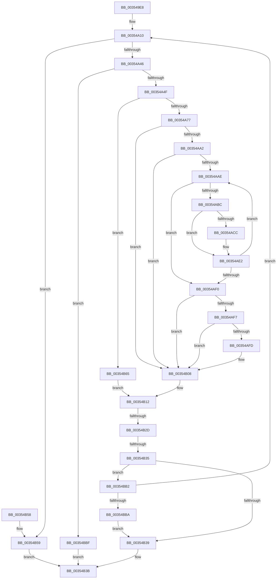

# CcWriteBehindAsync

- RVA: `0x003549E8`–`0x00354C1F` (길이 `567` bytes)
- VA: `0x00000001403549E8`
- 실행 섹션: `.text`
- PDB 이름 있음: `예`; PDB Function 태그: `예`
- unwind 정보 RVA: `0x000791FC`
- 디코드: `130`개 명령, `567/567` bytes 표시
- 미해석 바이트: `0` (있으면 어셈블리에 `.byte`로 보존)

> 이 문서는 커널 이미지의 기계어와 PDB 기호를 분석해 생성했습니다. 4번과 5번은 함수 원형과 자료형을 바이너리 사용 방식에서 추정한 C 해석이며 원본 소스 복구 결과는 아닙니다.

## 1. Dependencies

- 직접 호출 지점: **12**; 고유 호출 대상: **11**
- 직접 호출자로 확인된 함수: **1**
- RIP 상대 이미지 참조: **3**

### Outgoing calls
- `0x00354A1D` → [memset](../6C/memset_function_006C6C40.md) (function, `0x006C6C40`)
- `0x00354A38` → [CcWriteBehindPreProcess](CcWriteBehindPreProcess_function_00357784.md) (function, `0x00357784`)
- `0x00354A6A` → [CcFlushCachePreProcess](CcFlushCachePreProcess_function_0035A9B0.md) (function, `0x0035A9B0`)
- `0x00354AB3` → [CcFlushCacheAcquireRange](CcFlushCacheAcquireRange_function_0035A408.md) (function, `0x0035A408`)
- `0x00354AC1` → [CcFlushCacheOneRange](../23/CcFlushCacheOneRange_function_00236A30.md) (function, `0x00236A30`)
- `0x00354ADD` → [KeWaitForSingleObject](../20/KeWaitForSingleObject_function_0020E6B0.md) (function, `0x0020E6B0`)
- `0x00354AE7` → [CcFlushCachePostProcessOneRange](CcFlushCachePostProcessOneRange_function_00359710.md) (function, `0x00359710`)
- `0x00354AFF` → [KeQueryPerformanceCounter](../37/KeQueryPerformanceCounter_function_0037E7E0.md) (function, `0x0037E7E0`)
- `0x00354B0D` → [CcFlushCachePostProcess](CcFlushCachePostProcess_function_0035A570.md) (function, `0x0035A570`)
- `0x00354B19` → [CcWriteBehindPostProcess](CcWriteBehindPostProcess_function_00357BB4.md) (function, `0x00357BB4`)
- `0x00354BA8` → [DbgPrintEx](DbgPrintEx_function_00359290.md) (function, `0x00359290`)
- `0x00354C10` → [DbgPrintEx](DbgPrintEx_function_00359290.md) (function, `0x00359290`)

### Direct callers
- [CcAsyncLazywriteWorker](CcAsyncLazywriteWorker_function_00354C28.md) at `0x00354DC1`

### Static image references
- `0x00354A4F` → RVA `0x00F8F4F0` (`.data`; read)
- `0x00354B6E` → RVA `0x006C9020` (` ?? ::FNODOBFM::`string'`; read)
- `0x00354C09` → RVA `0x006C8F60` (` ?? ::FNODOBFM::`string'`; read)

## 2. Other-region calls and transfers

- 다른 실행 섹션으로 향하는 call: **0**
- call이 아닌 외부 분기/꼬리 이동: **2**
  - `0x00354B27` → [sub_006E2746](../6E/Unknown_function_006E2746.md) (`tail-transfer`)
  - `0x00354B2F` → [sub_006E2746](../6E/Unknown_function_006E2746.md) (`tail-transfer`)

## 3. Assembly (complete function range)

```asm
003549E8  48 8B C4                        mov rax, rsp
003549EB  48 89 58 08                     mov qword ptr [rax + 8], rbx
003549EF  48 89 70 10                     mov qword ptr [rax + 0x10], rsi
003549F3  48 89 78 18                     mov qword ptr [rax + 0x18], rdi
003549F7  4C 89 70 20                     mov qword ptr [rax + 0x20], r14
003549FB  55                              push rbp
003549FC  48 8D 68 98                     lea rbp, [rax - 0x68]
00354A00  48 81 EC 60 01 00 00            sub rsp, 0x160
00354A07  49 8B F0                        mov rsi, r8
00354A0A  4C 8B F2                        mov r14, rdx
00354A0D  48 8B F9                        mov rdi, rcx
00354A10  33 D2                           xor edx, edx
00354A12  48 8D 4C 24 50                  lea rcx, [rsp + 0x50]
00354A17  41 B8 10 01 00 00               mov r8d, 0x110
00354A1D  E8 1E 22 37 00                  call 0x1406c6c40
00354A22  66 83 65 D8 00                  and word ptr [rbp - 0x28], 0
00354A27  48 8D 4C 24 50                  lea rcx, [rsp + 0x50]
00354A2C  4C 89 75 C0                     mov qword ptr [rbp - 0x40], r14
00354A30  48 89 7D 58                     mov qword ptr [rbp + 0x58], rdi
00354A34  C6 45 DB 00                     mov byte ptr [rbp - 0x25], 0
00354A38  E8 47 2D 00 00                  call 0x140357784
00354A3D  83 F8 02                        cmp eax, 2
00354A40  0F 84 13 01 00 00               je 0x140354b59
00354A46  83 F8 01                        cmp eax, 1
00354A49  0F 84 70 01 00 00               je 0x140354bbf
00354A4F  48 8D 05 9A AA C3 00            lea rax, [rip + 0xc3aa9a]
00354A56  C7 45 B8 01 00 00 00            mov dword ptr [rbp - 0x48], 1
00354A5D  48 8D 4C 24 50                  lea rcx, [rsp + 0x50]
00354A62  48 89 45 B0                     mov qword ptr [rbp - 0x50], rax
00354A66  48 89 75 98                     mov qword ptr [rbp - 0x68], rsi
00354A6A  E8 41 5F 00 00                  call 0x14035a9b0
00354A6F  84 C0                           test al, al
00354A71  0F 84 EE 00 00 00               je 0x140354b65
00354A77  48 8B 45 98                     mov rax, qword ptr [rbp - 0x68]
00354A7B  48 83 65 B0 00                  and qword ptr [rbp - 0x50], 0
00354A80  48 8B 4C 24 60                  mov rcx, qword ptr [rsp + 0x60]
00354A85  83 60 04 00                     and dword ptr [rax + 4], 0
00354A89  66 C7 00 01 00                  mov word ptr [rax], 1
00354A8E  C6 40 02 06                     mov byte ptr [rax + 2], 6
00354A92  48 83 C0 08                     add rax, 8
00354A96  48 89 40 08                     mov qword ptr [rax + 8], rax
00354A9A  48 89 00                        mov qword ptr [rax], rax
00354A9D  48 85 C9                        test rcx, rcx
00354AA0  74 66                           je 0x140354b08
00354AA2  F7 81 98 00 00 00 00 00 00 04   test dword ptr [rcx + 0x98], 0x4000000
00354AAC  75 5A                           jne 0x140354b08
00354AAE  48 8D 4C 24 50                  lea rcx, [rsp + 0x50]
00354AB3  E8 50 59 00 00                  call 0x14035a408
00354AB8  84 C0                           test al, al
00354ABA  74 34                           je 0x140354af0
00354ABC  48 8D 4C 24 50                  lea rcx, [rsp + 0x50]
00354AC1  E8 6A 1F EE FF                  call 0x140236a30
00354AC6  83 7D 8C 00                     cmp dword ptr [rbp - 0x74], 0
00354ACA  75 16                           jne 0x140354ae2
00354ACC  48 83 64 24 20 00               and qword ptr [rsp + 0x20], 0
00354AD2  45 33 C9                        xor r9d, r9d
00354AD5  45 33 C0                        xor r8d, r8d
00354AD8  33 D2                           xor edx, edx
00354ADA  48 8B CE                        mov rcx, rsi
00354ADD  E8 CE 9B EB FF                  call 0x14020e6b0
00354AE2  48 8D 4C 24 50                  lea rcx, [rsp + 0x50]
00354AE7  E8 24 4C 00 00                  call 0x140359710
00354AEC  84 C0                           test al, al
00354AEE  75 BE                           jne 0x140354aae
00354AF0  48 83 7D 38 00                  cmp qword ptr [rbp + 0x38], 0
00354AF5  74 11                           je 0x140354b08
00354AF7  83 7D 48 00                     cmp dword ptr [rbp + 0x48], 0
00354AFB  74 0B                           je 0x140354b08
00354AFD  33 C9                           xor ecx, ecx
00354AFF  E8 DC 9C 02 00                  call 0x14037e7e0
00354B04  48 89 45 40                     mov qword ptr [rbp + 0x40], rax
00354B08  48 8D 4C 24 50                  lea rcx, [rsp + 0x50]
00354B0D  E8 5E 5A 00 00                  call 0x14035a570
00354B12  33 D2                           xor edx, edx
00354B14  48 8D 4C 24 50                  lea rcx, [rsp + 0x50]
00354B19  E8 96 30 00 00                  call 0x140357bb4
00354B1E  0F B6 D8                        movzx ebx, al
00354B21  0F B6 45 D9                     movzx eax, byte ptr [rbp - 0x27]
00354B25  84 DB                           test bl, bl
00354B27  0F 84 19 DC 38 00               je 0x1406e2746
00354B2D  84 C0                           test al, al
00354B2F  0F 85 11 DC 38 00               jne 0x1406e2746
00354B35  84 DB                           test bl, bl
00354B37  74 79                           je 0x140354bb2
00354B39  33 C0                           xor eax, eax
00354B3B  4C 8D 9C 24 60 01 00 00         lea r11, [rsp + 0x160]
00354B43  49 8B 5B 10                     mov rbx, qword ptr [r11 + 0x10]
00354B47  49 8B 73 18                     mov rsi, qword ptr [r11 + 0x18]
00354B4B  49 8B 7B 20                     mov rdi, qword ptr [r11 + 0x20]
00354B4F  4D 8B 73 28                     mov r14, qword ptr [r11 + 0x28]
00354B53  49 8B E3                        mov rsp, r11
00354B56  5D                              pop rbp
00354B57  C3                              ret
00354B58  CC                              int3
00354B59  48 83 67 10 00                  and qword ptr [rdi + 0x10], 0
00354B5E  B8 02 00 00 00                  mov eax, 2
00354B63  EB D6                           jmp 0x140354b3b
00354B65  65 48 8B 0C 25 88 01 00 00      mov rcx, qword ptr gs:[0x188]
00354B6E  4C 8D 05 AB 44 37 00            lea r8, [rip + 0x3744ab]
00354B75  65 4C 8B 0C 25 88 01 00 00      mov r9, qword ptr gs:[0x188]
00354B7E  BA 03 00 00 00                  mov edx, 3
00354B83  41 8B 06                        mov eax, dword ptr [r14]
00354B86  89 44 24 30                     mov dword ptr [rsp + 0x30], eax
00354B8A  48 8B 44 24 68                  mov rax, qword ptr [rsp + 0x68]
00354B8F  45 8B 89 08 05 00 00            mov r9d, dword ptr [r9 + 0x508]
00354B96  48 89 44 24 28                  mov qword ptr [rsp + 0x28], rax
00354B9B  8B 81 10 05 00 00               mov eax, dword ptr [rcx + 0x510]
00354BA1  8D 4A 7C                        lea ecx, [rdx + 0x7c]
00354BA4  89 44 24 20                     mov dword ptr [rsp + 0x20], eax
00354BA8  E8 E3 46 00 00                  call 0x140359290
00354BAD  E9 60 FF FF FF                  jmp 0x140354b12
00354BB2  84 C0                           test al, al
00354BB4  0F 85 56 FE FF FF               jne 0x140354a10
00354BBA  E9 7A FF FF FF                  jmp 0x140354b39
00354BBF  65 4C 8B 1C 25 88 01 00 00      mov r11, qword ptr gs:[0x188]
00354BC8  BA 03 00 00 00                  mov edx, 3
00354BCD  65 4C 8B 0C 25 88 01 00 00      mov r9, qword ptr gs:[0x188]
00354BD6  4C 8B 97 90 00 00 00            mov r10, qword ptr [rdi + 0x90]
00354BDD  8D 4A 7C                        lea ecx, [rdx + 0x7c]
00354BE0  45 8B 89 08 05 00 00            mov r9d, dword ptr [r9 + 0x508]
00354BE7  45 8B 42 18                     mov r8d, dword ptr [r10 + 0x18]
00354BEB  44 89 44 24 38                  mov dword ptr [rsp + 0x38], r8d
00354BF0  45 8B 83 10 05 00 00            mov r8d, dword ptr [r11 + 0x510]
00354BF7  4C 89 54 24 30                  mov qword ptr [rsp + 0x30], r10
00354BFC  C7 44 24 28 01 00 00 00         mov dword ptr [rsp + 0x28], 1
00354C04  44 89 44 24 20                  mov dword ptr [rsp + 0x20], r8d
00354C09  4C 8D 05 50 43 37 00            lea r8, [rip + 0x374350]
00354C10  E8 7B 46 00 00                  call 0x140359290
00354C15  B8 01 00 00 00                  mov eax, 1
00354C1A  E9 1C FF FF FF                  jmp 0x140354b3b
```

## 4. C-style interpretation (structured pseudocode)

```c
__int64 __fastcall CcWriteBehindAsync(__int64 a1, __int64 a2, __int64 a3, int a4)
{
    __int64 result;
    __int64 v_rsp;
    unsigned __int64 v_stack_m108;
    unsigned __int64 v_stack_m118;
    unsigned int v_stack_m128;
    unsigned int v_stack_m130;
    unsigned __int64 v_stack_m138;
    unsigned int v_stack_m140;
    unsigned __int64 v_stack_m148;
    unsigned __int64 v_stack_m8;
    unsigned __int64 v_stack_mF8;

    *(unsigned __int64 *)(v_rsp + 8) = v_rbx;
    *(unsigned __int64 *)(v_rsp + 16) = v_rsi;
    *(unsigned __int64 *)(v_rsp + 24) = v_rdi;
    *(unsigned __int64 *)(v_rsp + 32) = v_r14;
    v_rsp = (v_rsp) - (352);
loc_00354A10:
    a2 = 0;
    result = memset(v_stack_m118, a2, 272, a4);
    *(unsigned __int64 *)(v_rsp - 104 - 64) = 0;
    *(unsigned __int64 *)(v_rsp - 104 + 88) = a1;
    *(unsigned __int8 *)(v_rsp - 104 - 37) = 0;
    result = CcWriteBehindPreProcess(v_stack_m118, a2, 272, a4);
    if (((unsigned int)(result)) == 2) goto loc_00354B59;
    if (((unsigned int)(result)) == 1) goto loc_00354BBF;
    *(unsigned int *)(v_rsp - 104 - 72) = 1;
    *(unsigned __int64 *)(v_rsp - 104 - 80) = v_rip + 12823194;
    *(unsigned __int64 *)(v_rsp - 104 - 104) = a3;
    result = CcFlushCachePreProcess(v_stack_m118, a2, 272, a4);
    if ((unsigned __int8)(result) == 0) goto loc_00354B65;
    *(unsigned __int16 *)(*(unsigned __int64 *)(v_rsp - 104 - 104)) = 1;
    *(unsigned __int8 *)(*(unsigned __int64 *)(v_rsp - 104 - 104) + 2) = 6;
    result = (*(unsigned __int64 *)(v_rsp - 104 - 104)) + (8);
    *(unsigned __int64 *)(result + 8) = result;
    *(unsigned __int64 *)(result) = result;
    if (v_stack_m108 == 0) goto loc_00354B08;
    if (((*(unsigned int *)(v_stack_m108 + 152)) & (0x4000000ULL)) != 0) goto loc_00354B08;
loc_00354AAE:
    result = CcFlushCacheAcquireRange(v_stack_m118, a2, 272, a4);
    if ((unsigned __int8)(result) == 0) goto loc_00354AF0;
    result = CcFlushCacheOneRange(v_stack_m118, a2, 272, a4);
    if ((*(unsigned int *)(v_rsp - 104 - 116)) == 0) {
        a4 = 0;
        a3 = 0;
        a2 = 0;
        a1 = 0;
        result = KeWaitForSingleObject(a1, a2, a3, a4);
    }
    result = CcFlushCachePostProcessOneRange(v_stack_m118, a2, a3, a4);
    if ((unsigned __int8)(result) != 0) goto loc_00354AAE;
loc_00354AF0:
    if ((*(unsigned __int64 *)(v_rsp - 104 + 56)) == 0) goto loc_00354B08;
    if ((*(unsigned int *)(v_rsp - 104 + 72)) != 0) {
        a1 = 0;
        result = KeQueryPerformanceCounter(a1, a2, a3, a4);
        *(unsigned __int64 *)(v_rsp - 104 + 64) = result;
    }
    result = CcFlushCachePostProcess(v_stack_m118, a2, a3, a4);
loc_00354B12:
    a2 = 0;
    result = CcWriteBehindPostProcess(v_stack_m118, a2, a3, a4);
    if ((unsigned __int8)((unsigned __int8)(result)) == 0) goto loc_00354BB2;
loc_00354B39:
    result = 0;
loc_00354B3B:
    return result;
loc_00354B59:
    goto loc_00354B3B;
loc_00354B65:
    v_stack_m130 = (unsigned int)((unsigned int)(*(unsigned int *)(*(unsigned __int64 *)(v_stack_m8 + 40))));
    v_stack_m138 = v_stack_mF8;
    v_stack_m140 = (unsigned int)((unsigned int)(*(unsigned int *)(*(unsigned __int64 *)(gs_base + (0 + 392)) + 1296)));
    result = DbgPrintEx(3 + 124, 3, v_rip + 3622059, (unsigned int)(*(unsigned int *)(*(unsigned __int64 *)(gs_base + (0 + 392)) + 1288)));
    goto loc_00354B12;
loc_00354BB2:
    if ((unsigned __int8)(result) != 0) goto loc_00354A10;
    goto loc_00354B39;
loc_00354BBF:
    v_stack_m128 = (unsigned int)((unsigned int)(*(unsigned int *)(*(unsigned __int64 *)(*(unsigned __int64 *)(v_stack_m8 + 32) + 144) + 24)));
    v_stack_m130 = *(unsigned __int64 *)(*(unsigned __int64 *)(v_stack_m8 + 32) + 144);
    v_stack_m138 = 1;
    v_stack_m140 = (unsigned int)((unsigned int)(*(unsigned int *)(*(unsigned __int64 *)(gs_base + (0 + 392)) + 1296)));
    result = DbgPrintEx(3 + 124, 3, v_rip + 3621712, (unsigned int)(*(unsigned int *)(*(unsigned __int64 *)(gs_base + (0 + 392)) + 1288)));
    goto loc_00354B3B;
}
```

## 5. (Beta) C Style

```c
int64_t CcWriteBehindAsync(void *Arg1, void *Arg2, int64_t Arg3, int32_t Arg4)
{
    uint8_t *arg1 = (uint8_t *)Arg1;
    uint8_t *arg2 = (uint8_t *)Arg2;

    int64_t result;
    int64_t local_rsp;
    uint64_t v_stack_m108;
    uint64_t v_stack_m118;
    uint32_t v_stack_m128;
    uint32_t v_stack_m130;
    uint64_t v_stack_m138;
    uint32_t v_stack_m140;
    uint64_t v_stack_m148;
    uint64_t v_stack_m8;
    uint64_t v_stack_mF8;

    *(uint64_t *)(local_rsp + 0x8) = local_rbx;
    *(uint64_t *)(local_rsp + 0x10) = local_rsi;
    *(uint64_t *)(local_rsp + 0x18) = local_rdi;
    *(uint64_t *)(local_rsp + 0x20) = local_r14;
    local_rsp = (local_rsp) - (352);
loc_00354A10:
    Arg2 = 0;
    result = memset(v_stack_m118, Arg2, 272, Arg4);
    *(uint64_t *)(local_rsp - 0x68 - 0x40) = 0;
    *(void **)(local_rsp - 0x68 + 0x58) = Arg1;
    *(uint8_t *)(local_rsp - 0x68 - 0x25) = 0;
    result = CcWriteBehindPreProcess(v_stack_m118, Arg2, 272, Arg4);
    if (((uint32_t)(result)) == 2) goto loc_00354B59;
    if (((uint32_t)(result)) == 1) goto loc_00354BBF;
    *(uint32_t *)(local_rsp - 0x68 - 0x48) = 1;
    *(uint64_t *)(local_rsp - 0x68 - 0x50) = v_rip + 12823194;
    *(uint64_t *)(local_rsp - 0x68 - 0x68) = Arg3;
    result = CcFlushCachePreProcess(v_stack_m118, Arg2, 272, Arg4);
    if ((uint8_t)(result) == 0) goto loc_00354B65;
    *(uint16_t *)(*(uint64_t *)(local_rsp - 0x68 - 0x68)) = 1;
    *(uint8_t *)(*(uint64_t *)(local_rsp - 0x68 - 0x68) + 0x2) = 6;
    result = (*(uint64_t *)(local_rsp - 0x68 - 0x68)) + (8);
    *(uint64_t *)(result + 0x8) = result;
    *(uint64_t *)(result) = result;
    if (v_stack_m108 == 0) goto loc_00354B08;
    if (((*(uint32_t *)(v_stack_m108 + 0x98)) & (0x4000000ULL)) != 0) goto loc_00354B08;
loc_00354AAE:
    result = CcFlushCacheAcquireRange(v_stack_m118, Arg2, 272, Arg4);
    if ((uint8_t)(result) == 0) goto loc_00354AF0;
    result = CcFlushCacheOneRange(v_stack_m118, Arg2, 272, Arg4);
    if ((*(uint32_t *)(local_rsp - 0x68 - 0x74)) == 0) {
        Arg4 = 0;
        Arg3 = 0;
        Arg2 = 0;
        Arg1 = 0;
        result = KeWaitForSingleObject(Arg1, Arg2, Arg3, Arg4);
    }
    result = CcFlushCachePostProcessOneRange(v_stack_m118, Arg2, Arg3, Arg4);
    if ((uint8_t)(result) != 0) goto loc_00354AAE;
loc_00354AF0:
    if ((*(uint64_t *)(local_rsp - 0x68 + 0x38)) == 0) goto loc_00354B08;
    if ((*(uint32_t *)(local_rsp - 0x68 + 0x48)) != 0) {
        Arg1 = 0;
        result = KeQueryPerformanceCounter(Arg1, Arg2, Arg3, Arg4);
        *(uint64_t *)(local_rsp - 0x68 + 0x40) = result;
    }
    result = CcFlushCachePostProcess(v_stack_m118, Arg2, Arg3, Arg4);
loc_00354B12:
    Arg2 = 0;
    result = CcWriteBehindPostProcess(v_stack_m118, Arg2, Arg3, Arg4);
    if ((uint8_t)((uint8_t)(result)) == 0) goto loc_00354BB2;
loc_00354B39:
    result = 0;
loc_00354B3B:
    return result;
loc_00354B59:
    goto loc_00354B3B;
loc_00354B65:
    v_stack_m130 = (uint32_t)((uint32_t)(*(uint32_t *)(*(uint64_t *)(v_stack_m8 + 0x28))));
    v_stack_m138 = v_stack_mF8;
    v_stack_m140 = (uint32_t)((uint32_t)(*(uint32_t *)(*(uint64_t *)(gs_base + (0 + 0x188)) + 0x510)));
    result = DbgPrintEx(3 + 124, 3, v_rip + 3622059, (uint32_t)(*(uint32_t *)(*(uint64_t *)(gs_base + (0 + 0x188)) + 0x508)));
    goto loc_00354B12;
loc_00354BB2:
    if ((uint8_t)(result) != 0) goto loc_00354A10;
    goto loc_00354B39;
loc_00354BBF:
    v_stack_m128 = (uint32_t)((uint32_t)(*(uint32_t *)(*(uint64_t *)(*(uint64_t *)(v_stack_m8 + 0x20) + 0x90) + 0x18)));
    v_stack_m130 = *(uint64_t *)(*(uint64_t *)(v_stack_m8 + 0x20) + 0x90);
    v_stack_m138 = 1;
    v_stack_m140 = (uint32_t)((uint32_t)(*(uint32_t *)(*(uint64_t *)(gs_base + (0 + 0x188)) + 0x510)));
    result = DbgPrintEx(3 + 124, 3, v_rip + 3621712, (uint32_t)(*(uint32_t *)(*(uint64_t *)(gs_base + (0 + 0x188)) + 0x508)));
    goto loc_00354B3B;
}
```

### 관측된 메모리 오프셋

구조체 형식이 확인되지 않은 접근은 인자 기준의 오프셋으로만 기록했습니다.

| 기준 인자 | 오프셋 표현 | 폭 (bit) | 접근 |
|---|---:|---:|---|
| `Arg1` | `+ 0x10` | `64` | `R/W` |
| `Arg1` | `+ 0x90` | `64` | `R` |
| `Arg2` | `+ 0x0` | `32` | `R` |

## 6. Execution-region graph

[열기: 2D/3D 그래프와 함수 탐색 컨트롤 패널](../../../control-panel.html?section=text&rva=0x003549E8&view=graph)

- 2D 그래프는 위에서 아래로 흐르고, 3D 그래프는 빈 공간을 드래그해 회전합니다. Shift+드래그는 이동, 휠은 확대·축소, 함수 노드 선택은 대상 보고서 이동입니다.

### Static fallback


