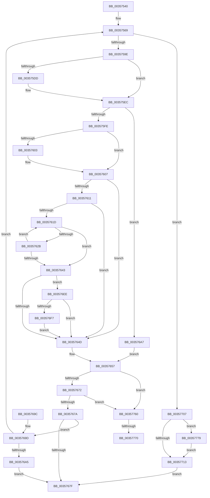

# CcWriteBehindInternal

- RVA: `0x00357540`–`0x0035777E` (길이 `574` bytes)
- VA: `0x0000000140357540`
- 실행 섹션: `.text`
- PDB 이름 있음: `예`; PDB Function 태그: `예`
- unwind 정보 RVA: `0x00079618`
- 디코드: `134`개 명령, `574/574` bytes 표시
- 미해석 바이트: `0` (있으면 어셈블리에 `.byte`로 보존)

> 이 문서는 커널 이미지의 기계어와 PDB 기호를 분석해 생성했습니다. 4번과 5번은 함수 원형과 자료형을 바이너리 사용 방식에서 추정한 C 해석이며 원본 소스 복구 결과는 아닙니다.

## 1. Dependencies

- 직접 호출 지점: **11**; 고유 호출 대상: **10**
- 직접 호출자로 확인된 함수: **1**
- RIP 상대 이미지 참조: **3**

### Outgoing calls
- `0x00357576` → [memset](../6C/memset_function_006C6C40.md) (function, `0x006C6C40`)
- `0x00357590` → [CcWriteBehindPreProcess](CcWriteBehindPreProcess_function_00357784.md) (function, `0x00357784`)
- `0x003575F1` → [CcFlushCachePreProcess](CcFlushCachePreProcess_function_0035A9B0.md) (function, `0x0035A9B0`)
- `0x00357622` → [CcFlushCacheAcquireRange](CcFlushCacheAcquireRange_function_0035A408.md) (function, `0x0035A408`)
- `0x00357630` → [CcFlushCacheOneRange](../23/CcFlushCacheOneRange_function_00236A30.md) (function, `0x00236A30`)
- `0x0035763A` → [CcFlushCachePostProcessOneRange](CcFlushCachePostProcessOneRange_function_00359710.md) (function, `0x00359710`)
- `0x00357652` → [CcFlushCachePostProcess](CcFlushCachePostProcess_function_0035A570.md) (function, `0x0035A570`)
- `0x0035765E` → [CcWriteBehindPostProcess](CcWriteBehindPostProcess_function_00357BB4.md) (function, `0x00357BB4`)
- `0x003576E4` → [DbgPrintEx](DbgPrintEx_function_00359290.md) (function, `0x00359290`)
- `0x003576F9` → [KeQueryPerformanceCounter](../37/KeQueryPerformanceCounter_function_0037E7E0.md) (function, `0x0037E7E0`)
- `0x00357756` → [DbgPrintEx](DbgPrintEx_function_00359290.md) (function, `0x00359290`)

### Direct callers
- [CcWriteBehind](CcWriteBehind_function_00356EAC.md) at `0x0035701A`

### Static image references
- `0x003575A3` → RVA `0x00F8F4F0` (`.data`; read)
- `0x003576B0` → RVA `0x006C7E00` (` ?? ::FNODOBFM::`string'`; read)
- `0x0035771C` → RVA `0x006C7D00` (` ?? ::FNODOBFM::`string'`; read)

## 2. Other-region calls and transfers

- 다른 실행 섹션으로 향하는 call: **0**
- call이 아닌 외부 분기/꼬리 이동: **2**
  - `0x0035776A` → [sub_006E2A9E](../6E/Unknown_function_006E2A9E.md) (`tail-transfer`)
  - `0x00357774` → [sub_006E2A9E + 0x3](../6E/Unknown_function_006E2A9E.md) (`tail-transfer`)

## 3. Assembly (complete function range)

```asm
00357540  48 89 5C 24 08                  mov qword ptr [rsp + 8], rbx
00357545  48 89 74 24 10                  mov qword ptr [rsp + 0x10], rsi
0035754A  48 89 7C 24 18                  mov qword ptr [rsp + 0x18], rdi
0035754F  55                              push rbp
00357550  41 56                           push r14
00357552  41 57                           push r15
00357554  48 8D 6C 24 90                  lea rbp, [rsp - 0x70]
00357559  48 81 EC 70 01 00 00            sub rsp, 0x170
00357560  4C 8B 71 18                     mov r14, qword ptr [rcx + 0x18]
00357564  48 8B F9                        mov rdi, rcx
00357567  33 DB                           xor ebx, ebx
00357569  33 D2                           xor edx, edx
0035756B  48 8D 4C 24 60                  lea rcx, [rsp + 0x60]
00357570  41 B8 10 01 00 00               mov r8d, 0x110
00357576  E8 C5 F6 36 00                  call 0x1406c6c40
0035757B  48 8D 4C 24 60                  lea rcx, [rsp + 0x60]
00357580  4C 89 75 D0                     mov qword ptr [rbp - 0x30], r14
00357584  66 89 5D E8                     mov word ptr [rbp - 0x18], bx
00357588  48 89 7D 68                     mov qword ptr [rbp + 0x68], rdi
0035758C  C6 45 EB 01                     mov byte ptr [rbp - 0x15], 1
00357590  E8 EF 01 00 00                  call 0x140357784
00357595  83 F8 01                        cmp eax, 1
00357598  0F 84 69 01 00 00               je 0x140357707
0035759E  4C 8B 7C 24 78                  mov r15, qword ptr [rsp + 0x78]
003575A3  48 8D 05 46 7F C3 00            lea rax, [rip + 0xc37f46]
003575AA  4D 85 F6                        test r14, r14
003575AD  48 89 45 C0                     mov qword ptr [rbp - 0x40], rax
003575B1  48 8B 45 B8                     mov rax, qword ptr [rbp - 0x48]
003575B5  48 8D 74 24 50                  lea rsi, [rsp + 0x50]
003575BA  49 0F 45 F6                     cmovne rsi, r14
003575BE  C7 45 C8 01 00 00 00            mov dword ptr [rbp - 0x38], 1
003575C5  88 5D CC                        mov byte ptr [rbp - 0x34], bl
003575C8  0F 57 C0                        xorps xmm0, xmm0
003575CB  48 89 75 D0                     mov qword ptr [rbp - 0x30], rsi
003575CF  48 89 5D A8                     mov qword ptr [rbp - 0x58], rbx
003575D3  0F 11 44 24 50                  movups xmmword ptr [rsp + 0x50], xmm0
003575D8  48 85 C0                        test rax, rax
003575DB  74 0F                           je 0x1403575ec
003575DD  48 8B 00                        mov rax, qword ptr [rax]
003575E0  48 89 45 B0                     mov qword ptr [rbp - 0x50], rax
003575E4  48 8D 45 B0                     lea rax, [rbp - 0x50]
003575E8  48 89 45 B8                     mov qword ptr [rbp - 0x48], rax
003575EC  48 8D 4C 24 60                  lea rcx, [rsp + 0x60]
003575F1  E8 BA 33 00 00                  call 0x14035a9b0
003575F6  84 C0                           test al, al
003575F8  0F 84 A9 00 00 00               je 0x1403576a7
003575FE  38 5D E4                        cmp byte ptr [rbp - 0x1c], bl
00357601  74 04                           je 0x140357607
00357603  48 89 5D C0                     mov qword ptr [rbp - 0x40], rbx
00357607  48 8B 44 24 70                  mov rax, qword ptr [rsp + 0x70]
0035760C  48 85 C0                        test rax, rax
0035760F  74 3C                           je 0x14035764d
00357611  F7 80 98 00 00 00 00 00 00 04   test dword ptr [rax + 0x98], 0x4000000
0035761B  75 30                           jne 0x14035764d
0035761D  48 8D 4C 24 60                  lea rcx, [rsp + 0x60]
00357622  E8 E1 2D 00 00                  call 0x14035a408
00357627  84 C0                           test al, al
00357629  74 18                           je 0x140357643
0035762B  48 8D 4C 24 60                  lea rcx, [rsp + 0x60]
00357630  E8 FB F3 ED FF                  call 0x140236a30
00357635  48 8D 4C 24 60                  lea rcx, [rsp + 0x60]
0035763A  E8 D1 20 00 00                  call 0x140359710
0035763F  84 C0                           test al, al
00357641  75 DA                           jne 0x14035761d
00357643  48 39 5D 48                     cmp qword ptr [rbp + 0x48], rbx
00357647  0F 85 A1 00 00 00               jne 0x1403576ee
0035764D  48 8D 4C 24 60                  lea rcx, [rsp + 0x60]
00357652  E8 19 2F 00 00                  call 0x14035a570
00357657  33 D2                           xor edx, edx
00357659  48 8D 4C 24 60                  lea rcx, [rsp + 0x60]
0035765E  E8 51 05 00 00                  call 0x140357bb4
00357663  0F B6 4D E9                     movzx ecx, byte ptr [rbp - 0x17]
00357667  0F B6 F0                        movzx esi, al
0035766A  84 C0                           test al, al
0035766C  0F 84 EE 00 00 00               je 0x140357760
00357672  84 C9                           test cl, cl
00357674  0F 85 E6 00 00 00               jne 0x140357760
0035767A  40 84 F6                        test sil, sil
0035767D  74 1E                           je 0x14035769d
0035767F  4C 8D 9C 24 70 01 00 00         lea r11, [rsp + 0x170]
00357687  49 8B 5B 20                     mov rbx, qword ptr [r11 + 0x20]
0035768B  49 8B 73 28                     mov rsi, qword ptr [r11 + 0x28]
0035768F  49 8B 7B 30                     mov rdi, qword ptr [r11 + 0x30]
00357693  49 8B E3                        mov rsp, r11
00357696  41 5F                           pop r15
00357698  41 5E                           pop r14
0035769A  5D                              pop rbp
0035769B  C3                              ret
0035769C  CC                              int3
0035769D  84 C9                           test cl, cl
0035769F  0F 85 C4 FE FF FF               jne 0x140357569
003576A5  EB D8                           jmp 0x14035767f
003576A7  65 48 8B 0C 25 88 01 00 00      mov rcx, qword ptr gs:[0x188]
003576B0  4C 8D 05 49 07 37 00            lea r8, [rip + 0x370749]
003576B7  65 4C 8B 0C 25 88 01 00 00      mov r9, qword ptr gs:[0x188]
003576C0  BA 03 00 00 00                  mov edx, 3
003576C5  8B 06                           mov eax, dword ptr [rsi]
003576C7  89 44 24 30                     mov dword ptr [rsp + 0x30], eax
003576CB  8B 81 10 05 00 00               mov eax, dword ptr [rcx + 0x510]
003576D1  45 8B 89 08 05 00 00            mov r9d, dword ptr [r9 + 0x508]
003576D8  8D 4A 7C                        lea ecx, [rdx + 0x7c]
003576DB  4C 89 7C 24 28                  mov qword ptr [rsp + 0x28], r15
003576E0  89 44 24 20                     mov dword ptr [rsp + 0x20], eax
003576E4  E8 A7 1B 00 00                  call 0x140359290
003576E9  E9 69 FF FF FF                  jmp 0x140357657
003576EE  39 5D 58                        cmp dword ptr [rbp + 0x58], ebx
003576F1  0F 84 56 FF FF FF               je 0x14035764d
003576F7  33 C9                           xor ecx, ecx
003576F9  E8 E2 70 02 00                  call 0x14037e7e0
003576FE  48 89 45 50                     mov qword ptr [rbp + 0x50], rax
00357702  E9 46 FF FF FF                  jmp 0x14035764d
00357707  48 8B 8F 90 00 00 00            mov rcx, qword ptr [rdi + 0x90]
0035770E  48 85 C9                        test rcx, rcx
00357711  75 66                           jne 0x140357779
00357713  65 48 8B 04 25 88 01 00 00      mov rax, qword ptr gs:[0x188]
0035771C  4C 8D 05 DD 05 37 00            lea r8, [rip + 0x3705dd]
00357723  65 4C 8B 0C 25 88 01 00 00      mov r9, qword ptr gs:[0x188]
0035772C  BA 03 00 00 00                  mov edx, 3
00357731  89 5C 24 38                     mov dword ptr [rsp + 0x38], ebx
00357735  48 89 4C 24 30                  mov qword ptr [rsp + 0x30], rcx
0035773A  8B 80 10 05 00 00               mov eax, dword ptr [rax + 0x510]
00357740  45 8B 89 08 05 00 00            mov r9d, dword ptr [r9 + 0x508]
00357747  8D 4A 7C                        lea ecx, [rdx + 0x7c]
0035774A  C7 44 24 28 01 00 00 00         mov dword ptr [rsp + 0x28], 1
00357752  89 44 24 20                     mov dword ptr [rsp + 0x20], eax
00357756  E8 35 1B 00 00                  call 0x140359290
0035775B  E9 1F FF FF FF                  jmp 0x14035767f
00357760  4C 8B 87 90 00 00 00            mov r8, qword ptr [rdi + 0x90]
00357767  4D 85 C0                        test r8, r8
0035776A  0F 84 2E B3 38 00               je 0x1406e2a9e
00357770  45 8B 50 18                     mov r10d, dword ptr [r8 + 0x18]
00357774  E9 28 B3 38 00                  jmp 0x1406e2aa1
00357779  8B 59 18                        mov ebx, dword ptr [rcx + 0x18]
0035777C  EB 95                           jmp 0x140357713
```

## 4. C-style interpretation (structured pseudocode)

```c
__int64 __fastcall CcWriteBehindInternal(__int64 a1, int a2)
{
    __int64 result;
    __int64 v_rbx;
    __int64 v_rsi;
    __int64 v_rsp;
    unsigned __int64 v_stack_m110;
    unsigned __int64 v_stack_m118;
    unsigned __int64 v_stack_m128;
    unsigned __int64 v_stack_m138;
    unsigned int v_stack_m140;
    unsigned __int64 v_stack_m148;
    unsigned int v_stack_m150;
    unsigned __int64 v_stack_m18;
    unsigned __int64 v_stack_m20;
    unsigned int v_stack_m30;
    unsigned __int64 v_stack_m38;
    unsigned __int64 v_stack_m40;
    unsigned __int64 v_stack_m88;
    unsigned __int8 v_stack_m9D;
    unsigned __int8 v_stack_m9F;
    unsigned __int16 v_stack_mA0;
    unsigned __int8 v_stack_mA4;
    unsigned __int64 v_stack_mB8;
    unsigned __int8 v_stack_mBC;
    unsigned int v_stack_mC0;
    unsigned __int64 v_stack_mC8;
    unsigned __int64 v_stack_mD0;
    unsigned __int64 v_stack_mD8;
    unsigned __int64 v_stack_mE0;
    unsigned __int64 v_stack_p10;
    unsigned __int64 v_stack_p18;
    unsigned __int64 v_stack_p8;

    v_stack_p8 = v_rbx;
    v_stack_p10 = v_rsi;
    v_stack_p18 = v_rdi;
    v_rsp = (v_rsp) - (368);
    v_rbx = 0;
loc_00357569:
    a2 = 0;
    result = memset(v_stack_m128, a2, 272, a4);
    v_stack_mB8 = *(unsigned __int64 *)(a1 + 24);
    v_stack_mA0 = 0;
    v_stack_m20 = a1;
    v_stack_m9D = 1;
    result = CcWriteBehindPreProcess(v_stack_m128, a2, 272, a4);
    if (((unsigned int)(result)) == 1) goto loc_00357707;
    v_stack_mC8 = v_rip + 12812102;
    v_rsi = v_stack_m138;
    if (*(unsigned __int64 *)(a1 + 24) != 0) { v_rsi = *(unsigned __int64 *)(a1 + 24); }
    v_stack_mC0 = 1;
    v_stack_mBC = 0;
    v_stack_mB8 = v_rsi;
    v_stack_mE0 = 0;
    v_stack_m138 = v_xmm0;
    result = v_stack_mD0;
    if (v_stack_mD0 != 0) {
        result = *(unsigned __int64 *)(v_stack_mD0);
        v_stack_mD8 = result;
        result = v_stack_mD8;
        v_stack_mD0 = result;
    }
    result = CcFlushCachePreProcess(v_stack_m128, a2, 272, a4);
    if ((unsigned __int8)(result) == 0) goto loc_003576A7;
    if (v_stack_mA4 != 0) {
        v_stack_mC8 = 0;
    }
    if (v_stack_m118 == 0) goto loc_0035764D;
    if (((*(unsigned int *)(v_stack_m118 + 152)) & (0x4000000ULL)) != 0) goto loc_0035764D;
loc_0035761D:
    result = CcFlushCacheAcquireRange(v_stack_m128, a2, 272, a4);
    if ((unsigned __int8)(result) == 0) goto loc_00357643;
    result = CcFlushCacheOneRange(v_stack_m128, a2, 272, a4);
    result = CcFlushCachePostProcessOneRange(v_stack_m128, a2, 272, a4);
    if ((unsigned __int8)(result) != 0) goto loc_0035761D;
loc_00357643:
    if (v_stack_m40 != 0) goto loc_003576EE;
loc_0035764D:
    result = CcFlushCachePostProcess(v_stack_m128, a2, 272, a4);
loc_00357657:
    a2 = 0;
    result = CcWriteBehindPostProcess(v_stack_m128, a2, 272, a4);
    if ((unsigned __int8)(result) == 0) goto loc_00357760;
    if ((unsigned __int8)(v_stack_m9F) != 0) goto loc_00357760;
    if ((unsigned __int8)((unsigned __int8)(result)) == 0) goto loc_0035769D;
loc_0035767F:
    return result;
loc_0035769D:
    if ((unsigned __int8)(v_stack_m9F) != 0) goto loc_00357569;
    goto loc_0035767F;
loc_003576A7:
    v_stack_m140 = (unsigned int)((unsigned int)(*(unsigned int *)(*(unsigned __int64 *)(v_stack_m18 + 40))));
    v_stack_m148 = v_stack_m110;
    v_stack_m150 = (unsigned int)((unsigned int)(*(unsigned int *)(*(unsigned __int64 *)(gs_base + (0 + 392)) + 1296)));
    result = DbgPrintEx(3 + 124, 3, v_rip + 3606345, (unsigned int)(*(unsigned int *)(*(unsigned __int64 *)(gs_base + (0 + 392)) + 1288)));
    goto loc_00357657;
loc_003576EE:
    if (v_stack_m30 == ((unsigned int)(*(unsigned __int64 *)(v_stack_m18 + 32)))) goto loc_0035764D;
    a1 = 0;
    result = KeQueryPerformanceCounter(a1, 3, v_rip + 3606345, (unsigned int)(*(unsigned int *)(*(unsigned __int64 *)(gs_base + (0 + 392)) + 1288)));
    v_stack_m38 = result;
    goto loc_0035764D;
loc_00357707:
    if (*(unsigned __int64 *)(*(unsigned __int64 *)(v_stack_m18 + 48) + 144) != 0) goto loc_00357779;
loc_00357713:
    v_stack_m138 = (unsigned int)(*(unsigned __int64 *)(v_stack_m18 + 32));
    v_stack_m140 = *(unsigned __int64 *)(*(unsigned __int64 *)(v_stack_m18 + 48) + 144);
    v_stack_m148 = 1;
    v_stack_m150 = (unsigned int)((unsigned int)(*(unsigned int *)(*(unsigned __int64 *)(gs_base + (0 + 392)) + 1296)));
    result = DbgPrintEx(3 + 124, 3, v_rip + 3605981, (unsigned int)(*(unsigned int *)(*(unsigned __int64 *)(gs_base + (0 + 392)) + 1288)));
    goto loc_0035767F;
loc_00357760:
loc_00357779:
    goto loc_00357713;
}
```

## 5. (Beta) C Style

```c
int64_t CcWriteBehindInternal(void *Arg1, int32_t Arg2)
{
    uint8_t *arg1 = (uint8_t *)Arg1;

    int64_t result;
    int64_t local_rbx;
    int64_t local_rsi;
    int64_t local_rsp;
    uint64_t v_stack_m110;
    uint64_t v_stack_m118;
    uint64_t v_stack_m128;
    uint64_t v_stack_m138;
    uint32_t v_stack_m140;
    uint64_t v_stack_m148;
    uint32_t v_stack_m150;
    uint64_t v_stack_m18;
    uint64_t v_stack_m20;
    uint32_t v_stack_m30;
    uint64_t v_stack_m38;
    uint64_t v_stack_m40;
    uint64_t v_stack_m88;
    uint8_t v_stack_m9D;
    uint8_t v_stack_m9F;
    uint16_t v_stack_mA0;
    uint8_t v_stack_mA4;
    uint64_t v_stack_mB8;
    uint8_t v_stack_mBC;
    uint32_t v_stack_mC0;
    uint64_t v_stack_mC8;
    uint64_t v_stack_mD0;
    uint64_t v_stack_mD8;
    uint64_t v_stack_mE0;
    uint64_t v_stack_p10;
    uint64_t v_stack_p18;
    uint64_t v_stack_p8;

    v_stack_p8 = local_rbx;
    v_stack_p10 = local_rsi;
    v_stack_p18 = local_rdi;
    local_rsp = (local_rsp) - (368);
    local_rbx = 0;
loc_00357569:
    Arg2 = 0;
    result = memset(v_stack_m128, Arg2, 272, a4);
    v_stack_mB8 = *(uint64_t *)(arg1 + 0x18);
    v_stack_mA0 = 0;
    v_stack_m20 = Arg1;
    v_stack_m9D = 1;
    result = CcWriteBehindPreProcess(v_stack_m128, Arg2, 272, a4);
    if (((uint32_t)(result)) == 1) goto loc_00357707;
    v_stack_mC8 = v_rip + 12812102;
    local_rsi = v_stack_m138;
    if (*(uint64_t *)(arg1 + 0x18) != 0) { local_rsi = *(uint64_t *)(arg1 + 0x18); }
    v_stack_mC0 = 1;
    v_stack_mBC = 0;
    v_stack_mB8 = local_rsi;
    v_stack_mE0 = 0;
    v_stack_m138 = v_xmm0;
    result = v_stack_mD0;
    if (v_stack_mD0 != 0) {
        result = *(uint64_t *)(v_stack_mD0);
        v_stack_mD8 = result;
        result = v_stack_mD8;
        v_stack_mD0 = result;
    }
    result = CcFlushCachePreProcess(v_stack_m128, Arg2, 272, a4);
    if ((uint8_t)(result) == 0) goto loc_003576A7;
    if (v_stack_mA4 != 0) {
        v_stack_mC8 = 0;
    }
    if (v_stack_m118 == 0) goto loc_0035764D;
    if (((*(uint32_t *)(v_stack_m118 + 0x98)) & (0x4000000ULL)) != 0) goto loc_0035764D;
loc_0035761D:
    result = CcFlushCacheAcquireRange(v_stack_m128, Arg2, 272, a4);
    if ((uint8_t)(result) == 0) goto loc_00357643;
    result = CcFlushCacheOneRange(v_stack_m128, Arg2, 272, a4);
    result = CcFlushCachePostProcessOneRange(v_stack_m128, Arg2, 272, a4);
    if ((uint8_t)(result) != 0) goto loc_0035761D;
loc_00357643:
    if (v_stack_m40 != 0) goto loc_003576EE;
loc_0035764D:
    result = CcFlushCachePostProcess(v_stack_m128, Arg2, 272, a4);
loc_00357657:
    Arg2 = 0;
    result = CcWriteBehindPostProcess(v_stack_m128, Arg2, 272, a4);
    if ((uint8_t)(result) == 0) goto loc_00357760;
    if ((uint8_t)(v_stack_m9F) != 0) goto loc_00357760;
    if ((uint8_t)((uint8_t)(result)) == 0) goto loc_0035769D;
loc_0035767F:
    return result;
loc_0035769D:
    if ((uint8_t)(v_stack_m9F) != 0) goto loc_00357569;
    goto loc_0035767F;
loc_003576A7:
    v_stack_m140 = (uint32_t)((uint32_t)(*(uint32_t *)(*(uint64_t *)(v_stack_m18 + 0x28))));
    v_stack_m148 = v_stack_m110;
    v_stack_m150 = (uint32_t)((uint32_t)(*(uint32_t *)(*(uint64_t *)(gs_base + (0 + 0x188)) + 0x510)));
    result = DbgPrintEx(3 + 124, 3, v_rip + 3606345, (uint32_t)(*(uint32_t *)(*(uint64_t *)(gs_base + (0 + 0x188)) + 0x508)));
    goto loc_00357657;
loc_003576EE:
    if (v_stack_m30 == ((uint32_t)(*(uint64_t *)(v_stack_m18 + 0x20)))) goto loc_0035764D;
    Arg1 = 0;
    result = KeQueryPerformanceCounter(Arg1, 3, v_rip + 3606345, (uint32_t)(*(uint32_t *)(*(uint64_t *)(gs_base + (0 + 0x188)) + 0x508)));
    v_stack_m38 = result;
    goto loc_0035764D;
loc_00357707:
    if (*(uint64_t *)(*(uint64_t *)(v_stack_m18 + 0x30) + 0x90) != 0) goto loc_00357779;
loc_00357713:
    v_stack_m138 = (uint32_t)(*(uint64_t *)(v_stack_m18 + 0x20));
    v_stack_m140 = *(uint64_t *)(*(uint64_t *)(v_stack_m18 + 0x30) + 0x90);
    v_stack_m148 = 1;
    v_stack_m150 = (uint32_t)((uint32_t)(*(uint32_t *)(*(uint64_t *)(gs_base + (0 + 0x188)) + 0x510)));
    result = DbgPrintEx(3 + 124, 3, v_rip + 3605981, (uint32_t)(*(uint32_t *)(*(uint64_t *)(gs_base + (0 + 0x188)) + 0x508)));
    goto loc_0035767F;
loc_00357760:
loc_00357779:
    goto loc_00357713;
}
```

### 관측된 메모리 오프셋

구조체 형식이 확인되지 않은 접근은 인자 기준의 오프셋으로만 기록했습니다.

| 기준 인자 | 오프셋 표현 | 폭 (bit) | 접근 |
|---|---:|---:|---|
| `Arg1` | `+ 0x18` | `64` | `R` |
| `Arg1` | `+ 0x90` | `64` | `R` |

## 6. Execution-region graph

[열기: 2D/3D 그래프와 함수 탐색 컨트롤 패널](../../../control-panel.html?section=text&rva=0x00357540&view=graph)

- 2D 그래프는 위에서 아래로 흐르고, 3D 그래프는 빈 공간을 드래그해 회전합니다. Shift+드래그는 이동, 휠은 확대·축소, 함수 노드 선택은 대상 보고서 이동입니다.

### Static fallback


