# CcWriteBehindPostProcess

- RVA: `0x00357BB4`–`0x00357F6D` (길이 `953` bytes)
- VA: `0x0000000140357BB4`
- 실행 섹션: `.text`
- PDB 이름 있음: `예`; PDB Function 태그: `예`
- unwind 정보 RVA: `0x00079678`
- 디코드: `219`개 명령, `953/953` bytes 표시
- 미해석 바이트: `0` (있으면 어셈블리에 `.byte`로 보존)

> 이 문서는 커널 이미지의 기계어와 PDB 기호를 분석해 생성했습니다. 4번과 5번은 함수 원형과 자료형을 바이너리 사용 방식에서 추정한 C 해석이며 원본 소스 복구 결과는 아닙니다.

## 1. Dependencies

- 직접 호출 지점: **27**; 고유 호출 대상: **18**
- 직접 호출자로 확인된 함수: **3**
- RIP 상대 이미지 참조: **2**

### Outgoing calls
- `0x00357C3B` → [ExAcquireFastMutex](../20/ExAcquireFastMutex_function_0020E5A0.md) (function, `0x0020E5A0`)
- `0x00357C4B` → [CcShouldIssueVDLUpdate](../4B/CcShouldIssueVDLUpdate_function_004BA368.md) (function, `0x004BA368`)
- `0x00357C5F` → [ExReleaseFastMutex](../25/ExReleaseFastMutex_function_002519C0.md) (function, `0x002519C0`)
- `0x00357C6F` → [KeAcquireInStackQueuedSpinLock](../27/KeAcquireInStackQueuedSpinLock_function_002757A0.md) (function, `0x002757A0`)
- `0x00357CBC` → [KeReleaseInStackQueuedSpinLock](../34/KeReleaseInStackQueuedSpinLock_function_00342CE0.md) (function, `0x00342CE0`)
- `0x00357CC4` → [CcReferenceSharedCacheMapFileObject](../23/CcReferenceSharedCacheMapFileObject_function_002379BC.md) (function, `0x002379BC`)
- `0x00357CCF` → [FsRtlAcquireFileExclusive](../../page/9D/FsRtlAcquireFileExclusive_function_009D8E20.md) (function, `0x009D8E20`)
- `0x00357CDF` → [KeAcquireInStackQueuedSpinLock](../27/KeAcquireInStackQueuedSpinLock_function_002757A0.md) (function, `0x002757A0`)
- `0x00357CEF` → [KeAcquireInStackQueuedSpinLock](../27/KeAcquireInStackQueuedSpinLock_function_002757A0.md) (function, `0x002757A0`)
- `0x00357D42` → [CcDeleteSharedCacheMap](../38/CcDeleteSharedCacheMap_function_0038A804.md) (function, `0x0038A804`)
- `0x00357D99` → [KeReleaseInStackQueuedSpinLock](../34/KeReleaseInStackQueuedSpinLock_function_00342CE0.md) (function, `0x00342CE0`)
- `0x00357DB4` → [CcGetPrivateVolumeCacheMap](../38/CcGetPrivateVolumeCacheMap_function_0038B930.md) (function, `0x0038B930`)
- `0x00357DC4` → [CcGetFlushedValidData](../40/CcGetFlushedValidData_function_00402920.md) (function, `0x00402920`)
- `0x00357DDE` → [ExReleaseFastMutex](../25/ExReleaseFastMutex_function_002519C0.md) (function, `0x002519C0`)
- `0x00357DE6` → [CcReferenceSharedCacheMapFileObject](../23/CcReferenceSharedCacheMapFileObject_function_002379BC.md) (function, `0x002379BC`)
- `0x00357DF5` → [CcSetValidData](../29/CcSetValidData_function_00299420.md) (function, `0x00299420`)
- `0x00357E0A` → [ObFastDereferenceObjectDeferDelete](../23/ObFastDereferenceObjectDeferDelete_function_002378C0.md) (function, `0x002378C0`)
- `0x00357E16` → [ExAcquireFastMutex](../20/ExAcquireFastMutex_function_0020E5A0.md) (function, `0x0020E5A0`)
- `0x00357E30` → [CcIsFatalWriteError](../40/CcIsFatalWriteError_function_0040855C.md) (function, `0x0040855C`)
- `0x00357E40` → [CcReferenceSharedCacheMapFileObject](../23/CcReferenceSharedCacheMapFileObject_function_002379BC.md) (function, `0x002379BC`)
- `0x00357E4F` → [CcMmLogLostDelayedWriteError](../4C/CcMmLogLostDelayedWriteError_function_004C6C60.md) (function, `0x004C6C60`)
- `0x00357E61` → [ObFastDereferenceObjectDeferDelete](../23/ObFastDereferenceObjectDeferDelete_function_002378C0.md) (function, `0x002378C0`)
- `0x00357E6B` → [CcWriteBehindReleaseFile](../4A/CcWriteBehindReleaseFile_function_004A4080.md) (function, `0x004A4080`)
- `0x00357EE0` → [CcInsertIntoDirtySharedCacheMapList](../3C/CcInsertIntoDirtySharedCacheMapList_function_003CD9D8.md) (function, `0x003CD9D8`)
- `0x00357EFD` → [CcCancelMmWaitForUninitializeCacheMap](../4F/CcCancelMmWaitForUninitializeCacheMap_function_004F998C.md) (function, `0x004F998C`)
- `0x00357F19` → [KeReleaseInStackQueuedSpinLock](../34/KeReleaseInStackQueuedSpinLock_function_00342CE0.md) (function, `0x00342CE0`)
- `0x00357F63` → [KeSetEvent](../33/KeSetEvent_function_0033F310.md) (function, `0x0033F310`)

### Direct callers
- [CcWriteBehindAsync](CcWriteBehindAsync_function_003549E8.md) at `0x00354B19`
- [CcWriteBehindInternal](CcWriteBehindInternal_function_00357540.md) at `0x0035765E`
- [CcCompleteAsyncWriteBehind](../57/CcCompleteAsyncWriteBehind_function_0057F824.md) at `0x0057F873`

### Static image references
- `0x00357CD8` → RVA `0x00E11CC0` (`.data`; read)
- `0x00357F3B` → RVA `0x00E65B88` (`.data`; read)

## 2. Other-region calls and transfers

- 다른 실행 섹션으로 향하는 call: **1**
  - `0x00357CCF` → [FsRtlAcquireFileExclusive](../../page/9D/FsRtlAcquireFileExclusive_function_009D8E20.md) (`.text` → `PAGE`)
- call이 아닌 외부 분기/꼬리 이동: **7**
  - `0x00357ECF` → [sub_006E2B2A](../6E/Unknown_function_006E2B2A.md) (`tail-transfer`)
  - `0x00357ED7` → [sub_006E2B2A + 0x14](../6E/Unknown_function_006E2B2A.md) (`tail-transfer`)
  - `0x00357EE9` → [sub_006E2B2A + 0x14](../6E/Unknown_function_006E2B2A.md) (`tail-transfer`)
  - `0x00357EF4` → [sub_006E2B2A + 0x5D](../6E/Unknown_function_006E2B2A.md) (`tail-transfer`)
  - `0x00357F03` → [sub_006E2B2A + 0x5D](../6E/Unknown_function_006E2B2A.md) (`tail-transfer`)
  - `0x00357F42` → [sub_006E2B2A + 0x7D](../6E/Unknown_function_006E2B2A.md) (`tail-transfer`)
  - `0x00357F55` → [sub_006E2B2A + 0x8A](../6E/Unknown_function_006E2B2A.md) (`tail-transfer`)

## 3. Assembly (complete function range)

```asm
00357BB4  40 55                           push rbp
00357BB6  53                              push rbx
00357BB7  56                              push rsi
00357BB8  57                              push rdi
00357BB9  41 54                           push r12
00357BBB  41 55                           push r13
00357BBD  41 56                           push r14
00357BBF  41 57                           push r15
00357BC1  48 8B EC                        mov rbp, rsp
00357BC4  48 83 EC 68                     sub rsp, 0x68
00357BC8  32 C0                           xor al, al
00357BCA  0F 57 C0                        xorps xmm0, xmm0
00357BCD  88 45 50                        mov byte ptr [rbp + 0x50], al
00357BD0  0F 57 C9                        xorps xmm1, xmm1
00357BD3  33 C0                           xor eax, eax
00357BD5  4C 8B F9                        mov r15, rcx
00357BD8  48 89 45 F0                     mov qword ptr [rbp - 0x10], rax
00357BDC  48 89 45 D8                     mov qword ptr [rbp - 0x28], rax
00357BE0  88 45 48                        mov byte ptr [rbp + 0x48], al
00357BE3  0F 11 45 E0                     movups xmmword ptr [rbp - 0x20], xmm0
00357BE7  0F 11 4D C8                     movups xmmword ptr [rbp - 0x38], xmm1
00357BEB  84 D2                           test dl, dl
00357BED  0F 84 78 02 00 00               je 0x140357e6b
00357BF3  49 8B B7 08 01 00 00            mov rsi, qword ptr [r15 + 0x108]
00357BFA  4D 8B 67 70                     mov r12, qword ptr [r15 + 0x70]
00357BFE  83 BE 80 00 00 00 02            cmp dword ptr [rsi + 0x80], 2
00357C05  0F 84 95 01 00 00               je 0x140357da0
00357C0B  48 8B 7E 18                     mov rdi, qword ptr [rsi + 0x18]
00357C0F  4C 8B AE 88 00 00 00            mov r13, qword ptr [rsi + 0x88]
00357C16  48 8B 86 90 00 00 00            mov rax, qword ptr [rsi + 0x90]
00357C1D  41 8B 14 24                     mov edx, dword ptr [r12]
00357C21  48 89 45 60                     mov qword ptr [rbp + 0x60], rax
00357C25  81 FA 16 00 00 80               cmp edx, 0x80000016
00357C2B  0F 85 FC 01 00 00               jne 0x140357e2d
00357C31  48 8D 8F 20 01 00 00            lea rcx, [rdi + 0x120]
00357C38  45 33 F6                        xor r14d, r14d
00357C3B  E8 60 69 EB FF                  call 0x14020e5a0
00357C40  48 8B 47 28                     mov rax, qword ptr [rdi + 0x28]
00357C44  48 8B CF                        mov rcx, rdi
00357C47  48 89 45 58                     mov qword ptr [rbp + 0x58], rax
00357C4B  E8 18 27 16 00                  call 0x1404ba368
00357C50  84 C0                           test al, al
00357C52  0F 85 66 01 00 00               jne 0x140357dbe
00357C58  48 8D 8F 20 01 00 00            lea rcx, [rdi + 0x120]
00357C5F  E8 5C 9D EF FF                  call 0x1402519c0
00357C64  49 8D 8D 00 03 00 00            lea rcx, [r13 + 0x300]
00357C6B  48 8D 55 C8                     lea rdx, [rbp - 0x38]
00357C6F  E8 2C DB F1 FF                  call 0x1402757a0
00357C74  8B 47 04                        mov eax, dword ptr [rdi + 4]
00357C77  BB 00 00 01 00                  mov ebx, 0x10000
00357C7C  FF C8                           dec eax
00357C7E  89 47 04                        mov dword ptr [rdi + 4], eax
00357C81  FF 8F 20 02 00 00               dec dword ptr [rdi + 0x220]
00357C87  83 7F 04 00                     cmp dword ptr [rdi + 4], 0
00357C8B  0F 85 D9 00 00 00               jne 0x140357d6a
00357C91  41 81 FE 54 00 00 C0            cmp r14d, 0xc0000054
00357C98  0F 84 50 02 00 00               je 0x140357eee
00357C9E  41 81 FE 16 00 00 80            cmp r14d, 0x80000016
00357CA5  0F 84 43 02 00 00               je 0x140357eee
00357CAB  41 81 FE 9A 00 00 C0            cmp r14d, 0xc000009a
00357CB2  0F 84 36 02 00 00               je 0x140357eee
00357CB8  48 8D 4D C8                     lea rcx, [rbp - 0x38]
00357CBC  E8 1F B0 FE FF                  call 0x140342ce0
00357CC1  48 8B CF                        mov rcx, rdi
00357CC4  E8 F3 FC ED FF                  call 0x1402379bc
00357CC9  48 8B C8                        mov rcx, rax
00357CCC  48 8B D8                        mov rbx, rax
00357CCF  E8 4C 11 68 00                  call 0x1409d8e20
00357CD4  48 8D 55 E0                     lea rdx, [rbp - 0x20]
00357CD8  48 8D 0D E1 9F AB 00            lea rcx, [rip + 0xab9fe1]
00357CDF  E8 BC DA F1 FF                  call 0x1402757a0
00357CE4  48 8D 55 C8                     lea rdx, [rbp - 0x38]
00357CE8  49 8D 8D 00 03 00 00            lea rcx, [r13 + 0x300]
00357CEF  E8 AC DA F1 FF                  call 0x1402757a0
00357CF4  8B 4F 04                        mov ecx, dword ptr [rdi + 4]
00357CF7  45 33 F6                        xor r14d, r14d
00357CFA  85 C9                           test ecx, ecx
00357CFC  0F 85 C9 01 00 00               jne 0x140357ecb
00357D02  44 39 77 70                     cmp dword ptr [rdi + 0x70], r14d
00357D06  0F 85 AB 01 00 00               jne 0x140357eb7
00357D0C  48 B8 FF FF FF FF FF FF FF 7F   movabs rax, 0x7fffffffffffffff
00357D16  48 39 47 28                     cmp qword ptr [rdi + 0x28], rax
00357D1A  74 10                           je 0x140357d2c
00357D1C  F7 87 98 00 00 00 00 04 00 00   test dword ptr [rdi + 0x98], 0x400
00357D26  0F 85 7D 01 00 00               jne 0x140357ea9
00357D2C  41 B9 01 00 00 00               mov r9d, 1
00357D32  48 89 5C 24 20                  mov qword ptr [rsp + 0x20], rbx
00357D37  4C 8D 45 C8                     lea r8, [rbp - 0x38]
00357D3B  48 8B CF                        mov rcx, rdi
00357D3E  48 8D 55 E0                     lea rdx, [rbp - 0x20]
00357D42  E8 BD 2A 03 00                  call 0x14038a804
00357D47  4D 89 74 24 08                  mov qword ptr [r12 + 8], r14
00357D4C  44 38 75 48                     cmp byte ptr [rbp + 0x48], r14b
00357D50  0F 85 04 02 00 00               jne 0x140357f5a
00357D56  B0 01                           mov al, 1
00357D58  48 83 C4 68                     add rsp, 0x68
00357D5C  41 5F                           pop r15
00357D5E  41 5E                           pop r14
00357D60  41 5D                           pop r13
00357D62  41 5C                           pop r12
00357D64  5F                              pop rdi
00357D65  5E                              pop rsi
00357D66  5B                              pop rbx
00357D67  5D                              pop rbp
00357D68  C3                              ret
00357D69  CC                              int3
00357D6A  8A 4D 50                        mov cl, byte ptr [rbp + 0x50]
00357D6D  45 33 F6                        xor r14d, r14d
00357D70  8B 87 98 00 00 00               mov eax, dword ptr [rdi + 0x98]
00357D76  85 C3                           test ebx, eax
00357D78  0F 85 8A 01 00 00               jne 0x140357f08
00357D7E  49 81 7C 24 08 5E 8A 00 00      cmp qword ptr [r12 + 8], 0x8a5e
00357D87  0F 85 A0 01 00 00               jne 0x140357f2d
00357D8D  84 C9                           test cl, cl
00357D8F  0F 85 A6 01 00 00               jne 0x140357f3b
00357D95  48 8D 4D C8                     lea rcx, [rbp - 0x38]
00357D99  E8 42 AF FE FF                  call 0x140342ce0
00357D9E  EB AC                           jmp 0x140357d4c
00357DA0  48 8B 7E 10                     mov rdi, qword ptr [rsi + 0x10]
00357DA4  8A 46 38                        mov al, byte ptr [rsi + 0x38]
00357DA7  48 8B CF                        mov rcx, rdi
00357DAA  88 45 48                        mov byte ptr [rbp + 0x48], al
00357DAD  4C 8B AF 18 02 00 00            mov r13, qword ptr [rdi + 0x218]
00357DB4  E8 77 3B 03 00                  call 0x14038b930
00357DB9  E9 5F FE FF FF                  jmp 0x140357c1d
00357DBE  49 8B 4F 18                     mov rcx, qword ptr [r15 + 0x18]
00357DC2  B2 01                           mov dl, 1
00357DC4  E8 57 AB 0A 00                  call 0x140402920
00357DC9  48 89 45 58                     mov qword ptr [rbp + 0x58], rax
00357DCD  48 3B 47 28                     cmp rax, qword ptr [rdi + 0x28]
00357DD1  0F 8C 81 FE FF FF               jl 0x140357c58
00357DD7  48 8D 8F 20 01 00 00            lea rcx, [rdi + 0x120]
00357DDE  E8 DD 9B EF FF                  call 0x1402519c0
00357DE3  48 8B CF                        mov rcx, rdi
00357DE6  E8 D1 FB ED FF                  call 0x1402379bc
00357DEB  48 8D 55 58                     lea rdx, [rbp + 0x58]
00357DEF  48 8B C8                        mov rcx, rax
00357DF2  48 8B D8                        mov rbx, rax
00357DF5  E8 26 16 F4 FF                  call 0x140299420
00357DFA  48 8D 4F 60                     lea rcx, [rdi + 0x60]
00357DFE  41 B8 43 63 53 63               mov r8d, 0x63536343
00357E04  48 8B D3                        mov rdx, rbx
00357E07  44 8B F0                        mov r14d, eax
00357E0A  E8 B1 FA ED FF                  call 0x1402378c0
00357E0F  48 8D 8F 20 01 00 00            lea rcx, [rdi + 0x120]
00357E16  E8 85 67 EB FF                  call 0x14020e5a0
00357E1B  45 85 F6                        test r14d, r14d
00357E1E  78 55                           js 0x140357e75
00357E20  48 8B 4D 58                     mov rcx, qword ptr [rbp + 0x58]
00357E24  48 89 4F 28                     mov qword ptr [rdi + 0x28], rcx
00357E28  E9 2B FE FF FF                  jmp 0x140357c58
00357E2D  48 8B CF                        mov rcx, rdi
00357E30  E8 27 07 0B 00                  call 0x14040855c
00357E35  84 C0                           test al, al
00357E37  0F 84 F4 FD FF FF               je 0x140357c31
00357E3D  48 8B CF                        mov rcx, rdi
00357E40  E8 77 FB ED FF                  call 0x1402379bc
00357E45  41 8B 14 24                     mov edx, dword ptr [r12]
00357E49  48 8B C8                        mov rcx, rax
00357E4C  48 8B D8                        mov rbx, rax
00357E4F  E8 0C EE 16 00                  call 0x1404c6c60
00357E54  48 8D 4F 60                     lea rcx, [rdi + 0x60]
00357E58  41 B8 43 63 53 63               mov r8d, 0x63536343
00357E5E  48 8B D3                        mov rdx, rbx
00357E61  E8 5A FA ED FF                  call 0x1402378c0
00357E66  E9 C6 FD FF FF                  jmp 0x140357c31
00357E6B  E8 10 C2 14 00                  call 0x1404a4080
00357E70  E9 7E FD FF FF                  jmp 0x140357bf3
00357E75  41 81 FE 9A 00 00 C0            cmp r14d, 0xc000009a
00357E7C  0F 84 D6 FD FF FF               je 0x140357c58
00357E82  41 81 FE 16 00 00 80            cmp r14d, 0x80000016
00357E89  0F 84 C9 FD FF FF               je 0x140357c58
00357E8F  41 81 FE 54 00 00 C0            cmp r14d, 0xc0000054
00357E96  0F 84 BC FD FF FF               je 0x140357c58
00357E9C  48 8B 47 30                     mov rax, qword ptr [rdi + 0x30]
00357EA0  48 89 45 58                     mov qword ptr [rbp + 0x58], rax
00357EA4  E9 AF FD FF FF                  jmp 0x140357c58
00357EA9  48 8B 47 30                     mov rax, qword ptr [rdi + 0x30]
00357EAD  48 39 45 58                     cmp qword ptr [rbp + 0x58], rax
00357EB1  0F 8D 75 FE FF FF               jge 0x140357d2c
00357EB7  4C 39 77 08                     cmp qword ptr [rdi + 8], r14
00357EBB  75 0E                           jne 0x140357ecb
00357EBD  8B 87 98 00 00 00               mov eax, dword ptr [rdi + 0x98]
00357EC3  A8 04                           test al, 4
00357EC5  0F 84 61 FE FF FF               je 0x140357d2c
00357ECB  44 39 77 70                     cmp dword ptr [rdi + 0x70], r14d
00357ECF  0F 85 55 AC 38 00               jne 0x1406e2b2a
00357ED5  85 C9                           test ecx, ecx
00357ED7  0F 85 61 AC 38 00               jne 0x1406e2b3e
00357EDD  48 8B CF                        mov rcx, rdi
00357EE0  E8 F3 5A 07 00                  call 0x1403cd9d8
00357EE5  C6 45 50 01                     mov byte ptr [rbp + 0x50], 1
00357EE9  E9 50 AC 38 00                  jmp 0x1406e2b3e
00357EEE  85 9F 98 00 00 00               test dword ptr [rdi + 0x98], ebx
00357EF4  0F 84 8D AC 38 00               je 0x1406e2b87
00357EFA  48 8B CF                        mov rcx, rdi
00357EFD  E8 8A 1A 1A 00                  call 0x1404f998c
00357F02  90                              nop
00357F03  E9 7F AC 38 00                  jmp 0x1406e2b87
00357F08  45 38 B7 88 00 00 00            cmp byte ptr [r15 + 0x88], r14b
00357F0F  0F 85 69 FE FF FF               jne 0x140357d7e
00357F15  48 8D 4D C8                     lea rcx, [rbp - 0x38]
00357F19  E8 C2 AD FE FF                  call 0x140342ce0
00357F1E  32 C0                           xor al, al
00357F20  41 C6 87 89 00 00 00 01         mov byte ptr [r15 + 0x89], 1
00357F28  E9 2B FE FF FF                  jmp 0x140357d58
00357F2D  83 E0 DF                        and eax, 0xffffffdf
00357F30  89 87 98 00 00 00               mov dword ptr [rdi + 0x98], eax
00357F36  E9 52 FE FF FF                  jmp 0x140357d8d
00357F3B  44 38 35 46 DC B0 00            cmp byte ptr [rip + 0xb0dc46], r14b
00357F42  0F 84 5F AC 38 00               je 0x1406e2ba7
00357F48  48 8B 87 58 02 00 00            mov rax, qword ptr [rdi + 0x258]
00357F4F  48 05 DA 03 00 00               add rax, 0x3da
00357F55  E9 5A AC 38 00                  jmp 0x1406e2bb4
00357F5A  48 8D 4E 20                     lea rcx, [rsi + 0x20]
00357F5E  45 33 C0                        xor r8d, r8d
00357F61  33 D2                           xor edx, edx
00357F63  E8 A8 73 FE FF                  call 0x14033f310
00357F68  E9 E9 FD FF FF                  jmp 0x140357d56
```

## 4. C-style interpretation (structured pseudocode)

```c
__int64 __fastcall CcWriteBehindPostProcess(__int64 a1, unsigned __int8 a2)
{
    __int64 result;
    __int64 v_r14;
    __int64 v_rsp;
    unsigned __int64 v_stack_m50;
    unsigned __int64 v_stack_m60;
    unsigned __int64 v_stack_m68;
    unsigned __int64 v_stack_m78;
    unsigned __int64 v_stack_m88;
    unsigned __int8 v_stack_p10;
    unsigned __int64 v_stack_p18;
    unsigned __int64 v_stack_p20;
    unsigned __int8 v_stack_p8;

    v_rsp = (v_rsp) - (104);
    result = 0;
    v_stack_p10 = 0;
    result = 0;
    v_stack_m50 = 0;
    v_stack_m68 = 0;
    v_stack_p8 = 0;
    v_stack_m60 = v_xmm0;
    v_stack_m78 = v_xmm1;
    if (a2 == 0) goto loc_00357E6B;
loc_00357BF3:
    if ((*(unsigned int *)(*(unsigned __int64 *)(a1 + 264) + 128)) == 2) goto loc_00357DA0;
loc_00357C1D:
    v_stack_p20 = *(unsigned __int64 *)(*(unsigned __int64 *)(a1 + 264) + 144);
    if (((unsigned int)((unsigned int)(*(unsigned int *)(*(unsigned __int64 *)(a1 + 112))))) != 0x80000016ULL) goto loc_00357E2D;
loc_00357C31:
    v_r14 = 0;
    result = ExAcquireFastMutex(*(unsigned __int64 *)(*(unsigned __int64 *)(a1 + 264) + 24) + 288, (unsigned int)(*(unsigned int *)(*(unsigned __int64 *)(a1 + 112))), a3, a4);
    v_stack_p18 = *(unsigned __int64 *)(*(unsigned __int64 *)(*(unsigned __int64 *)(a1 + 264) + 24) + 40);
    result = CcShouldIssueVDLUpdate(*(unsigned __int64 *)(*(unsigned __int64 *)(a1 + 264) + 24), (unsigned int)(*(unsigned int *)(*(unsigned __int64 *)(a1 + 112))), a3, a4);
    if ((unsigned __int8)(result) != 0) goto loc_00357DBE;
loc_00357C58:
    result = ExReleaseFastMutex(*(unsigned __int64 *)(*(unsigned __int64 *)(a1 + 264) + 24) + 288, (unsigned int)(*(unsigned int *)(*(unsigned __int64 *)(a1 + 112))), a3, a4);
    result = KeAcquireInStackQueuedSpinLock(*(unsigned __int64 *)(*(unsigned __int64 *)(a1 + 264) + 136) + 768, v_stack_m78, a3, a4);
    result = (unsigned int)(((unsigned int)(*(unsigned int *)(*(unsigned __int64 *)(*(unsigned __int64 *)(a1 + 264) + 24) + 4))) - 1);
    *(unsigned int *)(*(unsigned __int64 *)(*(unsigned __int64 *)(a1 + 264) + 24) + 4) = (unsigned int)(result);
    if ((*(unsigned int *)(*(unsigned __int64 *)(*(unsigned __int64 *)(a1 + 264) + 24) + 4)) != 0) goto loc_00357D6A;
    if (0 == 0xC0000054ULL) goto loc_00357EEE;
    if (0 == 0x80000016ULL) goto loc_00357EEE;
    if (0 == 0xC000009AULL) goto loc_00357EEE;
    result = KeReleaseInStackQueuedSpinLock(v_stack_m78, v_stack_m78, a3, a4);
    result = CcReferenceSharedCacheMapFileObject(*(unsigned __int64 *)(*(unsigned __int64 *)(a1 + 264) + 24), v_stack_m78, a3, a4);
    result = FsRtlAcquireFileExclusive(result, v_stack_m78, a3, a4);
    result = KeAcquireInStackQueuedSpinLock(v_rip + 11247585, v_stack_m60, a3, a4);
    result = KeAcquireInStackQueuedSpinLock(*(unsigned __int64 *)(*(unsigned __int64 *)(a1 + 264) + 136) + 768, v_stack_m78, a3, a4);
    v_r14 = 0;
    if ((unsigned int)((unsigned int)(*(unsigned int *)(*(unsigned __int64 *)(*(unsigned __int64 *)(a1 + 264) + 24) + 4))) != 0) goto loc_00357ECB;
    if ((*(unsigned int *)(*(unsigned __int64 *)(*(unsigned __int64 *)(a1 + 264) + 24) + 112)) != 0) goto loc_00357EB7;
    if ((*(unsigned __int64 *)(*(unsigned __int64 *)(*(unsigned __int64 *)(a1 + 264) + 24) + 40)) == result) goto loc_00357D2C;
    if (((*(unsigned int *)(*(unsigned __int64 *)(*(unsigned __int64 *)(a1 + 264) + 24) + 152)) & (0x400ULL)) != 0) goto loc_00357EA9;
loc_00357D2C:
    v_stack_m88 = result;
    result = CcDeleteSharedCacheMap(*(unsigned __int64 *)(*(unsigned __int64 *)(a1 + 264) + 24), v_stack_m60, v_stack_m78, 1);
    *(unsigned __int64 *)(*(unsigned __int64 *)(a1 + 112) + 8) = 0;
loc_00357D4C:
    if (v_stack_p8 != 0) goto loc_00357F5A;
loc_00357D56:
loc_00357D58:
    v_rsp = (v_rsp) + (104);
    return 1;
loc_00357D6A:
    v_r14 = 0;
    if ((((unsigned int)(result)) & ((unsigned int)((unsigned int)(*(unsigned int *)(*(unsigned __int64 *)(*(unsigned __int64 *)(a1 + 264) + 24) + 152))))) != 0) goto loc_00357F08;
loc_00357D7E:
    if ((*(unsigned __int64 *)(*(unsigned __int64 *)(a1 + 112) + 8)) != 0x8A5EULL) goto loc_00357F2D;
loc_00357D8D:
    if ((unsigned __int8)(v_stack_p10) != 0) goto loc_00357F3B;
    result = KeReleaseInStackQueuedSpinLock(v_stack_m78, v_stack_m60, v_stack_m78, 1);
    goto loc_00357D4C;
loc_00357DA0:
    v_stack_p8 = (unsigned __int8)(*(unsigned __int8 *)(*(unsigned __int64 *)(a1 + 264) + 56));
    result = CcGetPrivateVolumeCacheMap(*(unsigned __int64 *)(*(unsigned __int64 *)(a1 + 264) + 16), v_stack_m60, v_stack_m78, 1);
    goto loc_00357C1D;
loc_00357DBE:
    result = CcGetFlushedValidData(*(unsigned __int64 *)(a1 + 24), 1, v_stack_m78, 1);
    v_stack_p18 = result;
    if (result < (*(unsigned __int64 *)(*(unsigned __int64 *)(*(unsigned __int64 *)(a1 + 264) + 16) + 40))) goto loc_00357C58;
    result = ExReleaseFastMutex(*(unsigned __int64 *)(*(unsigned __int64 *)(a1 + 264) + 16) + 288, 1, v_stack_m78, 1);
    result = CcReferenceSharedCacheMapFileObject(*(unsigned __int64 *)(*(unsigned __int64 *)(a1 + 264) + 16), 1, v_stack_m78, 1);
    result = CcSetValidData(result, v_stack_p18, v_stack_m78, 1);
    result = ObFastDereferenceObjectDeferDelete(*(unsigned __int64 *)(*(unsigned __int64 *)(a1 + 264) + 16) + 96, result, (unsigned int)(0x63536343ULL), 1);
    result = ExAcquireFastMutex(*(unsigned __int64 *)(*(unsigned __int64 *)(a1 + 264) + 16) + 288, result, (unsigned int)(0x63536343ULL), 1);
    if (sign_flag) goto loc_00357E75;
    *(unsigned __int64 *)(*(unsigned __int64 *)(*(unsigned __int64 *)(a1 + 264) + 16) + 40) = v_stack_p18;
    goto loc_00357C58;
loc_00357E2D:
    result = CcIsFatalWriteError(*(unsigned __int64 *)(*(unsigned __int64 *)(a1 + 264) + 16), result, (unsigned int)(0x63536343ULL), 1);
    if ((unsigned __int8)(result) == 0) goto loc_00357C31;
    result = CcReferenceSharedCacheMapFileObject(*(unsigned __int64 *)(*(unsigned __int64 *)(a1 + 264) + 16), result, (unsigned int)(0x63536343ULL), 1);
    result = CcMmLogLostDelayedWriteError(result, (unsigned int)(*(unsigned int *)(*(unsigned __int64 *)(a1 + 112))), (unsigned int)(0x63536343ULL), 1);
    result = ObFastDereferenceObjectDeferDelete(*(unsigned __int64 *)(*(unsigned __int64 *)(a1 + 264) + 16) + 96, result, (unsigned int)(0x63536343ULL), 1);
    goto loc_00357C31;
loc_00357E6B:
    result = CcWriteBehindReleaseFile(*(unsigned __int64 *)(*(unsigned __int64 *)(a1 + 264) + 16) + 96, result, (unsigned int)(0x63536343ULL), 1);
    goto loc_00357BF3;
loc_00357E75:
    if (((unsigned int)((unsigned int)((unsigned int)(result)))) == 0xC000009AULL) goto loc_00357C58;
    if (((unsigned int)((unsigned int)((unsigned int)(result)))) == 0x80000016ULL) goto loc_00357C58;
    if (((unsigned int)((unsigned int)((unsigned int)(result)))) == 0xC0000054ULL) goto loc_00357C58;
    v_stack_p18 = *(unsigned __int64 *)(*(unsigned __int64 *)(*(unsigned __int64 *)(a1 + 264) + 16) + 48);
    goto loc_00357C58;
loc_00357EA9:
    if (v_stack_p18 >= (*(unsigned __int64 *)(*(unsigned __int64 *)(*(unsigned __int64 *)(a1 + 264) + 16) + 48))) goto loc_00357D2C;
loc_00357EB7:
    if ((*(unsigned __int64 *)(*(unsigned __int64 *)(*(unsigned __int64 *)(a1 + 264) + 16) + 8)) != ((unsigned int)((unsigned int)(result)))) goto loc_00357ECB;
    if ((((unsigned __int8)((unsigned int)(*(unsigned int *)(*(unsigned __int64 *)(*(unsigned __int64 *)(a1 + 264) + 16) + 152)))) & (4)) == 0) goto loc_00357D2C;
loc_00357ECB:
    result = CcInsertIntoDirtySharedCacheMapList(*(unsigned __int64 *)(*(unsigned __int64 *)(a1 + 264) + 16), result, (unsigned int)(0x63536343ULL), 1);
    v_stack_p10 = 1;
loc_00357EEE:
    result = CcCancelMmWaitForUninitializeCacheMap(*(unsigned __int64 *)(*(unsigned __int64 *)(a1 + 264) + 16), result, (unsigned int)(0x63536343ULL), 1);
loc_00357F08:
    if ((*(unsigned __int8 *)(a1 + 136)) != ((unsigned __int8)((unsigned int)((unsigned int)(result))))) goto loc_00357D7E;
    result = KeReleaseInStackQueuedSpinLock(v_stack_m78, result, (unsigned int)(0x63536343ULL), 1);
    result = 0;
    *(unsigned __int8 *)(a1 + 137) = 1;
    goto loc_00357D58;
loc_00357F2D:
    result = (unsigned int)((result) & (0xFFFFFFDFULL));
    *(unsigned int *)(*(unsigned __int64 *)(*(unsigned __int64 *)(a1 + 264) + 16) + 152) = (unsigned int)(result);
    goto loc_00357D8D;
loc_00357F3B:
    result = (*(unsigned __int64 *)(*(unsigned __int64 *)(*(unsigned __int64 *)(a1 + 264) + 16) + 600)) + (986);
loc_00357F5A:
    a3 = 0;
    a2 = 0;
    result = KeSetEvent(*(unsigned __int64 *)(a1 + 264) + 32, a2, a3, 1);
    goto loc_00357D56;
}
```

## 5. (Beta) C Style

```c
int64_t CcWriteBehindPostProcess(void *Arg1, uint8_t Arg2)
{
    uint8_t *arg1 = (uint8_t *)Arg1;

    int64_t result;
    int64_t local_r14;
    int64_t local_rsp;
    uint64_t v_stack_m50;
    uint64_t v_stack_m60;
    uint64_t v_stack_m68;
    uint64_t v_stack_m78;
    uint64_t v_stack_m88;
    uint8_t v_stack_p10;
    uint64_t v_stack_p18;
    uint64_t v_stack_p20;
    uint8_t v_stack_p8;

    local_rsp = (local_rsp) - (104);
    result = 0;
    v_stack_p10 = 0;
    result = 0;
    v_stack_m50 = 0;
    v_stack_m68 = 0;
    v_stack_p8 = 0;
    v_stack_m60 = v_xmm0;
    v_stack_m78 = v_xmm1;
    if (Arg2 == 0) goto loc_00357E6B;
loc_00357BF3:
    if ((*(uint32_t *)(*(uint64_t *)(arg1 + 0x108) + 0x80)) == 2) goto loc_00357DA0;
loc_00357C1D:
    v_stack_p20 = *(uint64_t *)(*(uint64_t *)(arg1 + 0x108) + 0x90);
    if (((uint32_t)((uint32_t)(*(uint32_t *)(*(uint64_t *)(arg1 + 0x70))))) != 0x80000016ULL) goto loc_00357E2D;
loc_00357C31:
    local_r14 = 0;
    result = ExAcquireFastMutex(*(uint64_t *)(*(uint64_t *)(arg1 + 0x108) + 0x18) + 288, (uint32_t)(*(uint32_t *)(*(uint64_t *)(arg1 + 0x70))), a3, a4);
    v_stack_p18 = *(uint64_t *)(*(uint64_t *)(*(uint64_t *)(arg1 + 0x108) + 0x18) + 0x28);
    result = CcShouldIssueVDLUpdate(*(uint64_t *)(*(uint64_t *)(arg1 + 0x108) + 0x18), (uint32_t)(*(uint32_t *)(*(uint64_t *)(arg1 + 0x70))), a3, a4);
    if ((uint8_t)(result) != 0) goto loc_00357DBE;
loc_00357C58:
    result = ExReleaseFastMutex(*(uint64_t *)(*(uint64_t *)(arg1 + 0x108) + 0x18) + 288, (uint32_t)(*(uint32_t *)(*(uint64_t *)(arg1 + 0x70))), a3, a4);
    result = KeAcquireInStackQueuedSpinLock(*(uint64_t *)(*(uint64_t *)(arg1 + 0x108) + 0x88) + 768, v_stack_m78, a3, a4);
    result = (uint32_t)(((uint32_t)(*(uint32_t *)(*(uint64_t *)(*(uint64_t *)(arg1 + 0x108) + 0x18) + 0x4))) - 1);
    *(uint32_t *)(*(uint64_t *)(*(uint64_t *)(arg1 + 0x108) + 0x18) + 0x4) = (uint32_t)(result);
    if ((*(uint32_t *)(*(uint64_t *)(*(uint64_t *)(arg1 + 0x108) + 0x18) + 0x4)) != 0) goto loc_00357D6A;
    if (0 == 0xC0000054ULL) goto loc_00357EEE;
    if (0 == 0x80000016ULL) goto loc_00357EEE;
    if (0 == 0xC000009AULL) goto loc_00357EEE;
    result = KeReleaseInStackQueuedSpinLock(v_stack_m78, v_stack_m78, a3, a4);
    result = CcReferenceSharedCacheMapFileObject(*(uint64_t *)(*(uint64_t *)(arg1 + 0x108) + 0x18), v_stack_m78, a3, a4);
    result = FsRtlAcquireFileExclusive(result, v_stack_m78, a3, a4);
    result = KeAcquireInStackQueuedSpinLock(v_rip + 11247585, v_stack_m60, a3, a4);
    result = KeAcquireInStackQueuedSpinLock(*(uint64_t *)(*(uint64_t *)(arg1 + 0x108) + 0x88) + 768, v_stack_m78, a3, a4);
    local_r14 = 0;
    if ((uint32_t)((uint32_t)(*(uint32_t *)(*(uint64_t *)(*(uint64_t *)(arg1 + 0x108) + 0x18) + 0x4))) != 0) goto loc_00357ECB;
    if ((*(uint32_t *)(*(uint64_t *)(*(uint64_t *)(arg1 + 0x108) + 0x18) + 0x70)) != 0) goto loc_00357EB7;
    if ((*(uint64_t *)(*(uint64_t *)(*(uint64_t *)(arg1 + 0x108) + 0x18) + 0x28)) == result) goto loc_00357D2C;
    if (((*(uint32_t *)(*(uint64_t *)(*(uint64_t *)(arg1 + 0x108) + 0x18) + 0x98)) & (0x400ULL)) != 0) goto loc_00357EA9;
loc_00357D2C:
    v_stack_m88 = result;
    result = CcDeleteSharedCacheMap(*(uint64_t *)(*(uint64_t *)(arg1 + 0x108) + 0x18), v_stack_m60, v_stack_m78, 1);
    *(uint64_t *)(*(uint64_t *)(arg1 + 0x70) + 0x8) = 0;
loc_00357D4C:
    if (v_stack_p8 != 0) goto loc_00357F5A;
loc_00357D56:
loc_00357D58:
    local_rsp = (local_rsp) + (104);
    return 1;
loc_00357D6A:
    local_r14 = 0;
    if ((((uint32_t)(result)) & ((uint32_t)((uint32_t)(*(uint32_t *)(*(uint64_t *)(*(uint64_t *)(arg1 + 0x108) + 0x18) + 0x98))))) != 0) goto loc_00357F08;
loc_00357D7E:
    if ((*(uint64_t *)(*(uint64_t *)(arg1 + 0x70) + 0x8)) != 0x8A5EULL) goto loc_00357F2D;
loc_00357D8D:
    if ((uint8_t)(v_stack_p10) != 0) goto loc_00357F3B;
    result = KeReleaseInStackQueuedSpinLock(v_stack_m78, v_stack_m60, v_stack_m78, 1);
    goto loc_00357D4C;
loc_00357DA0:
    v_stack_p8 = (uint8_t)(*(uint8_t *)(*(uint64_t *)(arg1 + 0x108) + 0x38));
    result = CcGetPrivateVolumeCacheMap(*(uint64_t *)(*(uint64_t *)(arg1 + 0x108) + 0x10), v_stack_m60, v_stack_m78, 1);
    goto loc_00357C1D;
loc_00357DBE:
    result = CcGetFlushedValidData(*(uint64_t *)(arg1 + 0x18), 1, v_stack_m78, 1);
    v_stack_p18 = result;
    if (result < (*(uint64_t *)(*(uint64_t *)(*(uint64_t *)(arg1 + 0x108) + 0x10) + 0x28))) goto loc_00357C58;
    result = ExReleaseFastMutex(*(uint64_t *)(*(uint64_t *)(arg1 + 0x108) + 0x10) + 288, 1, v_stack_m78, 1);
    result = CcReferenceSharedCacheMapFileObject(*(uint64_t *)(*(uint64_t *)(arg1 + 0x108) + 0x10), 1, v_stack_m78, 1);
    result = CcSetValidData(result, v_stack_p18, v_stack_m78, 1);
    result = ObFastDereferenceObjectDeferDelete(*(uint64_t *)(*(uint64_t *)(arg1 + 0x108) + 0x10) + 96, result, (uint32_t)(0x63536343ULL), 1);
    result = ExAcquireFastMutex(*(uint64_t *)(*(uint64_t *)(arg1 + 0x108) + 0x10) + 288, result, (uint32_t)(0x63536343ULL), 1);
    if (sign_flag) goto loc_00357E75;
    *(uint64_t *)(*(uint64_t *)(*(uint64_t *)(arg1 + 0x108) + 0x10) + 0x28) = v_stack_p18;
    goto loc_00357C58;
loc_00357E2D:
    result = CcIsFatalWriteError(*(uint64_t *)(*(uint64_t *)(arg1 + 0x108) + 0x10), result, (uint32_t)(0x63536343ULL), 1);
    if ((uint8_t)(result) == 0) goto loc_00357C31;
    result = CcReferenceSharedCacheMapFileObject(*(uint64_t *)(*(uint64_t *)(arg1 + 0x108) + 0x10), result, (uint32_t)(0x63536343ULL), 1);
    result = CcMmLogLostDelayedWriteError(result, (uint32_t)(*(uint32_t *)(*(uint64_t *)(arg1 + 0x70))), (uint32_t)(0x63536343ULL), 1);
    result = ObFastDereferenceObjectDeferDelete(*(uint64_t *)(*(uint64_t *)(arg1 + 0x108) + 0x10) + 96, result, (uint32_t)(0x63536343ULL), 1);
    goto loc_00357C31;
loc_00357E6B:
    result = CcWriteBehindReleaseFile(*(uint64_t *)(*(uint64_t *)(arg1 + 0x108) + 0x10) + 96, result, (uint32_t)(0x63536343ULL), 1);
    goto loc_00357BF3;
loc_00357E75:
    if (((uint32_t)((uint32_t)((uint32_t)(result)))) == 0xC000009AULL) goto loc_00357C58;
    if (((uint32_t)((uint32_t)((uint32_t)(result)))) == 0x80000016ULL) goto loc_00357C58;
    if (((uint32_t)((uint32_t)((uint32_t)(result)))) == 0xC0000054ULL) goto loc_00357C58;
    v_stack_p18 = *(uint64_t *)(*(uint64_t *)(*(uint64_t *)(arg1 + 0x108) + 0x10) + 0x30);
    goto loc_00357C58;
loc_00357EA9:
    if (v_stack_p18 >= (*(uint64_t *)(*(uint64_t *)(*(uint64_t *)(arg1 + 0x108) + 0x10) + 0x30))) goto loc_00357D2C;
loc_00357EB7:
    if ((*(uint64_t *)(*(uint64_t *)(*(uint64_t *)(arg1 + 0x108) + 0x10) + 0x8)) != ((uint32_t)((uint32_t)(result)))) goto loc_00357ECB;
    if ((((uint8_t)((uint32_t)(*(uint32_t *)(*(uint64_t *)(*(uint64_t *)(arg1 + 0x108) + 0x10) + 0x98)))) & (4)) == 0) goto loc_00357D2C;
loc_00357ECB:
    result = CcInsertIntoDirtySharedCacheMapList(*(uint64_t *)(*(uint64_t *)(arg1 + 0x108) + 0x10), result, (uint32_t)(0x63536343ULL), 1);
    v_stack_p10 = 1;
loc_00357EEE:
    result = CcCancelMmWaitForUninitializeCacheMap(*(uint64_t *)(*(uint64_t *)(arg1 + 0x108) + 0x10), result, (uint32_t)(0x63536343ULL), 1);
loc_00357F08:
    if ((*(uint8_t *)(arg1 + 0x88)) != ((uint8_t)((uint32_t)((uint32_t)(result))))) goto loc_00357D7E;
    result = KeReleaseInStackQueuedSpinLock(v_stack_m78, result, (uint32_t)(0x63536343ULL), 1);
    result = 0;
    *(uint8_t *)(arg1 + 0x89) = 1;
    goto loc_00357D58;
loc_00357F2D:
    result = (uint32_t)((result) & (0xFFFFFFDFULL));
    *(uint32_t *)(*(uint64_t *)(*(uint64_t *)(arg1 + 0x108) + 0x10) + 0x98) = (uint32_t)(result);
    goto loc_00357D8D;
loc_00357F3B:
    result = (*(uint64_t *)(*(uint64_t *)(*(uint64_t *)(arg1 + 0x108) + 0x10) + 0x258)) + (986);
loc_00357F5A:
    a3 = 0;
    Arg2 = 0;
    result = KeSetEvent(*(uint64_t *)(arg1 + 0x108) + 32, Arg2, a3, 1);
    goto loc_00357D56;
}
```

### 관측된 메모리 오프셋

구조체 형식이 확인되지 않은 접근은 인자 기준의 오프셋으로만 기록했습니다.

| 기준 인자 | 오프셋 표현 | 폭 (bit) | 접근 |
|---|---:|---:|---|
| `Arg1` | `+ 0x18` | `64` | `R` |
| `Arg1` | `+ 0x70` | `64` | `R` |
| `Arg1` | `+ 0x88` | `8` | `R` |
| `Arg1` | `+ 0x89` | `8` | `W` |
| `Arg1` | `+ 0x108` | `64` | `R` |

## 6. Execution-region graph

[열기: 2D/3D 그래프와 함수 탐색 컨트롤 패널](../../../control-panel.html?section=text&rva=0x00357BB4&view=graph)

- 2D 그래프는 위에서 아래로 흐르고, 3D 그래프는 빈 공간을 드래그해 회전합니다. Shift+드래그는 이동, 휠은 확대·축소, 함수 노드 선택은 대상 보고서 이동입니다.

### Static fallback

```mermaid
flowchart TD
  bb_00357BB4[BB_00357BB4]
  bb_00357BF3[BB_00357BF3]
  bb_00357C0B[BB_00357C0B]
  bb_00357C1D[BB_00357C1D]
  bb_00357C31[BB_00357C31]
  bb_00357C58[BB_00357C58]
  bb_00357C91[BB_00357C91]
  bb_00357C9E[BB_00357C9E]
  bb_00357CAB[BB_00357CAB]
  bb_00357CB8[BB_00357CB8]
  bb_00357D02[BB_00357D02]
  bb_00357D0C[BB_00357D0C]
  bb_00357D1C[BB_00357D1C]
  bb_00357D2C[BB_00357D2C]
  bb_00357D4C[BB_00357D4C]
  bb_00357D56[BB_00357D56]
  bb_00357D58[BB_00357D58]
  bb_00357D69[BB_00357D69]
  bb_00357D6A[BB_00357D6A]
  bb_00357D7E[BB_00357D7E]
  bb_00357D8D[BB_00357D8D]
  bb_00357D95[BB_00357D95]
  bb_00357DA0[BB_00357DA0]
  bb_00357DBE[BB_00357DBE]
  bb_00357DD7[BB_00357DD7]
  bb_00357E20[BB_00357E20]
  bb_00357E2D[BB_00357E2D]
  bb_00357E3D[BB_00357E3D]
  bb_00357E6B[BB_00357E6B]
  bb_00357E75[BB_00357E75]
  bb_00357E82[BB_00357E82]
  bb_00357E8F[BB_00357E8F]
  bb_00357E9C[BB_00357E9C]
  bb_00357EA9[BB_00357EA9]
  bb_00357EB7[BB_00357EB7]
  bb_00357EBD[BB_00357EBD]
  bb_00357ECB[BB_00357ECB]
  bb_00357ED5[BB_00357ED5]
  bb_00357EDD[BB_00357EDD]
  bb_00357EEE[BB_00357EEE]
  bb_00357EFA[BB_00357EFA]
  bb_00357F08[BB_00357F08]
  bb_00357F15[BB_00357F15]
  bb_00357F2D[BB_00357F2D]
  bb_00357F3B[BB_00357F3B]
  bb_00357F48[BB_00357F48]
  bb_00357F5A[BB_00357F5A]
  bb_00357BB4 -->|branch| bb_00357E6B
  bb_00357BB4 -->|fallthrough| bb_00357BF3
  bb_00357BF3 -->|branch| bb_00357DA0
  bb_00357BF3 -->|fallthrough| bb_00357C0B
  bb_00357C0B -->|flow| bb_00357C1D
  bb_00357C1D -->|branch| bb_00357E2D
  bb_00357C1D -->|fallthrough| bb_00357C31
  bb_00357C31 -->|branch| bb_00357DBE
  bb_00357C31 -->|fallthrough| bb_00357C58
  bb_00357C58 -->|branch| bb_00357D6A
  bb_00357C58 -->|fallthrough| bb_00357C91
  bb_00357C91 -->|branch| bb_00357EEE
  bb_00357C91 -->|fallthrough| bb_00357C9E
  bb_00357C9E -->|branch| bb_00357EEE
  bb_00357C9E -->|fallthrough| bb_00357CAB
  bb_00357CAB -->|branch| bb_00357EEE
  bb_00357CAB -->|fallthrough| bb_00357CB8
  bb_00357CB8 -->|branch| bb_00357ECB
  bb_00357CB8 -->|fallthrough| bb_00357D02
  bb_00357D02 -->|branch| bb_00357EB7
  bb_00357D02 -->|fallthrough| bb_00357D0C
  bb_00357D0C -->|branch| bb_00357D2C
  bb_00357D0C -->|fallthrough| bb_00357D1C
  bb_00357D1C -->|branch| bb_00357EA9
  bb_00357D1C -->|fallthrough| bb_00357D2C
  bb_00357D2C -->|flow| bb_00357D4C
  bb_00357D4C -->|branch| bb_00357F5A
  bb_00357D4C -->|fallthrough| bb_00357D56
  bb_00357D56 -->|flow| bb_00357D58
  bb_00357D69 -->|flow| bb_00357D6A
  bb_00357D6A -->|branch| bb_00357F08
  bb_00357D6A -->|fallthrough| bb_00357D7E
  bb_00357D7E -->|branch| bb_00357F2D
  bb_00357D7E -->|fallthrough| bb_00357D8D
  bb_00357D8D -->|branch| bb_00357F3B
  bb_00357D8D -->|fallthrough| bb_00357D95
  bb_00357D95 -->|branch| bb_00357D4C
  bb_00357DA0 -->|branch| bb_00357C1D
  bb_00357DBE -->|branch| bb_00357C58
  bb_00357DBE -->|fallthrough| bb_00357DD7
  bb_00357DD7 -->|branch| bb_00357E75
  bb_00357DD7 -->|fallthrough| bb_00357E20
  bb_00357E20 -->|branch| bb_00357C58
  bb_00357E2D -->|branch| bb_00357C31
  bb_00357E2D -->|fallthrough| bb_00357E3D
  bb_00357E3D -->|branch| bb_00357C31
  bb_00357E6B -->|branch| bb_00357BF3
  bb_00357E75 -->|branch| bb_00357C58
  bb_00357E75 -->|fallthrough| bb_00357E82
  bb_00357E82 -->|branch| bb_00357C58
  bb_00357E82 -->|fallthrough| bb_00357E8F
  bb_00357E8F -->|branch| bb_00357C58
  bb_00357E8F -->|fallthrough| bb_00357E9C
  bb_00357E9C -->|branch| bb_00357C58
  bb_00357EA9 -->|branch| bb_00357D2C
  bb_00357EA9 -->|fallthrough| bb_00357EB7
  bb_00357EB7 -->|branch| bb_00357ECB
  bb_00357EB7 -->|fallthrough| bb_00357EBD
  bb_00357EBD -->|branch| bb_00357D2C
  bb_00357EBD -->|fallthrough| bb_00357ECB
  bb_00357ECB -->|fallthrough| bb_00357ED5
  bb_00357ED5 -->|fallthrough| bb_00357EDD
  bb_00357EEE -->|fallthrough| bb_00357EFA
  bb_00357F08 -->|branch| bb_00357D7E
  bb_00357F08 -->|fallthrough| bb_00357F15
  bb_00357F15 -->|branch| bb_00357D58
  bb_00357F2D -->|branch| bb_00357D8D
  bb_00357F3B -->|fallthrough| bb_00357F48
  bb_00357F5A -->|branch| bb_00357D56
```


