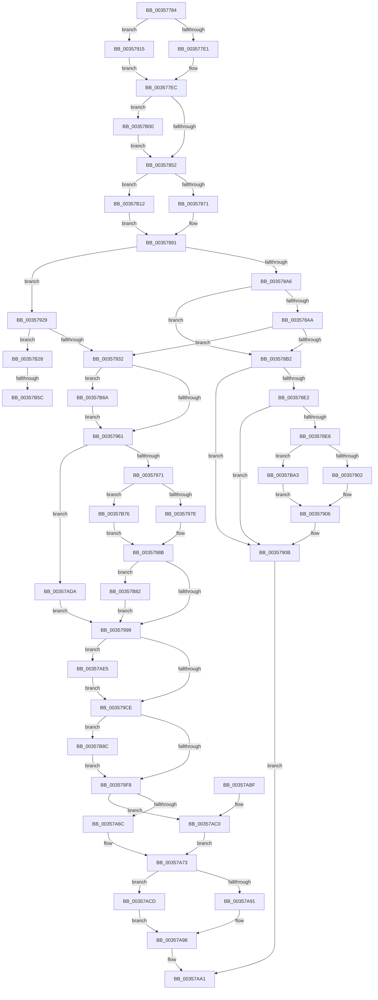

# CcWriteBehindPreProcess

- RVA: `0x00357784`–`0x00357BAC` (길이 `1,064` bytes)
- VA: `0x0000000140357784`
- 실행 섹션: `.text`
- PDB 이름 있음: `예`; PDB Function 태그: `예`
- unwind 정보 RVA: `0x00079648`
- 디코드: `232`개 명령, `1,064/1,064` bytes 표시
- 미해석 바이트: `0` (있으면 어셈블리에 `.byte`로 보존)

> 이 문서는 커널 이미지의 기계어와 PDB 기호를 분석해 생성했습니다. 4번과 5번은 함수 원형과 자료형을 바이너리 사용 방식에서 추정한 C 해석이며 원본 소스 복구 결과는 아닙니다.

## 1. Dependencies

- 직접 호출 지점: **20**; 고유 호출 대상: **9**
- 직접 호출자로 확인된 함수: **3**
- RIP 상대 이미지 참조: **1**

### Outgoing calls
- `0x003577FE` → [KeAcquireInStackQueuedSpinLock](../27/KeAcquireInStackQueuedSpinLock_function_002757A0.md) (function, `0x002757A0`)
- `0x00357815` → [KeReleaseInStackQueuedSpinLock](../34/KeReleaseInStackQueuedSpinLock_function_00342CE0.md) (function, `0x00342CE0`)
- `0x00357822` → [CcApplyLowIoPriorityToThread](../4A/CcApplyLowIoPriorityToThread_function_004A4210.md) (function, `0x004A4210`)
- `0x00357832` → [KeAcquireInStackQueuedSpinLock](../27/KeAcquireInStackQueuedSpinLock_function_002757A0.md) (function, `0x002757A0`)
- `0x0035783A` → [CcIsWriteBehindThreadpoolAtLowPriority](CcIsWriteBehindThreadpoolAtLowPriority_function_003570DC.md) (function, `0x003570DC`)
- `0x00357845` → [KeReleaseInStackQueuedSpinLock](../34/KeReleaseInStackQueuedSpinLock_function_00342CE0.md) (function, `0x00342CE0`)
- `0x0035788C` → [guard_dispatch_icall](../6B/guard_dispatch_icall_function_006BAAD0.md) (function, `0x006BAAD0`)
- `0x003578BD` → [KeAcquireInStackQueuedSpinLock](../27/KeAcquireInStackQueuedSpinLock_function_002757A0.md) (function, `0x002757A0`)
- `0x003578C5` → [CcDecrementOpenCount](../38/CcDecrementOpenCount_function_0038B75C.md) (function, `0x0038B75C`)
- `0x003578CE` → [KeReleaseInStackQueuedSpinLock](../34/KeReleaseInStackQueuedSpinLock_function_00342CE0.md) (function, `0x00342CE0`)
- `0x00357906` → [guard_dispatch_icall](../6B/guard_dispatch_icall_function_006BAAD0.md) (function, `0x006BAAD0`)
- `0x0035793C` → [ExAcquireFastMutex](../20/ExAcquireFastMutex_function_0020E5A0.md) (function, `0x0020E5A0`)
- `0x0035794C` → [KeAcquireInStackQueuedSpinLock](../27/KeAcquireInStackQueuedSpinLock_function_002757A0.md) (function, `0x002757A0`)
- `0x003579B3` → [KeReleaseInStackQueuedSpinLock](../34/KeReleaseInStackQueuedSpinLock_function_00342CE0.md) (function, `0x00342CE0`)
- `0x003579BB` → [ExReleaseFastMutex](../25/ExReleaseFastMutex_function_002519C0.md) (function, `0x002519C0`)
- `0x00357B08` → [CcApplyLowIoPriorityToThread](../4A/CcApplyLowIoPriorityToThread_function_004A4210.md) (function, `0x004A4210`)
- `0x00357B1E` → [guard_dispatch_icall](../6B/guard_dispatch_icall_function_006BAAD0.md) (function, `0x006BAAD0`)
- `0x00357B30` → [CcApplyLowIoPriorityToThread](../4A/CcApplyLowIoPriorityToThread_function_004A4210.md) (function, `0x004A4210`)
- `0x00357B40` → [KeAcquireInStackQueuedSpinLock](../27/KeAcquireInStackQueuedSpinLock_function_002757A0.md) (function, `0x002757A0`)
- `0x00357B5F` → [CcCancelMmWaitForUninitializeCacheMap](../4F/CcCancelMmWaitForUninitializeCacheMap_function_004F998C.md) (function, `0x004F998C`)

### Direct callers
- [CcWriteBehindAsync](CcWriteBehindAsync_function_003549E8.md) at `0x00354A38`
- [CcWriteBehindInternal](CcWriteBehindInternal_function_00357540.md) at `0x00357590`
- [CcWriteBehindAsyncPreProcess](../57/CcWriteBehindAsyncPreProcess_function_0057FB6C.md) at `0x0057FC2B`

### Static image references
- `0x00357971` → RVA `0x00E65B88` (`.data`; read)

## 2. Other-region calls and transfers

- 다른 실행 섹션으로 향하는 call: **0**
- call이 아닌 외부 분기/꼬리 이동: **2**
  - `0x00357B56` → [sub_006E2AF2](../6E/Unknown_function_006E2AF2.md) (`tail-transfer`)
  - `0x00357B65` → [sub_006E2AF2](../6E/Unknown_function_006E2AF2.md) (`tail-transfer`)

## 3. Assembly (complete function range)

```asm
00357784  48 89 5C 24 10                  mov qword ptr [rsp + 0x10], rbx
00357789  48 89 74 24 18                  mov qword ptr [rsp + 0x18], rsi
0035778E  48 89 7C 24 20                  mov qword ptr [rsp + 0x20], rdi
00357793  55                              push rbp
00357794  41 54                           push r12
00357796  41 55                           push r13
00357798  41 56                           push r14
0035779A  41 57                           push r15
0035779C  48 8B EC                        mov rbp, rsp
0035779F  48 83 EC 50                     sub rsp, 0x50
003577A3  4C 8B B1 08 01 00 00            mov r14, qword ptr [rcx + 0x108]
003577AA  33 C0                           xor eax, eax
003577AC  48 89 45 E0                     mov qword ptr [rbp - 0x20], rax
003577B0  45 33 E4                        xor r12d, r12d
003577B3  48 89 45 F8                     mov qword ptr [rbp - 8], rax
003577B7  0F 57 C0                        xorps xmm0, xmm0
003577BA  48 8B 41 70                     mov rax, qword ptr [rcx + 0x70]
003577BE  0F 57 C9                        xorps xmm1, xmm1
003577C1  0F 11 45 D0                     movups xmmword ptr [rbp - 0x30], xmm0
003577C5  48 8B F1                        mov rsi, rcx
003577C8  45 8A EC                        mov r13b, r12b
003577CB  0F 11 4D E8                     movups xmmword ptr [rbp - 0x18], xmm1
003577CF  41 83 BE 80 00 00 00 02         cmp dword ptr [r14 + 0x80], 2
003577D7  48 89 45 30                     mov qword ptr [rbp + 0x30], rax
003577DB  0F 84 34 01 00 00               je 0x140357915
003577E1  49 8B 7E 18                     mov rdi, qword ptr [r14 + 0x18]
003577E5  4D 8B BE 88 00 00 00            mov r15, qword ptr [r14 + 0x88]
003577EC  44 88 A1 88 00 00 00            mov byte ptr [rcx + 0x88], r12b
003577F3  48 8D 55 D0                     lea rdx, [rbp - 0x30]
003577F7  49 8D 8F 00 03 00 00            lea rcx, [r15 + 0x300]
003577FE  E8 9D DF F1 FF                  call 0x1402757a0
00357803  8B 47 04                        mov eax, dword ptr [rdi + 4]
00357806  48 8D 4D D0                     lea rcx, [rbp - 0x30]
0035780A  FF C0                           inc eax
0035780C  89 47 04                        mov dword ptr [rdi + 4], eax
0035780F  FF 87 20 02 00 00               inc dword ptr [rdi + 0x220]
00357815  E8 C6 B4 FE FF                  call 0x140342ce0
0035781A  4C 8B C7                        mov r8, rdi
0035781D  B2 01                           mov dl, 1
0035781F  49 8B CF                        mov rcx, r15
00357822  E8 E9 C9 14 00                  call 0x1404a4210
00357827  49 8D 8F 40 03 00 00            lea rcx, [r15 + 0x340]
0035782E  48 8D 55 E8                     lea rdx, [rbp - 0x18]
00357832  E8 69 DF F1 FF                  call 0x1402757a0
00357837  49 8B CF                        mov rcx, r15
0035783A  E8 9D F8 FF FF                  call 0x1403570dc
0035783F  48 8D 4D E8                     lea rcx, [rbp - 0x18]
00357843  8A D8                           mov bl, al
00357845  E8 96 B4 FE FF                  call 0x140342ce0
0035784A  84 DB                           test bl, bl
0035784C  0F 84 AE 02 00 00               je 0x140357b00
00357852  48 8D 9E 8C 00 00 00            lea rbx, [rsi + 0x8c]
00357859  44 89 23                        mov dword ptr [rbx], r12d
0035785C  8B 87 9C 00 00 00               mov eax, dword ptr [rdi + 0x9c]
00357862  48 8B 8F D8 00 00 00            mov rcx, qword ptr [rdi + 0xd8]
00357869  A8 01                           test al, 1
0035786B  0F 84 A1 02 00 00               je 0x140357b12
00357871  44 38 A6 8B 00 00 00            cmp byte ptr [rsi + 0x8b], r12b
00357878  41 8B D4                        mov edx, r12d
0035787B  48 8B 41 08                     mov rax, qword ptr [rcx + 8]
0035787F  4C 8B C3                        mov r8, rbx
00357882  48 8B 8F E0 00 00 00            mov rcx, qword ptr [rdi + 0xe0]
00357889  0F 94 C2                        sete dl
0035788C  E8 3F 32 36 00                  call 0x1406baad0
00357891  8A 1B                           mov bl, byte ptr [rbx]
00357893  44 8A E0                        mov r12b, al
00357896  80 E3 01                        and bl, 1
00357899  80 BE 8B 00 00 00 00            cmp byte ptr [rsi + 0x8b], 0
003578A0  0F 85 83 00 00 00               jne 0x140357929
003578A6  84 C0                           test al, al
003578A8  74 08                           je 0x1403578b2
003578AA  84 DB                           test bl, bl
003578AC  0F 85 80 00 00 00               jne 0x140357932
003578B2  48 8D 55 D0                     lea rdx, [rbp - 0x30]
003578B6  49 8D 8F 00 03 00 00            lea rcx, [r15 + 0x300]
003578BD  E8 DE DE F1 FF                  call 0x1402757a0
003578C2  48 8B CF                        mov rcx, rdi
003578C5  E8 92 3E 03 00                  call 0x14038b75c
003578CA  48 8D 4D D0                     lea rcx, [rbp - 0x30]
003578CE  E8 0D B4 FE FF                  call 0x140342ce0
003578D3  48 8B 45 30                     mov rax, qword ptr [rbp + 0x30]
003578D7  C7 00 54 00 00 C0               mov dword ptr [rax], 0xc0000054
003578DD  45 84 E4                        test r12b, r12b
003578E0  74 29                           je 0x14035790b
003578E2  84 DB                           test bl, bl
003578E4  75 25                           jne 0x14035790b
003578E6  8B 87 9C 00 00 00               mov eax, dword ptr [rdi + 0x9c]
003578EC  48 8B 97 D8 00 00 00            mov rdx, qword ptr [rdi + 0xd8]
003578F3  48 8B 8F E0 00 00 00            mov rcx, qword ptr [rdi + 0xe0]
003578FA  A8 01                           test al, 1
003578FC  0F 84 A1 02 00 00               je 0x140357ba3
00357902  48 8B 42 10                     mov rax, qword ptr [rdx + 0x10]
00357906  E8 C5 31 36 00                  call 0x1406baad0
0035790B  B8 02 00 00 00                  mov eax, 2
00357910  E9 8C 01 00 00                  jmp 0x140357aa1
00357915  49 8B 7E 10                     mov rdi, qword ptr [r14 + 0x10]
00357919  45 8A 6E 38                     mov r13b, byte ptr [r14 + 0x38]
0035791D  4C 8B BF 18 02 00 00            mov r15, qword ptr [rdi + 0x218]
00357924  E9 C3 FE FF FF                  jmp 0x1403577ec
00357929  45 84 E4                        test r12b, r12b
0035792C  0F 84 F6 01 00 00               je 0x140357b28
00357932  48 8D 9F 20 01 00 00            lea rbx, [rdi + 0x120]
00357939  48 8B CB                        mov rcx, rbx
0035793C  E8 5F 6C EB FF                  call 0x14020e5a0
00357941  48 8D 55 D0                     lea rdx, [rbp - 0x30]
00357945  49 8D 8F 00 03 00 00            lea rcx, [r15 + 0x300]
0035794C  E8 4F DE F1 FF                  call 0x1402757a0
00357951  F7 87 98 00 00 00 00 00 01 00   test dword ptr [rdi + 0x98], 0x10000
0035795B  0F 85 09 02 00 00               jne 0x140357b6a
00357961  48 8B 97 A8 00 00 00            mov rdx, qword ptr [rdi + 0xa8]
00357968  48 85 D2                        test rdx, rdx
0035796B  0F 84 69 01 00 00               je 0x140357ada
00357971  80 3D 10 E2 B0 00 00            cmp byte ptr [rip + 0xb0e210], 0
00357978  0F 84 F8 01 00 00               je 0x140357b76
0035797E  48 8B 87 58 02 00 00            mov rax, qword ptr [rdi + 0x258]
00357985  8B 88 90 03 00 00               mov ecx, dword ptr [rax + 0x390]
0035798B  8B 42 08                        mov eax, dword ptr [rdx + 8]
0035798E  89 42 04                        mov dword ptr [rdx + 4], eax
00357991  3B C1                           cmp eax, ecx
00357993  0F 87 E9 01 00 00               ja 0x140357b82
00357999  89 86 FC 00 00 00               mov dword ptr [rsi + 0xfc], eax
0035799F  48 8D 4D D0                     lea rcx, [rbp - 0x30]
003579A3  48 8B 47 60                     mov rax, qword ptr [rdi + 0x60]
003579A7  48 83 E0 F0                     and rax, 0xfffffffffffffff0
003579AB  48 8B 40 28                     mov rax, qword ptr [rax + 0x28]
003579AF  48 89 46 18                     mov qword ptr [rsi + 0x18], rax
003579B3  E8 28 B3 FE FF                  call 0x140342ce0
003579B8  48 8B CB                        mov rcx, rbx
003579BB  E8 00 A0 EF FF                  call 0x1402519c0
003579C0  0F BA A7 98 00 00 00 18         bt dword ptr [rdi + 0x98], 0x18
003579C8  0F 82 17 01 00 00               jb 0x140357ae5
003579CE  48 8B 8F 00 02 00 00            mov rcx, qword ptr [rdi + 0x200]
003579D5  41 BA CC 00 00 00               mov r10d, 0xcc
003579DB  8B 86 FC 00 00 00               mov eax, dword ptr [rsi + 0xfc]
003579E1  F0 42 01 04 11                  lock add dword ptr [rcx + r10], eax
003579E6  0F BA A7 98 00 00 00 18         bt dword ptr [rdi + 0x98], 0x18
003579EE  45 8D 4A 04                     lea r9d, [r10 + 4]
003579F2  0F 82 94 01 00 00               jb 0x140357b8c
003579F8  4C 8B 87 00 02 00 00            mov r8, qword ptr [rdi + 0x200]
003579FF  41 8B 88 CC 00 00 00            mov ecx, dword ptr [r8 + 0xcc]
00357A06  49 8B 80 28 01 00 00            mov rax, qword ptr [r8 + 0x128]
00357A0D  48 03 C8                        add rcx, rax
00357A10  49 89 88 28 01 00 00            mov qword ptr [r8 + 0x128], rcx
00357A17  49 8B 80 38 01 00 00            mov rax, qword ptr [r8 + 0x138]
00357A1E  48 FF C0                        inc rax
00357A21  49 89 80 38 01 00 00            mov qword ptr [r8 + 0x138], rax
00357A28  48 8B 87 00 02 00 00            mov rax, qword ptr [rdi + 0x200]
00357A2F  42 8B 0C 08                     mov ecx, dword ptr [rax + r9]
00357A33  49 8B 80 40 01 00 00            mov rax, qword ptr [r8 + 0x140]
00357A3A  48 03 C8                        add rcx, rax
00357A3D  49 89 88 40 01 00 00            mov qword ptr [r8 + 0x140], rcx
00357A44  49 8B 80 50 01 00 00            mov rax, qword ptr [r8 + 0x150]
00357A4B  48 FF C0                        inc rax
00357A4E  49 89 80 50 01 00 00            mov qword ptr [r8 + 0x150], rax
00357A55  49 8B 90 30 01 00 00            mov rdx, qword ptr [r8 + 0x130]
00357A5C  48 8B 87 00 02 00 00            mov rax, qword ptr [rdi + 0x200]
00357A63  42 8B 04 10                     mov eax, dword ptr [rax + r10]
00357A67  48 3B D0                        cmp rdx, rax
00357A6A  76 54                           jbe 0x140357ac0
00357A6C  49 8B 80 30 01 00 00            mov rax, qword ptr [r8 + 0x130]
00357A73  49 89 80 30 01 00 00            mov qword ptr [r8 + 0x130], rax
00357A7A  49 8B 90 48 01 00 00            mov rdx, qword ptr [r8 + 0x148]
00357A81  48 8B 87 00 02 00 00            mov rax, qword ptr [rdi + 0x200]
00357A88  42 8B 04 08                     mov eax, dword ptr [rax + r9]
00357A8C  48 3B D0                        cmp rdx, rax
00357A8F  76 3C                           jbe 0x140357acd
00357A91  49 8B 80 48 01 00 00            mov rax, qword ptr [r8 + 0x148]
00357A98  49 89 80 48 01 00 00            mov qword ptr [r8 + 0x148], rax
00357A9F  33 C0                           xor eax, eax
00357AA1  4C 8D 5C 24 50                  lea r11, [rsp + 0x50]
00357AA6  49 8B 5B 38                     mov rbx, qword ptr [r11 + 0x38]
00357AAA  49 8B 73 40                     mov rsi, qword ptr [r11 + 0x40]
00357AAE  49 8B 7B 48                     mov rdi, qword ptr [r11 + 0x48]
00357AB2  49 8B E3                        mov rsp, r11
00357AB5  41 5F                           pop r15
00357AB7  41 5E                           pop r14
00357AB9  41 5D                           pop r13
00357ABB  41 5C                           pop r12
00357ABD  5D                              pop rbp
00357ABE  C3                              ret
00357ABF  CC                              int3
00357AC0  48 8B 87 00 02 00 00            mov rax, qword ptr [rdi + 0x200]
00357AC7  42 8B 04 10                     mov eax, dword ptr [rax + r10]
00357ACB  EB A6                           jmp 0x140357a73
00357ACD  48 8B 87 00 02 00 00            mov rax, qword ptr [rdi + 0x200]
00357AD4  42 8B 04 08                     mov eax, dword ptr [rax + r9]
00357AD8  EB BE                           jmp 0x140357a98
00357ADA  8B 87 C8 00 00 00               mov eax, dword ptr [rdi + 0xc8]
00357AE0  E9 B4 FE FF FF                  jmp 0x140357999
00357AE5  48 8B 87 F8 00 00 00            mov rax, qword ptr [rdi + 0xf8]
00357AEC  48 8D 4E 50                     lea rcx, [rsi + 0x50]
00357AF0  48 8B 40 70                     mov rax, qword ptr [rax + 0x70]
00357AF4  48 89 01                        mov qword ptr [rcx], rax
00357AF7  48 89 4E 58                     mov qword ptr [rsi + 0x58], rcx
00357AFB  E9 CE FE FF FF                  jmp 0x1403579ce
00357B00  4C 8B C7                        mov r8, rdi
00357B03  33 D2                           xor edx, edx
00357B05  49 8B CF                        mov rcx, r15
00357B08  E8 03 C7 14 00                  call 0x1404a4210
00357B0D  E9 40 FD FF FF                  jmp 0x140357852
00357B12  48 8B 01                        mov rax, qword ptr [rcx]
00357B15  B2 01                           mov dl, 1
00357B17  48 8B 8F E0 00 00 00            mov rcx, qword ptr [rdi + 0xe0]
00357B1E  E8 AD 2F 36 00                  call 0x1406baad0
00357B23  E9 69 FD FF FF                  jmp 0x140357891
00357B28  4C 8B C7                        mov r8, rdi
00357B2B  33 D2                           xor edx, edx
00357B2D  49 8B CF                        mov rcx, r15
00357B30  E8 DB C6 14 00                  call 0x1404a4210
00357B35  48 8D 55 D0                     lea rdx, [rbp - 0x30]
00357B39  49 8D 8F 00 03 00 00            lea rcx, [r15 + 0x300]
00357B40  E8 5B DC F1 FF                  call 0x1402757a0
00357B45  83 A7 98 00 00 00 DF            and dword ptr [rdi + 0x98], 0xffffffdf
00357B4C  F7 87 98 00 00 00 00 00 01 00   test dword ptr [rdi + 0x98], 0x10000
00357B56  0F 84 96 AF 38 00               je 0x1406e2af2
00357B5C  48 8B CF                        mov rcx, rdi
00357B5F  E8 28 1E 1A 00                  call 0x1404f998c
00357B64  90                              nop
00357B65  E9 88 AF 38 00                  jmp 0x1406e2af2
00357B6A  C6 86 88 00 00 00 01            mov byte ptr [rsi + 0x88], 1
00357B71  E9 EB FD FF FF                  jmp 0x140357961
00357B76  41 8B 8F D0 03 00 00            mov ecx, dword ptr [r15 + 0x3d0]
00357B7D  E9 09 FE FF FF                  jmp 0x14035798b
00357B82  89 4A 04                        mov dword ptr [rdx + 4], ecx
00357B85  8B C1                           mov eax, ecx
00357B87  E9 0D FE FF FF                  jmp 0x140357999
00357B8C  48 8B 8F 00 02 00 00            mov rcx, qword ptr [rdi + 0x200]
00357B93  8B 86 FC 00 00 00               mov eax, dword ptr [rsi + 0xfc]
00357B99  F0 42 01 04 09                  lock add dword ptr [rcx + r9], eax
00357B9E  E9 55 FE FF FF                  jmp 0x1403579f8
00357BA3  48 8B 42 08                     mov rax, qword ptr [rdx + 8]
00357BA7  E9 5A FD FF FF                  jmp 0x140357906
```

## 4. C-style interpretation (structured pseudocode)

```c
__int64 __fastcall CcWriteBehindPreProcess(__int64 a1)
{
    __int64 result;
    __int64 v_r12;
    __int64 v_rbx;
    __int64 v_rsp;
    unsigned __int64 v_stack_m28;
    unsigned __int64 v_stack_m30;
    unsigned __int64 v_stack_m40;
    unsigned __int64 v_stack_m48;
    unsigned __int64 v_stack_m58;
    unsigned __int64 v_stack_p10;
    unsigned __int64 v_stack_p18;
    unsigned __int64 v_stack_p20;
    unsigned __int64 v_stack_p8;

    v_stack_p10 = v_rbx;
    v_stack_p18 = v_rsi;
    v_stack_p20 = v_rdi;
    v_rsp = (v_rsp) - (80);
    result = 0;
    v_stack_m48 = 0;
    v_r12 = 0;
    v_stack_m30 = 0;
    v_stack_m58 = v_xmm0;
    v_stack_m40 = v_xmm1;
    v_stack_p8 = *(unsigned __int64 *)(a1 + 112);
    if ((*(unsigned int *)(*(unsigned __int64 *)(a1 + 264) + 128)) == 2) goto loc_00357915;
loc_003577EC:
    *(unsigned __int8 *)(a1 + 136) = 0;
    result = KeAcquireInStackQueuedSpinLock(*(unsigned __int64 *)(*(unsigned __int64 *)(a1 + 264) + 136) + 768, v_stack_m58, a3, a4);
    result = (unsigned int)(((unsigned int)(*(unsigned int *)(*(unsigned __int64 *)(*(unsigned __int64 *)(a1 + 264) + 24) + 4))) + 1);
    *(unsigned int *)(*(unsigned __int64 *)(*(unsigned __int64 *)(a1 + 264) + 24) + 4) = (unsigned int)(result);
    result = KeReleaseInStackQueuedSpinLock(v_stack_m58, v_stack_m58, a3, a4);
    result = CcApplyLowIoPriorityToThread(*(unsigned __int64 *)(*(unsigned __int64 *)(a1 + 264) + 136), 1, *(unsigned __int64 *)(*(unsigned __int64 *)(a1 + 264) + 24), a4);
    result = KeAcquireInStackQueuedSpinLock(*(unsigned __int64 *)(*(unsigned __int64 *)(a1 + 264) + 136) + 832, v_stack_m40, *(unsigned __int64 *)(*(unsigned __int64 *)(a1 + 264) + 24), a4);
    result = CcIsWriteBehindThreadpoolAtLowPriority(*(unsigned __int64 *)(*(unsigned __int64 *)(a1 + 264) + 136), v_stack_m40, *(unsigned __int64 *)(*(unsigned __int64 *)(a1 + 264) + 24), a4);
    result = KeReleaseInStackQueuedSpinLock(v_stack_m40, v_stack_m40, *(unsigned __int64 *)(*(unsigned __int64 *)(a1 + 264) + 24), a4);
    if ((unsigned __int8)((unsigned __int8)(result)) == 0) goto loc_00357B00;
loc_00357852:
    *(unsigned int *)(a1 + 140) = 0;
    if ((((unsigned __int8)((unsigned int)(*(unsigned int *)(*(unsigned __int64 *)(*(unsigned __int64 *)(a1 + 264) + 24) + 156)))) & (1)) == 0) goto loc_00357B12;
    a2 = ((*(unsigned __int8 *)(a1 + 139)) == 0) ? 1 : 0;
    result = guard_dispatch_icall(*(unsigned __int64 *)(*(unsigned __int64 *)(*(unsigned __int64 *)(a1 + 264) + 24) + 224), a2, a1 + 140, a4);
loc_00357891:
    v_rbx = (unsigned __int8)((*(unsigned __int8 *)(a1 + 140)) & (1));
    if ((*(unsigned __int8 *)(a1 + 139)) != 0) goto loc_00357929;
    if ((unsigned __int8)(result) == 0) goto loc_003578B2;
    if ((unsigned __int8)(v_rbx) != 0) goto loc_00357932;
loc_003578B2:
    result = KeAcquireInStackQueuedSpinLock(*(unsigned __int64 *)(*(unsigned __int64 *)(a1 + 264) + 136) + 768, v_stack_m58, a1 + 140, a4);
    result = CcDecrementOpenCount(*(unsigned __int64 *)(*(unsigned __int64 *)(a1 + 264) + 24), v_stack_m58, a1 + 140, a4);
    result = KeReleaseInStackQueuedSpinLock(v_stack_m58, v_stack_m58, a1 + 140, a4);
    *(unsigned int *)(v_stack_p8) = 0xC0000054ULL;
    if ((unsigned __int8)((unsigned __int8)(result)) == 0) goto loc_0035790B;
    if ((unsigned __int8)(v_rbx) != 0) goto loc_0035790B;
    if ((((unsigned __int8)((unsigned int)(*(unsigned int *)(*(unsigned __int64 *)(*(unsigned __int64 *)(a1 + 264) + 24) + 156)))) & (1)) == 0) goto loc_00357BA3;
loc_00357906:
    result = guard_dispatch_icall(*(unsigned __int64 *)(*(unsigned __int64 *)(*(unsigned __int64 *)(a1 + 264) + 24) + 224), *(unsigned __int64 *)(*(unsigned __int64 *)(*(unsigned __int64 *)(a1 + 264) + 24) + 216), a1 + 140, a4);
loc_0035790B:
    goto loc_00357AA1;
loc_00357915:
    goto loc_003577EC;
loc_00357929:
    if ((unsigned __int8)((unsigned __int8)(result)) == 0) goto loc_00357B28;
loc_00357932:
    result = ExAcquireFastMutex(*(unsigned __int64 *)(*(unsigned __int64 *)(a1 + 264) + 16) + 288, *(unsigned __int64 *)(*(unsigned __int64 *)(*(unsigned __int64 *)(a1 + 264) + 24) + 216), a1 + 140, a4);
    result = KeAcquireInStackQueuedSpinLock(*(unsigned __int64 *)(*(unsigned __int64 *)(*(unsigned __int64 *)(a1 + 264) + 16) + 536) + 768, v_stack_m58, a1 + 140, a4);
    if (((*(unsigned int *)(*(unsigned __int64 *)(*(unsigned __int64 *)(a1 + 264) + 16) + 152)) & (0x10000ULL)) != 0) goto loc_00357B6A;
loc_00357961:
    if (*(unsigned __int64 *)(*(unsigned __int64 *)(*(unsigned __int64 *)(a1 + 264) + 16) + 168) == 0) goto loc_00357ADA;
    if ((*(unsigned __int8 *)(v_rip + 11592208)) == 0) goto loc_00357B76;
loc_0035798B:
    *(unsigned int *)(*(unsigned __int64 *)(*(unsigned __int64 *)(*(unsigned __int64 *)(a1 + 264) + 16) + 168) + 4) = (unsigned int)((unsigned int)(*(unsigned int *)(*(unsigned __int64 *)(*(unsigned __int64 *)(*(unsigned __int64 *)(a1 + 264) + 16) + 168) + 8)));
    if (((unsigned int)((unsigned int)(*(unsigned int *)(*(unsigned __int64 *)(*(unsigned __int64 *)(*(unsigned __int64 *)(a1 + 264) + 16) + 168) + 8)))) > ((unsigned int)((unsigned int)(*(unsigned int *)(*(unsigned __int64 *)(*(unsigned __int64 *)(*(unsigned __int64 *)(a1 + 264) + 16) + 600) + 912))))) goto loc_00357B82;
loc_00357999:
    *(unsigned int *)(a1 + 252) = (unsigned int)((unsigned int)(*(unsigned int *)(*(unsigned __int64 *)(*(unsigned __int64 *)(*(unsigned __int64 *)(a1 + 264) + 16) + 168) + 8)));
    result = (*(unsigned __int64 *)(*(unsigned __int64 *)(*(unsigned __int64 *)(a1 + 264) + 16) + 96)) & (-16);
    *(unsigned __int64 *)(a1 + 24) = *(unsigned __int64 *)(result + 40);
    result = KeReleaseInStackQueuedSpinLock(v_stack_m58, *(unsigned __int64 *)(*(unsigned __int64 *)(*(unsigned __int64 *)(a1 + 264) + 16) + 168), a1 + 140, a4);
    result = ExReleaseFastMutex(*(unsigned __int64 *)(*(unsigned __int64 *)(a1 + 264) + 16) + 288, *(unsigned __int64 *)(*(unsigned __int64 *)(*(unsigned __int64 *)(a1 + 264) + 16) + 168), a1 + 140, a4);
    if (condition_is_below) goto loc_00357AE5;
loc_003579CE:
    if (condition_is_below) goto loc_00357B8C;
loc_003579F8:
    a1 = ((unsigned int)(*(unsigned int *)(*(unsigned __int64 *)(*(unsigned __int64 *)(*(unsigned __int64 *)(a1 + 264) + 16) + 512) + 204))) + (*(unsigned __int64 *)(*(unsigned __int64 *)(*(unsigned __int64 *)(*(unsigned __int64 *)(a1 + 264) + 16) + 512) + 296));
    *(unsigned __int64 *)(*(unsigned __int64 *)(*(unsigned __int64 *)(*(unsigned __int64 *)(a1 + 264) + 16) + 512) + 296) = a1;
    result = (*(unsigned __int64 *)(*(unsigned __int64 *)(*(unsigned __int64 *)(*(unsigned __int64 *)(a1 + 264) + 16) + 512) + 312)) + 1;
    *(unsigned __int64 *)(*(unsigned __int64 *)(*(unsigned __int64 *)(*(unsigned __int64 *)(a1 + 264) + 16) + 512) + 312) = result;
    a1 = ((unsigned int)(*(unsigned int *)(*(unsigned __int64 *)(*(unsigned __int64 *)(*(unsigned __int64 *)(a1 + 264) + 16) + 512) + 204 + 4 * 1))) + (*(unsigned __int64 *)(*(unsigned __int64 *)(*(unsigned __int64 *)(*(unsigned __int64 *)(a1 + 264) + 16) + 512) + 320));
    *(unsigned __int64 *)(*(unsigned __int64 *)(*(unsigned __int64 *)(*(unsigned __int64 *)(a1 + 264) + 16) + 512) + 320) = a1;
    result = (*(unsigned __int64 *)(*(unsigned __int64 *)(*(unsigned __int64 *)(*(unsigned __int64 *)(a1 + 264) + 16) + 512) + 336)) + 1;
    *(unsigned __int64 *)(*(unsigned __int64 *)(*(unsigned __int64 *)(*(unsigned __int64 *)(a1 + 264) + 16) + 512) + 336) = result;
    if ((*(unsigned __int64 *)(*(unsigned __int64 *)(*(unsigned __int64 *)(*(unsigned __int64 *)(a1 + 264) + 16) + 512) + 304)) <= ((unsigned int)(*(unsigned int *)(*(unsigned __int64 *)(*(unsigned __int64 *)(*(unsigned __int64 *)(a1 + 264) + 16) + 512) + 204 * 1)))) goto loc_00357AC0;
loc_00357A73:
    *(unsigned __int64 *)(*(unsigned __int64 *)(*(unsigned __int64 *)(*(unsigned __int64 *)(a1 + 264) + 16) + 512) + 304) = *(unsigned __int64 *)(*(unsigned __int64 *)(*(unsigned __int64 *)(*(unsigned __int64 *)(a1 + 264) + 16) + 512) + 304);
    if ((*(unsigned __int64 *)(*(unsigned __int64 *)(*(unsigned __int64 *)(*(unsigned __int64 *)(a1 + 264) + 16) + 512) + 328)) <= ((unsigned int)(*(unsigned int *)(*(unsigned __int64 *)(*(unsigned __int64 *)(*(unsigned __int64 *)(a1 + 264) + 16) + 512) + 204 + 4 * 1)))) goto loc_00357ACD;
loc_00357A98:
    *(unsigned __int64 *)(*(unsigned __int64 *)(*(unsigned __int64 *)(*(unsigned __int64 *)(a1 + 264) + 16) + 512) + 328) = *(unsigned __int64 *)(*(unsigned __int64 *)(*(unsigned __int64 *)(*(unsigned __int64 *)(a1 + 264) + 16) + 512) + 328);
    result = 0;
loc_00357AA1:
    return result;
loc_00357AC0:
    goto loc_00357A73;
loc_00357ACD:
    goto loc_00357A98;
loc_00357ADA:
    goto loc_00357999;
loc_00357AE5:
    *(unsigned __int64 *)(*(unsigned __int64 *)(v_stack_m28 + 64) + 80) = *(unsigned __int64 *)(*(unsigned __int64 *)(*(unsigned __int64 *)(v_stack_m28 + 72) + 248) + 112);
    *(unsigned __int64 *)(*(unsigned __int64 *)(v_stack_m28 + 64) + 88) = *(unsigned __int64 *)(v_stack_m28 + 64) + 80;
    goto loc_003579CE;
loc_00357B00:
    a2 = 0;
    result = CcApplyLowIoPriorityToThread(*(unsigned __int64 *)(*(unsigned __int64 *)(*(unsigned __int64 *)(a1 + 264) + 16) + 536), a2, *(unsigned __int64 *)(v_stack_m28 + 72), 204 + 4);
    goto loc_00357852;
loc_00357B12:
    result = guard_dispatch_icall(*(unsigned __int64 *)(*(unsigned __int64 *)(v_stack_m28 + 72) + 224), 1, *(unsigned __int64 *)(v_stack_m28 + 72), 204 + 4);
    goto loc_00357891;
loc_00357B28:
    a2 = 0;
    result = CcApplyLowIoPriorityToThread(*(unsigned __int64 *)(*(unsigned __int64 *)(*(unsigned __int64 *)(a1 + 264) + 16) + 536), a2, *(unsigned __int64 *)(v_stack_m28 + 72), 204 + 4);
    result = KeAcquireInStackQueuedSpinLock(*(unsigned __int64 *)(*(unsigned __int64 *)(*(unsigned __int64 *)(a1 + 264) + 16) + 536) + 768, v_stack_m58, *(unsigned __int64 *)(v_stack_m28 + 72), 204 + 4);
    result = CcCancelMmWaitForUninitializeCacheMap(*(unsigned __int64 *)(v_stack_m28 + 72), v_stack_m58, *(unsigned __int64 *)(v_stack_m28 + 72), 204 + 4);
loc_00357B6A:
    *(unsigned __int8 *)(*(unsigned __int64 *)(v_stack_m28 + 64) + 136) = 1;
    goto loc_00357961;
loc_00357B76:
    goto loc_0035798B;
loc_00357B82:
    *(unsigned int *)(v_stack_m58 + 4) = (unsigned int)((unsigned int)(*(unsigned int *)(*(unsigned __int64 *)(*(unsigned __int64 *)(*(unsigned __int64 *)(a1 + 264) + 16) + 536) + 976)));
    goto loc_00357999;
loc_00357B8C:
    goto loc_003579F8;
loc_00357BA3:
    goto loc_00357906;
}
```

## 5. (Beta) C Style

```c
int64_t CcWriteBehindPreProcess(void *Arg1)
{
    uint8_t *arg1 = (uint8_t *)Arg1;

    int64_t result;
    int64_t local_r12;
    int64_t local_rbx;
    int64_t local_rsp;
    uint64_t v_stack_m28;
    uint64_t v_stack_m30;
    uint64_t v_stack_m40;
    uint64_t v_stack_m48;
    uint64_t v_stack_m58;
    uint64_t v_stack_p10;
    uint64_t v_stack_p18;
    uint64_t v_stack_p20;
    uint64_t v_stack_p8;

    v_stack_p10 = local_rbx;
    v_stack_p18 = local_rsi;
    v_stack_p20 = local_rdi;
    local_rsp = (local_rsp) - (80);
    result = 0;
    v_stack_m48 = 0;
    local_r12 = 0;
    v_stack_m30 = 0;
    v_stack_m58 = v_xmm0;
    v_stack_m40 = v_xmm1;
    v_stack_p8 = *(uint64_t *)(arg1 + 0x70);
    if ((*(uint32_t *)(*(uint64_t *)(arg1 + 0x108) + 0x80)) == 2) goto loc_00357915;
loc_003577EC:
    *(uint8_t *)(arg1 + 0x88) = 0;
    result = KeAcquireInStackQueuedSpinLock(*(uint64_t *)(*(uint64_t *)(arg1 + 0x108) + 0x88) + 768, v_stack_m58, a3, a4);
    result = (uint32_t)(((uint32_t)(*(uint32_t *)(*(uint64_t *)(*(uint64_t *)(arg1 + 0x108) + 0x18) + 0x4))) + 1);
    *(uint32_t *)(*(uint64_t *)(*(uint64_t *)(arg1 + 0x108) + 0x18) + 0x4) = (uint32_t)(result);
    result = KeReleaseInStackQueuedSpinLock(v_stack_m58, v_stack_m58, a3, a4);
    result = CcApplyLowIoPriorityToThread(*(uint64_t *)(*(uint64_t *)(arg1 + 0x108) + 0x88), 1, *(uint64_t *)(*(uint64_t *)(arg1 + 0x108) + 0x18), a4);
    result = KeAcquireInStackQueuedSpinLock(*(uint64_t *)(*(uint64_t *)(arg1 + 0x108) + 0x88) + 832, v_stack_m40, *(uint64_t *)(*(uint64_t *)(arg1 + 0x108) + 0x18), a4);
    result = CcIsWriteBehindThreadpoolAtLowPriority(*(uint64_t *)(*(uint64_t *)(arg1 + 0x108) + 0x88), v_stack_m40, *(uint64_t *)(*(uint64_t *)(arg1 + 0x108) + 0x18), a4);
    result = KeReleaseInStackQueuedSpinLock(v_stack_m40, v_stack_m40, *(uint64_t *)(*(uint64_t *)(arg1 + 0x108) + 0x18), a4);
    if ((uint8_t)((uint8_t)(result)) == 0) goto loc_00357B00;
loc_00357852:
    *(uint32_t *)(arg1 + 0x8C) = 0;
    if ((((uint8_t)((uint32_t)(*(uint32_t *)(*(uint64_t *)(*(uint64_t *)(arg1 + 0x108) + 0x18) + 0x9C)))) & (1)) == 0) goto loc_00357B12;
    a2 = ((*(uint8_t *)(arg1 + 0x8B)) == 0) ? 1 : 0;
    result = guard_dispatch_icall(*(uint64_t *)(*(uint64_t *)(*(uint64_t *)(arg1 + 0x108) + 0x18) + 0xE0), a2, Arg1 + 140, a4);
loc_00357891:
    local_rbx = (uint8_t)((*(uint8_t *)(arg1 + 0x8C)) & (1));
    if ((*(uint8_t *)(arg1 + 0x8B)) != 0) goto loc_00357929;
    if ((uint8_t)(result) == 0) goto loc_003578B2;
    if ((uint8_t)(local_rbx) != 0) goto loc_00357932;
loc_003578B2:
    result = KeAcquireInStackQueuedSpinLock(*(uint64_t *)(*(uint64_t *)(arg1 + 0x108) + 0x88) + 768, v_stack_m58, Arg1 + 140, a4);
    result = CcDecrementOpenCount(*(uint64_t *)(*(uint64_t *)(arg1 + 0x108) + 0x18), v_stack_m58, Arg1 + 140, a4);
    result = KeReleaseInStackQueuedSpinLock(v_stack_m58, v_stack_m58, Arg1 + 140, a4);
    *(uint32_t *)(v_stack_p8) = 0xC0000054ULL;
    if ((uint8_t)((uint8_t)(result)) == 0) goto loc_0035790B;
    if ((uint8_t)(local_rbx) != 0) goto loc_0035790B;
    if ((((uint8_t)((uint32_t)(*(uint32_t *)(*(uint64_t *)(*(uint64_t *)(arg1 + 0x108) + 0x18) + 0x9C)))) & (1)) == 0) goto loc_00357BA3;
loc_00357906:
    result = guard_dispatch_icall(*(uint64_t *)(*(uint64_t *)(*(uint64_t *)(arg1 + 0x108) + 0x18) + 0xE0), *(uint64_t *)(*(uint64_t *)(*(uint64_t *)(arg1 + 0x108) + 0x18) + 0xD8), Arg1 + 140, a4);
loc_0035790B:
    goto loc_00357AA1;
loc_00357915:
    goto loc_003577EC;
loc_00357929:
    if ((uint8_t)((uint8_t)(result)) == 0) goto loc_00357B28;
loc_00357932:
    result = ExAcquireFastMutex(*(uint64_t *)(*(uint64_t *)(arg1 + 0x108) + 0x10) + 288, *(uint64_t *)(*(uint64_t *)(*(uint64_t *)(arg1 + 0x108) + 0x18) + 0xD8), Arg1 + 140, a4);
    result = KeAcquireInStackQueuedSpinLock(*(uint64_t *)(*(uint64_t *)(*(uint64_t *)(arg1 + 0x108) + 0x10) + 0x218) + 768, v_stack_m58, Arg1 + 140, a4);
    if (((*(uint32_t *)(*(uint64_t *)(*(uint64_t *)(arg1 + 0x108) + 0x10) + 0x98)) & (0x10000ULL)) != 0) goto loc_00357B6A;
loc_00357961:
    if (*(uint64_t *)(*(uint64_t *)(*(uint64_t *)(arg1 + 0x108) + 0x10) + 0xA8) == 0) goto loc_00357ADA;
    if ((*(uint8_t *)(v_rip + 0xB0E210)) == 0) goto loc_00357B76;
loc_0035798B:
    *(uint32_t *)(*(uint64_t *)(*(uint64_t *)(*(uint64_t *)(arg1 + 0x108) + 0x10) + 0xA8) + 0x4) = (uint32_t)((uint32_t)(*(uint32_t *)(*(uint64_t *)(*(uint64_t *)(*(uint64_t *)(arg1 + 0x108) + 0x10) + 0xA8) + 0x8)));
    if (((uint32_t)((uint32_t)(*(uint32_t *)(*(uint64_t *)(*(uint64_t *)(*(uint64_t *)(arg1 + 0x108) + 0x10) + 0xA8) + 0x8)))) > ((uint32_t)((uint32_t)(*(uint32_t *)(*(uint64_t *)(*(uint64_t *)(*(uint64_t *)(arg1 + 0x108) + 0x10) + 0x258) + 0x390))))) goto loc_00357B82;
loc_00357999:
    *(uint32_t *)(arg1 + 0xFC) = (uint32_t)((uint32_t)(*(uint32_t *)(*(uint64_t *)(*(uint64_t *)(*(uint64_t *)(arg1 + 0x108) + 0x10) + 0xA8) + 0x8)));
    result = (*(uint64_t *)(*(uint64_t *)(*(uint64_t *)(arg1 + 0x108) + 0x10) + 0x60)) & (-16);
    *(uint64_t *)(arg1 + 0x18) = *(uint64_t *)(result + 0x28);
    result = KeReleaseInStackQueuedSpinLock(v_stack_m58, *(uint64_t *)(*(uint64_t *)(*(uint64_t *)(arg1 + 0x108) + 0x10) + 0xA8), Arg1 + 140, a4);
    result = ExReleaseFastMutex(*(uint64_t *)(*(uint64_t *)(arg1 + 0x108) + 0x10) + 288, *(uint64_t *)(*(uint64_t *)(*(uint64_t *)(arg1 + 0x108) + 0x10) + 0xA8), Arg1 + 140, a4);
    if (condition_is_below) goto loc_00357AE5;
loc_003579CE:
    if (condition_is_below) goto loc_00357B8C;
loc_003579F8:
    Arg1 = ((uint32_t)(*(uint32_t *)(*(uint64_t *)(*(uint64_t *)(*(uint64_t *)(arg1 + 0x108) + 0x10) + 0x200) + 0xCC))) + (*(uint64_t *)(*(uint64_t *)(*(uint64_t *)(*(uint64_t *)(arg1 + 0x108) + 0x10) + 0x200) + 0x128));
    *(void **)(*(uint64_t *)(*(uint64_t *)(*(uint64_t *)(arg1 + 0x108) + 0x10) + 0x200) + 0x128) = Arg1;
    result = (*(uint64_t *)(*(uint64_t *)(*(uint64_t *)(*(uint64_t *)(arg1 + 0x108) + 0x10) + 0x200) + 0x138)) + 1;
    *(uint64_t *)(*(uint64_t *)(*(uint64_t *)(*(uint64_t *)(arg1 + 0x108) + 0x10) + 0x200) + 0x138) = result;
    Arg1 = ((uint32_t)(*(uint32_t *)(*(uint64_t *)(*(uint64_t *)(*(uint64_t *)(arg1 + 0x108) + 0x10) + 0x200) + 0xCC + 0x4 * 1))) + (*(uint64_t *)(*(uint64_t *)(*(uint64_t *)(*(uint64_t *)(arg1 + 0x108) + 0x10) + 0x200) + 0x140));
    *(void **)(*(uint64_t *)(*(uint64_t *)(*(uint64_t *)(arg1 + 0x108) + 0x10) + 0x200) + 0x140) = Arg1;
    result = (*(uint64_t *)(*(uint64_t *)(*(uint64_t *)(*(uint64_t *)(arg1 + 0x108) + 0x10) + 0x200) + 0x150)) + 1;
    *(uint64_t *)(*(uint64_t *)(*(uint64_t *)(*(uint64_t *)(arg1 + 0x108) + 0x10) + 0x200) + 0x150) = result;
    if ((*(uint64_t *)(*(uint64_t *)(*(uint64_t *)(*(uint64_t *)(arg1 + 0x108) + 0x10) + 0x200) + 0x130)) <= ((uint32_t)(*(uint32_t *)(*(uint64_t *)(*(uint64_t *)(*(uint64_t *)(arg1 + 0x108) + 0x10) + 0x200) + 0xCC * 1)))) goto loc_00357AC0;
loc_00357A73:
    *(uint64_t *)(*(uint64_t *)(*(uint64_t *)(*(uint64_t *)(arg1 + 0x108) + 0x10) + 0x200) + 0x130) = *(uint64_t *)(*(uint64_t *)(*(uint64_t *)(*(uint64_t *)(arg1 + 0x108) + 0x10) + 0x200) + 0x130);
    if ((*(uint64_t *)(*(uint64_t *)(*(uint64_t *)(*(uint64_t *)(arg1 + 0x108) + 0x10) + 0x200) + 0x148)) <= ((uint32_t)(*(uint32_t *)(*(uint64_t *)(*(uint64_t *)(*(uint64_t *)(arg1 + 0x108) + 0x10) + 0x200) + 0xCC + 0x4 * 1)))) goto loc_00357ACD;
loc_00357A98:
    *(uint64_t *)(*(uint64_t *)(*(uint64_t *)(*(uint64_t *)(arg1 + 0x108) + 0x10) + 0x200) + 0x148) = *(uint64_t *)(*(uint64_t *)(*(uint64_t *)(*(uint64_t *)(arg1 + 0x108) + 0x10) + 0x200) + 0x148);
    result = 0;
loc_00357AA1:
    return result;
loc_00357AC0:
    goto loc_00357A73;
loc_00357ACD:
    goto loc_00357A98;
loc_00357ADA:
    goto loc_00357999;
loc_00357AE5:
    *(uint64_t *)(*(uint64_t *)(v_stack_m28 + 0x40) + 0x50) = *(uint64_t *)(*(uint64_t *)(*(uint64_t *)(v_stack_m28 + 0x48) + 0xF8) + 0x70);
    *(uint64_t *)(*(uint64_t *)(v_stack_m28 + 0x40) + 0x58) = *(uint64_t *)(v_stack_m28 + 0x40) + 80;
    goto loc_003579CE;
loc_00357B00:
    a2 = 0;
    result = CcApplyLowIoPriorityToThread(*(uint64_t *)(*(uint64_t *)(*(uint64_t *)(arg1 + 0x108) + 0x10) + 0x218), a2, *(uint64_t *)(v_stack_m28 + 0x48), 204 + 4);
    goto loc_00357852;
loc_00357B12:
    result = guard_dispatch_icall(*(uint64_t *)(*(uint64_t *)(v_stack_m28 + 0x48) + 0xE0), 1, *(uint64_t *)(v_stack_m28 + 0x48), 204 + 4);
    goto loc_00357891;
loc_00357B28:
    a2 = 0;
    result = CcApplyLowIoPriorityToThread(*(uint64_t *)(*(uint64_t *)(*(uint64_t *)(arg1 + 0x108) + 0x10) + 0x218), a2, *(uint64_t *)(v_stack_m28 + 0x48), 204 + 4);
    result = KeAcquireInStackQueuedSpinLock(*(uint64_t *)(*(uint64_t *)(*(uint64_t *)(arg1 + 0x108) + 0x10) + 0x218) + 768, v_stack_m58, *(uint64_t *)(v_stack_m28 + 0x48), 204 + 4);
    result = CcCancelMmWaitForUninitializeCacheMap(*(uint64_t *)(v_stack_m28 + 0x48), v_stack_m58, *(uint64_t *)(v_stack_m28 + 0x48), 204 + 4);
loc_00357B6A:
    *(uint8_t *)(*(uint64_t *)(v_stack_m28 + 0x40) + 0x88) = 1;
    goto loc_00357961;
loc_00357B76:
    goto loc_0035798B;
loc_00357B82:
    *(uint32_t *)(v_stack_m58 + 0x4) = (uint32_t)((uint32_t)(*(uint32_t *)(*(uint64_t *)(*(uint64_t *)(*(uint64_t *)(arg1 + 0x108) + 0x10) + 0x218) + 0x3D0)));
    goto loc_00357999;
loc_00357B8C:
    goto loc_003579F8;
loc_00357BA3:
    goto loc_00357906;
}
```

### 관측된 메모리 오프셋

구조체 형식이 확인되지 않은 접근은 인자 기준의 오프셋으로만 기록했습니다.

| 기준 인자 | 오프셋 표현 | 폭 (bit) | 접근 |
|---|---:|---:|---|
| `Arg1` | `+ 0x0` | `8` | `R` |
| `Arg1` | `+ 0x0` | `32` | `W` |
| `Arg1` | `+ 0x0` | `64` | `W` |
| `Arg1` | `+ 0x18` | `64` | `W` |
| `Arg1` | `+ 0x50` | `64` | `R` |
| `Arg1` | `+ 0x58` | `64` | `W` |
| `Arg1` | `+ 0x70` | `64` | `R` |
| `Arg1` | `+ 0x88` | `8` | `W` |
| `Arg1` | `+ 0x8B` | `8` | `R` |
| `Arg1` | `+ 0x8C` | `64` | `R` |
| `Arg1` | `+ 0xFC` | `32` | `R` |
| `Arg1` | `+ 0xFC` | `32` | `W` |
| `Arg1` | `+ 0x108` | `64` | `R` |

## 6. Execution-region graph

[열기: 2D/3D 그래프와 함수 탐색 컨트롤 패널](../../../control-panel.html?section=text&rva=0x00357784&view=graph)

- 2D 그래프는 위에서 아래로 흐르고, 3D 그래프는 빈 공간을 드래그해 회전합니다. Shift+드래그는 이동, 휠은 확대·축소, 함수 노드 선택은 대상 보고서 이동입니다.

### Static fallback


