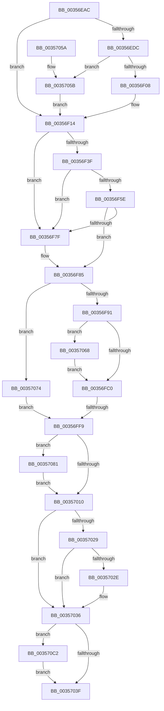

# CcWriteBehind

- RVA: `0x00356EAC`–`0x003570D4` (길이 `552` bytes)
- VA: `0x0000000140356EAC`
- 실행 섹션: `.text`
- PDB 이름 있음: `예`; PDB Function 태그: `예`
- unwind 정보 RVA: `0x00079580`
- 디코드: `127`개 명령, `552/552` bytes 표시
- 미해석 바이트: `0` (있으면 어셈블리에 `.byte`로 보존)

> 이 문서는 커널 이미지의 기계어와 PDB 기호를 분석해 생성했습니다. 4번과 5번은 함수 원형과 자료형을 바이너리 사용 방식에서 추정한 C 해석이며 원본 소스 복구 결과는 아닙니다.

## 1. Dependencies

- 직접 호출 지점: **9**; 고유 호출 대상: **8**
- 직접 호출자로 확인된 함수: **3**
- RIP 상대 이미지 참조: **2**

### Outgoing calls
- `0x00356F32` → [ExpInterlockedPopEntrySList](../6B/ExpInterlockedPopEntrySList_function_006BA570.md) (function, `0x006BA570`)
- `0x00356F51` → [ExpInterlockedPopEntrySList](../6B/ExpInterlockedPopEntrySList_function_006BA570.md) (function, `0x006BA570`)
- `0x00356F72` → [guard_dispatch_icall](../6B/guard_dispatch_icall_function_006BAAD0.md) (function, `0x006BAAD0`)
- `0x00356FC3` → [CcReferencePrivateVolumeCacheMap](CcReferencePrivateVolumeCacheMap_function_00357210.md) (function, `0x00357210`)
- `0x00356FEC` → [CcIsWriteBehindThreadpoolAtLowPriority](CcIsWriteBehindThreadpoolAtLowPriority_function_003570DC.md) (function, `0x003570DC`)
- `0x00357006` → [memset](../6C/memset_function_006C6C40.md) (function, `0x006C6C40`)
- `0x0035701A` → [CcWriteBehindInternal](CcWriteBehindInternal_function_00357540.md) (function, `0x00357540`)
- `0x00357031` → [CcFreeWorkQueueEntry](CcFreeWorkQueueEntry_function_0035723C.md) (function, `0x0035723C`)
- `0x003570CA` → [ExFreePoolWithTag](../../poolcode/B8/ExFreePoolWithTag_function_00B82870.md) (function, `0x00B82870`)

### Direct callers
- [CcCachemapUninitWorkerThread](CcCachemapUninitWorkerThread_function_003569D0.md) at `0x00356AE8`
- [CcWaitForUninitializeCacheMap](../46/CcWaitForUninitializeCacheMap_function_004633F0.md) at `0x00463621`
- [CcWorkerThread](../48/CcWorkerThread_function_0048F0F0.md) at `0x0048F329`

### Static image references
- `0x00356EF5` → RVA `0x00E0A874` (`.data`; read)
- `0x00356EFB` → RVA `0x00E65B88` (`.data`; read)

## 2. Other-region calls and transfers

- 다른 실행 섹션으로 향하는 call: **1**
  - `0x003570CA` → [ExFreePoolWithTag](../../poolcode/B8/ExFreePoolWithTag_function_00B82870.md) (`.text` → `POOLCODE`)
- call이 아닌 외부 분기/꼬리 이동: **1**
  - `0x00356FF3` → [sub_006E299E](../6E/Unknown_function_006E299E.md) (`tail-transfer`)

## 3. Assembly (complete function range)

```asm
00356EAC  48 89 5C 24 18                  mov qword ptr [rsp + 0x18], rbx
00356EB1  48 89 54 24 10                  mov qword ptr [rsp + 0x10], rdx
00356EB6  55                              push rbp
00356EB7  56                              push rsi
00356EB8  57                              push rdi
00356EB9  41 54                           push r12
00356EBB  41 55                           push r13
00356EBD  41 56                           push r14
00356EBF  41 57                           push r15
00356EC1  48 81 EC D0 00 00 00            sub rsp, 0xd0
00356EC8  48 8B 99 18 02 00 00            mov rbx, qword ptr [rcx + 0x218]
00356ECF  33 F6                           xor esi, esi
00356ED1  4D 8B F8                        mov r15, r8
00356ED4  48 8B E9                        mov rbp, rcx
00356ED7  4D 85 C0                        test r8, r8
00356EDA  75 38                           jne 0x140356f14
00356EDC  65 48 8B 04 25 20 00 00 00      mov rax, qword ptr gs:[0x20]
00356EE5  33 D2                           xor edx, edx
00356EE7  48 8B 80 C0 00 00 00            mov rax, qword ptr [rax + 0xc0]
00356EEE  0F B7 80 8A 00 00 00            movzx eax, word ptr [rax + 0x8a]
00356EF5  F7 35 79 39 AB 00               div dword ptr [rip + 0xab3979]
00356EFB  40 38 35 86 EC B0 00            cmp byte ptr [rip + 0xb0ec86], sil
00356F02  0F 84 53 01 00 00               je 0x14035705b
00356F08  48 8B 81 58 02 00 00            mov rax, qword ptr [rcx + 0x258]
00356F0F  4C 8B 7C D0 40                  mov r15, qword ptr [rax + rdx*8 + 0x40]
00356F14  65 4C 8B 2C 25 20 00 00 00      mov r13, qword ptr gs:[0x20]
00356F1D  4C 8B A1 58 02 00 00            mov r12, qword ptr [rcx + 0x258]
00356F24  4D 8B B5 60 08 00 00            mov r14, qword ptr [r13 + 0x860]
00356F2B  49 8B CE                        mov rcx, r14
00356F2E  41 FF 46 14                     inc dword ptr [r14 + 0x14]
00356F32  E8 39 36 36 00                  call 0x1406ba570
00356F37  48 8B F8                        mov rdi, rax
00356F3A  48 85 C0                        test rax, rax
00356F3D  75 40                           jne 0x140356f7f
00356F3F  41 FF 46 18                     inc dword ptr [r14 + 0x18]
00356F43  4D 8B B5 68 08 00 00            mov r14, qword ptr [r13 + 0x868]
00356F4A  49 8B CE                        mov rcx, r14
00356F4D  41 FF 46 14                     inc dword ptr [r14 + 0x14]
00356F51  E8 1A 36 36 00                  call 0x1406ba570
00356F56  48 8B F8                        mov rdi, rax
00356F59  48 85 C0                        test rax, rax
00356F5C  75 21                           jne 0x140356f7f
00356F5E  41 8B 56 2C                     mov edx, dword ptr [r14 + 0x2c]
00356F62  49 8B 46 30                     mov rax, qword ptr [r14 + 0x30]
00356F66  45 8B 46 28                     mov r8d, dword ptr [r14 + 0x28]
00356F6A  41 8B 4E 24                     mov ecx, dword ptr [r14 + 0x24]
00356F6E  41 FF 46 18                     inc dword ptr [r14 + 0x18]
00356F72  E8 59 3B 36 00                  call 0x1406baad0
00356F77  48 8B F8                        mov rdi, rax
00356F7A  48 85 C0                        test rax, rax
00356F7D  74 06                           je 0x140356f85
00356F7F  41 8B 45 24                     mov eax, dword ptr [r13 + 0x24]
00356F83  89 07                           mov dword ptr [rdi], eax
00356F85  45 33 ED                        xor r13d, r13d
00356F88  48 85 FF                        test rdi, rdi
00356F8B  0F 84 E3 00 00 00               je 0x140357074
00356F91  48 89 9F 88 00 00 00            mov qword ptr [rdi + 0x88], rbx
00356F98  41 8D 45 01                     lea eax, [r13 + 1]
00356F9C  4C 89 A7 90 00 00 00            mov qword ptr [rdi + 0x90], r12
00356FA3  4C 89 BF 98 00 00 00            mov qword ptr [rdi + 0x98], r15
00356FAA  F0 48 0F C1 83 10 05 00 00      lock xadd qword ptr [rbx + 0x510], rax
00356FB3  48 FF C0                        inc rax
00356FB6  48 83 F8 01                     cmp rax, 1
00356FBA  0F 8E A8 00 00 00               jle 0x140357068
00356FC0  49 8B CC                        mov rcx, r12
00356FC3  E8 48 02 00 00                  call 0x140357210
00356FC8  4C 8B B4 24 18 01 00 00         mov r14, qword ptr [rsp + 0x118]
00356FD0  48 8B CB                        mov rcx, rbx
00356FD3  4C 89 77 18                     mov qword ptr [rdi + 0x18], r14
00356FD7  C7 87 80 00 00 00 02 00 00 00   mov dword ptr [rdi + 0x80], 2
00356FE1  4C 89 6F 08                     mov qword ptr [rdi + 8], r13
00356FE5  4C 89 2F                        mov qword ptr [rdi], r13
00356FE8  48 89 6F 10                     mov qword ptr [rdi + 0x10], rbp
00356FEC  E8 EB 00 00 00                  call 0x1403570dc
00356FF1  84 C0                           test al, al
00356FF3  0F 85 A5 B9 38 00               jne 0x1406e299e
00356FF9  33 D2                           xor edx, edx
00356FFB  48 8D 4C 24 30                  lea rcx, [rsp + 0x30]
00357000  41 B8 A0 00 00 00               mov r8d, 0xa0
00357006  E8 35 FC 36 00                  call 0x1406c6c40
0035700B  48 85 FF                        test rdi, rdi
0035700E  74 71                           je 0x140357081
00357010  48 8B CF                        mov rcx, rdi
00357013  44 88 6F 38                     mov byte ptr [rdi + 0x38], r13b
00357017  48 8B DF                        mov rbx, rdi
0035701A  E8 21 05 00 00                  call 0x140357540
0035701F  48 8D 44 24 30                  lea rax, [rsp + 0x30]
00357024  48 3B F8                        cmp rdi, rax
00357027  74 0D                           je 0x140357036
00357029  48 85 DB                        test rbx, rbx
0035702C  74 08                           je 0x140357036
0035702E  48 8B CF                        mov rcx, rdi
00357031  E8 06 02 00 00                  call 0x14035723c
00357036  48 85 F6                        test rsi, rsi
00357039  0F 85 83 00 00 00               jne 0x1403570c2
0035703F  48 8B 9C 24 20 01 00 00         mov rbx, qword ptr [rsp + 0x120]
00357047  48 81 C4 D0 00 00 00            add rsp, 0xd0
0035704E  41 5F                           pop r15
00357050  41 5E                           pop r14
00357052  41 5D                           pop r13
00357054  41 5C                           pop r12
00357056  5F                              pop rdi
00357057  5E                              pop rsi
00357058  5D                              pop rbp
00357059  C3                              ret
0035705A  CC                              int3
0035705B  4C 8B BC D3 80 00 00 00         mov r15, qword ptr [rbx + rdx*8 + 0x80]
00357063  E9 AC FE FF FF                  jmp 0x140356f14
00357068  B9 0E 00 00 00                  mov ecx, 0xe
0035706D  CD 29                           int 0x29
0035706F  E9 4C FF FF FF                  jmp 0x140356fc0
00357074  4C 8B B4 24 18 01 00 00         mov r14, qword ptr [rsp + 0x118]
0035707C  E9 78 FF FF FF                  jmp 0x140356ff9
00357081  48 89 9C 24 B8 00 00 00         mov qword ptr [rsp + 0xb8], rbx
00357089  48 8D 7C 24 30                  lea rdi, [rsp + 0x30]
0035708E  4C 89 A4 24 C0 00 00 00         mov qword ptr [rsp + 0xc0], r12
00357096  4C 89 BC 24 C8 00 00 00         mov qword ptr [rsp + 0xc8], r15
0035709E  C7 84 24 B0 00 00 00 02 00 00 00  mov dword ptr [rsp + 0xb0], 2
003570A9  4C 89 6C 24 38                  mov qword ptr [rsp + 0x38], r13
003570AE  4C 89 6C 24 30                  mov qword ptr [rsp + 0x30], r13
003570B3  48 89 6C 24 40                  mov qword ptr [rsp + 0x40], rbp
003570B8  4C 89 74 24 48                  mov qword ptr [rsp + 0x48], r14
003570BD  E9 4E FF FF FF                  jmp 0x140357010
003570C2  BA 43 63 57 71                  mov edx, 0x71576343
003570C7  48 8B CE                        mov rcx, rsi
003570CA  E8 A1 B7 82 00                  call 0x140b82870
003570CF  E9 6B FF FF FF                  jmp 0x14035703f
```

## 4. C-style interpretation (structured pseudocode)

```c
__int64 __fastcall CcWriteBehind(__int64 a1, __int64 a2, __int64 a3)
{
    __int64 result;
    __int64 v_r13;
    __int64 v_rsi;
    __int64 v_rsp;
    unsigned __int64 v_stack_mD8;
    unsigned __int64 v_stack_p10;
    unsigned __int64 v_stack_p118;
    unsigned __int64 v_stack_p18;
    unsigned __int64 v_stack_p30;
    unsigned __int64 v_stack_p38;
    unsigned __int64 v_stack_p40;
    unsigned __int64 v_stack_p48;
    unsigned int v_stack_pB0;
    unsigned __int64 v_stack_pB8;
    unsigned __int64 v_stack_pC0;
    unsigned __int64 v_stack_pC8;

    v_stack_p18 = v_rbx;
    v_stack_p10 = a2;
    v_rsp = (v_rsp) - (208);
    v_rsi = 0;
    if (a3 != 0) goto loc_00356F14;
    a2 = 0;
    if ((*(unsigned __int8 *)(v_rip + 11594886)) == 0) goto loc_0035705B;
loc_00356F14:
    result = ExpInterlockedPopEntrySList(*(unsigned __int64 *)(*(unsigned __int64 *)(gs_base + (0 + 32)) + 2144), a2, a3, a4);
    if (result != 0) goto loc_00356F7F;
    result = ExpInterlockedPopEntrySList(*(unsigned __int64 *)(*(unsigned __int64 *)(gs_base + (0 + 32)) + 2152), a2, a3, a4);
    if (result != 0) goto loc_00356F7F;
    result = guard_dispatch_icall((unsigned int)(*(unsigned int *)(*(unsigned __int64 *)(*(unsigned __int64 *)(gs_base + (0 + 32)) + 2152) + 36)), (unsigned int)(*(unsigned int *)(*(unsigned __int64 *)(*(unsigned __int64 *)(gs_base + (0 + 32)) + 2152) + 44)), (unsigned int)(*(unsigned int *)(*(unsigned __int64 *)(*(unsigned __int64 *)(gs_base + (0 + 32)) + 2152) + 40)), a4);
    if (result != 0) {
        result = *(unsigned int *)(*(unsigned __int64 *)(gs_base + (0 + 32)) + 36);
        *(unsigned int *)(result) = (unsigned int)(result);
    }
    v_r13 = 0;
    if (result == 0) goto loc_00357074;
    *(unsigned __int64 *)(result + 136) = *(unsigned __int64 *)(a1 + 536);
    *(unsigned __int64 *)(result + 144) = *(unsigned __int64 *)(a1 + 600);
    *(unsigned __int64 *)(result + 152) = *(unsigned __int64 *)(*(unsigned __int64 *)(a1 + 600) + a2 * 8 + 64);
    result = (v_r13 + 1) + 1;
    if (result <= 1) goto loc_00357068;
loc_00356FC0:
    result = CcReferencePrivateVolumeCacheMap(*(unsigned __int64 *)(a1 + 600), (unsigned int)(*(unsigned int *)(*(unsigned __int64 *)(*(unsigned __int64 *)(gs_base + (0 + 32)) + 2152) + 44)), (unsigned int)(*(unsigned int *)(*(unsigned __int64 *)(*(unsigned __int64 *)(gs_base + (0 + 32)) + 2152) + 40)), a4);
    *(unsigned __int64 *)(result + 24) = v_stack_p10;
    *(unsigned int *)(result + 128) = 2;
    *(unsigned __int64 *)(result + 8) = 0;
    *(unsigned __int64 *)(result) = 0;
    *(unsigned __int64 *)(result + 16) = a1;
    result = CcIsWriteBehindThreadpoolAtLowPriority(*(unsigned __int64 *)(a1 + 536), (unsigned int)(*(unsigned int *)(*(unsigned __int64 *)(*(unsigned __int64 *)(gs_base + (0 + 32)) + 2152) + 44)), (unsigned int)(*(unsigned int *)(*(unsigned __int64 *)(*(unsigned __int64 *)(gs_base + (0 + 32)) + 2152) + 40)), a4);
loc_00356FF9:
    a2 = 0;
    result = memset(v_stack_mD8, a2, 160, a4);
    if (result == 0) goto loc_00357081;
loc_00357010:
    *(unsigned __int8 *)(result + 56) = 0;
    result = CcWriteBehindInternal(result, a2, 160, a4);
    if (result == v_stack_mD8) goto loc_00357036;
    result = v_stack_mD8;
    if (result != 0) {
        a1 = result;
        result = CcFreeWorkQueueEntry(a1, a2, 160, a4);
    }
    if (0 != 0) goto loc_003570C2;
loc_0035703F:
    v_rsp = (v_rsp) + (208);
    return result;
loc_0035705B:
    goto loc_00356F14;
loc_00357068:
    goto loc_00356FC0;
loc_00357074:
    goto loc_00356FF9;
loc_00357081:
    v_stack_pB8 = v_stack_p18;
    v_stack_pC0 = *(unsigned __int64 *)(a1 + 600);
    v_stack_pC8 = *(unsigned __int64 *)(v_stack_p18 + a2 * 8 + 128);
    v_stack_pB0 = 2;
    v_stack_p38 = 0;
    v_stack_p30 = 0;
    v_stack_p40 = a1;
    v_stack_p48 = v_stack_p118;
    goto loc_00357010;
loc_003570C2:
    result = ExFreePoolWithTag(0, (unsigned int)(0x71576343ULL), 160, a4);
    goto loc_0035703F;
}
```

## 5. (Beta) C Style

```c
int64_t CcWriteBehind(void *Arg1, int64_t Arg2, int64_t Arg3)
{
    uint8_t *arg1 = (uint8_t *)Arg1;

    int64_t result;
    int64_t local_r13;
    int64_t local_rsi;
    int64_t local_rsp;
    uint64_t v_stack_mD8;
    uint64_t v_stack_p10;
    uint64_t v_stack_p118;
    uint64_t v_stack_p18;
    uint64_t v_stack_p30;
    uint64_t v_stack_p38;
    uint64_t v_stack_p40;
    uint64_t v_stack_p48;
    uint32_t v_stack_pB0;
    uint64_t v_stack_pB8;
    uint64_t v_stack_pC0;
    uint64_t v_stack_pC8;

    v_stack_p18 = local_rbx;
    v_stack_p10 = Arg2;
    local_rsp = (local_rsp) - (208);
    local_rsi = 0;
    if (Arg3 != 0) goto loc_00356F14;
    Arg2 = 0;
    if ((*(uint8_t *)(v_rip + 0xB0EC86)) == 0) goto loc_0035705B;
loc_00356F14:
    result = ExpInterlockedPopEntrySList(*(uint64_t *)(*(uint64_t *)(gs_base + (0 + 0x20)) + 0x860), Arg2, Arg3, a4);
    if (result != 0) goto loc_00356F7F;
    result = ExpInterlockedPopEntrySList(*(uint64_t *)(*(uint64_t *)(gs_base + (0 + 0x20)) + 0x868), Arg2, Arg3, a4);
    if (result != 0) goto loc_00356F7F;
    result = guard_dispatch_icall((uint32_t)(*(uint32_t *)(*(uint64_t *)(*(uint64_t *)(gs_base + (0 + 0x20)) + 0x868) + 0x24)), (uint32_t)(*(uint32_t *)(*(uint64_t *)(*(uint64_t *)(gs_base + (0 + 0x20)) + 0x868) + 0x2C)), (uint32_t)(*(uint32_t *)(*(uint64_t *)(*(uint64_t *)(gs_base + (0 + 0x20)) + 0x868) + 0x28)), a4);
    if (result != 0) {
        result = *(uint32_t *)(*(uint64_t *)(gs_base + (0 + 0x20)) + 0x24);
        *(uint32_t *)(result) = (uint32_t)(result);
    }
    local_r13 = 0;
    if (result == 0) goto loc_00357074;
    *(uint64_t *)(result + 0x88) = *(uint64_t *)(arg1 + 0x218);
    *(uint64_t *)(result + 0x90) = *(uint64_t *)(arg1 + 0x258);
    *(uint64_t *)(result + 0x98) = *(uint64_t *)(*(uint64_t *)(arg1 + 0x258) + Arg2 * 8 + 0x40);
    result = (local_r13 + 1) + 1;
    if (result <= 1) goto loc_00357068;
loc_00356FC0:
    result = CcReferencePrivateVolumeCacheMap(*(uint64_t *)(arg1 + 0x258), (uint32_t)(*(uint32_t *)(*(uint64_t *)(*(uint64_t *)(gs_base + (0 + 0x20)) + 0x868) + 0x2C)), (uint32_t)(*(uint32_t *)(*(uint64_t *)(*(uint64_t *)(gs_base + (0 + 0x20)) + 0x868) + 0x28)), a4);
    *(uint64_t *)(result + 0x18) = v_stack_p10;
    *(uint32_t *)(result + 0x80) = 2;
    *(uint64_t *)(result + 0x8) = 0;
    *(uint64_t *)(result) = 0;
    *(void **)(result + 0x10) = Arg1;
    result = CcIsWriteBehindThreadpoolAtLowPriority(*(uint64_t *)(arg1 + 0x218), (uint32_t)(*(uint32_t *)(*(uint64_t *)(*(uint64_t *)(gs_base + (0 + 0x20)) + 0x868) + 0x2C)), (uint32_t)(*(uint32_t *)(*(uint64_t *)(*(uint64_t *)(gs_base + (0 + 0x20)) + 0x868) + 0x28)), a4);
loc_00356FF9:
    Arg2 = 0;
    result = memset(v_stack_mD8, Arg2, 160, a4);
    if (result == 0) goto loc_00357081;
loc_00357010:
    *(uint8_t *)(result + 0x38) = 0;
    result = CcWriteBehindInternal(result, Arg2, 160, a4);
    if (result == v_stack_mD8) goto loc_00357036;
    result = v_stack_mD8;
    if (result != 0) {
        Arg1 = result;
        result = CcFreeWorkQueueEntry(Arg1, Arg2, 160, a4);
    }
    if (0 != 0) goto loc_003570C2;
loc_0035703F:
    local_rsp = (local_rsp) + (208);
    return result;
loc_0035705B:
    goto loc_00356F14;
loc_00357068:
    goto loc_00356FC0;
loc_00357074:
    goto loc_00356FF9;
loc_00357081:
    v_stack_pB8 = v_stack_p18;
    v_stack_pC0 = *(uint64_t *)(arg1 + 0x258);
    v_stack_pC8 = *(uint64_t *)(v_stack_p18 + Arg2 * 8 + 0x80);
    v_stack_pB0 = 2;
    v_stack_p38 = 0;
    v_stack_p30 = 0;
    v_stack_p40 = Arg1;
    v_stack_p48 = v_stack_p118;
    goto loc_00357010;
loc_003570C2:
    result = ExFreePoolWithTag(0, (uint32_t)(0x71576343ULL), 160, a4);
    goto loc_0035703F;
}
```

### 관측된 메모리 오프셋

구조체 형식이 확인되지 않은 접근은 인자 기준의 오프셋으로만 기록했습니다.

| 기준 인자 | 오프셋 표현 | 폭 (bit) | 접근 |
|---|---:|---:|---|
| `Arg1` | `+ 0x218` | `64` | `R` |
| `Arg1` | `+ 0x258` | `64` | `R` |

## 6. Execution-region graph

[열기: 2D/3D 그래프와 함수 탐색 컨트롤 패널](../../../control-panel.html?section=text&rva=0x00356EAC&view=graph)

- 2D 그래프는 위에서 아래로 흐르고, 3D 그래프는 빈 공간을 드래그해 회전합니다. Shift+드래그는 이동, 휠은 확대·축소, 함수 노드 선택은 대상 보고서 이동입니다.

### Static fallback


