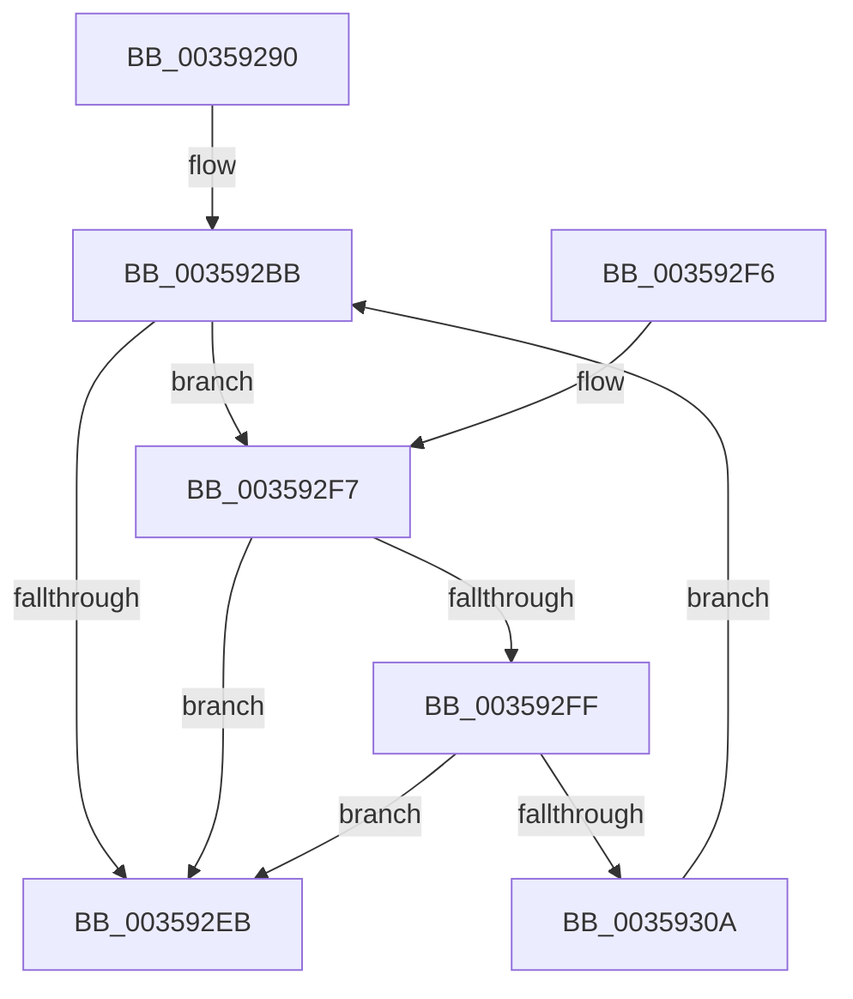

# DbgPrintEx

- RVA: `0x00359290`–`0x0035930C` (길이 `124` bytes)
- VA: `0x0000000140359290`
- 실행 섹션: `.text`
- PDB 이름 있음: `예`; PDB Function 태그: `아니요`
- unwind 정보 RVA: `0x00079844`
- 디코드: `41`개 명령, `124/124` bytes 표시
- 미해석 바이트: `0` (있으면 어셈블리에 `.byte`로 보존)

> 이 문서는 커널 이미지의 기계어와 PDB 기호를 분석해 생성했습니다. 4번과 5번은 함수 원형과 자료형을 바이너리 사용 방식에서 추정한 C 해석이며 원본 소스 복구 결과는 아닙니다.

## 1. Dependencies

- 직접 호출 지점: **1**; 고유 호출 대상: **1**
- 직접 호출자로 확인된 함수: **115**
- RIP 상대 이미지 참조: **1**

### Outgoing calls
- `0x003592DF` → [vDbgPrintExWithPrefixInternalHelper](vDbgPrintExWithPrefixInternalHelper_function_003593C0.md) (function, `0x003593C0`)

### Direct callers
- [CcWriteBehindAsync](CcWriteBehindAsync_function_003549E8.md) at `0x00354BA8`
- [CcWriteBehindAsync](CcWriteBehindAsync_function_003549E8.md) at `0x00354C10`
- [CcWriteBehindInternal](CcWriteBehindInternal_function_00357540.md) at `0x003576E4`
- [CcWriteBehindInternal](CcWriteBehindInternal_function_00357540.md) at `0x00357756`
- [CcFlushCachePriv](CcFlushCachePriv_function_0035B040.md) at `0x0035B210`
- [CcCanIWrite](../38/CcCanIWrite_function_00388250.md) at `0x003884F3`
- [CcDeleteSharedCacheMap](../38/CcDeleteSharedCacheMap_function_0038A804.md) at `0x0038AB2C`
- [CcInitializePrivateVolumeCacheMap](../3C/CcInitializePrivateVolumeCacheMap_function_003CE088.md) at `0x003CE6E2`
- [CcInsertPrivateVolumeCacheMap](../3C/CcInsertPrivateVolumeCacheMap_function_003CE714.md) at `0x003CE7BD`
- [CcInsertPrivateVolumeCacheMap](../3C/CcInsertPrivateVolumeCacheMap_function_003CE714.md) at `0x003CE8AE`
- [CcDeletePrivateVolumeCacheMap](../3C/CcDeletePrivateVolumeCacheMap_function_003CE950.md) at `0x003CE9B7`
- [CcDeletePrivateVolumeCacheMap](../3C/CcDeletePrivateVolumeCacheMap_function_003CE950.md) at `0x003CE9FC`
- [CcDeletePrivateVolumeCacheMap](../3C/CcDeletePrivateVolumeCacheMap_function_003CE950.md) at `0x003CEB5F`
- [CcInitializeNumaNodeForVolume](../3C/CcInitializeNumaNodeForVolume_function_003CEC44.md) at `0x003CEED5`
- [CcReapPrivateVolumeCachemap](../3C/CcReapPrivateVolumeCachemap_function_003CF1B8.md) at `0x003CF21B`
- [CcReapPrivateVolumeCachemap](../3C/CcReapPrivateVolumeCachemap_function_003CF1B8.md) at `0x003CF2C5`
- [BgpTxtDisplayCharacter](../47/BgpTxtDisplayCharacter_function_0047F120.md) at `0x0047F236`
- [BgpRasPrintGlyph](../47/BgpRasPrintGlyph_function_0047F3B4.md) at `0x0047F648`
- [ExpCheckForLookasideList](../4A/ExpCheckForLookasideList_function_004A5348.md) at `0x004A53A6`
- [PopQueryPowerButtonConfiguration](../4C/PopQueryPowerButtonConfiguration_function_004CA6EC.md) at `0x004CA8E2`
- [PopQueryPowerButtonConfiguration](../4C/PopQueryPowerButtonConfiguration_function_004CA6EC.md) at `0x004CA9D9`
- [PopQueryPowerButtonConfiguration](../4C/PopQueryPowerButtonConfiguration_function_004CA6EC.md) at `0x004CAA29`
- [CcAsyncLazywriteWorkerMulti](../4D/CcAsyncLazywriteWorkerMulti_function_004D1574.md) at `0x004D1642`
- [CcAsyncLazywriteWorkerMulti](../4D/CcAsyncLazywriteWorkerMulti_function_004D1574.md) at `0x004D17C2`
- [ExpWorkerThread](../4E/ExpWorkerThread_function_004ECAF0.md) at `0x004ECEC9`
- [ExpWorkerThread](../4E/ExpWorkerThread_function_004ECAF0.md) at `0x004ECFB4`
- [HalpInterruptSpuriousService](../55/HalpInterruptSpuriousService_function_0055B8A0.md) at `0x0055B8B0`
- [HalpInterruptStubService](../55/HalpInterruptStubService_function_0055B8D0.md) at `0x0055B8E0`
- [CcCheckContainerWaitForRestore](../57/CcCheckContainerWaitForRestore_function_0057AEE4.md) at `0x0057AFD1`
- [CcContainerRestoreCallBack](../57/CcContainerRestoreCallBack_function_0057B000.md) at `0x0057B057`
- [CcRegisterForContainerRestore](../57/CcRegisterForContainerRestore_function_0057B220.md) at `0x0057B26D`
- [CcRegistryChangeCallback](../57/CcRegistryChangeCallback_function_0057CC20.md) at `0x0057CC83`
- [CcRegistryChangeCallback](../57/CcRegistryChangeCallback_function_0057CC20.md) at `0x0057CCB4`
- [CcRegistryChangeCallback](../57/CcRegistryChangeCallback_function_0057CC20.md) at `0x0057CCEC`
- [CcRegistryChangeCallback](../57/CcRegistryChangeCallback_function_0057CC20.md) at `0x0057CD92`
- [CcRegistryChangeCallback](../57/CcRegistryChangeCallback_function_0057CC20.md) at `0x0057CDAB`
- [CcSetupWatchForRegistryChanges](../57/CcSetupWatchForRegistryChanges_function_0057CE10.md) at `0x0057CF12`
- [CcSetupWatchForRegistryChanges](../57/CcSetupWatchForRegistryChanges_function_0057CE10.md) at `0x0057CF33`
- [CcSetupWatchForRegistryChanges](../57/CcSetupWatchForRegistryChanges_function_0057CE10.md) at `0x0057CF55`
- [CcSetupWatchForRegistryChanges](../57/CcSetupWatchForRegistryChanges_function_0057CE10.md) at `0x0057CF9F`
- [CcUpdateDynamicRegistrySettings](../57/CcUpdateDynamicRegistrySettings_function_0057CFC0.md) at `0x0057D06A`
- [CcUpdateDynamicRegistrySettings](../57/CcUpdateDynamicRegistrySettings_function_0057CFC0.md) at `0x0057D45E`
- [CcUpdateDynamicRegistrySettings](../57/CcUpdateDynamicRegistrySettings_function_0057CFC0.md) at `0x0057D4E5`
- [CcUpdateDynamicRegistrySettings](../57/CcUpdateDynamicRegistrySettings_function_0057CFC0.md) at `0x0057D601`
- [CcUpdateDynamicRegistrySettings](../57/CcUpdateDynamicRegistrySettings_function_0057CFC0.md) at `0x0057D625`
- [CcUpdateDynamicRegistrySettings](../57/CcUpdateDynamicRegistrySettings_function_0057CFC0.md) at `0x0057D66E`
- [CcUpdateDynamicRegistrySettings](../57/CcUpdateDynamicRegistrySettings_function_0057CFC0.md) at `0x0057D692`
- [CcCreatePartition](../57/CcCreatePartition_function_0057DE10.md) at `0x0057DE45`
- [CcDeletePartition](../57/CcDeletePartition_function_0057DE9C.md) at `0x0057E0C2`
- [CcExitPartition](../57/CcExitPartition_function_0057E340.md) at `0x0057E4AD`
- [CcInitializePartition](../57/CcInitializePartition_function_0057E4D8.md) at `0x0057EB17`
- [CcInitPerVolumeParameters](../57/CcInitPerVolumeParameters_function_0057EF28.md) at `0x0057EF8B`
- [CcInitPerVolumeParameters](../57/CcInitPerVolumeParameters_function_0057EF28.md) at `0x0057EFCE`
- [CcInitializeNumaNode](../57/CcInitializeNumaNode_function_0057F2AC.md) at `0x0057F534`
- [CcCompleteAsyncWriteBehind](../57/CcCompleteAsyncWriteBehind_function_0057F824.md) at `0x0057F8DC`
- [CcWriteBehindAsyncPreProcess](../57/CcWriteBehindAsyncPreProcess_function_0057FB6C.md) at `0x0057FC81`
- [DbgkCaptureLiveKernelDump](../58/DbgkCaptureLiveKernelDump_function_00580288.md) at `0x005802E2`
- [DbgkCaptureLiveKernelDump](../58/DbgkCaptureLiveKernelDump_function_00580288.md) at `0x0058034C`
- [DbgkCaptureLiveKernelDump](../58/DbgkCaptureLiveKernelDump_function_00580288.md) at `0x005803B7`
- [DbgkCaptureLiveKernelDump](../58/DbgkCaptureLiveKernelDump_function_00580288.md) at `0x005803FE`
- [DbgkCaptureLiveKernelDump](../58/DbgkCaptureLiveKernelDump_function_00580288.md) at `0x005804B2`
- [DbgkCaptureLiveKernelDump](../58/DbgkCaptureLiveKernelDump_function_00580288.md) at `0x005804F2`
- [DbgkCaptureLiveKernelDump](../58/DbgkCaptureLiveKernelDump_function_00580288.md) at `0x00580529`
- [DbgkCaptureLiveKernelDump](../58/DbgkCaptureLiveKernelDump_function_00580288.md) at `0x00580592`
- [DbgkCaptureLiveKernelDump](../58/DbgkCaptureLiveKernelDump_function_00580288.md) at `0x005805D3`
- [IoRetryAsMiniDump](../59/IoRetryAsMiniDump_function_00592CA0.md) at `0x00592CF1`
- [IoRetryAsMiniDump](../59/IoRetryAsMiniDump_function_00592CA0.md) at `0x00592D37`
- [IoRetryAsMiniDump](../59/IoRetryAsMiniDump_function_00592CA0.md) at `0x00592D97`
- [IoRetryAsMiniDump](../59/IoRetryAsMiniDump_function_00592CA0.md) at `0x00592DAD`
- [KeBugCheck2](../5B/KeBugCheck2_function_005B27D0.md) at `0x005B2AFD`
- [KeBugCheck2](../5B/KeBugCheck2_function_005B27D0.md) at `0x005B2B85`
- [KeBugCheck2](../5B/KeBugCheck2_function_005B27D0.md) at `0x005B2B9B`
- [KeBugCheck2](../5B/KeBugCheck2_function_005B27D0.md) at `0x005B328D`
- [KeBugCheck2](../5B/KeBugCheck2_function_005B27D0.md) at `0x005B32AE`
- [KeBugCheck2](../5B/KeBugCheck2_function_005B27D0.md) at `0x005B32CB`
- [KeBugCheck2](../5B/KeBugCheck2_function_005B27D0.md) at `0x005B32DD`
- [KeBugCheck2](../5B/KeBugCheck2_function_005B27D0.md) at `0x005B33B0`
- [KeBugCheck2](../5B/KeBugCheck2_function_005B27D0.md) at `0x005B3478`
- [KeBugCheck2](../5B/KeBugCheck2_function_005B27D0.md) at `0x005B349F`
- [KiAddTriageDumpDataBlock](../5B/KiAddTriageDumpDataBlock_function_005B3AB8.md) at `0x005B3B15`
- [KiAddTriageDumpDataBlock](../5B/KiAddTriageDumpDataBlock_function_005B3AB8.md) at `0x005B3BA2`
- [KiCheckRangeOverlap](../5B/KiCheckRangeOverlap_function_005B42F8.md) at `0x005B4370`
- [KiCheckRangeOverlap](../5B/KiCheckRangeOverlap_function_005B42F8.md) at `0x005B4390`
- [KiDeduplicateTriageDumpDataArrays](../5B/KiDeduplicateTriageDumpDataArrays_function_005B4748.md) at `0x005B4827`
- [KiDeduplicateTriageDumpDataArrays](../5B/KiDeduplicateTriageDumpDataArrays_function_005B4748.md) at `0x005B48A6`
- [KiDeduplicateTriageDumpDataArrays](../5B/KiDeduplicateTriageDumpDataArrays_function_005B4748.md) at `0x005B48D3`
- [KiDeduplicateTriageDumpDataArrays](../5B/KiDeduplicateTriageDumpDataArrays_function_005B4748.md) at `0x005B48F1`
- [KiPassiveIsrWatchdog](../5C/KiPassiveIsrWatchdog_function_005C34A0.md) at `0x005C34C6`
- [KiAttemptBugcheckRecovery](../5C/KiAttemptBugcheckRecovery_function_005C6D24.md) at `0x005C6EDF`
- [KiAttemptBugcheckRecovery](../5C/KiAttemptBugcheckRecovery_function_005C6D24.md) at `0x005C6EEF`
- [KiAttemptBugcheckRecovery](../5C/KiAttemptBugcheckRecovery_function_005C6D24.md) at `0x005C6F36`
- [KiAttemptBugcheckRecovery](../5C/KiAttemptBugcheckRecovery_function_005C6D24.md) at `0x005C6F4D`
- [PopPowerButtonWorkCallback](../5D/PopPowerButtonWorkCallback_function_005D9A70.md) at `0x005D9CF3`
- [PopPowerButtonWorkCallback](../5D/PopPowerButtonWorkCallback_function_005D9A70.md) at `0x005D9E03`
- [RtlAssert](../5E/RtlAssert_function_005E75E0.md) at `0x005E764B`
- [RtlAssert](../5E/RtlAssert_function_005E75E0.md) at `0x005E76C9`
- [MiNoPagesLastChance](../68/MiNoPagesLastChance_function_0068B22C.md) at `0x0068B3F6`
- [CcSetupWatchForRegistryChanges$fin$0](../6D/CcSetupWatchForRegistryChanges_fin_0_function_006D50C4.md) at `0x006D50E3`
- [CcSetupWatchForRegistryChanges$fin$0](../6D/CcSetupWatchForRegistryChanges_fin_0_function_006D50C4.md) at `0x006D5114`
- [sub_006D678E](../6D/Unknown_function_006D678E.md) at `0x006D67B9`
- [sub_006E2746](../6E/Unknown_function_006E2746.md) at `0x006E2796`
- [sub_006E2A9E](../6E/Unknown_function_006E2A9E.md) at `0x006E2AE5`
- [sub_006E53AC](../6E/Unknown_function_006E53AC.md) at `0x006E542C`
- [sub_006E7CBA](../6E/Unknown_function_006E7CBA.md) at `0x006E7CFD`
- [sub_006EC13A](../6E/Unknown_function_006EC13A.md) at `0x006EC1F4`
- [sub_006EF914](../6E/Unknown_function_006EF914.md) at `0x006EF981`
- [sub_006F1946](../6F/Unknown_function_006F1946.md) at `0x006F1997`
- [sub_006F7E72](../6F/Unknown_function_006F7E72.md) at `0x006F7E9B`
- [sub_006F88AE](../6F/Unknown_function_006F88AE.md) at `0x006F8995`
- [DbgkWerAddSecondaryData](../../page/71/DbgkWerAddSecondaryData_function_00711E80.md) at `0x00711F1D`
- [DbgkWerAddSecondaryData](../../page/71/DbgkWerAddSecondaryData_function_00711E80.md) at `0x00711FCF`
- [DbgkpWerCaptureLiveTriageDump](../../page/71/DbgkpWerCaptureLiveTriageDump_function_00712000.md) at `0x0071203B`
- [DbgkpWerCaptureLiveTriageDump](../../page/71/DbgkpWerCaptureLiveTriageDump_function_00712000.md) at `0x007120D8`
- [DbgkpWerCaptureLiveTriageDump](../../page/71/DbgkpWerCaptureLiveTriageDump_function_00712000.md) at `0x00712106`
- [DbgkpWerCleanupContext](../../page/71/DbgkpWerCleanupContext_function_00712178.md) at `0x0071219C`
- [DbgkpWerCleanupContext](../../page/71/DbgkpWerCleanupContext_function_00712178.md) at `0x007121CE`
- [DbgkpWerCleanupContext](../../page/71/DbgkpWerCleanupContext_function_00712178.md) at `0x007122EF`
- [DbgkpWerCleanupContext](../../page/71/DbgkpWerCleanupContext_function_00712178.md) at `0x00712319`
- [DbgkpWerDeferredWriteRoutine](../../page/71/DbgkpWerDeferredWriteRoutine_function_00712340.md) at `0x00712369`
- [DbgkpWerDeferredWriteRoutine](../../page/71/DbgkpWerDeferredWriteRoutine_function_00712340.md) at `0x007123F4`
- [DbgkpWerProcessPolicyResult](../../page/71/DbgkpWerProcessPolicyResult_function_00712578.md) at `0x007125B9`
- [DbgkpWerStartDeferredLiveDump](../../page/71/DbgkpWerStartDeferredLiveDump_function_007125D0.md) at `0x0071260D`
- [DbgkpWerUpdateTriageDumpHeader](../../page/71/DbgkpWerUpdateTriageDumpHeader_function_00712668.md) at `0x007126CC`
- [DbgkpWerUpdateTriageDumpHeader](../../page/71/DbgkpWerUpdateTriageDumpHeader_function_00712668.md) at `0x007126E8`
- [DbgkpWerWriteTriageDump](../../page/71/DbgkpWerWriteTriageDump_function_00712860.md) at `0x0071291B`
- [ObpPushRefDerefInfo](../../page/74/ObpPushRefDerefInfo_function_0074FEC4.md) at `0x00750014`
- [PopBatteryInitialize](../../page/76/PopBatteryInitialize_function_00766834.md) at `0x00766AB2`
- [PspCatchCriticalBreak](../../page/78/PspCatchCriticalBreak_function_00786408.md) at `0x00786471`
- [EtwWmitraceWorker](../../page/7B/EtwWmitraceWorker_function_007BBD3C.md) at `0x007BBE09`
- [EtwWmitraceWorker](../../page/7B/EtwWmitraceWorker_function_007BBD3C.md) at `0x007BBF1D`
- [EtwWmitraceWorker](../../page/7B/EtwWmitraceWorker_function_007BBD3C.md) at `0x007BC001`
- [ExpKdPullRemoteFileForUser](../../page/7D/ExpKdPullRemoteFileForUser_function_007D15AC.md) at `0x007D1989`
- [LkmdTelCreateReport](../../page/84/LkmdTelCreateReport_function_008414CC.md) at `0x008415B8`
- [LkmdTelCreateReport](../../page/84/LkmdTelCreateReport_function_008414CC.md) at `0x00841600`
- [LkmdTelCreateReport](../../page/84/LkmdTelCreateReport_function_008414CC.md) at `0x0084162C`
- [LkmdTelCreateReport](../../page/84/LkmdTelCreateReport_function_008414CC.md) at `0x00841677`
- [LkmdTelSubmitReport](../../page/84/LkmdTelSubmitReport_function_008416E4.md) at `0x0084170B`
- [LkmdTelSubmitReport](../../page/84/LkmdTelSubmitReport_function_008416E4.md) at `0x00841740`
- [LkmdTelSubmitReport](../../page/84/LkmdTelSubmitReport_function_008416E4.md) at `0x00841773`
- [LkmdTelSubmitReport](../../page/84/LkmdTelSubmitReport_function_008416E4.md) at `0x0084179D`
- [LkmdTelpWriteDumpFile](../../page/84/LkmdTelpWriteDumpFile_function_008417DC.md) at `0x0084182C`
- [PopBatteryUpdateCompositeInformation](../../page/90/PopBatteryUpdateCompositeInformation_function_0090FDD0.md) at `0x0090FEEC`
- [MiCreateSectionForDriver](../../page/A2/MiCreateSectionForDriver_function_00A2477C.md) at `0x00A24938`
- [PopSpoilBatteryEstimate](../../page/A3/PopSpoilBatteryEstimate_function_00A313EC.md) at `0x00A31467`
- [ExpSetPendingUILanguage](../../page/A8/ExpSetPendingUILanguage_function_00A87E70.md) at `0x00A88288`
- [PopPepUnregisterDevice](../../page/A8/PopPepUnregisterDevice_function_00A8B048.md) at `0x00A8B069`
- [PopEstimateChargeTime](../../page/A9/PopEstimateChargeTime_function_00A99264.md) at `0x00A992DC`
- [PopBatteryEstimatesSpoiled](../../page/A9/PopBatteryEstimatesSpoiled_function_00A993F0.md) at `0x00A9941C`
- [MiCaptureImageExceptionValues](../../page/AA/MiCaptureImageExceptionValues_function_00AAA890.md) at `0x00AAA92C`
- [PopPepRegisterDevice](../../page/AA/PopPepRegisterDevice_function_00AAEBD0.md) at `0x00AAECB3`
- [DbgkpWerCaptureLiveFullDump](../../page/AB/DbgkpWerCaptureLiveFullDump_function_00AB0DAC.md) at `0x00AB0DF7`
- [DbgkpWerCaptureLiveFullDump](../../page/AB/DbgkpWerCaptureLiveFullDump_function_00AB0DAC.md) at `0x00AB0E26`
- [DbgkpWerCaptureLiveFullDump](../../page/AB/DbgkpWerCaptureLiveFullDump_function_00AB0DAC.md) at `0x00AB0EC5`
- [DbgkpWerInvokeCallbacks](../../page/AB/DbgkpWerInvokeCallbacks_function_00AB0FC4.md) at `0x00AB0FE5`
- [DbgkpWerInvokeCallbacks](../../page/AB/DbgkpWerInvokeCallbacks_function_00AB0FC4.md) at `0x00AB1009`
- [DbgkpWerInvokeCallbacks](../../page/AB/DbgkpWerInvokeCallbacks_function_00AB0FC4.md) at `0x00AB106F`
- [DbgkpWerInitializeDeferredLiveDump](../../page/AB/DbgkpWerInitializeDeferredLiveDump_function_00AB1088.md) at `0x00AB10F6`
- [DbgkpWerInitializeDeferredLiveDump](../../page/AB/DbgkpWerInitializeDeferredLiveDump_function_00AB1088.md) at `0x00AB114F`
- [DbgkpWerInitializeDeferredLiveDump](../../page/AB/DbgkpWerInitializeDeferredLiveDump_function_00AB1088.md) at `0x00AB11A3`
- [ObCreateObjectTypeEx](../../page/AB/ObCreateObjectTypeEx_function_00AB46D0.md) at `0x00AB4CE9`
- [DbgkWerCaptureLiveKernelDump2](../../page/AC/DbgkWerCaptureLiveKernelDump2_function_00AC1F10.md) at `0x00AC1F5E`
- [DbgkWerCaptureLiveKernelDump2](../../page/AC/DbgkWerCaptureLiveKernelDump2_function_00AC1F10.md) at `0x00AC1F83`
- [DbgkWerCaptureLiveKernelDump2](../../page/AC/DbgkWerCaptureLiveKernelDump2_function_00AC1F10.md) at `0x00AC1FA9`
- [DbgkWerCaptureLiveKernelDump2](../../page/AC/DbgkWerCaptureLiveKernelDump2_function_00AC1F10.md) at `0x00AC1FD1`
- [DbgkWerCaptureLiveKernelDump2](../../page/AC/DbgkWerCaptureLiveKernelDump2_function_00AC1F10.md) at `0x00AC20DD`
- [PopQueryPowerButtonBugcheckEnabled](../../page/AC/PopQueryPowerButtonBugcheckEnabled_function_00ACA4E4.md) at `0x00ACA5C4`
- [PopQueryPowerButtonBugcheckEnabled](../../page/AC/PopQueryPowerButtonBugcheckEnabled_function_00ACA4E4.md) at `0x00ACA5E6`
- [PopPublishPowerButtonState](../../page/AD/PopPublishPowerButtonState_function_00ADB8C8.md) at `0x00ADB977`
- [PopBatteryApplyCompositeState](../../page/AE/PopBatteryApplyCompositeState_function_00AE0CD0.md) at `0x00AE0F53`
- [PopBatteryQueryStatus](../../page/AE/PopBatteryQueryStatus_function_00AE1450.md) at `0x00AE1577`
- [PopBatteryWorker](../../page/AE/PopBatteryWorker_function_00AE1650.md) at `0x00AE1AEF`
- [sub_00B20EEE](../../page/B2/Unknown_function_00B20EEE.md) at `0x00B20FCB`
- [sub_00B44C1A](../../page/B4/Unknown_function_00B44C1A.md) at `0x00B44E29`
- [HaliSetWakeAlarm](../../pagelk/B7/HaliSetWakeAlarm_function_00B7D300.md) at `0x00B7D35E`
- [KdpCreateFileCallback](../../pagekd/B8/KdpCreateFileCallback_function_00B86830.md) at `0x00B868E4`
- [KdpCreateFileCallback](../../pagekd/B8/KdpCreateFileCallback_function_00B86830.md) at `0x00B868FE`
- [KdpPullRemoteFile](../../pagekd/B8/KdpPullRemoteFile_function_00B86B48.md) at `0x00B86C21`
- [KdpWriteFileCallback](../../pagekd/B8/KdpWriteFileCallback_function_00B86EC0.md) at `0x00B86F20`
- [ExpDebuggerWorker](../../pagekd/B8/ExpDebuggerWorker_function_00B89F70.md) at `0x00B8A06F`
- [ExpDebuggerWorker](../../pagekd/B8/ExpDebuggerWorker_function_00B89F70.md) at `0x00B8A0B2`
- [ViHalPreprocessOptions](../../pagevrfy/B9/ViHalPreprocessOptions_function_00B9920C.md) at `0x00B992A5`
- [ViHalPreprocessOptions](../../pagevrfy/B9/ViHalPreprocessOptions_function_00B9920C.md) at `0x00B992BE`
- [ViDeadlockPreprocessOptions](../../pagevrfy/BA/ViDeadlockPreprocessOptions_function_00BA9BB4.md) at `0x00BA9C66`
- [VfPnpDumpIrpStack](../../pagevrfy/BB/VfPnpDumpIrpStack_function_00BB5310.md) at `0x00BB5329`
- [VfPnpDumpIrpStack](../../pagevrfy/BB/VfPnpDumpIrpStack_function_00BB5310.md) at `0x00BB546D`
- [VfDeadlockReleaseResource](../../pagevrfy/BB/VfDeadlockReleaseResource_function_00BB759C.md) at `0x00BB784F`
- [VfDeadlockReleaseResource](../../pagevrfy/BB/VfDeadlockReleaseResource_function_00BB759C.md) at `0x00BB787A`
- [ViDeadlockCheckStackLimits](../../pagevrfy/BB/ViDeadlockCheckStackLimits_function_00BB7BF8.md) at `0x00BB7C61`
- [AnFwDisplayBackgroundUpdate](../../pagebgfx/BC/AnFwDisplayBackgroundUpdate_function_00BC1E44.md) at `0x00BC1EE5`
- [AnFwDisplayBackgroundUpdate](../../pagebgfx/BC/AnFwDisplayBackgroundUpdate_function_00BC1E44.md) at `0x00BC1EF9`
- [AnFwDisplayBackgroundUpdate](../../pagebgfx/BC/AnFwDisplayBackgroundUpdate_function_00BC1E44.md) at `0x00BC1F22`
- [AnFwpBackgroundUpdateTimer](../../pagebgfx/BC/AnFwpBackgroundUpdateTimer_function_00BC21B0.md) at `0x00BC2227`
- [LogFwReport](../../pagebgfx/BC/LogFwReport_function_00BC43FC.md) at `0x00BC44F2`
- [LogFwReport](../../pagebgfx/BC/LogFwReport_function_00BC43FC.md) at `0x00BC451D`
- [LogFwReport](../../pagebgfx/BC/LogFwReport_function_00BC43FC.md) at `0x00BC4534`
- [LogFwReport](../../pagebgfx/BC/LogFwReport_function_00BC43FC.md) at `0x00BC455B`
- [LogFwReport](../../pagebgfx/BC/LogFwReport_function_00BC43FC.md) at `0x00BC4572`
- [LogFwReport](../../pagebgfx/BC/LogFwReport_function_00BC43FC.md) at `0x00BC4589`
- [LogFwReport](../../pagebgfx/BC/LogFwReport_function_00BC43FC.md) at `0x00BC45B0`
- [LogFwReport](../../pagebgfx/BC/LogFwReport_function_00BC43FC.md) at `0x00BC45D7`
- [LogFwReport](../../pagebgfx/BC/LogFwReport_function_00BC43FC.md) at `0x00BC461A`
- [LogFwReport](../../pagebgfx/BC/LogFwReport_function_00BC43FC.md) at `0x00BC4641`
- [LogFwReport](../../pagebgfx/BC/LogFwReport_function_00BC43FC.md) at `0x00BC4658`
- [LogFwReport](../../pagebgfx/BC/LogFwReport_function_00BC43FC.md) at `0x00BC4683`
- [LogFwReport](../../pagebgfx/BC/LogFwReport_function_00BC43FC.md) at `0x00BC46AA`
- [LogFwReport](../../pagebgfx/BC/LogFwReport_function_00BC43FC.md) at `0x00BC46D1`
- [LogFwReport](../../pagebgfx/BC/LogFwReport_function_00BC43FC.md) at `0x00BC4700`
- [LogFwReport](../../pagebgfx/BC/LogFwReport_function_00BC43FC.md) at `0x00BC4727`
- [LogFwReport](../../pagebgfx/BC/LogFwReport_function_00BC43FC.md) at `0x00BC4746`
- [LogFwReport](../../pagebgfx/BC/LogFwReport_function_00BC43FC.md) at `0x00BC476D`
- [LogFwReport](../../pagebgfx/BC/LogFwReport_function_00BC43FC.md) at `0x00BC477D`
- [BgpFwLibraryInitialize](../../pagebgfx/BC/BgpFwLibraryInitialize_function_00BC5400.md) at `0x00BC596C`
- [HalpExtInitExtensions](../../init/C1/HalpExtInitExtensions_function_00C1F7FC.md) at `0x00C1F8E6`
- [PipResetDevice](../../init/C3/PipResetDevice_function_00C31F90.md) at `0x00C31FDA`
- [PipResetMatchingFilteredDevices](../../init/C3/PipResetMatchingFilteredDevices_function_00C32260.md) at `0x00C323DC`
- [KiInitializeMTRR](../../init/C3/KiInitializeMTRR_function_00C39A1C.md) at `0x00C39BA6`
- [KiInitializeMTRR](../../init/C3/KiInitializeMTRR_function_00C39A1C.md) at `0x00C39C40`
- [KiInitializeMTRR](../../init/C3/KiInitializeMTRR_function_00C39A1C.md) at `0x00C39CE2`
- [VfTriageSystem](../../init/C4/VfTriageSystem_function_00C4CB34.md) at `0x00C4CB74`
- [VfTriageSystem](../../init/C4/VfTriageSystem_function_00C4CB34.md) at `0x00C4CBDC`
- [VfTriageSystem](../../init/C4/VfTriageSystem_function_00C4CB34.md) at `0x00C4CC81`
- [VfTriageSystem](../../init/C4/VfTriageSystem_function_00C4CB34.md) at `0x00C4CCBA`
- [VfTriageSystem](../../init/C4/VfTriageSystem_function_00C4CB34.md) at `0x00C4CDAA`
- [VfTriageSystem](../../init/C4/VfTriageSystem_function_00C4CB34.md) at `0x00C4CE14`
- [VfTriageSystem](../../init/C4/VfTriageSystem_function_00C4CB34.md) at `0x00C4CE2B`
- [VfTriageSystem](../../init/C4/VfTriageSystem_function_00C4CB34.md) at `0x00C4CE4E`
- [VfTriageSystem](../../init/C4/VfTriageSystem_function_00C4CB34.md) at `0x00C4CE70`
- [ViFindTriageRule](../../init/C4/ViFindTriageRule_function_00C4CE9C.md) at `0x00C4CEF4`
- [ViFindTriageRule](../../init/C4/ViFindTriageRule_function_00C4CE9C.md) at `0x00C4CF0D`
- [ViFindTriageRule](../../init/C4/ViFindTriageRule_function_00C4CE9C.md) at `0x00C4CF26`
- [ViMakeVerifierSettings](../../init/C4/ViMakeVerifierSettings_function_00C4CF3C.md) at `0x00C4CFAB`
- [ViMakeVerifierSettings](../../init/C4/ViMakeVerifierSettings_function_00C4CF3C.md) at `0x00C4CFCF`
- [ViMakeVerifierSettings](../../init/C4/ViMakeVerifierSettings_function_00C4CF3C.md) at `0x00C4CFF0`
- [ViTriageSameDriversFromDump](../../init/C4/ViTriageSameDriversFromDump_function_00C4D02C.md) at `0x00C4D069`
- [ViTriageSameDriversFromDump](../../init/C4/ViTriageSameDriversFromDump_function_00C4D02C.md) at `0x00C4D0B9`
- [ViValidateTriageRules](../../init/C4/ViValidateTriageRules_function_00C4D0E4.md) at `0x00C4D119`
- [ViValidateTriageRules](../../init/C4/ViValidateTriageRules_function_00C4D0E4.md) at `0x00C4D13A`
- [IopInitializeBuiltinDriver](../../init/C7/IopInitializeBuiltinDriver_function_00C7625C.md) at `0x00C76698`
- [IopInitializeBuiltinDriver](../../init/C7/IopInitializeBuiltinDriver_function_00C7625C.md) at `0x00C766B2`

### Static image references
- `0x003592BE` → RVA `0x006C7800` (` ?? ::FNODOBFM::`string'`; read)

## 2. Other-region calls and transfers

- 다른 실행 섹션으로 향하는 call: **0**
- 별도 외부 분기/꼬리 이동을 확인하지 못했습니다.

## 3. Assembly (complete function range)

```asm
00359290  48 8B C4                        mov rax, rsp
00359293  4C 89 40 18                     mov qword ptr [rax + 0x18], r8
00359297  4C 89 48 20                     mov qword ptr [rax + 0x20], r9
0035929B  53                              push rbx
0035929C  55                              push rbp
0035929D  56                              push rsi
0035929E  57                              push rdi
0035929F  41 54                           push r12
003592A1  48 83 EC 50                     sub rsp, 0x50
003592A5  BB 80 00 00 00                  mov ebx, 0x80
003592AA  4C 8D 60 20                     lea r12, [rax + 0x20]
003592AE  81 FB 00 02 00 00               cmp ebx, 0x200
003592B4  49 8B F8                        mov rdi, r8
003592B7  8B F2                           mov esi, edx
003592B9  8B E9                           mov ebp, ecx
003592BB  0F 92 C0                        setb al
003592BE  48 8D 0D 3B E5 36 00            lea rcx, [rip + 0x36e53b]
003592C5  88 44 24 38                     mov byte ptr [rsp + 0x38], al
003592C9  4C 8B CF                        mov r9, rdi
003592CC  89 5C 24 30                     mov dword ptr [rsp + 0x30], ebx
003592D0  44 8B C6                        mov r8d, esi
003592D3  C6 44 24 28 01                  mov byte ptr [rsp + 0x28], 1
003592D8  8B D5                           mov edx, ebp
003592DA  4C 89 64 24 20                  mov qword ptr [rsp + 0x20], r12
003592DF  E8 DC 00 00 00                  call 0x1403593c0
003592E4  3D 05 00 00 80                  cmp eax, 0x80000005
003592E9  74 0C                           je 0x1403592f7
003592EB  48 83 C4 50                     add rsp, 0x50
003592EF  41 5C                           pop r12
003592F1  5F                              pop rdi
003592F2  5E                              pop rsi
003592F3  5D                              pop rbp
003592F4  5B                              pop rbx
003592F5  C3                              ret
003592F6  CC                              int3
003592F7  81 FB 00 02 00 00               cmp ebx, 0x200
003592FD  73 EC                           jae 0x1403592eb
003592FF  83 EB 80                        sub ebx, -0x80
00359302  81 FB 00 02 00 00               cmp ebx, 0x200
00359308  77 E1                           ja 0x1403592eb
0035930A  EB AF                           jmp 0x1403592bb
```

## 4. C-style interpretation (structured pseudocode)

```c
__int64 __fastcall DbgPrintEx(int a1, int a2, __int64 a3, __int64 a4)
{
    __int64 result;
    __int64 v_rbx;
    __int64 v_rsp;
    unsigned __int8 v_stack_m40;
    unsigned int v_stack_m48;
    unsigned __int8 v_stack_m50;
    unsigned __int64 v_stack_m58;

    *(unsigned __int64 *)(v_rsp + 24) = a3;
    *(unsigned __int64 *)(v_rsp + 32) = a4;
    v_rsp = (v_rsp) - (80);
loc_003592BB:
    result = (128 < 512) ? 1 : 0;
    v_stack_m40 = (unsigned __int8)(result);
    v_stack_m48 = 128;
    v_stack_m50 = 1;
    v_stack_m58 = v_rsp + 32;
    result = vDbgPrintExWithPrefixInternalHelper(v_rip + 3597627, (unsigned int)((unsigned int)((unsigned int)(a1))), (unsigned int)((unsigned int)((unsigned int)(a2))), a3);
    if (((unsigned int)(result)) == 0x80000005ULL) goto loc_003592F7;
loc_003592EB:
    v_rsp = (v_rsp) + (80);
    return result;
loc_003592F7:
    if (128 >= 512) goto loc_003592EB;
    v_rbx = (unsigned int)((128) - (-128));
    if (((unsigned int)(v_rbx)) > 512) goto loc_003592EB;
    goto loc_003592BB;
}
```

## 5. (Beta) C Style

```c
int64_t DbgPrintEx(int32_t Arg1, int32_t Arg2, int64_t Arg3, int64_t Arg4)
{
    int64_t result;
    int64_t local_rbx;
    int64_t local_rsp;
    uint8_t v_stack_m40;
    uint32_t v_stack_m48;
    uint8_t v_stack_m50;
    uint64_t v_stack_m58;

    *(uint64_t *)(local_rsp + 0x18) = Arg3;
    *(uint64_t *)(local_rsp + 0x20) = Arg4;
    local_rsp = (local_rsp) - (80);
loc_003592BB:
    result = (128 < 512) ? 1 : 0;
    v_stack_m40 = (uint8_t)(result);
    v_stack_m48 = 128;
    v_stack_m50 = 1;
    v_stack_m58 = local_rsp + 32;
    result = vDbgPrintExWithPrefixInternalHelper(v_rip + 3597627, (uint32_t)((uint32_t)((uint32_t)(Arg1))), (uint32_t)((uint32_t)((uint32_t)(Arg2))), Arg3);
    if (((uint32_t)(result)) == 0x80000005ULL) goto loc_003592F7;
loc_003592EB:
    local_rsp = (local_rsp) + (80);
    return result;
loc_003592F7:
    if (128 >= 512) goto loc_003592EB;
    local_rbx = (uint32_t)((128) - (-128));
    if (((uint32_t)(local_rbx)) > 512) goto loc_003592EB;
    goto loc_003592BB;
}
```

## 6. Execution-region graph

[열기: 2D/3D 그래프와 함수 탐색 컨트롤 패널](../../../control-panel.html?section=text&rva=0x00359290&view=graph)

- 2D 그래프는 위에서 아래로 흐르고, 3D 그래프는 빈 공간을 드래그해 회전합니다. Shift+드래그는 이동, 휠은 확대·축소, 함수 노드 선택은 대상 보고서 이동입니다.

### Static fallback


