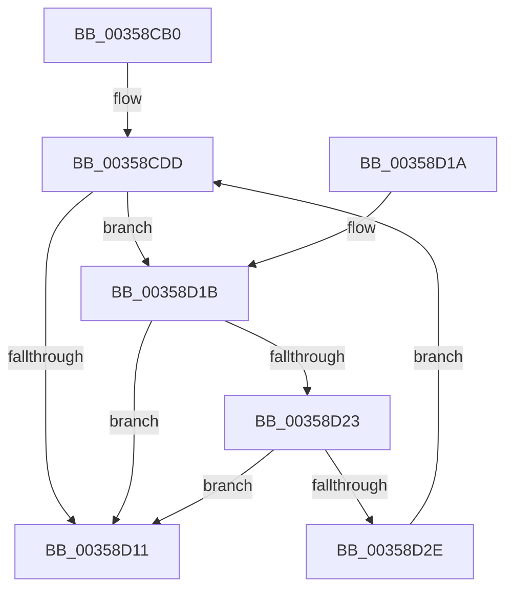

# DbgPrint

- RVA: `0x00358CB0`–`0x00358D30` (길이 `128` bytes)
- VA: `0x0000000140358CB0`
- 실행 섹션: `.text`
- PDB 이름 있음: `예`; PDB Function 태그: `아니요`
- unwind 정보 RVA: `0x000797D4`
- 디코드: `37`개 명령, `128/128` bytes 표시
- 미해석 바이트: `0` (있으면 어셈블리에 `.byte`로 보존)

> 이 문서는 커널 이미지의 기계어와 PDB 기호를 분석해 생성했습니다. 4번과 5번은 함수 원형과 자료형을 바이너리 사용 방식에서 추정한 C 해석이며 원본 소스 복구 결과는 아닙니다.

## 1. Dependencies

- 직접 호출 지점: **1**; 고유 호출 대상: **1**
- 직접 호출자로 확인된 함수: **41**
- RIP 상대 이미지 참조: **1**

### Outgoing calls
- `0x00358D05` → [vDbgPrintExWithPrefixInternalHelper](vDbgPrintExWithPrefixInternalHelper_function_003593C0.md) (function, `0x003593C0`)

### Direct callers
- [CcInitializeCacheMapInternal](../3C/CcInitializeCacheMapInternal_function_003CC720.md) at `0x003CD144`
- [CcInsertIntoCleanSharedCacheMapList](../45/CcInsertIntoCleanSharedCacheMapList_function_004511CC.md) at `0x00451362`
- [RtlpCreateHeap](../4E/RtlpCreateHeap_function_004E1904.md) at `0x004E1AF7`
- [SepCreateTokenEx](../4E/SepCreateTokenEx_function_004E9CD0.md) at `0x004EA851`
- [HalpAcpiGetFacsMapping](../53/HalpAcpiGetFacsMapping_function_0053F0F0.md) at `0x0053F132`
- [HalReturnToFirmware](../54/HalReturnToFirmware_function_00546550.md) at `0x0054656E`
- [x86BiosExecuteInterruptShadowed](../54/x86BiosExecuteInterruptShadowed_function_00547BA8.md) at `0x00547BF9`
- [RtlpAllocateHeap](../5E/RtlpAllocateHeap_function_005E8B1C.md) at `0x005E8F9A`
- [RtlpCoalesceFreeBlocks](../5E/RtlpCoalesceFreeBlocks_function_005E952C.md) at `0x005E9671`
- [RtlpCoalesceFreeBlocks](../5E/RtlpCoalesceFreeBlocks_function_005E952C.md) at `0x005E9826`
- [RtlpCreateSplitBlock](../5E/RtlpCreateSplitBlock_function_005E98F0.md) at `0x005E9ACA`
- [RtlpCreateUCREntry](../5E/RtlpCreateUCREntry_function_005EA010.md) at `0x005EA0AB`
- [RtlpDeCommitFreeBlock](../5E/RtlpDeCommitFreeBlock_function_005EA158.md) at `0x005EA306`
- [RtlpDeCommitFreeBlock](../5E/RtlpDeCommitFreeBlock_function_005EA158.md) at `0x005EA345`
- [RtlpDeCommitFreeBlock](../5E/RtlpDeCommitFreeBlock_function_005EA158.md) at `0x005EA47F`
- [RtlpDeCommitFreeBlock](../5E/RtlpDeCommitFreeBlock_function_005EA158.md) at `0x005EA607`
- [RtlpDeCommitFreeBlock](../5E/RtlpDeCommitFreeBlock_function_005EA158.md) at `0x005EA6D2`
- [RtlpFindAndCommitPages](../5E/RtlpFindAndCommitPages_function_005EA95C.md) at `0x005EA9AE`
- [RtlpInsertFreeBlock](../5E/RtlpInsertFreeBlock_function_005EB4C0.md) at `0x005EB526`
- [RtlpInsertFreeBlock](../5E/RtlpInsertFreeBlock_function_005EB4C0.md) at `0x005EB7D6`
- [RtlpTraceDatabaseInternalAdd](../5E/RtlpTraceDatabaseInternalAdd_function_005EE9A0.md) at `0x005EEAC5`
- [RtlpFindUCREntry](../5F/RtlpFindUCREntry_function_005F1828.md) at `0x005F1851`
- [RtlpPopulateListIndex](../5F/RtlpPopulateListIndex_function_005F1C84.md) at `0x005F1DF6`
- [HalpTimerWatchdogLogReset](../../page/70/HalpTimerWatchdogLogReset_function_00707F84.md) at `0x00707FC0`
- [ObpShutdownCloseHandleProcedure](../../page/74/ObpShutdownCloseHandleProcedure_function_0074E7C0.md) at `0x0074E809`
- [CmpPostApcRunDown](../../page/7E/CmpPostApcRunDown_function_007E1F90.md) at `0x007E1FDF`
- [CmpPostApcRunDown](../../page/7E/CmpPostApcRunDown_function_007E1F90.md) at `0x007E2093`
- [RtlpMuiRegLoadRegistryInfo](../../page/83/RtlpMuiRegLoadRegistryInfo_function_0083EDC4.md) at `0x0083EDF1`
- [SepDuplicateToken](../../page/8B/SepDuplicateToken_function_008B87EC.md) at `0x008B90AF`
- [RtlpQueryRegistryValues](../../page/8C/RtlpQueryRegistryValues_function_008C9050.md) at `0x008C9410`
- [RtlpQueryRegistryValues](../../page/8C/RtlpQueryRegistryValues_function_008C9050.md) at `0x008C9549`
- [CmNotifyRunDown](../../page/90/CmNotifyRunDown_function_00906984.md) at `0x00906AFE`
- [CmNotifyRunDown](../../page/90/CmNotifyRunDown_function_00906984.md) at `0x00906B6F`
- [SepFilterToken](../../page/9C/SepFilterToken_function_009C6B80.md) at `0x009C782E`
- [IopQueryLegacyBusInformation](../../page/A2/IopQueryLegacyBusInformation_function_00A28078.md) at `0x00A28138`
- [IopQueryLegacyBusInformation](../../page/A2/IopQueryLegacyBusInformation_function_00A28078.md) at `0x00A28144`
- [RtlDestroyHeap](../../page/AA/RtlDestroyHeap_function_00AA8790.md) at `0x00AA87DE`
- [IopUnloadDriver](../../page/AB/IopUnloadDriver_function_00ABF868.md) at `0x00ABF9E6`
- [PnpGetDeviceInstancePropertyData](../../page/AC/PnpGetDeviceInstancePropertyData_function_00AC9730.md) at `0x00AC97BE`
- [RtlLCIDToCultureName](../../page/AD/RtlLCIDToCultureName_function_00AD3010.md) at `0x00AD303E`
- [CmpPostApc](../../page/AF/CmpPostApc_function_00AF78F0.md) at `0x00AF7928`
- [CmpPostApc](../../page/AF/CmpPostApc_function_00AF78F0.md) at `0x00AF79D0`
- [CmpPostApc](../../page/AF/CmpPostApc_function_00AF78F0.md) at `0x00AF7A18`
- [sub_00B1EF9C](../../page/B1/Unknown_function_00B1EF9C.md) at `0x00B1EFBA`
- [sub_00B2CB5C](../../page/B2/Unknown_function_00B2CB5C.md) at `0x00B2CC0C`
- [sub_00B44C1A](../../page/B4/Unknown_function_00B44C1A.md) at `0x00B44F21`
- [sub_00B44C1A](../../page/B4/Unknown_function_00B44C1A.md) at `0x00B450D5`
- [sub_00B44C1A](../../page/B4/Unknown_function_00B44C1A.md) at `0x00B45100`
- [PopWriteHeaderPages](../../pagelk/B6/PopWriteHeaderPages_function_00B6FC14.md) at `0x00B6FD03`
- [PopWriteHeaderPages](../../pagelk/B6/PopWriteHeaderPages_function_00B6FC14.md) at `0x00B6FD9E`
- [PopWriteHeaderPages](../../pagelk/B6/PopWriteHeaderPages_function_00B6FC14.md) at `0x00B6FDE6`
- [PopWriteImageHeader](../../pagelk/B7/PopWriteImageHeader_function_00B70290.md) at `0x00B702C0`
- [PoBroadcastSystemState](../../pagelk/B7/PoBroadcastSystemState_function_00B761B0.md) at `0x00B765CB`
- [HalpMapNvsArea](../../pagelk/B7/HalpMapNvsArea_function_00B7D180.md) at `0x00B7D1FC`
- [ViIsBTSSupported](../../pagevrfy/BA/ViIsBTSSupported_function_00BA3A44.md) at `0x00BA3B21`
- [HalpAcpiFindRsdp](../../init/C1/HalpAcpiFindRsdp_function_00C1DF48.md) at `0x00C1DFD5`
- [HalpAcpiTableCacheInit](../../init/C7/HalpAcpiTableCacheInit_function_00C77650.md) at `0x00C777F5`
- [HalpAcpiTableCacheInit](../../init/C7/HalpAcpiTableCacheInit_function_00C77650.md) at `0x00C7789D`
- [HalpAcpiTableCacheInit](../../init/C7/HalpAcpiTableCacheInit_function_00C77650.md) at `0x00C77906`

### Static image references
- `0x00358CE2` → RVA `0x006C7800` (` ?? ::FNODOBFM::`string'`; read)

## 2. Other-region calls and transfers

- 다른 실행 섹션으로 향하는 call: **0**
- 별도 외부 분기/꼬리 이동을 확인하지 못했습니다.

## 3. Assembly (complete function range)

```asm
00358CB0  48 8B C4                        mov rax, rsp
00358CB3  48 89 48 08                     mov qword ptr [rax + 8], rcx
00358CB7  48 89 50 10                     mov qword ptr [rax + 0x10], rdx
00358CBB  4C 89 40 18                     mov qword ptr [rax + 0x18], r8
00358CBF  4C 89 48 20                     mov qword ptr [rax + 0x20], r9
00358CC3  53                              push rbx
00358CC4  57                              push rdi
00358CC5  41 56                           push r14
00358CC7  48 83 EC 50                     sub rsp, 0x50
00358CCB  BB 80 00 00 00                  mov ebx, 0x80
00358CD0  4C 8D 70 10                     lea r14, [rax + 0x10]
00358CD4  81 FB 00 02 00 00               cmp ebx, 0x200
00358CDA  48 8B F9                        mov rdi, rcx
00358CDD  BA 65 00 00 00                  mov edx, 0x65
00358CE2  48 8D 0D 17 EB 36 00            lea rcx, [rip + 0x36eb17]
00358CE9  0F 92 C0                        setb al
00358CEC  4C 8B CF                        mov r9, rdi
00358CEF  88 44 24 38                     mov byte ptr [rsp + 0x38], al
00358CF3  89 5C 24 30                     mov dword ptr [rsp + 0x30], ebx
00358CF7  44 8D 42 9E                     lea r8d, [rdx - 0x62]
00358CFB  C6 44 24 28 01                  mov byte ptr [rsp + 0x28], 1
00358D00  4C 89 74 24 20                  mov qword ptr [rsp + 0x20], r14
00358D05  E8 B6 06 00 00                  call 0x1403593c0
00358D0A  3D 05 00 00 80                  cmp eax, 0x80000005
00358D0F  74 0A                           je 0x140358d1b
00358D11  48 83 C4 50                     add rsp, 0x50
00358D15  41 5E                           pop r14
00358D17  5F                              pop rdi
00358D18  5B                              pop rbx
00358D19  C3                              ret
00358D1A  CC                              int3
00358D1B  81 FB 00 02 00 00               cmp ebx, 0x200
00358D21  73 EE                           jae 0x140358d11
00358D23  83 EB 80                        sub ebx, -0x80
00358D26  81 FB 00 02 00 00               cmp ebx, 0x200
00358D2C  77 E3                           ja 0x140358d11
00358D2E  EB AD                           jmp 0x140358cdd
```

## 4. C-style interpretation (structured pseudocode)

```c
__int64 __fastcall DbgPrint(__int64 a1, __int64 a2, __int64 a3, __int64 a4)
{
    __int64 result;
    __int64 v_rbx;
    __int64 v_rsp;
    unsigned __int8 v_stack_m30;
    unsigned int v_stack_m38;
    unsigned __int8 v_stack_m40;
    unsigned __int64 v_stack_m48;

    *(unsigned __int64 *)(v_rsp + 8) = a1;
    *(unsigned __int64 *)(v_rsp + 16) = a2;
    *(unsigned __int64 *)(v_rsp + 24) = a3;
    *(unsigned __int64 *)(v_rsp + 32) = a4;
    v_rsp = (v_rsp) - (80);
loc_00358CDD:
    result = (128 < 512) ? 1 : 0;
    v_stack_m30 = (unsigned __int8)(result);
    v_stack_m38 = 128;
    v_stack_m40 = 1;
    v_stack_m48 = v_rsp + 16;
    result = vDbgPrintExWithPrefixInternalHelper(v_rip + 3599127, 101, 101 - 98, a1);
    if (((unsigned int)(result)) == 0x80000005ULL) goto loc_00358D1B;
loc_00358D11:
    v_rsp = (v_rsp) + (80);
    return result;
loc_00358D1B:
    if (128 >= 512) goto loc_00358D11;
    v_rbx = (unsigned int)((128) - (-128));
    if (((unsigned int)(v_rbx)) > 512) goto loc_00358D11;
    goto loc_00358CDD;
}
```

## 5. (Beta) C Style

```c
int64_t DbgPrint(int64_t Arg1, int64_t Arg2, int64_t Arg3, int64_t Arg4)
{
    int64_t result;
    int64_t local_rbx;
    int64_t local_rsp;
    uint8_t v_stack_m30;
    uint32_t v_stack_m38;
    uint8_t v_stack_m40;
    uint64_t v_stack_m48;

    *(uint64_t *)(local_rsp + 0x8) = Arg1;
    *(uint64_t *)(local_rsp + 0x10) = Arg2;
    *(uint64_t *)(local_rsp + 0x18) = Arg3;
    *(uint64_t *)(local_rsp + 0x20) = Arg4;
    local_rsp = (local_rsp) - (80);
loc_00358CDD:
    result = (128 < 512) ? 1 : 0;
    v_stack_m30 = (uint8_t)(result);
    v_stack_m38 = 128;
    v_stack_m40 = 1;
    v_stack_m48 = local_rsp + 16;
    result = vDbgPrintExWithPrefixInternalHelper(v_rip + 3599127, 101, 101 - 98, Arg1);
    if (((uint32_t)(result)) == 0x80000005ULL) goto loc_00358D1B;
loc_00358D11:
    local_rsp = (local_rsp) + (80);
    return result;
loc_00358D1B:
    if (128 >= 512) goto loc_00358D11;
    local_rbx = (uint32_t)((128) - (-128));
    if (((uint32_t)(local_rbx)) > 512) goto loc_00358D11;
    goto loc_00358CDD;
}
```

## 6. Execution-region graph

[열기: 2D/3D 그래프와 함수 탐색 컨트롤 패널](../../../control-panel.html?section=text&rva=0x00358CB0&view=graph)

- 2D 그래프는 위에서 아래로 흐르고, 3D 그래프는 빈 공간을 드래그해 회전합니다. Shift+드래그는 이동, 휠은 확대·축소, 함수 노드 선택은 대상 보고서 이동입니다.

### Static fallback


