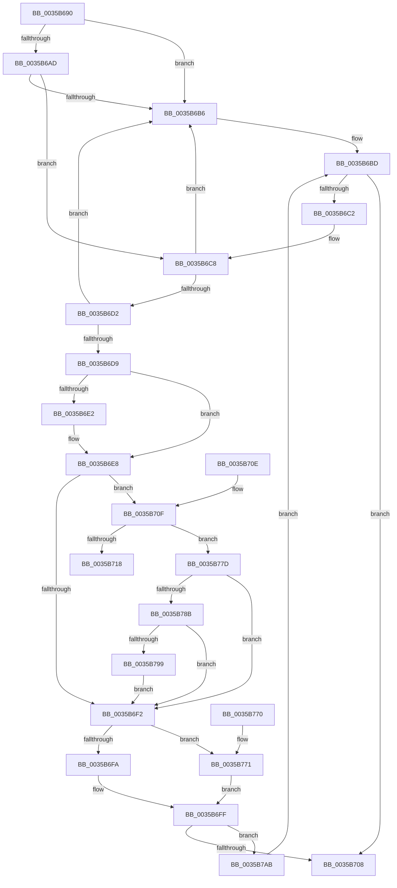

# ExAllocatePoolMm

- RVA: `0x0035B690`–`0x0035B7B5` (길이 `293` bytes)
- VA: `0x000000014035B690`
- 실행 섹션: `.text`
- PDB 이름 있음: `예`; PDB Function 태그: `아니요`
- unwind 정보 RVA: `0x00079AF4`
- 디코드: `76`개 명령, `293/293` bytes 표시
- 미해석 바이트: `0` (있으면 어셈블리에 `.byte`로 보존)

> 이 문서는 커널 이미지의 기계어와 PDB 기호를 분석해 생성했습니다. 4번과 5번은 함수 원형과 자료형을 바이너리 사용 방식에서 추정한 C 해석이며 원본 소스 복구 결과는 아닙니다.

## 1. Dependencies

- 직접 호출 지점: **4**; 고유 호출 대상: **4**
- 직접 호출자로 확인된 함수: **21**
- RIP 상대 이미지 참조: **2**

### Outgoing calls
- `0x0035B6C2` → [RtlRaiseStatus](../2F/RtlRaiseStatus_function_002F6A50.md) (function, `0x002F6A50`)
- `0x0035B6FA` → [ExpAllocatePoolWithTagFromNode](ExpAllocatePoolWithTagFromNode_function_0035B970.md) (function, `0x0035B970`)
- `0x0035B765` → [VfHandlePoolAlloc](../../pagevrfy/BB/VfHandlePoolAlloc_function_00BB8A90.md) (function, `0x00BB8A90`)
- `0x0035B776` → [ExpAllocatePoolWithQuotaTag](../../poolcode/B8/ExpAllocatePoolWithQuotaTag_function_00B82210.md) (function, `0x00B82210`)

### Direct callers
- [MiReferenceIoPages](../23/MiReferenceIoPages_function_0023C804.md) at `0x0023CD85`
- [MiGetBackgroundHugePageToZero](../31/MiGetBackgroundHugePageToZero_function_0031DD8C.md) at `0x0031DE36`
- [MiComputeIdealDpcGang](../43/MiComputeIdealDpcGang_function_0043EAAC.md) at `0x0043EC0F`
- [MiLockWorkingSetForLargeMapping](../4E/MiLockWorkingSetForLargeMapping_function_004E3110.md) at `0x004E316F`
- [MiInitializeSlabIdentities](../68/MiInitializeSlabIdentities_function_0068EBD8.md) at `0x0068EC2D`
- [MiAllocatePrcb](../69/MiAllocatePrcb_function_00695594.md) at `0x006955AF`
- [MiAbsorbPossibleEngineChanges](../69/MiAbsorbPossibleEngineChanges_function_006958B4.md) at `0x00695A27`
- [MiAllocateZeroPageDecisionTraceBuffer](../69/MiAllocateZeroPageDecisionTraceBuffer_function_00695DB4.md) at `0x00695E28`
- [MiAllocateAcceleratorDescriptor](../69/MiAllocateAcceleratorDescriptor_function_00697124.md) at `0x00697227`
- [MiZeroPageCalibrate](../69/MiZeroPageCalibrate_function_0069A69C.md) at `0x0069A870`
- [MiInitializeScrubPacket](../../page/80/MiInitializeScrubPacket_function_0080EA10.md) at `0x0080EA9E`
- [MiCreatePerNodeZeroingConductor](../../page/81/MiCreatePerNodeZeroingConductor_function_00810480.md) at `0x008104DA`
- [MiCreateZeroThreadContext](../../page/81/MiCreateZeroThreadContext_function_008105B4.md) at `0x008105FC`
- [sub_008873D4](../../page/88/Unknown_function_008873D4.md) at `0x008873FC`
- [MmPrefetchPagesEx](../../page/93/MmPrefetchPagesEx_function_0093C9A0.md) at `0x0093CA03`
- [MiAllocateReadList](../../page/93/MiAllocateReadList_function_0093D4F0.md) at `0x0093D518`
- [MiAddSecureEntry](../../page/98/MiAddSecureEntry_function_00980250.md) at `0x009802AA`
- [MiSecureVad](../../page/9F/MiSecureVad_function_009F5788.md) at `0x009F581E`
- [MiCombineAllPhysicalMemory](../../page/9F/MiCombineAllPhysicalMemory_function_009F6B6C.md) at `0x009F6CAB`
- [MiInitNucleus](../../init/C5/MiInitNucleus_function_00C5FD38.md) at `0x00C6028C`
- [MiComputeMemoryNodeProcessorAssignments](../../init/C6/MiComputeMemoryNodeProcessorAssignments_function_00C68F8C.md) at `0x00C6904F`

### Static image references
- `0x0035B6E8` → RVA `0x00FC6BD0` (`ALMOSTRO`; read)
- `0x0035B78B` → RVA `0x00F04A20` (`.data`; read)

## 2. Other-region calls and transfers

- 다른 실행 섹션으로 향하는 call: **2**
  - `0x0035B765` → [VfHandlePoolAlloc](../../pagevrfy/BB/VfHandlePoolAlloc_function_00BB8A90.md) (`.text` → `PAGEVRFY`)
  - `0x0035B776` → [ExpAllocatePoolWithQuotaTag](../../poolcode/B8/ExpAllocatePoolWithQuotaTag_function_00B82210.md) (`.text` → `POOLCODE`)
- 별도 외부 분기/꼬리 이동을 확인하지 못했습니다.

## 3. Assembly (complete function range)

```asm
0035B690  40 53                           push rbx
0035B692  48 83 EC 50                     sub rsp, 0x50
0035B696  4C 8B D1                        mov r10, rcx
0035B699  0F 57 C0                        xorps xmm0, xmm0
0035B69C  48 8B D9                        mov rbx, rcx
0035B69F  0F 11 44 24 40                  movups xmmword ptr [rsp + 0x40], xmm0
0035B6A4  41 81 E2 C0 01 00 00            and r10d, 0x1c0
0035B6AB  74 09                           je 0x14035b6b6
0035B6AD  49 8D 42 FF                     lea rax, [r10 - 1]
0035B6B1  49 85 C2                        test r10, rax
0035B6B4  74 12                           je 0x14035b6c8
0035B6B6  B9 0D 00 00 C0                  mov ecx, 0xc000000d
0035B6BB  33 C0                           xor eax, eax
0035B6BD  F6 C3 20                        test bl, 0x20
0035B6C0  74 46                           je 0x14035b708
0035B6C2  E8 89 B3 F9 FF                  call 0x1402f6a50
0035B6C7  CC                              int3
0035B6C8  B8 00 F0 FF FF                  mov eax, 0xfffff000
0035B6CD  48 85 D8                        test rax, rbx
0035B6D0  75 E4                           jne 0x14035b6b6
0035B6D2  48 0F BA E3 0B                  bt rbx, 0xb
0035B6D7  72 DD                           jb 0x14035b6b6
0035B6D9  41 81 E0 FF FF FF 7F            and r8d, 0x7fffffff
0035B6E0  75 06                           jne 0x14035b6e8
0035B6E2  41 B8 42 61 64 30               mov r8d, 0x30646142
0035B6E8  8B 05 E2 B4 C6 00               mov eax, dword ptr [rip + 0xc6b4e2]
0035B6EE  A8 08                           test al, 8
0035B6F0  75 1D                           jne 0x14035b70f
0035B6F2  48 8B CB                        mov rcx, rbx
0035B6F5  F6 C3 01                        test bl, 1
0035B6F8  75 77                           jne 0x14035b771
0035B6FA  E8 71 02 00 00                  call 0x14035b970
0035B6FF  48 85 C0                        test rax, rax
0035B702  0F 84 A3 00 00 00               je 0x14035b7ab
0035B708  48 83 C4 50                     add rsp, 0x50
0035B70C  5B                              pop rbx
0035B70D  C3                              ret
0035B70E  CC                              int3
0035B70F  48 F7 C3 10 02 00 00            test rbx, 0x210
0035B716  75 65                           jne 0x14035b77d
0035B718  48 8B 44 24 40                  mov rax, qword ptr [rsp + 0x40]
0035B71D  48 83 E3 FE                     and rbx, 0xfffffffffffffffe
0035B721  48 25 01 FF FF FF               and rax, 0xffffffffffffff01
0035B727  C7 44 24 48 20 00 00 00         mov dword ptr [rsp + 0x48], 0x20
0035B72F  48 83 C8 01                     or rax, 1
0035B733  45 8B C8                        mov r9d, r8d
0035B736  48 89 44 24 40                  mov qword ptr [rsp + 0x40], rax
0035B73B  4C 8B C2                        mov r8, rdx
0035B73E  48 8B 44 24 58                  mov rax, qword ptr [rsp + 0x58]
0035B743  48 8B D3                        mov rdx, rbx
0035B746  48 89 44 24 38                  mov qword ptr [rsp + 0x38], rax
0035B74B  33 C9                           xor ecx, ecx
0035B74D  48 8D 44 24 40                  lea rax, [rsp + 0x40]
0035B752  C7 44 24 30 01 00 00 00         mov dword ptr [rsp + 0x30], 1
0035B75A  48 89 44 24 28                  mov qword ptr [rsp + 0x28], rax
0035B75F  33 C0                           xor eax, eax
0035B761  89 44 24 20                     mov dword ptr [rsp + 0x20], eax
0035B765  E8 26 D3 85 00                  call 0x140bb8a90
0035B76A  48 83 C4 50                     add rsp, 0x50
0035B76E  5B                              pop rbx
0035B76F  C3                              ret
0035B770  CC                              int3
0035B771  41 0F BA E9 1F                  bts r9d, 0x1f
0035B776  E8 95 6A 82 00                  call 0x140b82210
0035B77B  EB 82                           jmp 0x14035b6ff
0035B77D  48 0F BA F3 09                  btr rbx, 9
0035B782  F6 C3 10                        test bl, 0x10
0035B785  0F 84 67 FF FF FF               je 0x14035b6f2
0035B78B  8B 05 8F 92 BA 00               mov eax, dword ptr [rip + 0xba928f]
0035B791  A8 01                           test al, 1
0035B793  0F 84 59 FF FF FF               je 0x14035b6f2
0035B799  48 B8 00 00 00 00 01 00 00 00   movabs rax, 0x100000000
0035B7A3  48 0B D8                        or rbx, rax
0035B7A6  E9 47 FF FF FF                  jmp 0x14035b6f2
0035B7AB  B9 9A 00 00 C0                  mov ecx, 0xc000009a
0035B7B0  E9 08 FF FF FF                  jmp 0x14035b6bd
```

## 4. C-style interpretation (structured pseudocode)

```c
__int64 __fastcall ExAllocatePoolMm(__int64 a1, __int64 a2, int a3)
{
    __int64 result;
    __int64 v_r10;
    __int64 v_rbx;
    __int64 v_rsp;
    unsigned __int64 v_stack_m18;
    unsigned int v_stack_p20;
    unsigned __int64 v_stack_p28;
    unsigned int v_stack_p30;
    unsigned __int64 v_stack_p38;
    unsigned __int64 v_stack_p40;
    unsigned int v_stack_p48;
    unsigned __int64 v_stack_p58;

    v_rsp = (v_rsp) - (80);
    v_stack_m18 = v_xmm0;
    v_r10 = (unsigned int)((a1) & (448));
    if (condition_is_equal) goto loc_0035B6B6;
    if (((v_r10) & (v_r10 - 1)) == 0) goto loc_0035B6C8;
loc_0035B6B6:
    result = 0;
loc_0035B6BD:
    if ((((unsigned __int8)(a1)) & (32)) == 0) goto loc_0035B708;
    result = RtlRaiseStatus((unsigned int)(0xC000000DULL), a2, a3, a4);
loc_0035B6C8:
    if ((((unsigned int)(0xFFFFF000ULL)) & (a1)) != 0) goto loc_0035B6B6;
    if (condition_is_below) goto loc_0035B6B6;
    a3 = (unsigned int)((a3) & (0x7FFFFFFFULL));
    if (!(condition_is_not_equal)) {
        a3 = 0x30646142ULL;
    }
    if ((((unsigned __int8)((unsigned int)(*(unsigned int *)(v_rip + 13022434)))) & (8)) != 0) goto loc_0035B70F;
loc_0035B6F2:
    if ((((unsigned __int8)(a1)) & (1)) != 0) goto loc_0035B771;
    result = ExpAllocatePoolWithTagFromNode(a1, a2, a3, a4);
loc_0035B6FF:
    if (result == 0) goto loc_0035B7AB;
loc_0035B708:
    v_rsp = (v_rsp) + (80);
    return result;
loc_0035B70F:
    if (((a1) & (528)) != 0) goto loc_0035B77D;
    v_rbx = (a1) & (-2);
    result = (v_stack_p40) & (-255);
    v_stack_p48 = 32;
    result = (result) | (1);
    v_stack_p40 = result;
    v_stack_p38 = v_stack_p58;
    a1 = 0;
    v_stack_p30 = 1;
    v_stack_p28 = v_stack_p40;
    result = 0;
    v_stack_p20 = 0;
    result = VfHandlePoolAlloc(a1, v_rbx, a2, (unsigned int)(a3));
    v_rsp = (v_rsp) + (80);
    return result;
loc_0035B771:
    result = ExpAllocatePoolWithQuotaTag(a1, v_rbx, a2, (unsigned int)(a3));
    goto loc_0035B6FF;
loc_0035B77D:
    if ((((unsigned __int8)(v_rbx)) & (16)) == 0) goto loc_0035B6F2;
    if ((((unsigned __int8)((unsigned int)(*(unsigned int *)(v_rip + 12227215)))) & (1)) == 0) goto loc_0035B6F2;
    v_rbx = (v_rbx) | ((unsigned int)(*(unsigned int *)(v_rip + 12227215)));
    goto loc_0035B6F2;
loc_0035B7AB:
    goto loc_0035B6BD;
}
```

## 5. (Beta) C Style

```c
int64_t ExAllocatePoolMm(void *Arg1, int64_t Arg2, int32_t Arg3)
{
    uint8_t *arg1 = (uint8_t *)Arg1;

    int64_t result;
    int64_t local_r10;
    int64_t local_rbx;
    int64_t local_rsp;
    uint64_t v_stack_m18;
    uint32_t v_stack_p20;
    uint64_t v_stack_p28;
    uint32_t v_stack_p30;
    uint64_t v_stack_p38;
    uint64_t v_stack_p40;
    uint32_t v_stack_p48;
    uint64_t v_stack_p58;

    local_rsp = (local_rsp) - (80);
    v_stack_m18 = v_xmm0;
    local_r10 = (uint32_t)((Arg1) & (448));
    if (condition_is_equal) goto loc_0035B6B6;
    if (((local_r10) & (local_r10 - 1)) == 0) goto loc_0035B6C8;
loc_0035B6B6:
    result = 0;
loc_0035B6BD:
    if ((((uint8_t)(Arg1)) & (32)) == 0) goto loc_0035B708;
    result = RtlRaiseStatus((uint32_t)(0xC000000DULL), Arg2, Arg3, a4);
loc_0035B6C8:
    if ((((uint32_t)(0xFFFFF000ULL)) & (Arg1)) != 0) goto loc_0035B6B6;
    if (condition_is_below) goto loc_0035B6B6;
    Arg3 = (uint32_t)((Arg3) & (0x7FFFFFFFULL));
    if (!(condition_is_not_equal)) {
        Arg3 = 0x30646142ULL;
    }
    if ((((uint8_t)((uint32_t)(*(uint32_t *)(v_rip + 0xC6B4E2)))) & (8)) != 0) goto loc_0035B70F;
loc_0035B6F2:
    if ((((uint8_t)(Arg1)) & (1)) != 0) goto loc_0035B771;
    result = ExpAllocatePoolWithTagFromNode(Arg1, Arg2, Arg3, a4);
loc_0035B6FF:
    if (result == 0) goto loc_0035B7AB;
loc_0035B708:
    local_rsp = (local_rsp) + (80);
    return result;
loc_0035B70F:
    if (((Arg1) & (528)) != 0) goto loc_0035B77D;
    local_rbx = (Arg1) & (-2);
    result = (v_stack_p40) & (-255);
    v_stack_p48 = 32;
    result = (result) | (1);
    v_stack_p40 = result;
    v_stack_p38 = v_stack_p58;
    Arg1 = 0;
    v_stack_p30 = 1;
    v_stack_p28 = v_stack_p40;
    result = 0;
    v_stack_p20 = 0;
    result = VfHandlePoolAlloc(Arg1, local_rbx, Arg2, (uint32_t)(Arg3));
    local_rsp = (local_rsp) + (80);
    return result;
loc_0035B771:
    result = ExpAllocatePoolWithQuotaTag(Arg1, local_rbx, Arg2, (uint32_t)(Arg3));
    goto loc_0035B6FF;
loc_0035B77D:
    if ((((uint8_t)(local_rbx)) & (16)) == 0) goto loc_0035B6F2;
    if ((((uint8_t)((uint32_t)(*(uint32_t *)(v_rip + 0xBA928F)))) & (1)) == 0) goto loc_0035B6F2;
    local_rbx = (local_rbx) | ((uint32_t)(*(uint32_t *)(v_rip + 0xBA928F)));
    goto loc_0035B6F2;
loc_0035B7AB:
    goto loc_0035B6BD;
}
```

### 관측된 메모리 오프셋

구조체 형식이 확인되지 않은 접근은 인자 기준의 오프셋으로만 기록했습니다.

| 기준 인자 | 오프셋 표현 | 폭 (bit) | 접근 |
|---|---:|---:|---|
| `Arg1` | `- 0x1` | `64` | `R` |

## 6. Execution-region graph

[열기: 2D/3D 그래프와 함수 탐색 컨트롤 패널](../../../control-panel.html?section=text&rva=0x0035B690&view=graph)

- 2D 그래프는 위에서 아래로 흐르고, 3D 그래프는 빈 공간을 드래그해 회전합니다. Shift+드래그는 이동, 휠은 확대·축소, 함수 노드 선택은 대상 보고서 이동입니다.

### Static fallback


