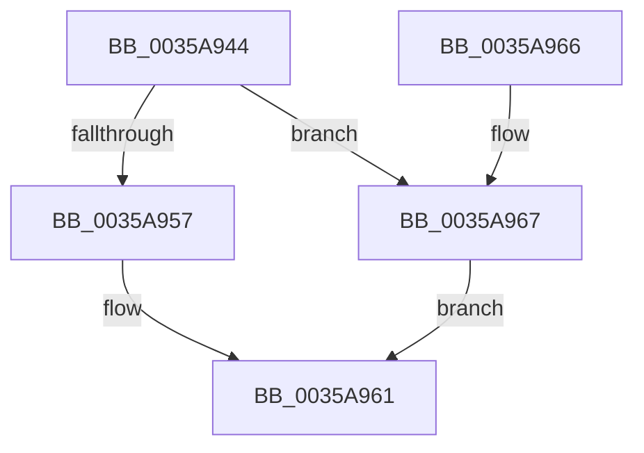

# ExAllocatePoolWithTagFromNode

- RVA: `0x0035A944`–`0x0035A9A8` (길이 `100` bytes)
- VA: `0x000000014035A944`
- 실행 섹션: `.text`
- PDB 이름 있음: `예`; PDB Function 태그: `아니요`
- unwind 정보 RVA: `0x00079A70`
- 디코드: `25`개 명령, `100/100` bytes 표시
- 미해석 바이트: `0` (있으면 어셈블리에 `.byte`로 보존)

> 이 문서는 커널 이미지의 기계어와 PDB 기호를 분석해 생성했습니다. 4번과 5번은 함수 원형과 자료형을 바이너리 사용 방식에서 추정한 C 해석이며 원본 소스 복구 결과는 아닙니다.

## 1. Dependencies

- 직접 호출 지점: **2**; 고유 호출 대상: **2**
- 직접 호출자로 확인된 함수: **10**
- RIP 상대 이미지 참조: **1**

### Outgoing calls
- `0x0035A95C` → [ExpAllocatePoolWithTagFromNode](ExpAllocatePoolWithTagFromNode_function_0035B970.md) (function, `0x0035B970`)
- `0x0035A9A1` → [VfHandlePoolAlloc](../../pagevrfy/BB/VfHandlePoolAlloc_function_00BB8A90.md) (function, `0x00BB8A90`)

### Direct callers
- [CcAsyncCopyRead](CcAsyncCopyRead_function_00358880.md) at `0x00358952`
- [CcInitializeNumaNodeForVolume](../3C/CcInitializeNumaNodeForVolume_function_003CEC44.md) at `0x003CED5B`
- [CcInitializeNumaNodeForVolume](../3C/CcInitializeNumaNodeForVolume_function_003CEC44.md) at `0x003CEDAC`
- [CcInitializeNumaNodeForVolume](../3C/CcInitializeNumaNodeForVolume_function_003CEC44.md) at `0x003CEE16`
- [CcInitializeQuickLWSThreadItem](../3C/CcInitializeQuickLWSThreadItem_function_003CF0EC.md) at `0x003CF11F`
- [CcPostWorkQueueAsyncRead](../45/CcPostWorkQueueAsyncRead_function_0045D624.md) at `0x0045D721`
- [CcInitializeAsyncReadForNodeHelper](../49/CcInitializeAsyncReadForNodeHelper_function_00498CD0.md) at `0x00498D30`
- [CcInitializeAsyncReadForNodeHelper](../49/CcInitializeAsyncReadForNodeHelper_function_00498CD0.md) at `0x00498D5B`
- [CcInitializeAsyncReadForNodeHelper](../49/CcInitializeAsyncReadForNodeHelper_function_00498CD0.md) at `0x00498D7D`
- [CcInitializeAsyncReadForNodeHelper](../49/CcInitializeAsyncReadForNodeHelper_function_00498CD0.md) at `0x00498DA2`
- [CcInitializeAsyncReadForNodeHelper](../49/CcInitializeAsyncReadForNodeHelper_function_00498CD0.md) at `0x00498DC8`
- [CcInitializeAsyncReadForNodeHelper](../49/CcInitializeAsyncReadForNodeHelper_function_00498CD0.md) at `0x00498DEA`
- [CcInitializeAsyncReadForNodeHelper](../49/CcInitializeAsyncReadForNodeHelper_function_00498CD0.md) at `0x00498E0C`
- [CcInitializeAsyncReadForNodeHelper](../49/CcInitializeAsyncReadForNodeHelper_function_00498CD0.md) at `0x00498F44`
- [CcInitializeAsyncReadForNodeHelper](../49/CcInitializeAsyncReadForNodeHelper_function_00498CD0.md) at `0x00499026`
- [CcInitializePartition](../57/CcInitializePartition_function_0057E4D8.md) at `0x0057EAA8`
- [CcInitializeAsyncLazywriteForNodeHelper](../57/CcInitializeAsyncLazywriteForNodeHelper_function_0057F020.md) at `0x0057F0D0`
- [CcInitializeAsyncLazywriteForNodeHelper](../57/CcInitializeAsyncLazywriteForNodeHelper_function_0057F020.md) at `0x0057F11B`
- [CcInitializeAsyncLazywriteForNodeHelper](../57/CcInitializeAsyncLazywriteForNodeHelper_function_0057F020.md) at `0x0057F199`
- [CcInitializeNumaNode](../57/CcInitializeNumaNode_function_0057F2AC.md) at `0x0057F383`
- [CcInitializeNumaNode](../57/CcInitializeNumaNode_function_0057F2AC.md) at `0x0057F401`
- [CcInitializeNumaNode](../57/CcInitializeNumaNode_function_0057F2AC.md) at `0x0057F478`
- [CcWriteBehindAsyncPreProcess](../57/CcWriteBehindAsyncPreProcess_function_0057FB6C.md) at `0x0057FBDD`
- [sub_006E299E](../6E/Unknown_function_006E299E.md) at `0x006E29E9`

### Static image references
- `0x0035A94D` → RVA `0x00FC6BD0` (`ALMOSTRO`; read)

## 2. Other-region calls and transfers

- 다른 실행 섹션으로 향하는 call: **1**
  - `0x0035A9A1` → [VfHandlePoolAlloc](../../pagevrfy/BB/VfHandlePoolAlloc_function_00BB8A90.md) (`.text` → `PAGEVRFY`)
- 별도 외부 분기/꼬리 이동을 확인하지 못했습니다.

## 3. Assembly (complete function range)

```asm
0035A944  48 83 EC 58                     sub rsp, 0x58
0035A948  83 64 24 4C 00                  and dword ptr [rsp + 0x4c], 0
0035A94D  8B 05 7D C2 C6 00               mov eax, dword ptr [rip + 0xc6c27d]
0035A953  A8 08                           test al, 8
0035A955  75 10                           jne 0x14035a967
0035A957  B9 42 00 00 00                  mov ecx, 0x42
0035A95C  E8 0F 10 00 00                  call 0x14035b970
0035A961  48 83 C4 58                     add rsp, 0x58
0035A965  C3                              ret
0035A966  CC                              int3
0035A967  48 8B 44 24 58                  mov rax, qword ptr [rsp + 0x58]
0035A96C  B9 01 00 00 00                  mov ecx, 1
0035A971  48 89 44 24 38                  mov qword ptr [rsp + 0x38], rax
0035A976  45 8B C8                        mov r9d, r8d
0035A979  89 4C 24 30                     mov dword ptr [rsp + 0x30], ecx
0035A97D  48 8D 44 24 40                  lea rax, [rsp + 0x40]
0035A982  4C 8B C2                        mov r8, rdx
0035A985  48 89 44 24 28                  mov qword ptr [rsp + 0x28], rax
0035A98A  83 64 24 20 00                  and dword ptr [rsp + 0x20], 0
0035A98F  8D 51 41                        lea edx, [rcx + 0x41]
0035A992  48 89 4C 24 40                  mov qword ptr [rsp + 0x40], rcx
0035A997  33 C9                           xor ecx, ecx
0035A999  C7 44 24 48 20 00 00 00         mov dword ptr [rsp + 0x48], 0x20
0035A9A1  E8 EA E0 85 00                  call 0x140bb8a90
0035A9A6  EB B9                           jmp 0x14035a961
```

## 4. C-style interpretation (structured pseudocode)

```c
__int64 __fastcall ExAllocatePoolWithTagFromNode(__int64 a1, __int64 a2, int a3)
{
    __int64 result;
    __int64 v_rsp;
    unsigned int v_stack_mC;
    unsigned int v_stack_p20;
    unsigned __int64 v_stack_p28;
    unsigned int v_stack_p30;
    unsigned __int64 v_stack_p38;
    unsigned __int64 v_stack_p40;
    unsigned int v_stack_p48;
    unsigned __int64 v_stack_p58;

    v_rsp = (v_rsp) - (88);
    if ((((unsigned __int8)((unsigned int)(*(unsigned int *)(v_rip + 13025917)))) & (8)) != 0) goto loc_0035A967;
    result = ExpAllocatePoolWithTagFromNode(66, a2, a3, a4);
loc_0035A961:
    v_rsp = (v_rsp) + (88);
    return result;
loc_0035A967:
    v_stack_p38 = v_stack_p58;
    v_stack_p30 = 1;
    v_stack_p28 = v_stack_p40;
    v_stack_p40 = 1;
    a1 = 0;
    v_stack_p48 = 32;
    result = VfHandlePoolAlloc(a1, 1 + 65, a2, (unsigned int)(a3));
    goto loc_0035A961;
}
```

## 5. (Beta) C Style

```c
int64_t ExAllocatePoolWithTagFromNode(int64_t Arg1, int64_t Arg2, int32_t Arg3)
{
    int64_t result;
    int64_t local_rsp;
    uint32_t v_stack_mC;
    uint32_t v_stack_p20;
    uint64_t v_stack_p28;
    uint32_t v_stack_p30;
    uint64_t v_stack_p38;
    uint64_t v_stack_p40;
    uint32_t v_stack_p48;
    uint64_t v_stack_p58;

    local_rsp = (local_rsp) - (88);
    if ((((uint8_t)((uint32_t)(*(uint32_t *)(v_rip + 0xC6C27D)))) & (8)) != 0) goto loc_0035A967;
    result = ExpAllocatePoolWithTagFromNode(66, Arg2, Arg3, a4);
loc_0035A961:
    local_rsp = (local_rsp) + (88);
    return result;
loc_0035A967:
    v_stack_p38 = v_stack_p58;
    v_stack_p30 = 1;
    v_stack_p28 = v_stack_p40;
    v_stack_p40 = 1;
    Arg1 = 0;
    v_stack_p48 = 32;
    result = VfHandlePoolAlloc(Arg1, 1 + 65, Arg2, (uint32_t)(Arg3));
    goto loc_0035A961;
}
```

## 6. Execution-region graph

[열기: 2D/3D 그래프와 함수 탐색 컨트롤 패널](../../../control-panel.html?section=text&rva=0x0035A944&view=graph)

- 2D 그래프는 위에서 아래로 흐르고, 3D 그래프는 빈 공간을 드래그해 회전합니다. Shift+드래그는 이동, 휠은 확대·축소, 함수 노드 선택은 대상 보고서 이동입니다.

### Static fallback


