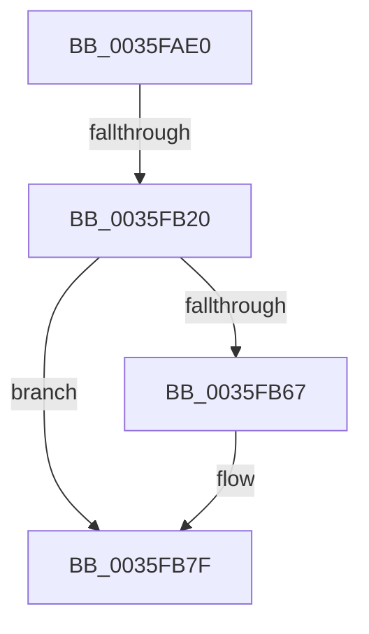

# ExFreeHeapPool

- RVA: `0x0035FAE0`–`0x0035FB85` (길이 `165` bytes)
- VA: `0x000000014035FAE0`
- 실행 섹션: `.text`
- PDB 이름 있음: `예`; PDB Function 태그: `아니요`
- unwind 정보 RVA: `0x00079C34`
- 디코드: `42`개 명령, `165/165` bytes 표시
- 미해석 바이트: `0` (있으면 어셈블리에 `.byte`로 보존)

> 이 문서는 커널 이미지의 기계어와 PDB 기호를 분석해 생성했습니다. 4번과 5번은 함수 원형과 자료형을 바이너리 사용 방식에서 추정한 C 해석이며 원본 소스 복구 결과는 아닙니다.

## 1. Dependencies

- 직접 호출 지점: **1**; 고유 호출 대상: **1**
- 직접 호출자로 확인된 함수: **3**
- RIP 상대 이미지 참조: **2**

### Outgoing calls
- `0x0035FB79` → [KeBugCheckEx](../4F/KeBugCheckEx_function_004FD660.md) (function, `0x004FD660`)

### Direct callers
- [MiUnlockAndDereferenceVadShared](../2A/MiUnlockAndDereferenceVadShared_function_002AEF10.md) at `0x002AEF93`
- [ExAllocateContiguousHeapPool](../2E/ExAllocateContiguousHeapPool_function_002EE960.md) at `0x002EEB3C`
- [MiUnlockAndDereferenceVad](../31/MiUnlockAndDereferenceVad_function_00316E60.md) at `0x00316EE3`

### Static image references
- `0x0035FB4D` → RVA `0x00E28300` (`.data`; read)
- `0x0035FB7F` → RVA `0x00EFED20` (`.data`; read)

## 2. Other-region calls and transfers

- 다른 실행 섹션으로 향하는 call: **0**
- call이 아닌 외부 분기/꼬리 이동: **1**
  - `0x0035FB1A` → [sub_00360911](../36/Unknown_function_00360911.md) (`tail-transfer`)

## 3. Assembly (complete function range)

```asm
0035FAE0  48 89 4C 24 08                  mov qword ptr [rsp + 8], rcx
0035FAE5  55                              push rbp
0035FAE6  41 54                           push r12
0035FAE8  41 55                           push r13
0035FAEA  41 57                           push r15
0035FAEC  48 8D 6C 24 C1                  lea rbp, [rsp - 0x3f]
0035FAF1  48 81 EC E8 00 00 00            sub rsp, 0xe8
0035FAF8  0F 57 C0                        xorps xmm0, xmm0
0035FAFB  45 33 FF                        xor r15d, r15d
0035FAFE  4C 8B E1                        mov r12, rcx
0035FB01  0F 11 45 DF                     movups xmmword ptr [rbp - 0x21], xmm0
0035FB05  66 C7 45 DF 01 01               mov word ptr [rbp - 0x21], 0x101
0035FB0B  C6 45 DF 03                     mov byte ptr [rbp - 0x21], 3
0035FB0F  C6 45 DF 03                     mov byte ptr [rbp - 0x21], 3
0035FB13  C6 45 E1 00                     mov byte ptr [rbp - 0x1f], 0
0035FB17  66 85 C9                        test cx, cx
0035FB1A  0F 84 F1 0D 00 00               je 0x140360911
0035FB20  41 8B C7                        mov eax, r15d
0035FB23  48 98                           cdqe
0035FB25  C7 45 CF 00 00 10 00            mov dword ptr [rbp - 0x31], 0x100000
0035FB2C  C7 45 D3 00 00 00 01            mov dword ptr [rbp - 0x2d], 0x1000000
0035FB33  44 8B 6C 85 CF                  mov r13d, dword ptr [rbp + rax*4 - 0x31]
0035FB38  48 8D 04 40                     lea rax, [rax + rax*2]
0035FB3C  49 FF CD                        dec r13
0035FB3F  48 C1 E0 06                     shl rax, 6
0035FB43  49 F7 D5                        not r13
0035FB46  4D 23 EC                        and r13, r12
0035FB49  4D 33 6D 10                     xor r13, qword ptr [r13 + 0x10]
0035FB4D  4C 33 2D AC 87 AC 00            xor r13, qword ptr [rip + 0xac87ac]
0035FB54  4C 2B E8                        sub r13, rax
0035FB57  49 81 ED 40 01 00 00            sub r13, 0x140
0035FB5E  4C 89 6D 6F                     mov qword ptr [rbp + 0x6f], r13
0035FB62  4D 85 ED                        test r13, r13
0035FB65  75 18                           jne 0x14035fb7f
0035FB67  4D 8B CC                        mov r9, r12
0035FB6A  4C 89 7C 24 20                  mov qword ptr [rsp + 0x20], r15
0035FB6F  45 33 C0                        xor r8d, r8d
0035FB72  33 D2                           xor edx, edx
0035FB74  B9 C2 00 00 00                  mov ecx, 0xc2
0035FB79  E8 E2 DA 19 00                  call 0x1404fd660
0035FB7E  CC                              int3
0035FB7F  8B 05 9B F1 B9 00               mov eax, dword ptr [rip + 0xb9f19b]
```

## 4. C-style interpretation (structured pseudocode)

```c
__int64 __fastcall ExFreeHeapPool(__int64 a1, int a2, int a3)
{
    __int64 result;
    __int64 v_r13;
    __int64 v_r15;
    __int64 v_rsp;
    unsigned __int64 v_stack_m5F;
    unsigned __int8 v_stack_m7E;
    unsigned __int64 v_stack_m80;
    unsigned int v_stack_m8C;
    unsigned int v_stack_m90;
    unsigned __int64 v_stack_mE8;
    unsigned __int64 v_stack_p10;
    unsigned __int64 v_stack_p8;

    v_stack_p8 = a1;
    v_rsp = (v_rsp) - (232);
    v_r15 = 0;
    v_stack_m80 = v_xmm0;
    v_stack_m80 = 257;
    v_stack_m80 = 3;
    v_stack_m80 = 3;
    v_stack_m7E = 0;
    v_stack_m90 = 0x100000ULL;
    v_stack_m8C = 0x1000000ULL;
    v_r13 = ((unsigned int)(*(unsigned int *)(v_stack_m5F + 0 * 4 - 49))) - 1;
    result = (0 + 0 * 2) << (6);
    v_r13 = ~(v_r13);
    v_r13 = (v_r13) & (a1);
    v_r13 = (v_r13) ^ (*(unsigned __int64 *)(v_r13 + 16));
    v_r13 = (v_r13) ^ (*(unsigned __int64 *)(v_rip + 11306924));
    v_r13 = (v_r13) - (result);
    v_r13 = (v_r13) - (320);
    v_stack_p10 = v_r13;
    if (v_r13 == 0) {
        a4 = a1;
        v_stack_mE8 = 0;
        a3 = 0;
        a2 = 0;
        a1 = 194;
        result = KeBugCheckEx(a1, a2, a3, a4);
    }
    return (unsigned int)(*(unsigned int *)(v_rip + 12186011));
}
```

## 5. (Beta) C Style

```c
int64_t ExFreeHeapPool(int64_t Arg1, int32_t Arg2, int32_t Arg3)
{
    int64_t result;
    int64_t local_r13;
    int64_t local_r15;
    int64_t local_rsp;
    uint64_t v_stack_m5F;
    uint8_t v_stack_m7E;
    uint64_t v_stack_m80;
    uint32_t v_stack_m8C;
    uint32_t v_stack_m90;
    uint64_t v_stack_mE8;
    uint64_t v_stack_p10;
    uint64_t v_stack_p8;

    v_stack_p8 = Arg1;
    local_rsp = (local_rsp) - (232);
    local_r15 = 0;
    v_stack_m80 = v_xmm0;
    v_stack_m80 = 257;
    v_stack_m80 = 3;
    v_stack_m80 = 3;
    v_stack_m7E = 0;
    v_stack_m90 = 0x100000ULL;
    v_stack_m8C = 0x1000000ULL;
    local_r13 = ((uint32_t)(*(uint32_t *)(v_stack_m5F + 0x0 * 4 - 0x31))) - 1;
    result = (0 + 0 * 2) << (6);
    local_r13 = ~(local_r13);
    local_r13 = (local_r13) & (Arg1);
    local_r13 = (local_r13) ^ (*(uint64_t *)(local_r13 + 0x10));
    local_r13 = (local_r13) ^ (*(uint64_t *)(v_rip + 0xAC87AC));
    local_r13 = (local_r13) - (result);
    local_r13 = (local_r13) - (320);
    v_stack_p10 = local_r13;
    if (local_r13 == 0) {
        a4 = Arg1;
        v_stack_mE8 = 0;
        Arg3 = 0;
        Arg2 = 0;
        Arg1 = 194;
        result = KeBugCheckEx(Arg1, Arg2, Arg3, a4);
    }
    return (uint32_t)(*(uint32_t *)(v_rip + 0xB9F19B));
}
```

## 6. Execution-region graph

[열기: 2D/3D 그래프와 함수 탐색 컨트롤 패널](../../../control-panel.html?section=text&rva=0x0035FAE0&view=graph)

- 2D 그래프는 위에서 아래로 흐르고, 3D 그래프는 빈 공간을 드래그해 회전합니다. Shift+드래그는 이동, 휠은 확대·축소, 함수 노드 선택은 대상 보고서 이동입니다.

### Static fallback


