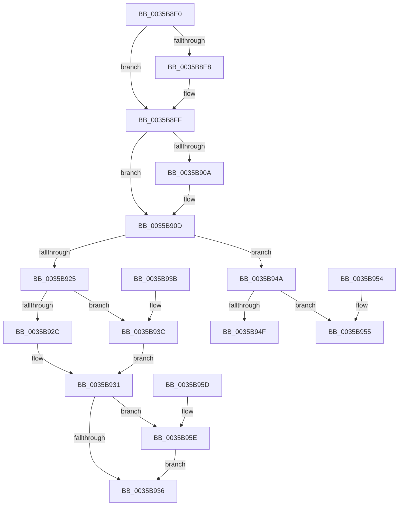

# ExGetHeapFromType

- RVA: `0x0035B8E0`–`0x0035B967` (길이 `135` bytes)
- VA: `0x000000014035B8E0`
- 실행 섹션: `.text`
- PDB 이름 있음: `예`; PDB Function 태그: `아니요`
- unwind 정보 RVA: `0x000DB714`
- 디코드: `37`개 명령, `135/135` bytes 표시
- 미해석 바이트: `0` (있으면 어셈블리에 `.byte`로 보존)

> 이 문서는 커널 이미지의 기계어와 PDB 기호를 분석해 생성했습니다. 4번과 5번은 함수 원형과 자료형을 바이너리 사용 방식에서 추정한 C 해석이며 원본 소스 복구 결과는 아닙니다.

## 1. Dependencies

- 직접 호출 지점: **0**; 고유 호출 대상: **0**
- 직접 호출자로 확인된 함수: **1**
- RIP 상대 이미지 참조: **4**

### Outgoing calls
- 직접 디코드된 call 명령이 없습니다.

### Direct callers
- [ExAllocateHeapPool](ExAllocateHeapPool_function_0035BA30.md) at `0x0035ED0C`

### Static image references
- `0x0035B902` → RVA `0x00E6BF10` (`.data`; read)
- `0x0035B90F` → RVA `0x00E6BF40` (`.data`; read)
- `0x0035B955` → RVA `0x00EEEF58` (`.data`; read)
- `0x0035B95E` → RVA `0x00EEEF40` (`.data`; read)

## 2. Other-region calls and transfers

- 다른 실행 섹션으로 향하는 call: **0**
- 별도 외부 분기/꼬리 이동을 확인하지 못했습니다.

## 3. Assembly (complete function range)

```asm
0035B8E0  81 FA 00 00 00 80               cmp edx, 0x80000000
0035B8E6  75 17                           jne 0x14035b8ff
0035B8E8  65 48 8B 04 25 20 00 00 00      mov rax, qword ptr gs:[0x20]
0035B8F1  48 8B 90 C0 00 00 00            mov rdx, qword ptr [rax + 0xc0]
0035B8F8  0F B7 92 8A 00 00 00            movzx edx, word ptr [rdx + 0x8a]
0035B8FF  45 33 C9                        xor r9d, r9d
0035B902  3B 15 08 06 B1 00               cmp edx, dword ptr [rip + 0xb10608]
0035B908  72 03                           jb 0x14035b90d
0035B90A  41 8B D1                        mov edx, r9d
0035B90D  8B C2                           mov eax, edx
0035B90F  48 8D 15 2A 06 B1 00            lea rdx, [rip + 0xb1062a]
0035B916  48 69 C0 C0 20 00 00            imul rax, rax, 0x20c0
0035B91D  48 03 C2                        add rax, rdx
0035B920  F6 C1 10                        test cl, 0x10
0035B923  75 25                           jne 0x14035b94a
0035B925  48 0F BA E1 08                  bt rcx, 8
0035B92A  73 10                           jae 0x14035b93c
0035B92C  BA 02 00 00 00                  mov edx, 2
0035B931  45 85 C0                        test r8d, r8d
0035B934  75 28                           jne 0x14035b95e
0035B936  48 8B 04 D0                     mov rax, qword ptr [rax + rdx*8]
0035B93A  C3                              ret
0035B93B  CC                              int3
0035B93C  F6 C1 80                        test cl, 0x80
0035B93F  BA 01 00 00 00                  mov edx, 1
0035B944  49 0F 45 D1                     cmovne rdx, r9
0035B948  EB E7                           jmp 0x14035b931
0035B94A  45 85 C0                        test r8d, r8d
0035B94D  75 06                           jne 0x14035b955
0035B94F  48 8B 40 18                     mov rax, qword ptr [rax + 0x18]
0035B953  C3                              ret
0035B954  CC                              int3
0035B955  48 8B 05 FC 35 B9 00            mov rax, qword ptr [rip + 0xb935fc]
0035B95C  C3                              ret
0035B95D  CC                              int3
0035B95E  48 8D 05 DB 35 B9 00            lea rax, [rip + 0xb935db]
0035B965  EB CF                           jmp 0x14035b936
```

## 4. C-style interpretation (structured pseudocode)

```c
__int64 __fastcall ExGetHeapFromType(__int64 a1, int a2, int a3, int a4)
{
    __int64 result;

    if (a2 == 0x80000000ULL) {
        result = *(unsigned __int64 *)(gs_base + (0 + 32));
        a2 = *(unsigned __int64 *)(result + 192);
        a2 = *(unsigned __int16 *)(a2 + 138);
    }
    a4 = 0;
    if (a2 >= (*(unsigned int *)(v_rip + 11601416))) {
        a2 = 0;
    }
    result = ((unsigned int)(a2)) * ((unsigned int)(a2));
    result = (result) + (v_rip + 11601450);
    if ((((unsigned __int8)(a1)) & (16)) != 0) goto loc_0035B94A;
    if (condition_is_above_or_equal) goto loc_0035B93C;
loc_0035B931:
    if (a3 != 0) goto loc_0035B95E;
loc_0035B936:
    return *(unsigned __int64 *)(result + 2 * 8);
loc_0035B93C:
    a2 = 1;
    if ((((unsigned __int8)(a1)) & (128)) != 0) { a2 = 0; }
    goto loc_0035B931;
loc_0035B94A:
    if (a3 != 0) goto loc_0035B955;
    return *(unsigned __int64 *)(*(unsigned __int64 *)(result + 2 * 8) + 24);
loc_0035B955:
    return *(unsigned __int64 *)(v_rip + 12137980);
loc_0035B95E:
    goto loc_0035B936;
}
```

## 5. (Beta) C Style

```c
int64_t ExGetHeapFromType(int64_t Arg1, int32_t Arg2, int32_t Arg3, int32_t Arg4)
{
    int64_t result;

    if (Arg2 == 0x80000000ULL) {
        result = *(uint64_t *)(gs_base + (0 + 0x20));
        Arg2 = *(uint64_t *)(result + 0xC0);
        Arg2 = *(uint16_t *)(Arg2 + 0x8A);
    }
    Arg4 = 0;
    if (Arg2 >= (*(uint32_t *)(v_rip + 0xB10608))) {
        Arg2 = 0;
    }
    result = ((uint32_t)(Arg2)) * ((uint32_t)(Arg2));
    result = (result) + (v_rip + 11601450);
    if ((((uint8_t)(Arg1)) & (16)) != 0) goto loc_0035B94A;
    if (condition_is_above_or_equal) goto loc_0035B93C;
loc_0035B931:
    if (Arg3 != 0) goto loc_0035B95E;
loc_0035B936:
    return *(uint64_t *)(result + 0x2 * 8);
loc_0035B93C:
    Arg2 = 1;
    if ((((uint8_t)(Arg1)) & (128)) != 0) { Arg2 = 0; }
    goto loc_0035B931;
loc_0035B94A:
    if (Arg3 != 0) goto loc_0035B955;
    return *(uint64_t *)(*(uint64_t *)(result + 0x2 * 8) + 0x18);
loc_0035B955:
    return *(uint64_t *)(v_rip + 0xB935FC);
loc_0035B95E:
    goto loc_0035B936;
}
```

## 6. Execution-region graph

[열기: 2D/3D 그래프와 함수 탐색 컨트롤 패널](../../../control-panel.html?section=text&rva=0x0035B8E0&view=graph)

- 2D 그래프는 위에서 아래로 흐르고, 3D 그래프는 빈 공간을 드래그해 회전합니다. Shift+드래그는 이동, 휠은 확대·축소, 함수 노드 선택은 대상 보고서 이동입니다.

### Static fallback


