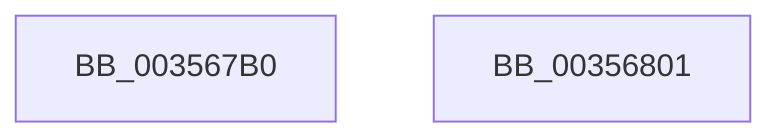

# ExQueueWorkItemEx

- RVA: `0x003567B0`–`0x00356802` (길이 `82` bytes)
- VA: `0x00000001403567B0`
- 실행 섹션: `.text`
- PDB 이름 있음: `예`; PDB Function 태그: `아니요`
- unwind 정보 RVA: `0x000794E0`
- 디코드: `23`개 명령, `82/82` bytes 표시
- 미해석 바이트: `0` (있으면 어셈블리에 `.byte`로 보존)

> 이 문서는 커널 이미지의 기계어와 PDB 기호를 분석해 생성했습니다. 4번과 5번은 함수 원형과 자료형을 바이너리 사용 방식에서 추정한 C 해석이며 원본 소스 복구 결과는 아닙니다.

## 1. Dependencies

- 직접 호출 지점: **3**; 고유 호출 대상: **3**
- 직접 호출자로 확인된 함수: **3**
- RIP 상대 이미지 참조: **1**

### Outgoing calls
- `0x003567C7` → [ExpValidateWorkItem](ExpValidateWorkItem_function_00358680.md) (function, `0x00358680`)
- `0x003567CE` → [ExpTypeToPriority](ExpTypeToPriority_function_00358660.md) (function, `0x00358660`)
- `0x003567EC` → [ExpQueueWorkItem](ExpQueueWorkItem_function_00358400.md) (function, `0x00358400`)

### Direct callers
- [KeTerminateThread](KeTerminateThread_function_00355138.md) at `0x0035534B`
- [PopFxResidentTimeoutDpcRoutine](../4A/PopFxResidentTimeoutDpcRoutine_function_004A54C0.md) at `0x004A54D4`
- [PopPepIdleTimeoutDpcRoutine](../4A/PopPepIdleTimeoutDpcRoutine_function_004A5B60.md) at `0x004A5B74`

### Static image references
- `0x003567D3` → RVA `0x00FC6EA0` (`ALMOSTRO`; read)

## 2. Other-region calls and transfers

- 다른 실행 섹션으로 향하는 call: **0**
- 별도 외부 분기/꼬리 이동을 확인하지 못했습니다.

## 3. Assembly (complete function range)

```asm
003567B0  48 89 5C 24 08                  mov qword ptr [rsp + 8], rbx
003567B5  48 89 74 24 10                  mov qword ptr [rsp + 0x10], rsi
003567BA  57                              push rdi
003567BB  48 83 EC 30                     sub rsp, 0x30
003567BF  41 8B F8                        mov edi, r8d
003567C2  8B DA                           mov ebx, edx
003567C4  48 8B F1                        mov rsi, rcx
003567C7  E8 B4 1E 00 00                  call 0x140358680
003567CC  8B CB                           mov ecx, ebx
003567CE  E8 8D 1E 00 00                  call 0x140358660
003567D3  48 8B 0D C6 06 C7 00            mov rcx, qword ptr [rip + 0xc706c6]
003567DA  44 8B CF                        mov r9d, edi
003567DD  83 64 24 20 00                  and dword ptr [rsp + 0x20], 0
003567E2  44 8B C0                        mov r8d, eax
003567E5  48 8B D6                        mov rdx, rsi
003567E8  48 8B 49 10                     mov rcx, qword ptr [rcx + 0x10]
003567EC  E8 0F 1C 00 00                  call 0x140358400
003567F1  48 8B 5C 24 40                  mov rbx, qword ptr [rsp + 0x40]
003567F6  48 8B 74 24 48                  mov rsi, qword ptr [rsp + 0x48]
003567FB  48 83 C4 30                     add rsp, 0x30
003567FF  5F                              pop rdi
00356800  C3                              ret
00356801  CC                              int3
```

## 4. C-style interpretation (structured pseudocode)

```c
__int64 __fastcall ExQueueWorkItemEx(__int64 a1, int a2, int a3)
{
    __int64 result;
    __int64 v_rsp;
    unsigned int v_stack_m18;
    unsigned __int64 v_stack_p10;
    unsigned __int64 v_stack_p8;

    v_stack_p8 = v_rbx;
    v_stack_p10 = v_rsi;
    v_rsp = (v_rsp) - (48);
    result = ExpValidateWorkItem(a1, a2, a3, a4);
    result = ExpTypeToPriority((unsigned int)((unsigned int)((unsigned int)(a2))), a2, a3, a4);
    result = ExpQueueWorkItem(*(unsigned __int64 *)(*(unsigned __int64 *)(v_rip + 13043398) + 16), a1, (unsigned int)((unsigned int)(result)), (unsigned int)((unsigned int)((unsigned int)(a3))));
    v_rsp = (v_rsp) + (48);
    return result;
}
```

## 5. (Beta) C Style

```c
int64_t ExQueueWorkItemEx(int64_t Arg1, int32_t Arg2, int32_t Arg3)
{
    int64_t result;
    int64_t local_rsp;
    uint32_t v_stack_m18;
    uint64_t v_stack_p10;
    uint64_t v_stack_p8;

    v_stack_p8 = local_rbx;
    v_stack_p10 = local_rsi;
    local_rsp = (local_rsp) - (48);
    result = ExpValidateWorkItem(Arg1, Arg2, Arg3, a4);
    result = ExpTypeToPriority((uint32_t)((uint32_t)((uint32_t)(Arg2))), Arg2, Arg3, a4);
    result = ExpQueueWorkItem(*(uint64_t *)(*(uint64_t *)(v_rip + 0xC706C6) + 0x10), Arg1, (uint32_t)((uint32_t)(result)), (uint32_t)((uint32_t)((uint32_t)(Arg3))));
    local_rsp = (local_rsp) + (48);
    return result;
}
```

## 6. Execution-region graph

[열기: 2D/3D 그래프와 함수 탐색 컨트롤 패널](../../../control-panel.html?section=text&rva=0x003567B0&view=graph)

- 2D 그래프는 위에서 아래로 흐르고, 3D 그래프는 빈 공간을 드래그해 회전합니다. Shift+드래그는 이동, 휠은 확대·축소, 함수 노드 선택은 대상 보고서 이동입니다.

### Static fallback


