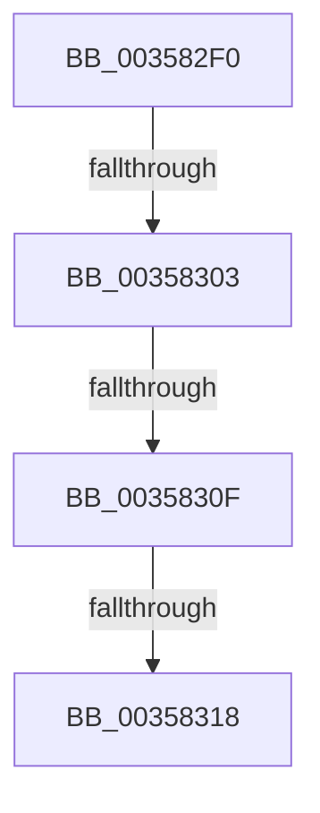

# ExQueueWorkItemFromIo

- RVA: `0x003582F0`–`0x0035832F` (길이 `63` bytes)
- VA: `0x00000001403582F0`
- 실행 섹션: `.text`
- PDB 이름 있음: `예`; PDB Function 태그: `아니요`
- unwind 정보 RVA: `0x000796E4`
- 디코드: `14`개 명령, `63/63` bytes 표시
- 미해석 바이트: `0` (있으면 어셈블리에 `.byte`로 보존)

> 이 문서는 커널 이미지의 기계어와 PDB 기호를 분석해 생성했습니다. 4번과 5번은 함수 원형과 자료형을 바이너리 사용 방식에서 추정한 C 해석이며 원본 소스 복구 결과는 아닙니다.

## 1. Dependencies

- 직접 호출 지점: **0**; 고유 호출 대상: **0**
- 직접 호출자로 확인된 함수: **2**
- RIP 상대 이미지 참조: **0**

### Outgoing calls
- 직접 디코드된 call 명령이 없습니다.

### Direct callers
- [IoQueueWorkItem](IoQueueWorkItem_function_00357F80.md) at `0x0035805B`
- [IoQueueWorkItemEx](IoQueueWorkItemEx_function_00358140.md) at `0x00358217`

### Static image references
- 디코드된 RIP-relative 메모리 참조가 없습니다.

## 2. Other-region calls and transfers

- 다른 실행 섹션으로 향하는 call: **0**
- call이 아닌 외부 분기/꼬리 이동: **4**
  - `0x003582FD` → [sub_0035839C + 0x1](Unknown_function_0035839C.md) (`tail-transfer`)
  - `0x00358309` → [sub_0035839C + 0x3C](Unknown_function_0035839C.md) (`tail-transfer`)
  - `0x00358312` → [sub_0035839C + 0x3C](Unknown_function_0035839C.md) (`tail-transfer`)
  - `0x00358329` → [sub_0035839C + 0x20](Unknown_function_0035839C.md) (`tail-transfer`)

## 3. Assembly (complete function range)

```asm
003582F0  40 53                           push rbx
003582F2  48 83 EC 30                     sub rsp, 0x30
003582F6  48 83 39 00                     cmp qword ptr [rcx], 0
003582FA  48 8B D9                        mov rbx, rcx
003582FD  0F 85 9A 00 00 00               jne 0x14035839d
00358303  8D 42 F9                        lea eax, [rdx - 7]
00358306  83 F8 18                        cmp eax, 0x18
00358309  0F 86 C9 00 00 00               jbe 0x1403583d8
0035830F  83 FA 40                        cmp edx, 0x40
00358312  0F 8D C0 00 00 00               jge 0x1403583d8
00358318  4C 8B 49 10                     mov r9, qword ptr [rcx + 0x10]
0035831C  48 B8 00 00 00 00 00 80 FF FF   movabs rax, 0xffff800000000000
00358326  4C 3B C8                        cmp r9, rax
00358329  0F 82 8D 00 00 00               jb 0x1403583bc
```

## 4. C-style interpretation (structured pseudocode)

```c
__int64 __fastcall ExQueueWorkItemFromIo(__int64 a1, __int64 a2)
{
    __int64 v_rsp;

    v_rsp = (v_rsp) - (48);
}
```

## 5. (Beta) C Style

```c
int64_t ExQueueWorkItemFromIo(void *Arg1, void *Arg2)
{
    uint8_t *arg1 = (uint8_t *)Arg1;
    uint8_t *arg2 = (uint8_t *)Arg2;

    int64_t local_rsp;

    local_rsp = (local_rsp) - (48);
}
```

### 관측된 메모리 오프셋

구조체 형식이 확인되지 않은 접근은 인자 기준의 오프셋으로만 기록했습니다.

| 기준 인자 | 오프셋 표현 | 폭 (bit) | 접근 |
|---|---:|---:|---|
| `Arg1` | `+ 0x0` | `64` | `R` |
| `Arg1` | `+ 0x10` | `64` | `R` |
| `Arg2` | `- 0x7` | `32` | `R` |

## 6. Execution-region graph

[열기: 2D/3D 그래프와 함수 탐색 컨트롤 패널](../../../control-panel.html?section=text&rva=0x003582F0&view=graph)

- 2D 그래프는 위에서 아래로 흐르고, 3D 그래프는 빈 공간을 드래그해 회전합니다. Shift+드래그는 이동, 휠은 확대·축소, 함수 노드 선택은 대상 보고서 이동입니다.

### Static fallback


