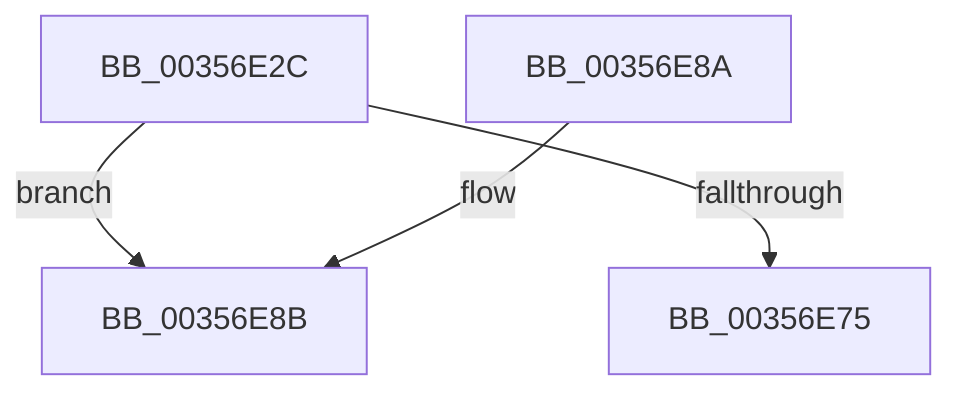

# ExQueueWorkItemToPartition

- RVA: `0x00356E2C`–`0x00356EA6` (길이 `122` bytes)
- VA: `0x0000000140356E2C`
- 실행 섹션: `.text`
- PDB 이름 있음: `예`; PDB Function 태그: `아니요`
- unwind 정보 RVA: `0x00069420`
- 디코드: `35`개 명령, `122/122` bytes 표시
- 미해석 바이트: `0` (있으면 어셈블리에 `.byte`로 보존)

> 이 문서는 커널 이미지의 기계어와 PDB 기호를 분석해 생성했습니다. 4번과 5번은 함수 원형과 자료형을 바이너리 사용 방식에서 추정한 C 해석이며 원본 소스 복구 결과는 아닙니다.

## 1. Dependencies

- 직접 호출 지점: **4**; 고유 호출 대상: **4**
- 직접 호출자로 확인된 함수: **27**
- RIP 상대 이미지 참조: **0**

### Outgoing calls
- `0x00356E4E` → [ExpValidateWorkItem](ExpValidateWorkItem_function_00358680.md) (function, `0x00358680`)
- `0x00356E55` → [ExpTypeToPriority](ExpTypeToPriority_function_00358660.md) (function, `0x00358660`)
- `0x00356E6C` → [ExpQueueWorkItem](ExpQueueWorkItem_function_00358400.md) (function, `0x00358400`)
- `0x00356EA0` → [KeBugCheckEx](../4F/KeBugCheckEx_function_004FD660.md) (function, `0x004FD660`)

### Direct callers
- [SMKM_STORE_MGR&lt;SM_TRAITS&gt;::SmFeEvictComplete](../26/SMKM_STORE_MGR_SM_TRAITS_SmFeEvictComplete_function_00266854.md) at `0x00266B04`
- [MiCheckZeroFreeRebalance](../28/MiCheckZeroFreeRebalance_function_0028B1FC.md) at `0x0028B30B`
- [MiLaunchZeroWorkers](../2C/MiLaunchZeroWorkers_function_002CAF28.md) at `0x002CAFEE`
- [MiCheckTrimUnusedPageFileRegions](../2D/MiCheckTrimUnusedPageFileRegions_function_002DB684.md) at `0x002DB72B`
- [CcPostWorkQueueRegular](CcPostWorkQueueRegular_function_00356834.md) at `0x0035696E`
- [CcPostWorkQueueCachemapUninit](CcPostWorkQueueCachemapUninit_function_00356C94.md) at `0x00356DF6`
- [MiWakeLargePageRebuild](../3B/MiWakeLargePageRebuild_function_003BA2C8.md) at `0x003BA38B`
- [SmKmStoreDeleteWhenEmpty](../45/SmKmStoreDeleteWhenEmpty_function_00450D50.md) at `0x00450E69`
- [MmInSwapWorkingSet](../45/MmInSwapWorkingSet_function_0045B6C4.md) at `0x0045B8A7`
- [CcPostWorkQueueAsyncRead](../45/CcPostWorkQueueAsyncRead_function_0045D624.md) at `0x0045D7FD`
- [CcPostWorkQueueAsyncRead](../45/CcPostWorkQueueAsyncRead_function_0045D624.md) at `0x0045D8CD`
- [CcAsyncReadWorker](../45/CcAsyncReadWorker_function_0045DB10.md) at `0x0045E053`
- [MiAsyncSlabReplenish](../4A/MiAsyncSlabReplenish_function_004AA54C.md) at `0x004AA605`
- [SmQueueExWorkItem](../4B/SmQueueExWorkItem_function_004B400C.md) at `0x004B401C`
- [CcPostWorkQueueAsyncLazywrite](../4B/CcPostWorkQueueAsyncLazywrite_function_004BA17C.md) at `0x004BA299`
- [CcPostWorkQueueSpecial](../4C/CcPostWorkQueueSpecial_function_004C046C.md) at `0x004C0558`
- [CcPostPVCMForDeleteToPartition](../4C/CcPostPVCMForDeleteToPartition_function_004C2DBC.md) at `0x004C2ECA`
- [CcIncrementWriteBehindPriority](../57/CcIncrementWriteBehindPriority_function_0057B8AC.md) at `0x0057BA33`
- [CcReEngageWorkerThreads](../57/CcReEngageWorkerThreads_function_0057BEB0.md) at `0x0057BF2C`
- [CcReEngageWorkerThreads](../57/CcReEngageWorkerThreads_function_0057BEB0.md) at `0x0057BF83`
- [CcPVCMDelayedDeleteTimerDpc](../57/CcPVCMDelayedDeleteTimerDpc_function_0057DC80.md) at `0x0057DC95`
- [MmSetAccessLogging](../68/MmSetAccessLogging_function_0068A188.md) at `0x0068A233`
- [sub_006DDE58](../6D/Unknown_function_006DDE58.md) at `0x006DDED9`
- [sub_006E299E](../6E/Unknown_function_006E299E.md) at `0x006E2A50`
- [sub_006F6D7E](../6F/Unknown_function_006F6D7E.md) at `0x006F6E5E`
- [sub_006F6D7E](../6F/Unknown_function_006F6D7E.md) at `0x006F6EF2`
- [MmScrubMemory](../../page/80/MmScrubMemory_function_0080EFA0.md) at `0x0080F0C8`
- [SmStoreCompressionStop](../../page/A6/SmStoreCompressionStop_function_00A6197C.md) at `0x00A61A35`
- [MiInSwapStore](../../page/A6/MiInSwapStore_function_00A61B74.md) at `0x00A61C14`
- [sub_00B37110](../../page/B3/Unknown_function_00B37110.md) at `0x00B3716A`

### Static image references
- 디코드된 RIP-relative 메모리 참조가 없습니다.

## 2. Other-region calls and transfers

- 다른 실행 섹션으로 향하는 call: **0**
- 별도 외부 분기/꼬리 이동을 확인하지 못했습니다.

## 3. Assembly (complete function range)

```asm
00356E2C  48 89 5C 24 08                  mov qword ptr [rsp + 8], rbx
00356E31  48 89 6C 24 10                  mov qword ptr [rsp + 0x10], rbp
00356E36  48 89 74 24 18                  mov qword ptr [rsp + 0x18], rsi
00356E3B  57                              push rdi
00356E3C  48 83 EC 30                     sub rsp, 0x30
00356E40  48 63 FA                        movsxd rdi, edx
00356E43  49 8B D9                        mov rbx, r9
00356E46  8B D7                           mov edx, edi
00356E48  41 8B E8                        mov ebp, r8d
00356E4B  48 8B F1                        mov rsi, rcx
00356E4E  E8 2D 18 00 00                  call 0x140358680
00356E53  8B CF                           mov ecx, edi
00356E55  E8 06 18 00 00                  call 0x140358660
00356E5A  48 8B 4B 10                     mov rcx, qword ptr [rbx + 0x10]
00356E5E  44 8B C0                        mov r8d, eax
00356E61  83 64 24 20 00                  and dword ptr [rsp + 0x20], 0
00356E66  44 8B CD                        mov r9d, ebp
00356E69  48 8B D6                        mov rdx, rsi
00356E6C  E8 8F 15 00 00                  call 0x140358400
00356E71  84 C0                           test al, al
00356E73  74 16                           je 0x140356e8b
00356E75  48 8B 5C 24 40                  mov rbx, qword ptr [rsp + 0x40]
00356E7A  48 8B 6C 24 48                  mov rbp, qword ptr [rsp + 0x48]
00356E7F  48 8B 74 24 50                  mov rsi, qword ptr [rsp + 0x50]
00356E84  48 83 C4 30                     add rsp, 0x30
00356E88  5F                              pop rdi
00356E89  C3                              ret
00356E8A  CC                              int3
00356E8B  4C 8B CF                        mov r9, rdi
00356E8E  48 89 6C 24 20                  mov qword ptr [rsp + 0x20], rbp
00356E93  4C 8B C6                        mov r8, rsi
00356E96  BA 05 00 00 00                  mov edx, 5
00356E9B  B9 E4 00 00 00                  mov ecx, 0xe4
00356EA0  E8 BB 67 1A 00                  call 0x1404fd660
00356EA5  CC                              int3
```

## 4. C-style interpretation (structured pseudocode)

```c
__int64 __fastcall ExQueueWorkItemToPartition(__int64 a1, int a2, int a3, __int64 a4)
{
    __int64 result;
    __int64 v_rsp;
    unsigned int v_stack_m18;
    unsigned __int64 v_stack_p10;
    unsigned __int64 v_stack_p18;
    unsigned __int64 v_stack_p20;
    unsigned __int64 v_stack_p8;

    v_stack_p8 = v_rbx;
    v_stack_p10 = v_rbp;
    v_stack_p18 = v_rsi;
    v_rsp = (v_rsp) - (48);
    result = ExpValidateWorkItem(a1, (unsigned int)((unsigned int)((int)(a2))), a3, a4);
    result = ExpTypeToPriority((unsigned int)((unsigned int)((int)(a2))), (unsigned int)((unsigned int)((int)(a2))), a3, a4);
    result = ExpQueueWorkItem(*(unsigned __int64 *)(a4 + 16), a1, (unsigned int)((unsigned int)(result)), (unsigned int)((unsigned int)((unsigned int)(a3))));
    if ((unsigned __int8)(result) == 0) goto loc_00356E8B;
    v_rsp = (v_rsp) + (48);
    return result;
loc_00356E8B:
    v_stack_p20 = v_stack_p10;
    result = KeBugCheckEx(228, 5, v_stack_p18, (int)(a2));
    return result;
}
```

## 5. (Beta) C Style

```c
int64_t ExQueueWorkItemToPartition(int64_t Arg1, int32_t Arg2, int32_t Arg3, void *Arg4)
{
    uint8_t *arg4 = (uint8_t *)Arg4;

    int64_t result;
    int64_t local_rsp;
    uint32_t v_stack_m18;
    uint64_t v_stack_p10;
    uint64_t v_stack_p18;
    uint64_t v_stack_p20;
    uint64_t v_stack_p8;

    v_stack_p8 = local_rbx;
    v_stack_p10 = local_rbp;
    v_stack_p18 = local_rsi;
    local_rsp = (local_rsp) - (48);
    result = ExpValidateWorkItem(Arg1, (uint32_t)((uint32_t)((int32_t)(Arg2))), Arg3, Arg4);
    result = ExpTypeToPriority((uint32_t)((uint32_t)((int32_t)(Arg2))), (uint32_t)((uint32_t)((int32_t)(Arg2))), Arg3, Arg4);
    result = ExpQueueWorkItem(*(uint64_t *)(arg4 + 0x10), Arg1, (uint32_t)((uint32_t)(result)), (uint32_t)((uint32_t)((uint32_t)(Arg3))));
    if ((uint8_t)(result) == 0) goto loc_00356E8B;
    local_rsp = (local_rsp) + (48);
    return result;
loc_00356E8B:
    v_stack_p20 = v_stack_p10;
    result = KeBugCheckEx(228, 5, v_stack_p18, (int32_t)(Arg2));
    return result;
}
```

### 관측된 메모리 오프셋

구조체 형식이 확인되지 않은 접근은 인자 기준의 오프셋으로만 기록했습니다.

| 기준 인자 | 오프셋 표현 | 폭 (bit) | 접근 |
|---|---:|---:|---|
| `Arg4` | `+ 0x10` | `64` | `R` |

## 6. Execution-region graph

[열기: 2D/3D 그래프와 함수 탐색 컨트롤 패널](../../../control-panel.html?section=text&rva=0x00356E2C&view=graph)

- 2D 그래프는 위에서 아래로 흐르고, 3D 그래프는 빈 공간을 드래그해 회전합니다. Shift+드래그는 이동, 휠은 확대·축소, 함수 노드 선택은 대상 보고서 이동입니다.

### Static fallback


