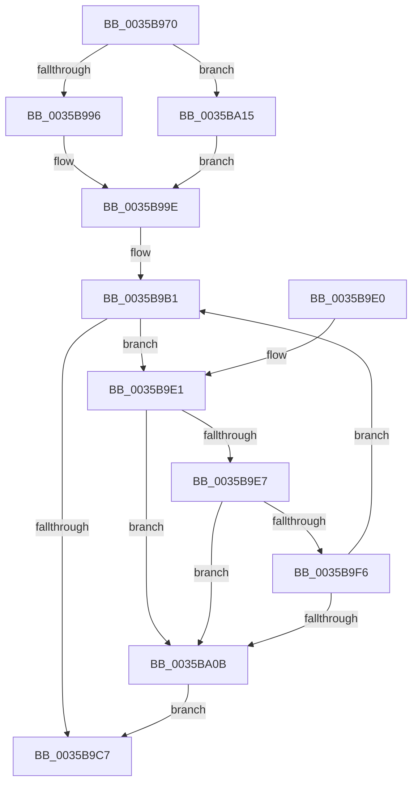

# ExpAllocatePoolWithTagFromNode

- RVA: `0x0035B970`–`0x0035BA1D` (길이 `173` bytes)
- VA: `0x000000014035B970`
- 실행 섹션: `.text`
- PDB 이름 있음: `예`; PDB Function 태그: `아니요`
- unwind 정보 RVA: `0x00079B4C`
- 디코드: `52`개 명령, `173/173` bytes 표시
- 미해석 바이트: `0` (있으면 어셈블리에 `.byte`로 보존)

> 이 문서는 커널 이미지의 기계어와 PDB 기호를 분석해 생성했습니다. 4번과 5번은 함수 원형과 자료형을 바이너리 사용 방식에서 추정한 C 해석이며 원본 소스 복구 결과는 아닙니다.

## 1. Dependencies

- 직접 호출 지점: **1**; 고유 호출 대상: **1**
- 직접 호출자로 확인된 함수: **9**
- RIP 상대 이미지 참조: **3**

### Outgoing calls
- `0x0035B9BD` → [ExAllocateHeapPool](ExAllocateHeapPool_function_0035BA30.md) (function, `0x0035BA30`)

### Direct callers
- [ExAllocatePoolWithTagFromNode](ExAllocatePoolWithTagFromNode_function_0035A944.md) at `0x0035A95C`
- [CcFlushCachePriv](CcFlushCachePriv_function_0035B040.md) at `0x0035B0D7`
- [MiAllocatePool](MiAllocatePool_function_0035B540.md) at `0x0035B5CD`
- [ExAllocatePoolMm](ExAllocatePoolMm_function_0035B690.md) at `0x0035B6FA`
- [MiGetInPageAutoBoostLock](../36/MiGetInPageAutoBoostLock_function_0036D3CC.md) at `0x0036D40A`
- [MiStoreGetWriteSupport](../45/MiStoreGetWriteSupport_function_00456DF0.md) at `0x00456E45`
- [ExAllocatePool2](../../poolcode/B8/ExAllocatePool2_function_00B820F0.md) at `0x00B82175`
- [ExpAllocatePoolWithQuotaTag](../../poolcode/B8/ExpAllocatePoolWithQuotaTag_function_00B82210.md) at `0x00B82260`
- [ExAllocatePool3](../../poolcode/B8/ExAllocatePool3_function_00B84270.md) at `0x00B8433E`

### Static image references
- `0x0035B996` → RVA `0x00FC5000` (`ALMOSTRO`; read)
- `0x0035B9F6` → RVA `0x00E2DBD0` (`.data`; read)
- `0x0035BA0B` → RVA `0x00EFED28` (`.data`; read/write)

## 2. Other-region calls and transfers

- 다른 실행 섹션으로 향하는 call: **0**
- 별도 외부 분기/꼬리 이동을 확인하지 못했습니다.

## 3. Assembly (complete function range)

```asm
0035B970  48 89 5C 24 08                  mov qword ptr [rsp + 8], rbx
0035B975  48 89 6C 24 10                  mov qword ptr [rsp + 0x10], rbp
0035B97A  48 89 74 24 18                  mov qword ptr [rsp + 0x18], rsi
0035B97F  57                              push rdi
0035B980  41 56                           push r14
0035B982  41 57                           push r15
0035B984  48 83 EC 20                     sub rsp, 0x20
0035B988  41 8B F8                        mov edi, r8d
0035B98B  48 8B F2                        mov rsi, rdx
0035B98E  48 8B E9                        mov rbp, rcx
0035B991  45 85 C9                        test r9d, r9d
0035B994  79 7F                           jns 0x14035ba15
0035B996  44 0F B7 35 62 96 C6 00         movzx r14d, word ptr [rip + 0xc69662]
0035B99E  41 8B D9                        mov ebx, r9d
0035B9A1  0F BA F3 1F                     btr ebx, 0x1f
0035B9A5  45 85 C9                        test r9d, r9d
0035B9A8  41 0F 49 D9                     cmovns ebx, r9d
0035B9AC  45 33 FF                        xor r15d, r15d
0035B9AF  8B C3                           mov eax, ebx
0035B9B1  44 8B C8                        mov r9d, eax
0035B9B4  44 8B C7                        mov r8d, edi
0035B9B7  48 8B D6                        mov rdx, rsi
0035B9BA  48 8B CD                        mov rcx, rbp
0035B9BD  E8 6E 00 00 00                  call 0x14035ba30
0035B9C2  48 85 C0                        test rax, rax
0035B9C5  74 1A                           je 0x14035b9e1
0035B9C7  48 8B 5C 24 40                  mov rbx, qword ptr [rsp + 0x40]
0035B9CC  48 8B 6C 24 48                  mov rbp, qword ptr [rsp + 0x48]
0035B9D1  48 8B 74 24 50                  mov rsi, qword ptr [rsp + 0x50]
0035B9D6  48 83 C4 20                     add rsp, 0x20
0035B9DA  41 5F                           pop r15
0035B9DC  41 5E                           pop r14
0035B9DE  5F                              pop rdi
0035B9DF  C3                              ret
0035B9E0  CC                              int3
0035B9E1  41 83 C6 FF                     add r14d, -1
0035B9E5  74 24                           je 0x14035ba0b
0035B9E7  0F B7 0D 12 96 C6 00            movzx ecx, word ptr [rip + 0xc69612]
0035B9EE  41 FF C7                        inc r15d
0035B9F1  44 3B F9                        cmp r15d, ecx
0035B9F4  74 15                           je 0x14035ba0b
0035B9F6  48 8B 05 D3 21 AD 00            mov rax, qword ptr [rip + 0xad21d3]
0035B9FD  0F AF CB                        imul ecx, ebx
0035BA00  41 03 CF                        add ecx, r15d
0035BA03  8B 04 88                        mov eax, dword ptr [rax + rcx*4]
0035BA06  83 F8 FF                        cmp eax, -1
0035BA09  75 A6                           jne 0x14035b9b1
0035BA0B  FF 05 17 33 BA 00               inc dword ptr [rip + 0xba3317]
0035BA11  33 C0                           xor eax, eax
0035BA13  EB B2                           jmp 0x14035b9c7
0035BA15  41 BE 01 00 00 00               mov r14d, 1
0035BA1B  EB 81                           jmp 0x14035b99e
```

## 4. C-style interpretation (structured pseudocode)

```c
__int64 __fastcall ExpAllocatePoolWithTagFromNode(__int64 a1, __int64 a2, int a3, int a4)
{
    __int64 result;
    __int64 v_r14;
    __int64 v_r15;
    __int64 v_rbx;
    __int64 v_rsp;
    unsigned __int64 v_stack_p10;
    unsigned __int64 v_stack_p18;
    unsigned __int64 v_stack_p8;

    v_stack_p8 = v_rbx;
    v_stack_p10 = v_rbp;
    v_stack_p18 = v_rsi;
    v_rsp = (v_rsp) - (32);
    if (!sign_flag) goto loc_0035BA15;
loc_0035B99E:
    v_rbx = (unsigned int)(a4);
    if (!sign_flag) { v_rbx = a4; }
    v_r15 = 0;
loc_0035B9B1:
    result = ExAllocateHeapPool(a1, a2, (unsigned int)((unsigned int)((unsigned int)(a3))), (unsigned int)((unsigned int)((unsigned int)((unsigned int)(v_rbx)))));
    if (result == 0) goto loc_0035B9E1;
loc_0035B9C7:
    v_rsp = (v_rsp) + (32);
    return result;
loc_0035B9E1:
    v_r14 = (unsigned int)((*(unsigned __int16 *)(v_rip + 13014626)) + (-1));
    if (condition_is_equal) goto loc_0035BA0B;
    v_r15 = (unsigned int)((v_r15) + 1);
    if (((unsigned int)(v_r15)) == ((unsigned int)(*(unsigned __int16 *)(v_rip + 13014546)))) goto loc_0035BA0B;
    a1 = (unsigned int)((*(unsigned __int16 *)(v_rip + 13014546)) * ((unsigned int)(v_stack_p8)));
    a1 = (unsigned int)((a1) + ((unsigned int)(v_r15)));
    if (((unsigned int)((unsigned int)(*(unsigned int *)(*(unsigned __int64 *)(v_rip + 11346387) + a1 * 4)))) != -1) goto loc_0035B9B1;
loc_0035BA0B:
    result = 0;
    goto loc_0035B9C7;
loc_0035BA15:
    goto loc_0035B99E;
}
```

## 5. (Beta) C Style

```c
int64_t ExpAllocatePoolWithTagFromNode(int64_t Arg1, int64_t Arg2, int32_t Arg3, int32_t Arg4)
{
    int64_t result;
    int64_t local_r14;
    int64_t local_r15;
    int64_t local_rbx;
    int64_t local_rsp;
    uint64_t v_stack_p10;
    uint64_t v_stack_p18;
    uint64_t v_stack_p8;

    v_stack_p8 = local_rbx;
    v_stack_p10 = local_rbp;
    v_stack_p18 = local_rsi;
    local_rsp = (local_rsp) - (32);
    if (!sign_flag) goto loc_0035BA15;
loc_0035B99E:
    local_rbx = (uint32_t)(Arg4);
    if (!sign_flag) { local_rbx = Arg4; }
    local_r15 = 0;
loc_0035B9B1:
    result = ExAllocateHeapPool(Arg1, Arg2, (uint32_t)((uint32_t)((uint32_t)(Arg3))), (uint32_t)((uint32_t)((uint32_t)((uint32_t)(local_rbx)))));
    if (result == 0) goto loc_0035B9E1;
loc_0035B9C7:
    local_rsp = (local_rsp) + (32);
    return result;
loc_0035B9E1:
    local_r14 = (uint32_t)((*(uint16_t *)(v_rip + 0xC69662)) + (-1));
    if (condition_is_equal) goto loc_0035BA0B;
    local_r15 = (uint32_t)((local_r15) + 1);
    if (((uint32_t)(local_r15)) == ((uint32_t)(*(uint16_t *)(v_rip + 0xC69612)))) goto loc_0035BA0B;
    Arg1 = (uint32_t)((*(uint16_t *)(v_rip + 0xC69612)) * ((uint32_t)(v_stack_p8)));
    Arg1 = (uint32_t)((Arg1) + ((uint32_t)(local_r15)));
    if (((uint32_t)((uint32_t)(*(uint32_t *)(*(uint64_t *)(v_rip + 0xAD21D3) + Arg1 * 4)))) != -1) goto loc_0035B9B1;
loc_0035BA0B:
    result = 0;
    goto loc_0035B9C7;
loc_0035BA15:
    goto loc_0035B99E;
}
```

## 6. Execution-region graph

[열기: 2D/3D 그래프와 함수 탐색 컨트롤 패널](../../../control-panel.html?section=text&rva=0x0035B970&view=graph)

- 2D 그래프는 위에서 아래로 흐르고, 3D 그래프는 빈 공간을 드래그해 회전합니다. Shift+드래그는 이동, 휠은 확대·축소, 함수 노드 선택은 대상 보고서 이동입니다.

### Static fallback


