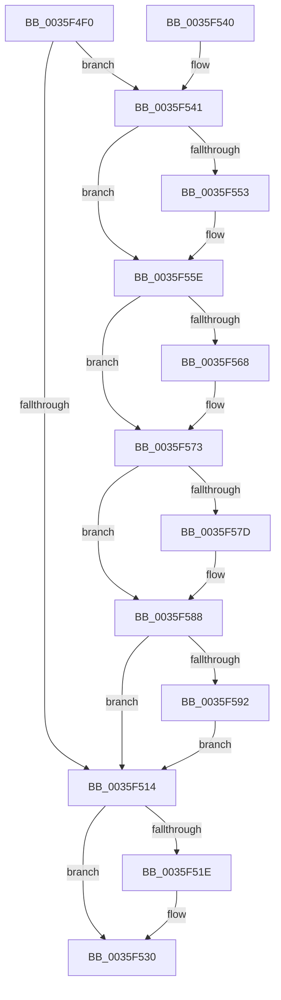

# ExpFreePoolChecks

- RVA: `0x0035F4F0`–`0x0035F5A2` (길이 `178` bytes)
- VA: `0x000000014035F4F0`
- 실행 섹션: `.text`
- PDB 이름 있음: `예`; PDB Function 태그: `아니요`
- unwind 정보 RVA: `0x00079B98`
- 디코드: `52`개 명령, `178/178` bytes 표시
- 미해석 바이트: `0` (있으면 어셈블리에 `.byte`로 보존)

> 이 문서는 커널 이미지의 기계어와 PDB 기호를 분석해 생성했습니다. 4번과 5번은 함수 원형과 자료형을 바이너리 사용 방식에서 추정한 C 해석이며 원본 소스 복구 결과는 아닙니다.

## 1. Dependencies

- 직접 호출 지점: **5**; 고유 호출 대상: **5**
- 직접 호출자로 확인된 함수: **5**
- RIP 상대 이미지 참조: **1**

### Outgoing calls
- `0x0035F52B` → [VfPtFreePoolNotification](../../pagevrfy/BB/VfPtFreePoolNotification_function_00BB96DC.md) (function, `0x00BB96DC`)
- `0x0035F559` → [ExpCheckForLookaside](../4A/ExpCheckForLookaside_function_004A52DC.md) (function, `0x004A52DC`)
- `0x0035F56E` → [KeCheckForTimer](../4D/KeCheckForTimer_function_004D870C.md) (function, `0x004D870C`)
- `0x0035F583` → [ExpCheckForResource](../49/ExpCheckForResource_function_0049CA24.md) (function, `0x0049CA24`)
- `0x0035F598` → [ExpCheckForWorker](../4E/ExpCheckForWorker_function_004EC8FC.md) (function, `0x004EC8FC`)

### Direct callers
- [ExpFreeHeapSpecialPool](../2E/ExpFreeHeapSpecialPool_function_002EE600.md) at `0x002EE65C`
- [ExAllocateHeapPool](ExAllocateHeapPool_function_0035BA30.md) at `0x0035EC63`
- [sub_00360968](../36/Unknown_function_00360968.md) at `0x00361118`
- [ExRemovePoolTag](../3F/ExRemovePoolTag_function_003F7CBC.md) at `0x003F7E8A`
- [sub_00B8371E](../../poolcode/B8/Unknown_function_00B8371E.md) at `0x00B83ED1`

### Static image references
- `0x0035F4FF` → RVA `0x00FC6BD0` (`ALMOSTRO`; read)

## 2. Other-region calls and transfers

- 다른 실행 섹션으로 향하는 call: **1**
  - `0x0035F52B` → [VfPtFreePoolNotification](../../pagevrfy/BB/VfPtFreePoolNotification_function_00BB96DC.md) (`.text` → `PAGEVRFY`)
- 별도 외부 분기/꼬리 이동을 확인하지 못했습니다.

## 3. Assembly (complete function range)

```asm
0035F4F0  48 89 5C 24 08                  mov qword ptr [rsp + 8], rbx
0035F4F5  48 89 74 24 10                  mov qword ptr [rsp + 0x10], rsi
0035F4FA  57                              push rdi
0035F4FB  48 83 EC 20                     sub rsp, 0x20
0035F4FF  8B 05 CB 76 C6 00               mov eax, dword ptr [rip + 0xc676cb]
0035F505  49 8B F8                        mov rdi, r8
0035F508  8B F2                           mov esi, edx
0035F50A  48 8B D9                        mov rbx, rcx
0035F50D  A9 07 02 00 00                  test eax, 0x207
0035F512  75 2D                           jne 0x14035f541
0035F514  8B 05 B6 76 C6 00               mov eax, dword ptr [rip + 0xc676b6]
0035F51A  A8 10                           test al, 0x10
0035F51C  74 12                           je 0x14035f530
0035F51E  4C 8B 4C 24 50                  mov r9, qword ptr [rsp + 0x50]
0035F523  4C 8B C7                        mov r8, rdi
0035F526  8B D6                           mov edx, esi
0035F528  48 8B CB                        mov rcx, rbx
0035F52B  E8 AC A1 85 00                  call 0x140bb96dc
0035F530  48 8B 5C 24 30                  mov rbx, qword ptr [rsp + 0x30]
0035F535  48 8B 74 24 38                  mov rsi, qword ptr [rsp + 0x38]
0035F53A  48 83 C4 20                     add rsp, 0x20
0035F53E  5F                              pop rdi
0035F53F  C3                              ret
0035F540  CC                              int3
0035F541  41 F6 C1 C0                     test r9b, 0xc0
0035F545  0F 95 C1                        setne cl
0035F548  0F BA E0 09                     bt eax, 9
0035F54C  0F 92 C0                        setb al
0035F54F  84 C8                           test al, cl
0035F551  74 0B                           je 0x14035f55e
0035F553  48 8B D7                        mov rdx, rdi
0035F556  48 8B CB                        mov rcx, rbx
0035F559  E8 7E 5D 14 00                  call 0x1404a52dc
0035F55E  8B 05 6C 76 C6 00               mov eax, dword ptr [rip + 0xc6766c]
0035F564  A8 01                           test al, 1
0035F566  74 0B                           je 0x14035f573
0035F568  48 8B D7                        mov rdx, rdi
0035F56B  48 8B CB                        mov rcx, rbx
0035F56E  E8 99 91 17 00                  call 0x1404d870c
0035F573  8B 05 57 76 C6 00               mov eax, dword ptr [rip + 0xc67657]
0035F579  A8 04                           test al, 4
0035F57B  74 0B                           je 0x14035f588
0035F57D  48 8B D7                        mov rdx, rdi
0035F580  48 8B CB                        mov rcx, rbx
0035F583  E8 9C D4 13 00                  call 0x14049ca24
0035F588  8B 05 42 76 C6 00               mov eax, dword ptr [rip + 0xc67642]
0035F58E  A8 02                           test al, 2
0035F590  74 82                           je 0x14035f514
0035F592  48 8B D7                        mov rdx, rdi
0035F595  48 8B CB                        mov rcx, rbx
0035F598  E8 5F D3 18 00                  call 0x1404ec8fc
0035F59D  E9 72 FF FF FF                  jmp 0x14035f514
```

## 4. C-style interpretation (structured pseudocode)

```c
__int64 __fastcall ExpFreePoolChecks(__int64 a1, int a2, __int64 a3, __int64 a4, __int64 a5)
{
    __int64 result;
    __int64 v_rsp;
    unsigned __int64 v_stack_p10;
    unsigned __int64 v_stack_p8;

    v_stack_p8 = v_rbx;
    v_stack_p10 = v_rsi;
    v_rsp = (v_rsp) - (32);
    if ((((unsigned int)((unsigned int)(*(unsigned int *)(v_rip + 13006539)))) & (519)) != 0) goto loc_0035F541;
loc_0035F514:
    result = (unsigned int)(*(unsigned int *)(v_rip + 13006518));
    if ((((unsigned __int8)((unsigned int)(*(unsigned int *)(v_rip + 13006518)))) & (16)) != 0) {
        a4 = a5;
        a3 = a3;
        a2 = (unsigned int)((unsigned int)(a2));
        a1 = a1;
        result = VfPtFreePoolNotification(a1, a2, a3, a4);
    }
    v_rsp = (v_rsp) + (32);
    return result;
loc_0035F541:
    a1 = ((((unsigned __int8)(a4)) & (192)) != 0) ? 1 : 0;
    result = (condition_is_below) ? 1 : 0;
    if ((((unsigned __int8)(result)) & ((unsigned __int8)(a1))) != 0) {
        a2 = a3;
        a1 = v_stack_p8;
        result = ExpCheckForLookaside(a1, a2, a3, a4);
    }
    result = (unsigned int)(*(unsigned int *)(v_rip + 13006444));
    if ((((unsigned __int8)((unsigned int)(*(unsigned int *)(v_rip + 13006444)))) & (1)) != 0) {
        a2 = a3;
        a1 = v_stack_p8;
        result = KeCheckForTimer(a1, a2, a3, a4);
    }
    result = (unsigned int)(*(unsigned int *)(v_rip + 13006423));
    if ((((unsigned __int8)((unsigned int)(*(unsigned int *)(v_rip + 13006423)))) & (4)) != 0) {
        a2 = a3;
        a1 = v_stack_p8;
        result = ExpCheckForResource(a1, a2, a3, a4);
    }
    if ((((unsigned __int8)((unsigned int)(*(unsigned int *)(v_rip + 13006402)))) & (2)) == 0) goto loc_0035F514;
    result = ExpCheckForWorker(v_stack_p8, a3, a3, a4);
    goto loc_0035F514;
}
```

## 5. (Beta) C Style

```c
int64_t ExpFreePoolChecks(int64_t Arg1, int32_t Arg2, int64_t Arg3, int64_t Arg4, int64_t Arg5)
{
    int64_t result;
    int64_t local_rsp;
    uint64_t v_stack_p10;
    uint64_t v_stack_p8;

    v_stack_p8 = local_rbx;
    v_stack_p10 = local_rsi;
    local_rsp = (local_rsp) - (32);
    if ((((uint32_t)((uint32_t)(*(uint32_t *)(v_rip + 0xC676CB)))) & (519)) != 0) goto loc_0035F541;
loc_0035F514:
    result = (uint32_t)(*(uint32_t *)(v_rip + 0xC676B6));
    if ((((uint8_t)((uint32_t)(*(uint32_t *)(v_rip + 0xC676B6)))) & (16)) != 0) {
        Arg4 = Arg5;
        Arg3 = Arg3;
        Arg2 = (uint32_t)((uint32_t)(Arg2));
        Arg1 = Arg1;
        result = VfPtFreePoolNotification(Arg1, Arg2, Arg3, Arg4);
    }
    local_rsp = (local_rsp) + (32);
    return result;
loc_0035F541:
    Arg1 = ((((uint8_t)(Arg4)) & (192)) != 0) ? 1 : 0;
    result = (condition_is_below) ? 1 : 0;
    if ((((uint8_t)(result)) & ((uint8_t)(Arg1))) != 0) {
        Arg2 = Arg3;
        Arg1 = v_stack_p8;
        result = ExpCheckForLookaside(Arg1, Arg2, Arg3, Arg4);
    }
    result = (uint32_t)(*(uint32_t *)(v_rip + 0xC6766C));
    if ((((uint8_t)((uint32_t)(*(uint32_t *)(v_rip + 0xC6766C)))) & (1)) != 0) {
        Arg2 = Arg3;
        Arg1 = v_stack_p8;
        result = KeCheckForTimer(Arg1, Arg2, Arg3, Arg4);
    }
    result = (uint32_t)(*(uint32_t *)(v_rip + 0xC67657));
    if ((((uint8_t)((uint32_t)(*(uint32_t *)(v_rip + 0xC67657)))) & (4)) != 0) {
        Arg2 = Arg3;
        Arg1 = v_stack_p8;
        result = ExpCheckForResource(Arg1, Arg2, Arg3, Arg4);
    }
    if ((((uint8_t)((uint32_t)(*(uint32_t *)(v_rip + 0xC67642)))) & (2)) == 0) goto loc_0035F514;
    result = ExpCheckForWorker(v_stack_p8, Arg3, Arg3, Arg4);
    goto loc_0035F514;
}
```

## 6. Execution-region graph

[열기: 2D/3D 그래프와 함수 탐색 컨트롤 패널](../../../control-panel.html?section=text&rva=0x0035F4F0&view=graph)

- 2D 그래프는 위에서 아래로 흐르고, 3D 그래프는 빈 공간을 드래그해 회전합니다. Shift+드래그는 이동, 휠은 확대·축소, 함수 노드 선택은 대상 보고서 이동입니다.

### Static fallback


