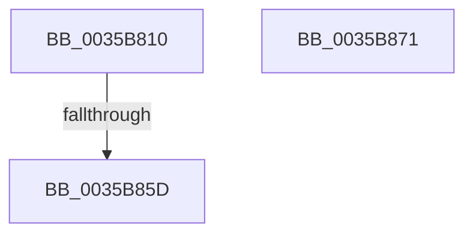

# ExpPoolTrackerChargeEntry

- RVA: `0x0035B810`–`0x0035B872` (길이 `98` bytes)
- VA: `0x000000014035B810`
- 실행 섹션: `.text`
- PDB 이름 있음: `예`; PDB Function 태그: `아니요`
- unwind 정보 RVA: `0x00079B04`
- 디코드: `32`개 명령, `98/98` bytes 표시
- 미해석 바이트: `0` (있으면 어셈블리에 `.byte`로 보존)

> 이 문서는 커널 이미지의 기계어와 PDB 기호를 분석해 생성했습니다. 4번과 5번은 함수 원형과 자료형을 바이너리 사용 방식에서 추정한 C 해석이며 원본 소스 복구 결과는 아닙니다.

## 1. Dependencies

- 직접 호출 지점: **0**; 고유 호출 대상: **0**
- 직접 호출자로 확인된 함수: **4**
- RIP 상대 이미지 참조: **0**

### Outgoing calls
- 직접 디코드된 call 명령이 없습니다.

### Direct callers
- [ExpInsertPoolTrackerExpansion](../2E/ExpInsertPoolTrackerExpansion_function_002ECCC0.md) at `0x002ECDBC`
- [ExAllocateContiguousHeapPool](../2E/ExAllocateContiguousHeapPool_function_002EE960.md) at `0x002EEB13`
- [ExpInsertPoolTracker](../2E/ExpInsertPoolTracker_function_002EEFAC.md) at `0x002EF071`
- [ExAllocateHeapPool](ExAllocateHeapPool_function_0035BA30.md) at `0x0035EEA6`

### Static image references
- 디코드된 RIP-relative 메모리 참조가 없습니다.

## 2. Other-region calls and transfers

- 다른 실행 섹션으로 향하는 call: **0**
- call이 아닌 외부 분기/꼬리 이동: **1**
  - `0x0035B85B` → [sub_0035B872](Unknown_function_0035B872.md) (`tail-transfer`)

## 3. Assembly (complete function range)

```asm
0035B810  48 89 5C 24 18                  mov qword ptr [rsp + 0x18], rbx
0035B815  55                              push rbp
0035B816  56                              push rsi
0035B817  57                              push rdi
0035B818  41 56                           push r14
0035B81A  41 57                           push r15
0035B81C  48 83 EC 20                     sub rsp, 0x20
0035B820  48 63 F1                        movsxd rsi, ecx
0035B823  41 BE 08 00 00 00               mov r14d, 8
0035B829  83 FE 01                        cmp esi, 1
0035B82C  B9 20 00 00 00                  mov ecx, 0x20
0035B831  B8 10 00 00 00                  mov eax, 0x10
0035B836  49 8B F8                        mov rdi, r8
0035B839  44 0F 45 F1                     cmovne r14d, ecx
0035B83D  4C 8B FA                        mov r15, rdx
0035B840  B9 28 00 00 00                  mov ecx, 0x28
0035B845  0F 45 C1                        cmovne eax, ecx
0035B848  F0 4A FF 04 00                  lock inc qword ptr [rax + r8]
0035B84D  48 8B EA                        mov rbp, rdx
0035B850  F0 4B 0F C1 2C 06               lock xadd qword ptr [r14 + r8], rbp
0035B856  49 83 78 48 00                  cmp qword ptr [r8 + 0x48], 0
0035B85B  75 15                           jne 0x14035b872
0035B85D  8D 41 D9                        lea eax, [rcx - 0x27]
0035B860  48 8B 5C 24 60                  mov rbx, qword ptr [rsp + 0x60]
0035B865  48 83 C4 20                     add rsp, 0x20
0035B869  41 5F                           pop r15
0035B86B  41 5E                           pop r14
0035B86D  5F                              pop rdi
0035B86E  5E                              pop rsi
0035B86F  5D                              pop rbp
0035B870  C3                              ret
0035B871  CC                              int3
```

## 4. C-style interpretation (structured pseudocode)

```c
__int64 __fastcall ExpPoolTrackerChargeEntry(int a1, __int64 a2, __int64 a3)
{
    __int64 result;
    __int64 v_r14;
    __int64 v_rsp;
    unsigned __int64 v_stack_p18;

    v_stack_p18 = v_rbx;
    v_rsp = (v_rsp) - (32);
    v_r14 = 8;
    if (((unsigned int)((int)(a1))) != 1) { v_r14 = 32; }
    result = 16;
    if (((unsigned int)((int)(a1))) != 1) { result = 40; }
    v_rsp = (v_rsp) + (32);
    return 40 - 39;
}
```

## 5. (Beta) C Style

```c
int64_t ExpPoolTrackerChargeEntry(int32_t Arg1, int64_t Arg2, void *Arg3)
{
    uint8_t *arg3 = (uint8_t *)Arg3;

    int64_t result;
    int64_t local_r14;
    int64_t local_rsp;
    uint64_t v_stack_p18;

    v_stack_p18 = local_rbx;
    local_rsp = (local_rsp) - (32);
    local_r14 = 8;
    if (((uint32_t)((int32_t)(Arg1))) != 1) { local_r14 = 32; }
    result = 16;
    if (((uint32_t)((int32_t)(Arg1))) != 1) { result = 40; }
    local_rsp = (local_rsp) + (32);
    return 40 - 39;
}
```

### 관측된 메모리 오프셋

구조체 형식이 확인되지 않은 접근은 인자 기준의 오프셋으로만 기록했습니다.

| 기준 인자 | 오프셋 표현 | 폭 (bit) | 접근 |
|---|---:|---:|---|
| `Arg3` | `+ 0x48` | `64` | `R` |

## 6. Execution-region graph

[열기: 2D/3D 그래프와 함수 탐색 컨트롤 패널](../../../control-panel.html?section=text&rva=0x0035B810&view=graph)

- 2D 그래프는 위에서 아래로 흐르고, 3D 그래프는 빈 공간을 드래그해 회전합니다. Shift+드래그는 이동, 휠은 확대·축소, 함수 노드 선택은 대상 보고서 이동입니다.

### Static fallback


