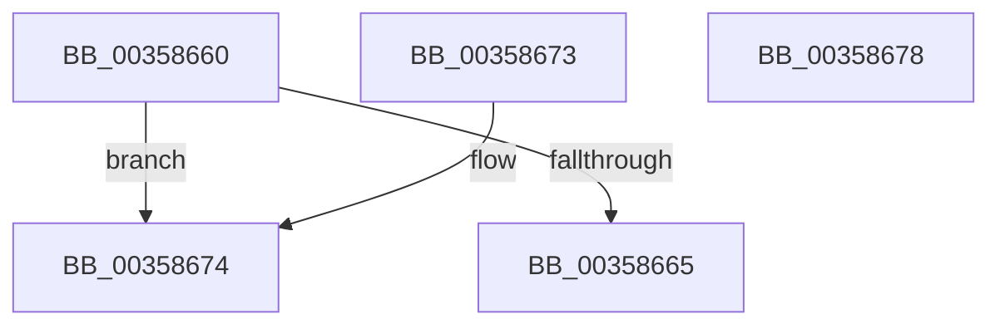

# ExpTypeToPriority

- RVA: `0x00358660`–`0x00358679` (길이 `25` bytes)
- VA: `0x0000000140358660`
- 실행 섹션: `.text`
- PDB 이름 있음: `예`; PDB Function 태그: `아니요`
- unwind 정보 RVA: `0x000DB714`
- 디코드: `10`개 명령, `25/25` bytes 표시
- 미해석 바이트: `0` (있으면 어셈블리에 `.byte`로 보존)

> 이 문서는 커널 이미지의 기계어와 PDB 기호를 분석해 생성했습니다. 4번과 5번은 함수 원형과 자료형을 바이너리 사용 방식에서 추정한 C 해석이며 원본 소스 복구 결과는 아닙니다.

## 1. Dependencies

- 직접 호출 지점: **0**; 고유 호출 대상: **0**
- 직접 호출자로 확인된 함수: **5**
- RIP 상대 이미지 참조: **1**

### Outgoing calls
- 직접 디코드된 call 명령이 없습니다.

### Direct callers
- [ExQueueWorkItemEx](ExQueueWorkItemEx_function_003567B0.md) at `0x003567CE`
- [ExQueueWorkItemToPartition](ExQueueWorkItemToPartition_function_00356E2C.md) at `0x00356E55`
- [ExpTryQueueWorkItem](../39/ExpTryQueueWorkItem_function_0039801C.md) at `0x0039805C`
- [ExQueueWorkItemExFromIo](../43/ExQueueWorkItemExFromIo_function_0043CB58.md) at `0x0043CB76`
- [ExpWorkQueueUpdateHealthMetricsOnRemove](../65/ExpWorkQueueUpdateHealthMetricsOnRemove_function_0065A99C.md) at `0x0065A9AA`

### Static image references
- `0x00358668` → RVA `0x000110F8` (`.rdata`; read)

## 2. Other-region calls and transfers

- 다른 실행 섹션으로 향하는 call: **0**
- 별도 외부 분기/꼬리 이동을 확인하지 못했습니다.

## 3. Assembly (complete function range)

```asm
00358660  83 F9 07                        cmp ecx, 7
00358663  73 0F                           jae 0x140358674
00358665  48 63 C1                        movsxd rax, ecx
00358668  48 8D 0D 89 8A CB FF            lea rcx, [rip - 0x347577]
0035866F  8B 04 81                        mov eax, dword ptr [rcx + rax*4]
00358672  C3                              ret
00358673  CC                              int3
00358674  8D 41 E0                        lea eax, [rcx - 0x20]
00358677  C3                              ret
00358678  CC                              int3
```

## 4. C-style interpretation (structured pseudocode)

```c
__int64 __fastcall ExpTypeToPriority(int a1)
{
    if (a1 >= 7) goto loc_00358674;
    return (unsigned int)(*(unsigned int *)(v_rip - 3437943 + (int)(a1) * 4));
loc_00358674:
    return v_rip - 3437943 - 32;
}
```

## 5. (Beta) C Style

```c
int64_t ExpTypeToPriority(int32_t Arg1)
{
    if (Arg1 >= 7) goto loc_00358674;
    return (uint32_t)(*(uint32_t *)(v_rip - 0x347577 + (int32_t)(Arg1) * 4));
loc_00358674:
    return v_rip - 3437943 - 32;
}
```

## 6. Execution-region graph

[열기: 2D/3D 그래프와 함수 탐색 컨트롤 패널](../../../control-panel.html?section=text&rva=0x00358660&view=graph)

- 2D 그래프는 위에서 아래로 흐르고, 3D 그래프는 빈 공간을 드래그해 회전합니다. Shift+드래그는 이동, 휠은 확대·축소, 함수 노드 선택은 대상 보고서 이동입니다.

### Static fallback


