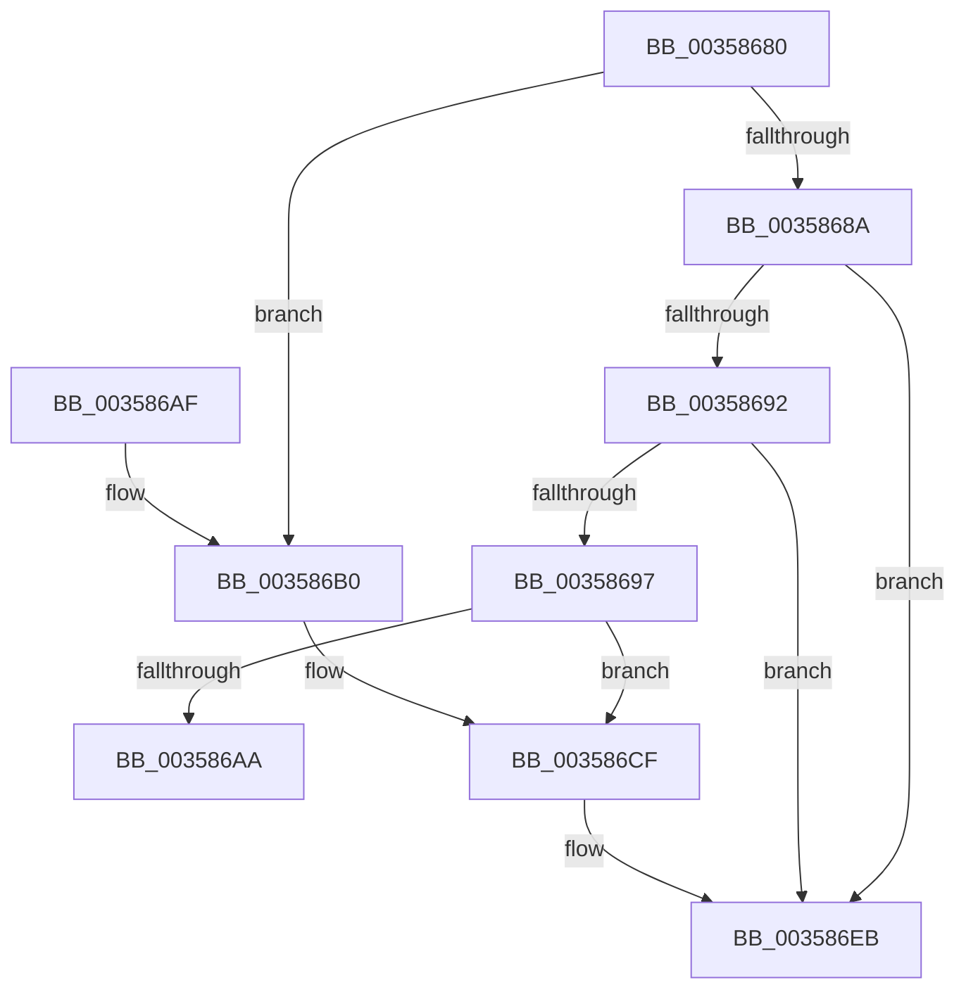

# ExpValidateWorkItem

- RVA: `0x00358680`–`0x0035870A` (길이 `138` bytes)
- VA: `0x0000000140358680`
- 실행 섹션: `.text`
- PDB 이름 있음: `예`; PDB Function 태그: `아니요`
- unwind 정보 RVA: `0x0007977C`
- 디코드: `35`개 명령, `138/138` bytes 표시
- 미해석 바이트: `0` (있으면 어셈블리에 `.byte`로 보존)

> 이 문서는 커널 이미지의 기계어와 PDB 기호를 분석해 생성했습니다. 4번과 5번은 함수 원형과 자료형을 바이너리 사용 방식에서 추정한 C 해석이며 원본 소스 복구 결과는 아닙니다.

## 1. Dependencies

- 직접 호출 지점: **3**; 고유 호출 대상: **1**
- 직접 호출자로 확인된 함수: **5**
- RIP 상대 이미지 참조: **0**

### Outgoing calls
- `0x003586C9` → [KeBugCheckEx](../4F/KeBugCheckEx_function_004FD660.md) (function, `0x004FD660`)
- `0x003586E5` → [KeBugCheckEx](../4F/KeBugCheckEx_function_004FD660.md) (function, `0x004FD660`)
- `0x00358704` → [KeBugCheckEx](../4F/KeBugCheckEx_function_004FD660.md) (function, `0x004FD660`)

### Direct callers
- [ExQueueWorkItemEx](ExQueueWorkItemEx_function_003567B0.md) at `0x003567C7`
- [ExQueueWorkItemToPartition](ExQueueWorkItemToPartition_function_00356E2C.md) at `0x00356E4E`
- [ExpTryQueueWorkItem](../39/ExpTryQueueWorkItem_function_0039801C.md) at `0x00398055`
- [ExQueueWorkItemExFromIo](../43/ExQueueWorkItemExFromIo_function_0043CB58.md) at `0x0043CB6F`
- [ExQueueWorkItemToPrivatePool](../47/ExQueueWorkItemToPrivatePool_function_0047D3B4.md) at `0x0047D3E2`

### Static image references
- 디코드된 RIP-relative 메모리 참조가 없습니다.

## 2. Other-region calls and transfers

- 다른 실행 섹션으로 향하는 call: **0**
- 별도 외부 분기/꼬리 이동을 확인하지 못했습니다.

## 3. Assembly (complete function range)

```asm
00358680  48 83 EC 38                     sub rsp, 0x38
00358684  48 83 39 00                     cmp qword ptr [rcx], 0
00358688  75 26                           jne 0x1403586b0
0035868A  8D 42 F9                        lea eax, [rdx - 7]
0035868D  83 F8 18                        cmp eax, 0x18
00358690  76 59                           jbe 0x1403586eb
00358692  83 FA 40                        cmp edx, 0x40
00358695  7D 54                           jge 0x1403586eb
00358697  4C 8B 49 10                     mov r9, qword ptr [rcx + 0x10]
0035869B  48 B8 00 00 00 00 00 80 FF FF   movabs rax, 0xffff800000000000
003586A5  4C 3B C8                        cmp r9, rax
003586A8  72 25                           jb 0x1403586cf
003586AA  48 83 C4 38                     add rsp, 0x38
003586AE  C3                              ret
003586AF  CC                              int3
003586B0  4C 63 CA                        movsxd r9, edx
003586B3  4C 8B C1                        mov r8, rcx
003586B6  BA 01 00 00 00                  mov edx, 1
003586BB  48 C7 44 24 20 00 00 00 00      mov qword ptr [rsp + 0x20], 0
003586C4  B9 E4 00 00 00                  mov ecx, 0xe4
003586C9  E8 92 4F 1A 00                  call 0x1404fd660
003586CE  CC                              int3
003586CF  4C 8B C1                        mov r8, rcx
003586D2  48 C7 44 24 20 00 00 00 00      mov qword ptr [rsp + 0x20], 0
003586DB  B9 E4 00 00 00                  mov ecx, 0xe4
003586E0  BA 07 00 00 00                  mov edx, 7
003586E5  E8 76 4F 1A 00                  call 0x1404fd660
003586EA  CC                              int3
003586EB  4C 63 CA                        movsxd r9, edx
003586EE  4C 8B C1                        mov r8, rcx
003586F1  BA 06 00 00 00                  mov edx, 6
003586F6  48 C7 44 24 20 00 00 00 00      mov qword ptr [rsp + 0x20], 0
003586FF  B9 E4 00 00 00                  mov ecx, 0xe4
00358704  E8 57 4F 1A 00                  call 0x1404fd660
00358709  CC                              int3
```

## 4. C-style interpretation (structured pseudocode)

```c
__int64 __fastcall ExpValidateWorkItem(__int64 a1, __int64 a2)
{
    __int64 result;
    __int64 v_rsp;
    unsigned __int64 v_stack_p20;

    v_rsp = (v_rsp) - (56);
    if ((*(unsigned __int64 *)(a1)) != 0) goto loc_003586B0;
    if (((unsigned int)(a2 - 7)) <= 24) goto loc_003586EB;
    if (((unsigned int)(a2)) >= 64) goto loc_003586EB;
    if ((*(unsigned __int64 *)(a1 + 16)) < (a2 - 7)) goto loc_003586CF;
    v_rsp = (v_rsp) + (56);
    return a2 - 7;
loc_003586B0:
    v_stack_p20 = 0;
    result = KeBugCheckEx(228, 1, a1, (int)((unsigned int)(a2)));
loc_003586CF:
    v_stack_p20 = 0;
    result = KeBugCheckEx(228, 7, 228, (int)((unsigned int)(a2)));
loc_003586EB:
    v_stack_p20 = 0;
    result = KeBugCheckEx(228, 6, 228, (int)(7));
    return result;
}
```

## 5. (Beta) C Style

```c
void *ExpValidateWorkItem(void *Arg1, void *Arg2)
{
    uint8_t *arg1 = (uint8_t *)Arg1;
    uint8_t *arg2 = (uint8_t *)Arg2;

    int64_t result;
    int64_t local_rsp;
    uint64_t v_stack_p20;

    local_rsp = (local_rsp) - (56);
    if ((*(uint64_t *)(arg1)) != 0) goto loc_003586B0;
    if (((uint32_t)(Arg2 - 7)) <= 24) goto loc_003586EB;
    if (((uint32_t)(Arg2)) >= 64) goto loc_003586EB;
    if ((*(uint64_t *)(arg1 + 0x10)) < (Arg2 - 7)) goto loc_003586CF;
    local_rsp = (local_rsp) + (56);
    return Arg2 - 7;
loc_003586B0:
    v_stack_p20 = 0;
    result = KeBugCheckEx(228, 1, Arg1, (int32_t)((uint32_t)(Arg2)));
loc_003586CF:
    v_stack_p20 = 0;
    result = KeBugCheckEx(228, 7, 228, (int32_t)((uint32_t)(Arg2)));
loc_003586EB:
    v_stack_p20 = 0;
    result = KeBugCheckEx(228, 6, 228, (int32_t)(7));
    return result;
}
```

### 관측된 메모리 오프셋

구조체 형식이 확인되지 않은 접근은 인자 기준의 오프셋으로만 기록했습니다.

| 기준 인자 | 오프셋 표현 | 폭 (bit) | 접근 |
|---|---:|---:|---|
| `Arg1` | `+ 0x0` | `64` | `R` |
| `Arg1` | `+ 0x10` | `64` | `R` |
| `Arg2` | `- 0x7` | `32` | `R` |

## 6. Execution-region graph

[열기: 2D/3D 그래프와 함수 탐색 컨트롤 패널](../../../control-panel.html?section=text&rva=0x00358680&view=graph)

- 2D 그래프는 위에서 아래로 흐르고, 3D 그래프는 빈 공간을 드래그해 회전합니다. Shift+드래그는 이동, 휠은 확대·축소, 함수 노드 선택은 대상 보고서 이동입니다.

### Static fallback


