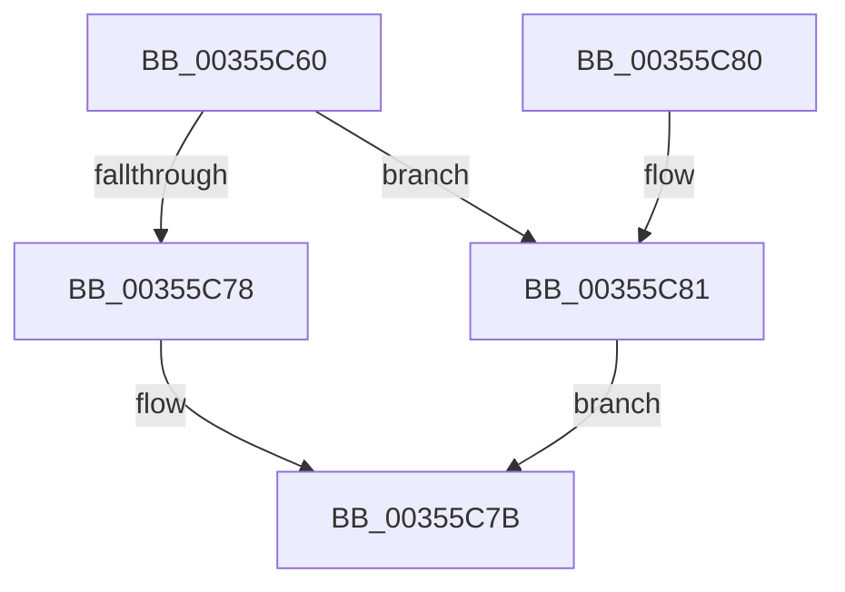

# Feature_HeteroRescheduleFixes__private_IsEnabledNoReportingNoInline

- RVA: `0x00355C60`–`0x00355C8F` (길이 `47` bytes)
- VA: `0x0000000140355C60`
- 실행 섹션: `.text`
- PDB 이름 있음: `예`; PDB Function 태그: `아니요`
- unwind 정보 RVA: `0x00064C74`
- 디코드: `14`개 명령, `47/47` bytes 표시
- 미해석 바이트: `0` (있으면 어셈블리에 `.byte`로 보존)

> 이 문서는 커널 이미지의 기계어와 PDB 기호를 분석해 생성했습니다. 4번과 5번은 함수 원형과 자료형을 바이너리 사용 방식에서 추정한 C 해석이며 원본 소스 복구 결과는 아닙니다.

## 1. Dependencies

- 직접 호출 지점: **1**; 고유 호출 대상: **1**
- 직접 호출자로 확인된 함수: **4**
- RIP 상대 이미지 참조: **1**

### Outgoing calls
- `0x00355C88` → [Feature_HeteroRescheduleFixes__private_IsEnabledFallback](../4F/Feature_HeteroRescheduleFixes__private_IsEnabledFallback_function_004FD14C.md) (function, `0x004FD14C`)

### Direct callers
- [sub_0021BAB9](../21/Unknown_function_0021BAB9.md) at `0x0021BAE7`
- [KiSendHeteroRescheduleIntRequestHelper](KiSendHeteroRescheduleIntRequestHelper_function_0035420C.md) at `0x00354560`
- [KiSwapThread](KiSwapThread_function_00355640.md) at `0x00355724`
- [KiCheckPreferredHeteroProcessor](../39/KiCheckPreferredHeteroProcessor_function_0039D72C.md) at `0x0039D811`
- [KiCheckPreferredHeteroProcessor](../39/KiCheckPreferredHeteroProcessor_function_0039D72C.md) at `0x0039D849`
- [KiCheckPreferredHeteroProcessor](../39/KiCheckPreferredHeteroProcessor_function_0039D72C.md) at `0x0039D8C3`

### Static image references
- `0x00355C6A` → RVA `0x00FC4900` (`.data`; read)

## 2. Other-region calls and transfers

- 다른 실행 섹션으로 향하는 call: **0**
- 별도 외부 분기/꼬리 이동을 확인하지 못했습니다.

## 3. Assembly (complete function range)

```asm
00355C60  48 83 EC 28                     sub rsp, 0x28
00355C64  48 83 64 24 30 00               and qword ptr [rsp + 0x30], 0
00355C6A  8B 05 90 EC C6 00               mov eax, dword ptr [rip + 0xc6ec90]
00355C70  89 44 24 30                     mov dword ptr [rsp + 0x30], eax
00355C74  A8 02                           test al, 2
00355C76  74 09                           je 0x140355c81
00355C78  83 E0 01                        and eax, 1
00355C7B  48 83 C4 28                     add rsp, 0x28
00355C7F  C3                              ret
00355C80  CC                              int3
00355C81  48 8B 4C 24 30                  mov rcx, qword ptr [rsp + 0x30]
00355C86  33 D2                           xor edx, edx
00355C88  E8 BF 74 1A 00                  call 0x1404fd14c
00355C8D  EB EC                           jmp 0x140355c7b
```

## 4. C-style interpretation (structured pseudocode)

```c
__int64 __fastcall Feature_HeteroRescheduleFixes__private_IsEnabledNoReportingNoInline(__int64 a1, int a2)
{
    __int64 result;
    __int64 v_rsp;
    unsigned __int64 v_stack_p30;
    unsigned __int64 v_stack_p8;

    v_rsp = (v_rsp) - (40);
    v_stack_p8 = (unsigned int)((unsigned int)(*(unsigned int *)(v_rip + 13036688)));
    if ((((unsigned __int8)((unsigned int)(*(unsigned int *)(v_rip + 13036688)))) & (2)) == 0) goto loc_00355C81;
    result = (unsigned int)(((unsigned int)(*(unsigned int *)(v_rip + 13036688))) & (1));
loc_00355C7B:
    v_rsp = (v_rsp) + (40);
    return result;
loc_00355C81:
    a2 = 0;
    result = Feature_HeteroRescheduleFixes__private_IsEnabledFallback(v_stack_p30, a2, a3, a4);
    goto loc_00355C7B;
}
```

## 5. (Beta) C Style

```c
int64_t Feature_HeteroRescheduleFixes__private_IsEnabledNoReportingNoInline(int64_t Arg1, int32_t Arg2)
{
    int64_t result;
    int64_t local_rsp;
    uint64_t v_stack_p30;
    uint64_t v_stack_p8;

    local_rsp = (local_rsp) - (40);
    v_stack_p8 = (uint32_t)((uint32_t)(*(uint32_t *)(v_rip + 0xC6EC90)));
    if ((((uint8_t)((uint32_t)(*(uint32_t *)(v_rip + 0xC6EC90)))) & (2)) == 0) goto loc_00355C81;
    result = (uint32_t)(((uint32_t)(*(uint32_t *)(v_rip + 0xC6EC90))) & (1));
loc_00355C7B:
    local_rsp = (local_rsp) + (40);
    return result;
loc_00355C81:
    Arg2 = 0;
    result = Feature_HeteroRescheduleFixes__private_IsEnabledFallback(v_stack_p30, Arg2, a3, a4);
    goto loc_00355C7B;
}
```

## 6. Execution-region graph

[열기: 2D/3D 그래프와 함수 탐색 컨트롤 패널](../../../control-panel.html?section=text&rva=0x00355C60&view=graph)

- 2D 그래프는 위에서 아래로 흐르고, 3D 그래프는 빈 공간을 드래그해 회전합니다. Shift+드래그는 이동, 휠은 확대·축소, 함수 노드 선택은 대상 보고서 이동입니다.

### Static fallback


