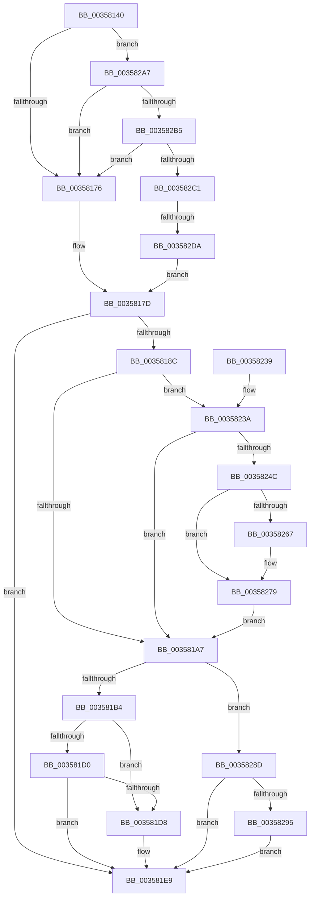

# IoQueueWorkItemEx

- RVA: `0x00358140`–`0x003582E7` (길이 `423` bytes)
- VA: `0x0000000140358140`
- 실행 섹션: `.text`
- PDB 이름 있음: `예`; PDB Function 태그: `예`
- unwind 정보 RVA: `0x000796A4`
- 디코드: `98`개 명령, `423/423` bytes 표시
- 미해석 바이트: `0` (있으면 어셈블리에 `.byte`로 보존)

> 이 문서는 커널 이미지의 기계어와 PDB 기호를 분석해 생성했습니다. 4번과 5번은 함수 원형과 자료형을 바이너리 사용 방식에서 추정한 C 해석이며 원본 소스 복구 결과는 아닙니다.

## 1. Dependencies

- 직접 호출 지점: **7**; 고유 호출 대상: **4**
- 직접 호출자로 확인된 함수: **1**
- RIP 상대 이미지 참조: **4**

### Outgoing calls
- `0x003581E0` → [ObfReferenceObjectWithTag](../21/ObfReferenceObjectWithTag_function_00210710.md) (function, `0x00210710`)
- `0x003581F2` → [ObfReferenceObjectWithTag](../21/ObfReferenceObjectWithTag_function_00210710.md) (function, `0x00210710`)
- `0x00358217` → [ExQueueWorkItemFromIo](ExQueueWorkItemFromIo_function_003582F0.md) (function, `0x003582F0`)
- `0x00358253` → [ExAcquireSpinLockShared](../24/ExAcquireSpinLockShared_function_0024DCE0.md) (function, `0x0024DCE0`)
- `0x0035826F` → [ObfReferenceObjectWithTag](../21/ObfReferenceObjectWithTag_function_00210710.md) (function, `0x00210710`)
- `0x00358283` → [ExReleaseSpinLockShared](../2F/ExReleaseSpinLockShared_function_002F0EF0.md) (function, `0x002F0EF0`)
- `0x0035829D` → [ObfReferenceObjectWithTag](../21/ObfReferenceObjectWithTag_function_00210710.md) (function, `0x00210710`)

### Direct callers
- [PnpDeviceCompletionRequestDestroy](../26/PnpDeviceCompletionRequestDestroy_function_0026E7E4.md) at `0x0026E826`

### Static image references
- `0x0035815C` → RVA `0x00E66114` (`.data`; read)
- `0x003581D0` → RVA `0x00F0EFD0` (`.data`; read)
- `0x0035824C` → RVA `0x00F06590` (`.data`; read)
- `0x003582A7` → RVA `0x00E66108` (`.data`; read)

## 2. Other-region calls and transfers

- 다른 실행 섹션으로 향하는 call: **0**
- call이 아닌 외부 분기/꼬리 이동: **1**
  - `0x003582D4` → [sub_006E2BEC](../6E/Unknown_function_006E2BEC.md) (`tail-transfer`)

## 3. Assembly (complete function range)

```asm
00358140  48 89 5C 24 08                  mov qword ptr [rsp + 8], rbx
00358145  48 89 6C 24 10                  mov qword ptr [rsp + 0x10], rbp
0035814A  48 89 74 24 18                  mov qword ptr [rsp + 0x18], rsi
0035814F  57                              push rdi
00358150  41 54                           push r12
00358152  41 55                           push r13
00358154  41 56                           push r14
00358156  41 57                           push r15
00358158  48 83 EC 20                     sub rsp, 0x20
0035815C  8B 05 B2 DF B0 00               mov eax, dword ptr [rip + 0xb0dfb2]
00358162  4D 8B E1                        mov r12, r9
00358165  45 8B F8                        mov r15d, r8d
00358168  4C 8B EA                        mov r13, rdx
0035816B  48 8B D9                        mov rbx, rcx
0035816E  A8 04                           test al, 4
00358170  0F 85 31 01 00 00               jne 0x1403582a7
00358176  0F 57 C0                        xorps xmm0, xmm0
00358179  0F 11 41 44                     movups xmmword ptr [rcx + 0x44], xmm0
0035817D  65 8B 04 25 3C 3A 00 00         mov eax, dword ptr gs:[0x3a3c]
00358185  A9 01 00 01 00                  test eax, 0x10001
0035818A  75 5D                           jne 0x1403581e9
0035818C  65 48 8B 34 25 88 01 00 00      mov rsi, qword ptr gs:[0x188]
00358195  33 ED                           xor ebp, ebp
00358197  48 8B BE 50 06 00 00            mov rdi, qword ptr [rsi + 0x650]
0035819E  48 85 FF                        test rdi, rdi
003581A1  0F 85 93 00 00 00               jne 0x14035823a
003581A7  48 89 7B 38                     mov qword ptr [rbx + 0x38], rdi
003581AB  48 85 FF                        test rdi, rdi
003581AE  0F 85 D9 00 00 00               jne 0x14035828d
003581B4  65 48 8B 04 25 88 01 00 00      mov rax, qword ptr gs:[0x188]
003581BD  48 8B 88 B8 00 00 00            mov rcx, qword ptr [rax + 0xb8]
003581C4  48 8B 81 A0 02 00 00            mov rax, qword ptr [rcx + 0x2a0]
003581CB  48 85 C0                        test rax, rax
003581CE  75 08                           jne 0x1403581d8
003581D0  38 05 FA 6D BB 00               cmp byte ptr [rip + 0xbb6dfa], al
003581D6  74 11                           je 0x1403581e9
003581D8  BA 44 66 6C 74                  mov edx, 0x746c6644
003581DD  48 8B CE                        mov rcx, rsi
003581E0  E8 2B 85 EB FF                  call 0x140210710
003581E5  48 89 73 38                     mov qword ptr [rbx + 0x38], rsi
003581E9  48 8B 4B 28                     mov rcx, qword ptr [rbx + 0x28]
003581ED  BA 44 66 6C 74                  mov edx, 0x746c6644
003581F2  E8 19 85 EB FF                  call 0x140210710
003581F7  4C 89 6B 20                     mov qword ptr [rbx + 0x20], r13
003581FB  41 8B D7                        mov edx, r15d
003581FE  4C 89 63 30                     mov qword ptr [rbx + 0x30], r12
00358202  48 8B CB                        mov rcx, rbx
00358205  48 A1 08 00 00 00 80 F7 FF FF   movabs rax, qword ptr [0xfffff78000000008]
0035820F  48 89 43 58                     mov qword ptr [rbx + 0x58], rax
00358213  44 89 7B 54                     mov dword ptr [rbx + 0x54], r15d
00358217  E8 D4 00 00 00                  call 0x1403582f0
0035821C  48 8B 5C 24 50                  mov rbx, qword ptr [rsp + 0x50]
00358221  48 8B 6C 24 58                  mov rbp, qword ptr [rsp + 0x58]
00358226  48 8B 74 24 60                  mov rsi, qword ptr [rsp + 0x60]
0035822B  48 83 C4 20                     add rsp, 0x20
0035822F  41 5F                           pop r15
00358231  41 5E                           pop r14
00358233  41 5D                           pop r13
00358235  41 5C                           pop r12
00358237  5F                              pop rdi
00358238  C3                              ret
00358239  CC                              int3
0035823A  65 48 8B 04 25 88 01 00 00      mov rax, qword ptr gs:[0x188]
00358243  48 3B F0                        cmp rsi, rax
00358246  0F 84 5B FF FF FF               je 0x1403581a7
0035824C  48 8D 0D 3D E3 BA 00            lea rcx, [rip + 0xbae33d]
00358253  E8 88 5A EF FF                  call 0x14024dce0
00358258  48 8B BE 50 06 00 00            mov rdi, qword ptr [rsi + 0x650]
0035825F  44 8A F0                        mov r14b, al
00358262  48 85 FF                        test rdi, rdi
00358265  74 12                           je 0x140358279
00358267  BA 44 66 6C 74                  mov edx, 0x746c6644
0035826C  48 8B CF                        mov rcx, rdi
0035826F  E8 9C 84 EB FF                  call 0x140210710
00358274  BD 01 00 00 00                  mov ebp, 1
00358279  41 8A D6                        mov dl, r14b
0035827C  48 8D 0D 0D E3 BA 00            lea rcx, [rip + 0xbae30d]
00358283  E8 68 8C F9 FF                  call 0x1402f0ef0
00358288  E9 1A FF FF FF                  jmp 0x1403581a7
0035828D  85 ED                           test ebp, ebp
0035828F  0F 85 54 FF FF FF               jne 0x1403581e9
00358295  BA 44 66 6C 74                  mov edx, 0x746c6644
0035829A  48 8B CF                        mov rcx, rdi
0035829D  E8 6E 84 EB FF                  call 0x140210710
003582A2  E9 42 FF FF FF                  jmp 0x1403581e9
003582A7  8B 05 5B DE B0 00               mov eax, dword ptr [rip + 0xb0de5b]
003582AD  A8 01                           test al, 1
003582AF  0F 84 C1 FE FF FF               je 0x140358176
003582B5  44 0F 20 C0                     mov rax, cr8
003582B9  3C 02                           cmp al, 2
003582BB  0F 83 B5 FE FF FF               jae 0x140358176
003582C1  65 48 8B 04 25 88 01 00 00      mov rax, qword ptr gs:[0x188]
003582CA  48 8B 88 30 06 00 00            mov rcx, qword ptr [rax + 0x630]
003582D1  48 85 C9                        test rcx, rcx
003582D4  0F 84 12 A9 38 00               je 0x1406e2bec
003582DA  0F 10 01                        movups xmm0, xmmword ptr [rcx]
003582DD  F3 0F 7F 43 44                  movdqu xmmword ptr [rbx + 0x44], xmm0
003582E2  E9 96 FE FF FF                  jmp 0x14035817d
```

## 4. C-style interpretation (structured pseudocode)

```c
__int64 __fastcall IoQueueWorkItemEx(__int64 a1, __int64 a2, int a3, __int64 a4)
{
    __int64 result;
    __int64 v_rbp;
    __int64 v_rsp;
    unsigned __int64 v_stack_p10;
    unsigned __int64 v_stack_p18;
    unsigned __int64 v_stack_p8;

    v_stack_p8 = v_rbx;
    v_stack_p10 = v_rbp;
    v_stack_p18 = v_rsi;
    v_rsp = (v_rsp) - (32);
    if ((((unsigned __int8)((unsigned int)(*(unsigned int *)(v_rip + 11591602)))) & (4)) != 0) goto loc_003582A7;
loc_00358176:
    *(unsigned __int64 *)(a1 + 68) = v_xmm0;
loc_0035817D:
    if ((((unsigned int)((unsigned int)(*(unsigned int *)(gs_base + (0 + 14908))))) & (0x10001ULL)) != 0) goto loc_003581E9;
    v_rbp = 0;
    if (*(unsigned __int64 *)(*(unsigned __int64 *)(gs_base + (0 + 392)) + 1616) != 0) goto loc_0035823A;
loc_003581A7:
    *(unsigned __int64 *)(a1 + 56) = *(unsigned __int64 *)(*(unsigned __int64 *)(gs_base + (0 + 392)) + 1616);
    if (*(unsigned __int64 *)(*(unsigned __int64 *)(gs_base + (0 + 392)) + 1616) != 0) goto loc_0035828D;
    if (*(unsigned __int64 *)(*(unsigned __int64 *)(*(unsigned __int64 *)(gs_base + (0 + 392)) + 184) + 672) != 0) goto loc_003581D8;
    result = *(unsigned __int64 *)(*(unsigned __int64 *)(*(unsigned __int64 *)(gs_base + (0 + 392)) + 184) + 672);
    if ((*(unsigned __int8 *)(v_rip + 12283386)) != ((unsigned __int8)(*(unsigned __int64 *)(*(unsigned __int64 *)(*(unsigned __int64 *)(gs_base + (0 + 392)) + 184) + 672)))) {
        a2 = 0x746C6644ULL;
        a1 = *(unsigned __int64 *)(gs_base + (0 + 392));
        result = ObfReferenceObjectWithTag(a1, a2, a3, a4);
        *(unsigned __int64 *)(a1 + 56) = *(unsigned __int64 *)(gs_base + (0 + 392));
    }
    result = ObfReferenceObjectWithTag(*(unsigned __int64 *)(a1 + 40), (unsigned int)(0x746C6644ULL), a3, a4);
    *(unsigned __int64 *)(a1 + 32) = a2;
    *(unsigned __int64 *)(a1 + 48) = a4;
    *(unsigned __int64 *)(a1 + 88) = result;
    *(unsigned int *)(a1 + 84) = (unsigned int)((unsigned int)(a3));
    result = ExQueueWorkItemFromIo(a1, (unsigned int)((unsigned int)((unsigned int)(a3))), a3, a4);
    v_rsp = (v_rsp) + (32);
    return result;
loc_0035823A:
    if (v_stack_p18 == (*(unsigned __int64 *)(gs_base + (0 + 392)))) goto loc_003581A7;
    result = ExAcquireSpinLockShared(v_rip + 12247869, (unsigned int)((unsigned int)((unsigned int)(a3))), a3, a4);
    v_rbp = v_stack_p10;
    if (*(unsigned __int64 *)(v_stack_p18 + 1616) != 0) {
        a2 = 0x746C6644ULL;
        a1 = *(unsigned __int64 *)(v_stack_p18 + 1616);
        result = ObfReferenceObjectWithTag(a1, a2, a3, a4);
        v_rbp = 1;
    }
    result = ExReleaseSpinLockShared(v_rip + 12247821, (unsigned __int8)((unsigned __int8)(result)), a3, a4);
    goto loc_003581A7;
loc_0035828D:
    if ((unsigned int)(v_rbp) != 0) goto loc_003581E9;
    result = ObfReferenceObjectWithTag(*(unsigned __int64 *)(v_stack_p18 + 1616), (unsigned int)(0x746C6644ULL), a3, a4);
    goto loc_003581E9;
loc_003582A7:
    if ((((unsigned __int8)((unsigned int)(*(unsigned int *)(v_rip + 11591259)))) & (1)) == 0) goto loc_00358176;
    if (((unsigned __int8)(v_cr8)) >= 2) goto loc_00358176;
    *(unsigned __int64 *)(v_stack_p8 + 68) = v_xmm0;
    goto loc_0035817D;
}
```

## 5. (Beta) C Style

```c
int64_t IoQueueWorkItemEx(void *Arg1, int64_t Arg2, int32_t Arg3, int64_t Arg4)
{
    uint8_t *arg1 = (uint8_t *)Arg1;

    int64_t result;
    int64_t local_rbp;
    int64_t local_rsp;
    uint64_t v_stack_p10;
    uint64_t v_stack_p18;
    uint64_t v_stack_p8;

    v_stack_p8 = local_rbx;
    v_stack_p10 = local_rbp;
    v_stack_p18 = local_rsi;
    local_rsp = (local_rsp) - (32);
    if ((((uint8_t)((uint32_t)(*(uint32_t *)(v_rip + 0xB0DFB2)))) & (4)) != 0) goto loc_003582A7;
loc_00358176:
    *(uint64_t *)(arg1 + 0x44) = v_xmm0;
loc_0035817D:
    if ((((uint32_t)((uint32_t)(*(uint32_t *)(gs_base + (0 + 0x3A3C))))) & (0x10001ULL)) != 0) goto loc_003581E9;
    local_rbp = 0;
    if (*(uint64_t *)(*(uint64_t *)(gs_base + (0 + 0x188)) + 0x650) != 0) goto loc_0035823A;
loc_003581A7:
    *(uint64_t *)(arg1 + 0x38) = *(uint64_t *)(*(uint64_t *)(gs_base + (0 + 0x188)) + 0x650);
    if (*(uint64_t *)(*(uint64_t *)(gs_base + (0 + 0x188)) + 0x650) != 0) goto loc_0035828D;
    if (*(uint64_t *)(*(uint64_t *)(*(uint64_t *)(gs_base + (0 + 0x188)) + 0xB8) + 0x2A0) != 0) goto loc_003581D8;
    result = *(uint64_t *)(*(uint64_t *)(*(uint64_t *)(gs_base + (0 + 0x188)) + 0xB8) + 0x2A0);
    if ((*(uint8_t *)(v_rip + 0xBB6DFA)) != ((uint8_t)(*(uint64_t *)(*(uint64_t *)(*(uint64_t *)(gs_base + (0 + 0x188)) + 0xB8) + 0x2A0)))) {
        Arg2 = 0x746C6644ULL;
        Arg1 = *(uint64_t *)(gs_base + (0 + 0x188));
        result = ObfReferenceObjectWithTag(Arg1, Arg2, Arg3, Arg4);
        *(uint64_t *)(arg1 + 0x38) = *(uint64_t *)(gs_base + (0 + 0x188));
    }
    result = ObfReferenceObjectWithTag(*(uint64_t *)(arg1 + 0x28), (uint32_t)(0x746C6644ULL), Arg3, Arg4);
    *(uint64_t *)(arg1 + 0x20) = Arg2;
    *(uint64_t *)(arg1 + 0x30) = Arg4;
    *(uint64_t *)(arg1 + 0x58) = result;
    *(uint32_t *)(arg1 + 0x54) = (uint32_t)((uint32_t)(Arg3));
    result = ExQueueWorkItemFromIo(Arg1, (uint32_t)((uint32_t)((uint32_t)(Arg3))), Arg3, Arg4);
    local_rsp = (local_rsp) + (32);
    return result;
loc_0035823A:
    if (v_stack_p18 == (*(uint64_t *)(gs_base + (0 + 0x188)))) goto loc_003581A7;
    result = ExAcquireSpinLockShared(v_rip + 12247869, (uint32_t)((uint32_t)((uint32_t)(Arg3))), Arg3, Arg4);
    local_rbp = v_stack_p10;
    if (*(uint64_t *)(v_stack_p18 + 0x650) != 0) {
        Arg2 = 0x746C6644ULL;
        Arg1 = *(uint64_t *)(v_stack_p18 + 0x650);
        result = ObfReferenceObjectWithTag(Arg1, Arg2, Arg3, Arg4);
        local_rbp = 1;
    }
    result = ExReleaseSpinLockShared(v_rip + 12247821, (uint8_t)((uint8_t)(result)), Arg3, Arg4);
    goto loc_003581A7;
loc_0035828D:
    if ((uint32_t)(local_rbp) != 0) goto loc_003581E9;
    result = ObfReferenceObjectWithTag(*(uint64_t *)(v_stack_p18 + 0x650), (uint32_t)(0x746C6644ULL), Arg3, Arg4);
    goto loc_003581E9;
loc_003582A7:
    if ((((uint8_t)((uint32_t)(*(uint32_t *)(v_rip + 0xB0DE5B)))) & (1)) == 0) goto loc_00358176;
    if (((uint8_t)(v_cr8)) >= 2) goto loc_00358176;
    *(uint64_t *)(v_stack_p8 + 0x44) = v_xmm0;
    goto loc_0035817D;
}
```

### 관측된 메모리 오프셋

구조체 형식이 확인되지 않은 접근은 인자 기준의 오프셋으로만 기록했습니다.

| 기준 인자 | 오프셋 표현 | 폭 (bit) | 접근 |
|---|---:|---:|---|
| `Arg1` | `+ 0x20` | `64` | `W` |
| `Arg1` | `+ 0x28` | `64` | `R` |
| `Arg1` | `+ 0x30` | `64` | `W` |
| `Arg1` | `+ 0x38` | `64` | `W` |
| `Arg1` | `+ 0x44` | `128` | `R` |
| `Arg1` | `+ 0x44` | `128` | `W` |
| `Arg1` | `+ 0x54` | `32` | `W` |
| `Arg1` | `+ 0x58` | `64` | `W` |

## 6. Execution-region graph

[열기: 2D/3D 그래프와 함수 탐색 컨트롤 패널](../../../control-panel.html?section=text&rva=0x00358140&view=graph)

- 2D 그래프는 위에서 아래로 흐르고, 3D 그래프는 빈 공간을 드래그해 회전합니다. Shift+드래그는 이동, 휠은 확대·축소, 함수 노드 선택은 대상 보고서 이동입니다.

### Static fallback


